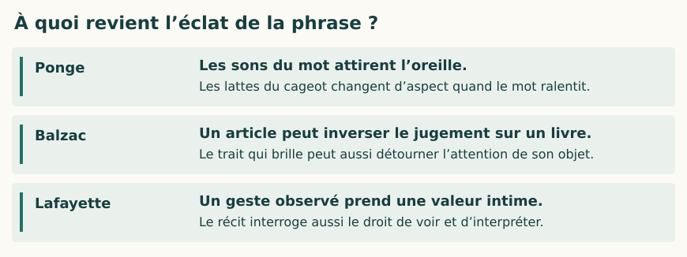

# La prose et l’éclat du proche · Lyon 2022 · Corrigé brut

*Corrigé rédigé par IA, non officiel. Signalez toute erreur.*

**Rédaction** · GPT-6.2 Astra Ultra · vitesse non renseignée

**Révision (tour 1)** · GPT-6.2 Astra Ultra · vitesse non renseignée

## Sujet

Dans « Flaubert, Baudelaire : la prose narrative comme art moderne », Jacques Neefs part d’un paradoxe. La prose est « un régime a priori familier du langage », une « chose commune » presque inaperçue. Lorsqu’elle se distingue par son rythme et sa « singularité stylistique », elle devient selon lui « la forme la plus apte à devenir l’appropriation intime du proche, du peu visible, à donner éclat à ce qui demeure habituellement dans l’indistinct » (*Crise de prose*, 2002, p. 144). La garde BEL LCU 171 demande : « Vous discuterez cette analyse en vous référant en particulier aux œuvres au programme. » Durée : six heures.

## Introduction

Le maître de philosophie de M. Jourdain lui apprend qu’il a parlé en prose toute sa vie. Ce qui fait rire au *Bourgeois gentilhomme* tient précisément à ce que la découverte ne demande aucun changement dans les paroles de l’élève. L’élève s’aperçoit que sa demande de pantoufles à Nicole relevait déjà de cette forme. Quand il cherche ensuite à composer un billet galant, son maître essaie plusieurs ordres des mots avant de reconnaître que la meilleure tournure est celle que l’élève avait trouvée tout seul. La même scène distingue ainsi deux expériences : découvrir un nom pour ce que chacun fait et choisir un agencement pour ce que soi-même on veut dire. Jacques Neefs prend cette plaisanterie au sérieux. Si la prose écrite possède un pouvoir singulier, c’est que sa matière, la langue dont nous nous servons sans y penser, peut acquérir un rythme auquel il devient impossible de ne pas prêter attention. Ce qui brillera alors sera le proche lui-même, et non la seule phrase. L’enchaînement n’a pourtant rien d’évident. Une page brillante peut retenir l’attention au détriment de l’objet qu’elle présente ; ce qui nous paraît familier résulte parfois d’un travail d’écriture très peu ordinaire. Comment la prose peut-elle se faire remarquer assez pour que nous cessions de traverser les choses sans les voir et demeurer assez juste pour que nous les regardions, elles ? Nous partirons de l’expérience que Ponge et Balzac rendent possible devant des objets usuels. Mme de Lafayette et Diderot obligeront à historiciser le prestige du singulier. Nous demanderons enfin si l’appropriation promise par Neefs revient pour le lecteur à posséder la chose ou à apprendre à lui faire place.

## I. Interrompre un usage ordinaire de la langue pour regarder ce qui se trouvait déjà sous nos yeux

Un cageot rend service en transportant des denrées ; une fois celles-ci vendues, on l’abandonne. Son nom fait ordinairement aussi peu de bruit que sa disparition. Dans *Le Parti pris des choses*, Ponge le trouve pourtant « à mi-chemin de la cage au cachot ». La succession des consonnes et des syllabes oblige la bouche à recommencer et à différencier trois mots qu’elle aurait pu prononcer sans leur trouver de relation. Ce voisinage sonore rend visibles les lattes et les intervalles par lesquels le contenant enferme ses fruits tout en les laissant paraître. Le mouvement de la phrase est indivisiblement lexical et visuel. Le poème s’attarde ensuite sur la durée de ce fragile assemblage, sur son bois neuf et sa brève fonction. Ce qui méritait à peine le temps d’un regard a reçu une vie complète. Pour comprendre la proposition de Neefs, il fallait garder ensemble le mot que tout le monde connaît, la disposition particulière qui le détache et l’attention nouvelle qui retourne vers la chose.

Balzac commence *Illusions perdues* par un retard technique. À Angoulême, l’emploi des vieilles presses donne lieu à une description de l’imprimerie Séchard. Il aurait suffi, pour indiquer le métier du personnage, de le nommer. Mais les opérations distinctes du tirage, la matière des outils et la brusque apparition d’un vocabulaire d’atelier rendent à l’objet imprimé que le lecteur a dans la main sa part de travail humain. Une feuille imprimée est commune ; la succession d’efforts qui la produisent l’est beaucoup moins aux yeux de celui qui la lit. Alors que Ponge découvre une analogie dans la forme d’un seul nom, Balzac change la dimension visible du roman en l’interrompant pour l’explication d’un métier. L’enjeu est aussi économique : le père Séchard peut attribuer à son matériel une valeur que son fils aura à payer. Un détail de technique devient une condition de l’existence de David. Il faut ce détour pour que le proche cesse de se confondre avec le connu.

Diderot fait subir un déplacement comparable à une parole que les spectateurs pourraient croire immédiatement transparente. Dans *Le Fils naturel*, les entretiens entre personnages sont faits d’hésitations, de silences et de phrases dont l’interlocuteur attend en vain la fin. Dorval, chargé de plaider auprès de Rosalie la cause de son ami Clairville, doit parler pour Clairville alors que Rosalie aime Dorval. Des expressions ordinaires de civilité changent de valeur selon le temps qu’il met à les prononcer et le geste qui les accompagne. On peut ici corriger une première interprétation trop étroite du « rythme ». Au théâtre, il comprend ce que fait le corps dans l’intervalle ménagé par la parole et ce que le spectateur sait de celui qu’elle engage. La prose semble pouvoir s’approprier une situation intime parce qu’elle dispose les conditions concrètes d’une écoute.

## II. Le style le plus voyant est-il toujours le plus apte à donner éclat au proche ?

La référence à Flaubert et Baudelaire invite à examiner ce que l’idéal d’une singularité absolument décisive doit à une histoire de la littérature. Mme de Lafayette fait saillir une passion sans avoir besoin d’une parole qui s’afficherait comme la signature de l’auteur. Lors du vol du portrait, Mme de Clèves voit Nemours s’en emparer. La dénonciation permettrait de préserver les règles de bienséance et risquerait de faire connaître aux témoins que la princesse a été particulièrement attentive à son geste. Le silence, inversement, pourra passer auprès du voleur pour une faveur. Le récit progresse en déployant les raisons incompatibles de ce qui, à la surface, prend la forme très simple d’une absence d’intervention. L’art de la distinction s’exerce ici dans des catégories que le personnage et le public lettré peuvent partager, dans la netteté de la syntaxe et dans la précision qui sépare deux raisons de se taire. La prose classique serait mal servie par une critique qui n’y chercherait que l’originalité éclatante du tour.

De plus, la prose qui se distingue le mieux peut être celle qui nous empêche de voir son objet. Les apprentissages journalistiques de Lucien dans *Illusions perdues* en fournissent une expérience presque réglée. À propos d’un même livre, Lousteau lui montre comment construire un article qui en transforme les qualités en défauts ; le journal peut ensuite exiger qu’on retourne le jugement. Qu’il s’agisse de décrire une œuvre ou de faire étinceler une saillie, le mouvement de la phrase produit une évidence locale. Le trait qui frappe le lecteur finit par tenir lieu d’examen du livre. L’efficacité et le style sont bien là. Leur puissance porte cependant sur la circulation des opinions et sur les intérêts du journal. Cette expérience découvre une condition que la phrase de Neefs n’énonce pas : l’éclat de la prose doit pouvoir être rapporté à quelque chose qui lui résiste, faute de quoi il fait seulement valoir l’habileté de celui qui parle.

Le théâtre fait entendre la même réserve autrement. Vouloir que la prose du *Fils naturel* ressemble à la vie familiale ne condamne pas à reproduire toutes les particularités d’une conversation. Une répétition réelle pourrait ennuyer quand une réplique brisée, placée au bon moment, trahit une émotion. Diderot travaille aussi le tableau, c’est-à-dire un ensemble d’attitudes dont l’arrangement momentané manifeste des relations entre les personnes. Il fait alors voir ce que nul personnage ne parviendrait à dire. Que le spectateur puisse éprouver une situation domestique dans son intimité dépend d’une scène, de corps et d’un dispositif de regards. Le superlatif de Neefs rencontre ici une limite. Le dramaturge peut faire lire un geste dans ses didascalies, mais sur scène le jeu de l’acteur décide de sa visibilité.

Comparons à cet égard deux rencontres dans la ville de Baudelaire. « À une passante » interrompt le fracas de la rue par l’apparition d’une femme. Le début du premier tercet précipite toute la rencontre entre « Un éclair… » et « puis la nuit ! ». À l’intérieur du même alexandrin, une coupe puis une exclamation mesurent le temps pendant lequel un visage proche a pu devenir visible. Le vers peut donc donner au fugitif un éclat aussi vif que celui que Neefs réserve de préférence à la prose. Dans le poème en prose « Les Yeux des pauvres », en revanche, l’homme qui raconte croit d’abord partager l’émotion de sa compagne devant une famille qui regarde un café illuminé. Il imagine ce que les yeux du père et ceux de ses enfants expriment devant le décor. Il faut attendre que la femme parle pour comprendre qu’elle souhaiterait qu’on les éloigne. La prose peut prolonger le malentendu, distribuer inégalement les paroles et accueillir une réplique qui oblige à relire toute la scène. La différence entre les deux formes tient ici à ce qu’elles demandent au lecteur de faire du bref instant de proximité.

## III. L’appropriation intime peut être l’apprentissage d’une distance

Que reste-t-il alors de la puissance attribuée à la prose ? Sans doute la capacité de régler à nouveau la distance entre une chose commune et celui qui la perçoit. Considérons « L’Huître » de Ponge. Le texte dirige d’abord l’attention vers ce que la main éprouve de rugueux et d’opiniâtre dans la coquille. Il faut des précautions et un outil pour passer à l’intérieur ; le poème lui-même ne livre pas d’un trait son contenu. À l’ouverture, l’échelle change. L’huître se déploie en un monde, avant que la perle éventuelle n’appelle un rapprochement avec la parole et l’ornement. Toute cette dépense de métaphores pourrait passer pour une prise de possession souveraine de l’objet par le langage. L’adverbe qui réserve l’apparition de la perle à de très rares occasions l’empêche de se clore en emblème flatteur du poète. Il reste dans l’huître quelque chose qui ne se prête ni immédiatement à l’ouverture réelle, ni nécessairement à l’interprétation brillante. L’intimité conquise est sensible d’abord comme une résistance.

Une scène de *La Princesse de Clèves* propose une épreuve plus directement morale de cette distinction. À Coulommiers, Nemours observe la princesse qui noue à une canne des rubans aux couleurs que le duc a portées au tournoi, puis contemple le portrait de celui-ci dans le tableau du siège de Metz. Une chose familière, un geste minuscule deviennent pour le regard amoureux des signes d’une intensité extraordinaire. Mais l’intimité ainsi rendue visible n’a pas été accordée à l’observateur. Le lecteur connaît à la fois la force de l’impression qu’elle exerce sur Nemours et les périls des observations partielles, puisque la surveillance dont Nemours est lui-même l’objet contribuera aux soupçons de M. de Clèves. Donner éclat peut donc faire violence. La retenue du récit consiste à laisser discerner les intérêts de ces regards au lieu de nous inviter à les tenir pour infaillibles. Être conduit près de quelqu’un, ici, c’est apprendre aussi ce qu’on ne saurait s’approprier de lui.

Revenons enfin au livre de Balzac. Le parcours de Lucien et celui de David donnent une forme commune au commerce des phrases, au coût du papier et aux emballements de la croyance. Un même objet, la feuille imprimée, reparaît en changeant de sens. Elle a été la trace d’un métier, le support d’une réputation et la condition d’un pouvoir économique. Ce n’est pas nécessairement au point le plus brillant d’une phrase que se produit cette révélation. L’éclat peut venir de la mémoire qu’a le lecteur d’une autre page, très éloignée de celle qu’il est en train de lire. Si la prose est propre à approprier le proche, c’est aussi par son aptitude à entrecroiser des registres, à laisser les voix se corriger mutuellement et à faire porter un rythme sur la durée de tout un récit. Le travail du lecteur qui rapproche les moments participe dès lors à la justesse de la vision.

## Conclusion

Jacques Neefs désigne une ressource singulière de la prose : la matière de la phrase littéraire est aussi celle dont nous nous servons pour ne plus avoir à regarder ce que nous nommons. En donnant à un mot, à un métier, à une hésitation leur durée propre, l’écriture peut rendre à l’expérience une part de son évidence perdue. Les œuvres du programme rendent toutefois la condition plus exigeante. Une trouvaille de style peut masquer la chose qu’elle prétend éclairer ; une phrase soumise aux usages de son temps, un geste sans paroles, le rappel discret d’une page ancienne peuvent l’éclairer avec davantage de justesse. L’appropriation du proche est alors une manière d’en recevoir les différences, parfois même la réserve, qui échappaient à notre première familiarité.

[Énoncé](https://www.ens-lyon.fr/sites/default/files/2022-11/Session-2022_BEL_Composition%20fran%C3%A7aise.pdf) · [Rapport du jury](https://www.ens-lyon.fr/sites/default/files/2022-11/Compo%20fr.%20%2B%20Explic.%20texte%20litt%C3%A9raire%202022.pdf)
