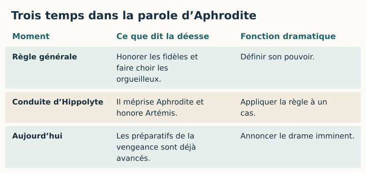

# ENS de Lyon · BEL A/L · Version grecque 2022 — Corrigé brut

*Corrigé rédigé par IA, non officiel. Signalez toute erreur.*

**Rédaction** · GPT-6.2 Astra Ultra · vitesse non renseignée

Euripide, Hippolyte, début du prologue d’Aphrodite. Épreuve de spécialité, trois heures.

## Version française

Puissante et loin d'être inconnue parmi les mortels comme au sein du ciel, je suis la déesse qu'on nomme Cypris. Parmi tous ceux qui, voyant la lumière du soleil, habitent entre le Pont et les confins de l'Atlantique, j'honore ceux qui révèrent ma puissance, et je précipite la chute de ceux qui se montrent hautains envers moi. Car ce trait se rencontre aussi chez les dieux, ils se réjouissent des honneurs que leur rendent les hommes.

De ces paroles, je montrerai bientôt la vérité. Le fils de Thésée, l'enfant de l'Amazone, Hippolyte, que le pieux Pitthée a élevé, est, de tous les citoyens de cette terre de Trézène, le seul à dire que je suis par nature la pire des divinités. Il dédaigne le lit d'amour et ne touche pas au mariage. C'est la sœur de Phébus, Artémis, fille de Zeus, qu'il honore, la tenant pour la plus grande des divinités. Dans les bois verdoyants, toujours en compagnie de la vierge, il débarrasse le pays de ses bêtes sauvages avec ses chiens rapides. Il a rencontré là une compagnie qui dépasse celle des mortels.

Voilà qui ne m'inspire aucune jalousie. À quoi bon ? Mais des offenses qu'il a commises envers moi, je me vengerai sur Hippolyte aujourd'hui même. Comme j'ai depuis longtemps fait le plus gros de la besogne, je n'ai plus grand effort à fournir.

[Sujet officiel, passage p. 2](https://www.ens-lyon.fr/sites/default/files/2022-11/Session-2022_BEL_Version%20grecque.pdf#page=2)
