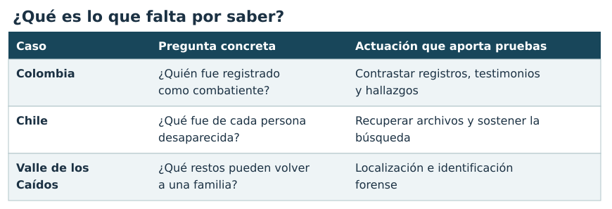

# ENS de Lyon · Séries LA/LV/SH (A/L) · Espagnol oral 2022 — Corrigé brut

*Corrigé rédigé par IA, non officiel. Signalez toute erreur.*

**Rédaction** · GPT-6.2 Astra Ultra · vitesse non renseignée

**Révision** · GPT-6.2 Astra Ultra · vitesse non renseignée

Soixante-deux billets sont traités dans l’ordre du fascicule. Les dix passages de Storni, García Lorca et Diego de San Pedro sont repérés dans des éditions consultables. Les cinquante-deux notices de presse comprennent l’article sur le sommet des Amériques inscrit dans deux séries. Les coupes de presse ne sont pas reproduites dans les archives de cette session.

## Letras y artes · Doce análisis de prensa

### 1. Los muertos que todo un país quiere borrar

_El País · 10/05/2022 (fascículo)._

En Colombia, «falsos positivos» designa ejecuciones de civiles presentados como combatientes muertos. La falsedad no convierte las muertes en ficticias, sino que altera el registro oficial de quién murió y en qué circunstancias. La negación de las familias contesta esa segunda violencia. El título atribuye a todo un país un deseo de borrar: merece examinarse esa generalización a la luz de las personas e instituciones que sí buscan esclarecer los hechos. [Reportaje sobre los falsos positivos en Colombia](https://elpais.com/america-colombia/2022-05-10/los-muertos-que-todo-un-pais-quiere-borrar.html)

**Intercambio.** ¿Por qué importa la clasificación de las víctimas? Afecta a la investigación judicial y al derecho de las familias a limpiar el nombre de quienes fueron estigmatizados.

### 2. Cumbre de las Américas: Estados Unidos desconectado

_El País · 27/05/2022 (fascículo)._

Ante la Cumbre de las Américas de Los Ángeles, el artículo juzga la capacidad de Estados Unidos para convocar a sus vecinos. Decidir qué gobiernos pueden asistir convierte la lista de invitados en un mensaje diplomático. El desacuerdo mexicano revela que los demás Estados también disponen de iniciativas y pueden cuestionar públicamente al anfitrión. «Desconectado» sugiere distancia política dentro de un continente que mantiene fuertes relaciones económicas y migratorias. [Publicación del medio](https://elpais.com/argentina/2022-05-27/cumbre-de-las-americas-estados-unidos-desconectado.html)

**Intercambio.** ¿Qué habría que distinguir en mayo de 2022? Las amenazas de no asistir y el resultado efectivo de una reunión todavía futura.

### 3. Chile emprende la búsqueda de 1.162 desaparecidos de la dictadura de Pinochet

_El País · 13/06/2022 (fascículo)._

En Chile, la cifra de 1.162 desaparecidos delimita el objeto de una búsqueda anunciada por el Gobierno de Gabriel Boric. Convertir una tarea largamente sostenida por los familiares en política estatal modifica quién responde por los archivos, los recursos y la continuidad de las investigaciones. La noticia mira hacia el cincuentenario del golpe de 1973, pero el aniversario solo cobra valor si impulsa trabajo verificable sobre el destino de cada persona. [Publicación del medio](https://elpais.com/chile/2022-06-13/chile-emprende-la-busqueda-de-1162-desaparecidos-de-la-dictadura-de-pinochet.html)

**Intercambio.** ¿Cuál sería una medida real de avance? Que una familia reciba una respuesta documentada, incluso cuando la complejidad forense y el tiempo transcurrido dificulten la identificación.

### 4. Los exilios latinoamericanos que ensanchan la cultura española

_El País · 12/11/2021 (fascículo)._

El verbo «ensanchan» atribuye a quienes llegan de distintos exilios latinoamericanos un papel activo en la cultura española. Editoriales, librerías, aulas y escenarios hacen posible la circulación de personas y obras. En el siglo XX y luego con otras diásporas cambiaron las procedencias y las causas de la salida. El reportaje permite analizar esos aportes sin presentar la persecución como un beneficio ni borrar las condiciones materiales del desarraigo. [Publicación del medio](https://elpais.com/cultura/2021-11-12/los-exilios-latinoamericanos-que-ensanchan-la-cultura-espanola.html)

**Intercambio.** ¿Por qué usar el plural «exilios»? Remite a momentos históricos y comunidades diferentes. La lengua común facilita ciertos intercambios, pero no iguala las experiencias de llegada.

### 5. Vox y la afinidad de género en campaña electoral

_El País · 09/06/2022 (fascículo)._

La «afinidad de género» en campaña plantea una hipótesis sobre el efecto de presentar a una candidata en un partido con desigual apoyo entre hombres y mujeres. En Andalucía, la candidatura de Macarena Olona ofreció una prueba concreta durante la campaña de Vox. Compartir género con una candidata no determina automáticamente el voto. Importan la identificación ideológica, las propuestas, la edad y la evaluación de su actuación pública. [Publicación del medio](https://elpais.com/opinion/2022-06-09/vox-y-la-afinidad-de-genero-en-campana-electoral.html)

**Intercambio.** ¿Qué prueba exigiría el argumento causal? Una comparación que distinga exposición a la candidata de preferencias previas, más allá de una correlación en los sondeos.

### 6. Una España de dos velocidades ante la Guerra Civil

_El País · 16/05/2022 (fascículo)._

La imagen de dos velocidades expresa desigualdad territorial en la recuperación y transmisión de la memoria de la Guerra Civil. El trabajo de documentación de Jesús Vicente Aguirre sobre La Rioja parte de personas y localidades identificables y contradice la fórmula de que allí no pasó nada. La disponibilidad de recursos y el apoyo institucional determinan lo que puede establecerse. Diferentes ritmos de investigación no equivalen a diferencias en la dignidad de las víctimas. [Publicación del medio](https://elpais.com/espana/2022-05-16/una-espana-de-dos-velocidades-ante-la-guerra-civil.html)

**Intercambio.** ¿Qué hace la escala local? Permite comprobar nombres, vinculaciones y silencios que desaparecen en una explicación nacional demasiado general.

### 7. Más de la mitad de los extranjeros que llegan a Madrid son mujeres y proceden de Rumania y América

_El País · 10/06/2022 (fascículo)._

El titular sobre las llegadas a Madrid combina sexo y origen, dos variables que conviene leer con su población de referencia. Una mayoría femenina entre quienes llegan no es necesariamente la misma proporción que entre quienes ya residen allí. Las procedencias también agregan escalas desiguales, un país y un continente. El comentario puede examinar edad, empleo y redes familiares sin suponer que todas las mujeres migrantes realizan los mismos trabajos. [Publicación del medio](https://elpais.com/espana/madrid/2022-06-10/madrid-acoge-a-mas-mujeres-extranjeras-que-a-hombres-procedentes-de-rumania-y-america-latina.html)

**Intercambio.** ¿Qué tabla aclararía el titular? Una que cruce origen, sexo y año de llegada, y separe el flujo reciente de la población extranjera residente.

### 8. El Gobierno crea un Observatorio Global del Español con sede en La Rioja

_El País · 07/06/2022 (fascículo)._

El Observatorio Global del Español, con sede en La Rioja, se concibe como centro de investigación sobre la situación de la lengua, con énfasis en la economía digital. Anunciar una institución implica decidir qué se va a medir: hablantes, presencia de contenidos, acceso a herramientas lingüísticas o diversidad de variedades. España puede financiar un instrumento de observación de una lengua pluricéntrica. Su legitimidad científica depende también de la participación de las comunidades observadas. [Publicación del medio](https://elpais.com/cultura/2022-06-07/el-gobierno-crea-un-observatorio-global-del-espanol-con-sede-en-la-rioja.html)

**Intercambio.** ¿Es observar lo mismo que regular? Medir la presencia del español en una tecnología no otorga autoridad para determinar cómo debe hablar una comunidad.

### 9. Goya y su lucha contra los demonios interiores y exteriores en un cómic basado en las ‘Pinturas negras’

_El País · 07/06/2022 (fascículo)._

El cómic *Saturnalia* se acerca a Goya a partir de las *Pinturas negras*. Los «demonios» del titular sitúan en relación el conflicto interior del artista con su entorno histórico. Conviene distinguir los cuadros conservados, su disposición original y lo que la novela gráfica imagina entre ellos. La viñeta, la sucesión de páginas y la elección de un punto de vista pueden convertir una imagen estática en relato sin que la ficción se transforme en prueba biográfica. [Publicación del medio](https://elpais.com/cultura/2022-06-07/goya-y-su-lucha-contra-los-demonios-interiores-y-exteriores-en-un-comic-basado-en-las-pinturas-negras.html)

**Intercambio.** ¿Qué gana el dibujo al dialogar con otro dibujo o pintura? Puede aislar un motivo y darle una duración narrativa que la contemplación del cuadro deja en manos del espectador.

### 10. Tren Maya: más que un tren, nada de maya

_Latinoamérica21 · 24/05/2022 (fascículo)._

La doble negación del título cuestiona tanto la modestia aparente del «tren» como el uso de la denominación maya. El proyecto mexicano comprende vías, desarrollos turísticos y reorganización del territorio. La crítica pregunta qué comunidades han podido decidir y quién controla los beneficios y soporta los cambios ambientales. Invocar una identidad en la marca de una obra no demuestra consentimiento de los pueblos a los que remite. [Publicación del medio](https://latinoamerica21.com/es/tren-maya-mas-que-un-tren-nada-de-maya/)

**Intercambio.** ¿Qué exigiría una consulta efectiva? Información comprensible sobre impactos, representación de los afectados y posibilidad real de influir antes de que las decisiones sean irreversibles.

### 11. Contradicciones frente al cambio climático

_Latinoamérica21 · 11/04/2022 (fascículo)._

La columna compara la preocupación latinoamericana por el cambio climático con las prácticas y preferencias que dificultan modificar el modelo económico. El desacuerdo entre una respuesta favorable en una encuesta y cierta conducta no demuestra necesariamente hipocresía. Quien depende de transporte contaminante o de una industria extractiva puede carecer de alternativas asequibles. Un buen comentario distingue dilemas individuales y decisiones de infraestructura. [Publicación del medio](https://latinoamerica21.com/es/contradicciones-frente-al-cambio-climatico/)

**Intercambio.** ¿Cómo interpretar una comparación entre países? Además del porcentaje de preocupación hace falta conocer la pregunta, la fecha y la exposición a daños concretos.

### 12. El lenguaje está vivo si con él nos podemos nombrar

_Página/12 · 11/06/2022 (fascículo)._

El debate argentino sobre el lenguaje inclusivo enfrenta posiciones sobre quién puede nombrarse y qué autoridad debe ejercer la escuela. La fórmula citada por Página/12 defiende la lengua como práctica viva y la identificación de quienes hablan. Examinar el artículo exige atribuir el enunciado a su voz y distinguir el uso espontáneo, la enseñanza de convenciones y una prohibición institucional. Un ejemplo lingüístico concreto pesa más que una declaración general sobre la evolución de la lengua. [Publicación del medio](https://www.pagina12.com.ar/428305-el-lenguaje-esta-vivo-si-con-el-nos-podemos-nombrar/)

**Intercambio.** ¿Por qué importa el pronombre «nos»? Presenta a los hablantes como participantes en la construcción de las formas que los identifican.

## Lenguas vivas · Diez explicaciones de textos literarios (LV1)

### Alfonsina Storni, «Tú me quieres blanca», pp. 48–50

Un «yo» responde a un «tú» que le dicta un ideal de blancura. Al principio una serie de imágenes vegetales y frías rodea a la mujer de signos de pureza. La voz recuerda después el pasado festivo del interlocutor. La modificación de la forma verbal es decisiva: quien era objeto del deseo ajeno pasa a formular imperativos, manda al hombre retirarse, lavarse y recobrar el contacto con la tierra. La condición final devuelve al destinatario su exigencia original y somete a prueba su derecho a juzgar. Los versos breves sostienen la insistencia de la voz; las imágenes de colores descubren la desigualdad del código moral. [Poema de Storni](https://pabloneruda.com/poemas/clasicos/alfonsina-storni/tu-me-quieres-blanca/)

**Intercambio.** ¿Por qué el pronombre «tú» organiza el poema? Obliga a oír la norma en boca de alguien que también tiene una historia. Deja de parecer natural o impersonal.

### Alfonsina Storni, «Rosales de suburbio», pp. 83–84

Una planta que trepa por casas de ladrillo, lata y madera recibe la palabra del poema. El condicional imagina qué ocurriría si el rosal compartiese el criterio humano de preferir a los ricos. El contraste toma después la forma de una visita. La planta avanza por la ventana, saluda y deja una corola deshecha sobre la cabeza de un niño. La comparación final con Eros asocia una imagen clásica a un niño del suburbio que ni siquiera nota la corona. Los versos varían de extensión y la asonancia en e-a reaparece a intervalos. La gracia del don reside también en que el agua de lluvia sigue sin pagar impuestos. [Facsímil de Languidez](https://upload.wikimedia.org/wikipedia/commons/e/e7/Languidez_-_Alfonsina_Storni.pdf)

**Intercambio.** ¿La flor resuelve la pobreza? No cambia el material de las casas. Hace visible una belleza que los criterios sociales de prestigio tienden a reservar a otros espacios.

### Alfonsina Storni, «II. La otra amiga» y «III. Y agrega la tercera», pp. 110–111

Los dos sonetos pertenecen a una conversación. La segunda amiga, que habla de las «mujeres mentales» en primera persona del plural, describe las relaciones en términos de trabajo y de intercambio. Ellas pulen y educan; después otra recibe lo producido. Las dos cuartetas de rimas abrazadas dan a esa denuncia el rigor de una argumentación. La tercera amiga abre su intervención con una conjetura y termina reconociendo una incógnita. La compañera aparentemente favorecida tampoco posee por entero al hombre, y el ideal que lo mueve quizá escape a todas. Se pasa así de la certeza amarga de un grupo a una interpretación incapaz de cerrar el debate. [Dos sonetos en Ocre](https://es.scribd.com/document/673033127/Ocre-1925)

**Intercambio.** ¿Por qué leer los dos seguidos? El pronombre inicial de la tercera voz recoge el desenlace del soneto anterior. Atribuir ambas afirmaciones directamente a Storni borraría la discusión que construye el poema.

### Federico García Lorca, Bodas de sangre, pp. 120–123

Desde los golpes en la puerta hasta la retirada de la Novia a su cuarto. El público oye llegar a alguien antes de verlo. Donde la Novia espera convidados, la Criada descubre a Leonardo, que ha adelantado a todos con el caballo. Los silencios y el cambio de tema de la Criada hacen perceptible la amenaza mucho antes de que se nombre la relación anterior. Desde lejos llegan las voces de la boda. Leonardo recoge su canto, de modo que la misma fórmula expresa una celebración pública y un deseo que la desbarata. La aparición de la Novia con el azahar permite por fin que la conversación mire de frente al pasado antes de su salida. [Texto dramático](https://people.duke.edu/~garci/garcitextos/GARCIA-LORCA-F/Bodas-sangre/Bodas-sangre.html)

**Intercambio.** ¿Qué haría un director con las voces de fuera? Su distancia inicial y su progresiva proximidad pueden medir el tiempo que les queda para hablar en privado.

### Federico García Lorca, Bodas de sangre, pp. 153–156

Desde «Ya dimos el paso» hasta la acotación «La arrastra». En el bosque, Leonardo recuerda los actos concretos de la fuga mediante preguntas sobre la escalera y las riendas. La Novia responde por su iniciativa y expresa al mismo tiempo una voluntad desgarrada. Las réplicas en verso se encadenan con asonancia en e-a y a veces dos voces se reparten una unidad rítmica. Las imágenes de fuego y de espigas anuncian una fuerza que alcanza a ambos. El abrazo y el verbo final atribuyen a Leonardo una acción física precisa. En escena esa acción impide convertir las palabras de los personajes en una simple declaración de libertad compartida. [Texto dramático](https://people.duke.edu/~garci/garcitextos/GARCIA-LORCA-F/Bodas-sangre/Bodas-sangre.html)

**Intercambio.** ¿Qué tensión debe mantenerse al actuar la escena? La Novia afirma lo que ella misma hizo y formula resistencia en el presente. Un gesto final impuesto no borra las etapas anteriores ni queda justificado por ellas.

### Federico García Lorca, Bodas de sangre, pp. 140–143

Desde la pregunta del Novio por el miedo de la Novia hasta el final del acto segundo. La Mujer busca a Leonardo y constata que falta también el caballo. El Novio interpreta el indicio sin inquietarse. Mientras la fiesta continúa fuera, puertas, carreras y retornos vacían de certeza la frase según la cual la Novia estaría descansando en su cuarto. Finalmente se anuncia la fuga. La Madre transforma un conflicto que aún parecía doméstico en una movilización de parientes y en una lectura de la vieja enemistad. La escena cambia de género ante el público: la celebración que debía unir familias da paso a la persecución. [Texto dramático](https://people.duke.edu/~garci/garcitextos/GARCIA-LORCA-F/Bodas-sangre/Bodas-sangre.html)

**Intercambio.** ¿Qué sabe el espectador antes que el Novio? Ha visto la visita de Leonardo y las dudas de la Novia. Su conocimiento anterior convierte respuestas tranquilizadoras en signos de ironía dramática.

### Diego de San Pedro, Cárcel de amor, pp. 75–78

Desde la salida del mediador hacia Suria hasta el reproche de Laureola por haber puesto en duda su bondad. El personaje llamado «el auctor» aprende primero las formas de sociabilidad de la corte y consigue acceso a la princesa contándole cosas de España. Una vez a solas con ella cambia la narración por una pieza de oratoria. Su preámbulo asocia piedad y grandeza; su relato intenta hacerla responsable del remedio de Leriano. Laureola empieza su respuesta rechazando la presuposición de que escuchar una embajada amorosa sea una prueba de virtud. La cortesía que abre las puertas al mensajero le ha ocultado las consecuencias que la petición tiene para la reputación de ella. [Edición de la Real Academia Española](https://www.rae.es/sites/default/files/Carcel_de_amor_Diego_de_San_Pedro.pdf)

**Intercambio.** ¿Qué efecto produce el gesto de arrodillarse? Despliega deferencia ceremonial a la vez que el argumento ejerce presión sobre la destinataria. El gesto y el razonamiento actúan en planos diferentes.

### Diego de San Pedro, Cárcel de amor, pp. 132–135

Desde la interpelación a Tefeo hasta la referencia al sustento del linaje humano. Leriano responde al amigo que habló mal de las mujeres creyendo así aliviarlo. Las quince razones reúnen autoridades cristianas, deberes filiales, obligaciones de caballería y consecuencias públicas de las palabras. La enumeración convierte una ofensa concreta en un problema de ética del hablante. Al señalar que la difamación puede incluso poner en peligro a las mujeres, el razonamiento se acerca al daño que Laureola ha sufrido en la intriga. Al mismo tiempo, varias alabanzas siguen midiendo el valor femenino por la maternidad o por los grandes varones a los que las mujeres han dado vida. [Edición de la Real Academia Española](https://www.rae.es/sites/default/files/Carcel_de_amor_Diego_de_San_Pedro.pdf)

**Intercambio.** ¿Cabe llamar moderna a la defensa sin más? Su crítica de la calumnia conserva fuerza, pero sus criterios expresos pertenecen a una argumentación cortesana y cristiana de fines del siglo XV.

### Diego de San Pedro, Cárcel de amor, pp. 91–93

Desde que el mediador recibe la carta de Laureola hasta el anuncio de las razones del cartel de Persio. Los sentimientos que acompañan al mensajero actúan como personajes y devuelven a Leriano fuerzas, sentido y entendimiento durante la lectura. El paso a la corte cambia el régimen de visibilidad. El mediador interpreta el encuentro de los amantes a partir de su conocimiento secreto; Persio observa los mismos indicios desde los celos y hace de su sospecha una acusación. La carta que abre una cárcel acaba dando paso a otra para Laureola. La fórmula de cierre prepara el cartel, sin incluir aún las razones que contendrá. [Edición de la Real Academia Española](https://www.rae.es/sites/default/files/Carcel_de_amor_Diego_de_San_Pedro.pdf)

**Intercambio.** ¿Qué distingue a dos testigos ante una misma turbación? Ningún gesto contiene una declaración inequívoca. La información previa y el interés personal del observador cambian lo que cree ver.

### Diego de San Pedro, Cárcel de amor, pp. 147–149

Desde la lamentación de la madre de Leriano hasta la despedida del narrador en Peñafiel. La madre pierde al hijo y con él el nombre de madre que daba sentido a su propia vejez. Las invocaciones y la acumulación de actividades cotidianas convierten el duelo en experiencia del tiempo que le queda por vivir. El narrador recupera luego la palabra, cuenta la muerte de Leriano en presencia de los testigos y regresa al marco de su viaje. Su negativa a detallar todas las lágrimas constituye una forma de representarlas. La fórmula final de servicio al destinatario devuelve la historia leída al circuito cortesano de su transmisión. [Edición de la Real Academia Española](https://www.rae.es/sites/default/files/Carcel_de_amor_Diego_de_San_Pedro.pdf)

**Intercambio.** ¿Coinciden madre y narrador en su forma de recordar? Ella habla desde una relación irreemplazable. Él selecciona lo que puede entregar por escrito a un destinatario y responde de esa selección.

## Lenguas vivas · Diez artículos de prensa (LV1)

### 13. El camino de las nacionalidades

_El País · 24/05/22 (fascículo)._

Feijóo invoca la singularidad cultural, lingüística y política de los territorios. El artículo discute el lugar de «nacionalidades» en la tradición constitucional española y en el lenguaje del PP. La palabra puede reconocer diferencias dentro del Estado y, a la vez, activar desacuerdos entre públicos distintos. Para valorar la posición política importa qué competencias o reconocimientos se derivan de ella y qué parte queda en el terreno simbólico. [Publicación del medio](https://elpais.com/opinion/2022-05-24/el-camino-de-las-nacionalidades.html)

**Intercambio.** ¿Qué aporta citar el artículo 2 de la Constitución? Sitúa en la misma disposición la unidad de la nación y la autonomía de nacionalidades y regiones, sin resolver por sí sola toda disputa política.

### 14. Vox es Vox

_El País · 27/05/22 (fascículo)._

El jurado vincula un artículo de este grupo al uso de redes por los dirigentes de Vox. El título tautológico permite preguntar cómo una fuerza política preserva una identidad de marca a fuerza de repetir signos reconocibles. Los mensajes breves circulan por públicos afines y pueden reaparecer fuera de ellos por la controversia que generan. Esa circulación no demuestra adhesión. El comentario debe identificar, en la copia concreta, quién publica, quién amplifica y qué afirmación sustenta la supuesta coherencia del partido.

**Intercambio.** ¿Son comparables seguidores y votantes? Una cuenta puede obtener atención de simpatizantes, periodistas y adversarios. Las métricas de interacción no sustituyen a la urna.

### 15. Estados Unidos cancela 93 visas a funcionarios de Daniel Ortega

_El País · 14/06/2022 (fascículo)._

Estados Unidos cancela visados a 93 funcionarios nicaragüenses del Gobierno de Daniel Ortega. La medida restringe la entrada a personas señaladas y comunica una posición diplomática tras la Cumbre de las Américas. Conviene distinguir estas restricciones individuales de una sanción económica general y de una resolución judicial sobre delitos. El reportaje plantea una pregunta abierta acerca de la eficacia de la presión exterior sobre un gobierno que mantiene sus propios instrumentos de control. [Publicación del medio](https://elpais.com/internacional/2022-06-13/estados-unidos-cancela-93-visas-a-funcionarios-de-daniel-ortega.html)

**Intercambio.** ¿Qué efecto puede comprobarse de inmediato? El alcance administrativo de la cancelación. Un cambio en el comportamiento de los dirigentes exige pruebas posteriores.

### 16. Petro busca suavizar sus relaciones con los militares y policías

_El País · 14/06/2022 (fascículo)._

En la segunda vuelta colombiana, Gustavo Petro busca atenuar el recelo de militares y policías. En junio de 2022 su iniciativa es todavía la de un candidato. La carta intenta compatibilizar promesas de reforma, como la adscripción institucional de la policía, con el reconocimiento de quienes trabajan en esos cuerpos. Una lectura atenta diferencia el respeto personal, el deber de neutralidad y la controversia sobre presupuesto o competencias. [Publicación del medio](https://elpais.com/america-colombia/elecciones-presidenciales/2022-06-13/gustavo-petro-busca-acercarse-a-los-militares-y-policias.html)

**Intercambio.** ¿Por qué importa el destinatario de una carta pública? Formalmente habla a los uniformados; públicamente tranquiliza o persuade también al electorado.

### 17. Abusos sexuales en la Iglesia

_El País · 01/02/2022 (fascículo)._

La investigación sobre abusos sexuales en la Iglesia española plantea quién recibe las denuncias y quién tiene acceso a los archivos. Una institución puede expresar solidaridad y aun así conservar procedimientos que dificulten conocer los hechos. La responsabilidad individual de los autores y la institucional respecto de la prevención y respuesta deben estudiarse por separado. Al comentar la prensa conviene atribuir con precisión testimonios, cifras y conclusiones y cuidar la privacidad de las personas que denuncian. [Contexto de la investigación de El País](https://elpais.com/comunicacion/el-pais-que-hacemos/2022-02-07/tres-anos-de-impotencia-ante-los-abusos-sexuales-en-la-iglesia.html)

**Intercambio.** ¿Qué justifica acudir a fuentes diferentes? Los relatos personales, archivos y actuaciones judiciales permiten contrastar aspectos distintos; ninguna cifra por sí sola agota la experiencia de las víctimas.

### 18. Vamos a matar a tu familia»: la última amenaza del narco a dos periodistas de Chiapas

_El País · 13/06/2022 (fascículo)._

La amenaza a dos periodistas de Chiapas alcanza a su familia. La cita del titular comunica cómo una agresión se extiende fuera de la redacción y puede condicionar qué asuntos se investigan. El reportaje cita el asesinato anterior de otro comunicador de la zona, lo que da significado local al temor. Una explicación sobre la prensa mexicana debe precisar las condiciones del periodismo regional y las respuestas de protección, sin convertir amenazas particulares en una descripción indiferenciada del país. [Publicación del medio](https://elpais.com/mexico/2022-06-13/vamos-a-matar-a-tu-familia-la-ultima-amenaza-del-narco-a-dos-periodistas-de-chiapas.html)

**Intercambio.** ¿Qué borra la autocensura? Algo difícil de contar: las informaciones que nunca se publican y que una comunidad deja, por ello, de conocer.

### 19. Cumbre de las Américas : Estados Unidos desconectado

_El País · 27/05/2022 (fascículo)._

Este artículo ya figuraba en Letras y artes. En la lectura de LV1 conviene detenerse en la paradoja de un anfitrión poderoso que ve discutido su control del programa. El debate sobre admitir o excluir gobiernos denuncia una tensión entre reglas democráticas, soberanía y representatividad. Un gobierno que rechaza una exclusión puede estar defendiendo un principio procedimental sin compartir las políticas del gobierno excluido. La columna debe leerse desde la fecha anterior a la reunión. [Publicación del medio](https://elpais.com/argentina/2022-05-27/cumbre-de-las-americas-estados-unidos-desconectado.html)

**Intercambio.** ¿Cuál es el límite de atribuir una sola posición a América Latina? Una región con gobiernos distintos produce alianzas puntuales sobre la invitación sin unificar por ello todos sus intereses.

### 20. Yolanda Díaz

_El País · 11/06/22 (fascículo)._

El jurado identifica una pieza sobre la campaña electoral de Yolanda Díaz. En junio, su intervención en la campaña andaluza abre una cuestión de escala: participar en un acto regional puede servir para presentar un proyecto de alcance español. Cuando una ministra habla como dirigente política, sus atribuciones institucionales y su estrategia electoral se solapan públicamente, aunque sean funciones distintas. Hay que situar cada promesa y cada alianza antes de juzgar su viabilidad. [Intervención en campaña, publicada en esa fecha](https://elpais.com/espana/elecciones-andalucia/2022-06-11/yolanda-diaz-estoy-dispuesta-a-dar-un-paso-para-ganar-espana.html)

**Intercambio.** ¿Equivale una declaración de disponibilidad a una candidatura constituida? Indica una disposición política y permite negociar apoyos. Su concreción depende de acuerdos y de procedimientos posteriores.

### 21. Nueva ley del aborto

_El País · 11/05/22 (fascículo)._

En mayo de 2022 el debate español sobre la reforma del aborto se encontraba en fase de proyecto. La existencia formal de un derecho y su ejercicio efectivo en la sanidad pública pueden separarse por distancia territorial, derivaciones o falta de servicios. El comentario debe atribuir cada medida al texto entonces discutido y distinguir la apreciación del editorial de la norma vigente. Una fecha de prensa no sustituye a la de entrada en vigor de una ley. [Editorial posterior del 18 de mayo](https://elpais.com/opinion/2022-05-18/la-nueva-ley-del-aborto.html)

**Intercambio.** ¿Por qué es importante la escala territorial? Un derecho reconocido de modo general puede resultar accesible de maneras muy desiguales según la organización de la asistencia.

### 22. La revolución levanta un cerco de censura y represión en torno al juicio contra los rostros emblemáticos del 11-J

_El mundo · 30/05/2022 (fascículo)._

El 11-J designa las protestas cubanas del 11 de julio de 2021. El reportaje de mayo siguiente examina las restricciones al acceso público durante los juicios contra figuras vinculadas a aquella movilización. Controlar quién puede observar el procedimiento afecta a la posibilidad de verificar la narración oficial. La palabra «revolución», como sujeto del titular, debe desplegarse en instituciones y decisiones concretas.

**Intercambio.** ¿Qué conviene separar? La protesta inicial, las acusaciones formuladas y las condiciones en que se juzga a cada acusado. Mezclarlas impediría evaluar las garantías procesales.

## Lenguas vivas · Veintidós artículos de prensa (LV2)

### 23. Chile lucha contra la epidemia de obesidad

_El País · 17/06/2022 (fascículo)._

Chile ha recurrido a etiquetas de advertencia y restricciones de publicidad para responder a un problema de salud pública. El artículo relaciona prevalencia, entorno alimentario y políticas estatales. Los productos disponibles, su precio y los horarios laborales condicionan las decisiones familiares. Para interpretar las cifras conviene distinguir las categorías epidemiológicas de la encuesta y evitar que el debate convierta un indicador poblacional en un juicio sobre una persona. [Publicación del medio](https://elpais.com/planeta-futuro/2022-06-17/chile-lucha-contra-la-epidemia-de-obesidad.html)

**Intercambio.** ¿Cómo se evalúa el etiquetado? Se pueden examinar cambios en la composición de los productos y en las compras antes de atribuir a una sola política cambios de salud a largo plazo.

### 24. Un aula de Vallecas se rebela contra los libros de texto que silencian a las mujeres

_El País · 22/06/2022 (fascículo)._

En un aula de Vallecas, los alumnos observan cómo aparecen las mujeres en manuales escolares. Una autora situada en un rincón bajo «otros autores» está presente y, a la vez, subordinada por la disposición de la página. Contar nombres, leer qué verbos se asocian a cada persona y medir el espacio de sus obras permiten fundamentar la crítica. La clase se convierte en un pequeño laboratorio de lectura del canon. [Publicación del medio](https://elpais.com/espana/madrid/2022-06-22/un-aula-de-vallecas-se-rebela-contra-los-libros-de-texto-que-silencian-a-las-mujeres.html)

**Intercambio.** ¿Bastaría con añadir un retrato femenino al margen? Cambiaría un recuento; habría que comprobar si la explicación central incorpora efectivamente su obra.

### 25. Así era América antes de que Colón la descubriera

_El País · 20/06/2022 (fascículo)._

El artículo propone imaginar un recorrido por América antes de 1492. Paisajes transformados, asentamientos y conexiones obligan a revisar la imagen de un continente vacío a la espera de un descubrimiento europeo. El propio verbo «descubrir» abre una pregunta por el punto de vista desde el que se cuenta la historia. El vuelo imaginario facilita el cambio de escala, pero sus afirmaciones deben apoyarse en pruebas arqueológicas e históricas diferenciadas. [Publicación del medio](https://elpais.com/ideas/2022-06-20/asi-era-america-antes-de-que-colon-la-descubriera.html)

**Intercambio.** ¿Qué riesgo supone hablar de «la» América precolombina? El singular puede ocultar sociedades, épocas y entornos muy diversos, desde las tierras bajas hasta los Andes.

### 26. Agotados por el procés : TV-3 reduce el contenido político en su programación

_El País · 16/06/2022 (fascículo)._

El reportaje sobre TV3 vincula una modificación de la programación con el cansancio experimentado tras años de cobertura del procés. La televisión pública ha de informar de política y también ofrecer una oferta variada. Una decisión sobre horarios puede responder a audiencia, presupuesto o dirección editorial. Conviene observar quién formula el diagnóstico de agotamiento y qué datos permiten pasar de una percepción al cambio de parrilla. [Publicación del medio](https://elpais.com/espana/catalunya/2022-06-16/agotados-por-el-proces-tv-3-reduce-el-contenido-politico-en-su-programacion.html)

**Intercambio.** ¿Reducir horas de política prueba que el conflicto ha perdido importancia? Prueba una decisión editorial. La evolución del conflicto exige otras evidencias.

### 27. Los errores se pagan

_El País · 21/06/2022 (fascículo)._

La columna «Los errores se pagan» interpreta los resultados de las elecciones andaluzas de junio de 2022. El título introduce una relación causal entre decisiones de campaña y voto. La mayoría absoluta del PP es un resultado observable; identificar los errores de sus adversarios exige comparar estrategias, participación y alternativas disponibles. Conviene señalar dónde la voz del articulista pasa del dato a la atribución de responsabilidad. [Publicación del medio](https://elpais.com/espana/elecciones-andalucia/2022-06-21/los-errores-se-pagan.html)

**Intercambio.** ¿Por qué no sumar sin más los votos dispersos? Listas y alianzas distintas modifican la movilización, y la traducción en escaños depende de las circunscripciones.

### 28. ‘Digan lo que digan, el reguetón cambió la historia de la música’: Bizarrap, la estrella bonaerense que triunfó desde su dormitorio

_El País · 13/06/2022 (fascículo)._

La entrevista a Bizarrap sitúa a un productor argentino que empezó a trabajar desde su habitación en el centro de circuitos internacionales. Sus sesiones reúnen una identidad visual reconocible y voces invitadas diferentes. El formato da protagonismo a tareas de producción que otros modelos dejan en segundo plano. La frase sobre el reguetón forma parte de una discusión sobre jerarquías musicales y circulación cultural, no de una clasificación de todos sus invitados como artistas de un solo género. [Publicación del medio](https://elpais.com/icon/2022-06-13/digan-lo-que-digan-el-regueton-cambio-la-historia-de-la-musica-bizarrap-la-estrella-bonaerense-que-triunfo-desde-su-dormitorio.html)

**Intercambio.** ¿Qué cambia con las plataformas? Rebajan algunas barreras de difusión, pero la visibilidad, la remuneración y el descubrimiento dependen también de intermediarios.

### 29. Francia Márquez: ‘Vivir sabroso es vivir sin miedo’

_El País · 23/06/2022 (fascículo)._

Francia Márquez explica su lema tras ser elegida vicepresidenta de Colombia. «Vivir sabroso» arraiga en una concepción colectiva de dignidad, territorio y seguridad. La aclaración «sin miedo» corrige la lectura reductora de la expresión como promesa de lujo personal. La trayectoria de una dirigente afrocolombiana permite examinar quién puede definir el bienestar en una campaña nacional y a qué experiencias de violencia responde el lenguaje que emplea. [Publicación del medio](https://elpais.com/america-colombia/elecciones-presidenciales/2022-06-23/francia-marquez-vivir-sabroso-es-vivir-sin-miedo.html)

**Intercambio.** ¿Por qué conservar la expresión original? Su sentido no se agota en un sinónimo administrativo; la explicación de la propia hablante revela su contexto político y comunitario.

### 30. La justicia de Cuba condena a cinco y nueve años de cárcel a los dos principales opositores del Movimiento San Isidro

_El País · 24/06/2022 (fascículo)._

El artista Luis Manuel Otero Alcántara y el músico Maykel Castillo reciben condenas diferentes en Cuba. El Movimiento San Isidro permite relacionar creación artística, intervención pública y desacuerdo político. El titular presenta a los artistas como opositores; para analizar un proceso hay que distinguir esa denominación periodística, los tipos penales invocados y las objeciones sobre garantías. La noticia de junio actualiza una secuencia anterior de detenciones y protestas. [Publicación del medio](https://elpais.com/internacional/2022-06-24/la-justicia-de-cuba-condena-a-cinco-y-nueve-anos-de-carcel-a-los-dos-principales-opositores-del-movimiento-san-isidro.html)

**Intercambio.** ¿Por qué no hablar de una sola condena colectiva? Las penas y las acusaciones corresponden a personas determinadas. Su comparación requiere identificar cada situación.

### 31. Sobrevivir en San José, la capital del exilio nicaragüense

_El País · 15/03/2022 (fascículo)._

San José aparece como «capital» de un exilio nicaragüense sin ser la capital de Nicaragua. El giro resalta cómo Costa Rica concentra redes de acogida, refugio y oposición desde la represión iniciada en 2018. «Sobrevivir» introduce además el trabajo precario, los costes de vivienda y la incertidumbre administrativa. El reportaje permite escuchar cómo la política de un país continúa organizando la vida cotidiana de personas que ya residen en otro. [Publicación del medio](https://elpais.com/internacional/2022-03-15/sobrevivir-en-san-jose-la-capital-del-exilio-nicaraguense.html)

**Intercambio.** ¿Cambian las necesidades al cruzar la frontera? A la demanda de seguridad se añaden documentación, ingresos, escolarización y la posibilidad de aportar a la comunidad de acogida.

### 32. América Latina está de vuelta

_El País · 10/05/2022 (fascículo)._

«América Latina está de vuelta» atribuye unidad a una región de regímenes y economías diferentes. El articulista revisa organizaciones creadas en ciclos políticos anteriores y pregunta si han promovido integración efectiva o protegido márgenes de soberanía. Un comentario puede contrastar una retórica compartida con resultados verificables en comercio, movilidad o cooperación sanitaria. La discrepancia entre instituciones creadas y coordinación lograda da sentido al debate. [Publicación del medio](https://elpais.com/opinion/2022-05-10/america-latina-esta-de-vuelta.html)

**Intercambio.** ¿Qué necesita especificar «de vuelta»? La comparación temporal: a qué espacio internacional regresa la región y qué habría cambiado desde la etapa anterior.

### 33. ‘Sojaguay’, el resultado del agronegocio

_El País · 25/04/2022 (fascículo)._

«Sojaguay» combina soja y Paraguay. El neologismo convierte un cultivo dominante en nombre del país y señala el riesgo de identificar toda su economía con el agronegocio. La mirada aérea que celebra una superficie productiva puede ocultar qué ocurre con la propiedad de la tierra, el agua y los pobladores rurales. Los beneficios de exportación y los costes locales deben seguirse por actores concretos. [Publicación del medio](https://elpais.com/planeta-futuro/red-de-expertos/2022-04-25/sojaguay-el-resultado-del-agronegocio.html)

**Intercambio.** ¿Qué análisis lingüístico pide el titular? Reconocer la fusión de palabras y explicar por qué la alteración del nombre propio condensa una crítica económica y ambiental.

### 34. Remendar una Colombia rota a puntadas

_El País · 21/06/2022 (fascículo)._

Virgelina Chará y la Unión de Costureros vinculan costura, memoria y organización en Colombia. Una puntada une fragmentos sin eliminar la costura que los separaba. La imagen permite pensar un trabajo público de reparación que no pretende borrar las marcas del conflicto. Las telas y los lugares cubiertos por ellas reúnen testimonios en una forma colectiva y visible. Ese trabajo cultural acompaña derechos de verdad y reparación que siguen teniendo dimensión institucional. [Publicación del medio](https://elpais.com/planeta-futuro/que-mueve-a/2022-06-21/remendar-una-colombia-rota-a-puntadas.html)

**Intercambio.** ¿Qué aporta la duración de coser? Hace visible el tiempo compartido requerido para escuchar, recomponer vínculos y sostener una iniciativa después de un acto conmemorativo.

### 35. El Tribunal Superior de Madrid levanta las cautelares que impedían exhumar en el Valle de los Caídos

_El País · 21/06/2022 (fascículo)._

El Tribunal Superior de Justicia de Madrid levanta medidas cautelares que mantenían suspendido el plan de exhumaciones en las criptas del Valle. En 2022 se trata de devolver a familias restos de víctimas; la exhumación de Franco ya había tenido lugar en 2019. La decisión elimina un obstáculo procesal, pero no certifica que puedan localizarse e identificarse todos los restos. El reportaje exige diferenciar el tiempo judicial, el forense y el de quienes esperan. [Publicación del medio](https://elpais.com/espana/2022-06-21/el-tribunal-superior-de-madrid-levanta-las-cautelares-que-impedian-exhumar-en-el-valle-de-los-caidos.html)

**Intercambio.** ¿Qué es una medida cautelar? Una decisión provisional para preservar la situación mientras se examina un litigio. Levantarla modifica las posibilidades de actuación.

### 36. El tirano, el funcionario y el cuerpo de lobos

_El País · 14/06/2022 (fascículo)._

El artículo de opinión trata la presencia en Twitter de Lis Cuesta, esposa del mandatario cubano Miguel Díaz-Canel. Un registro afectuoso puede presentar a una figura de gobierno como persona próxima y restar visibilidad a las estructuras que ejercen el poder. El título distribuye papeles de tirano y funcionario mediante una imagen polémica. El comentario ha de identificar esa tesis como interpretación del columnista y contrastarla con las palabras y signos que analiza. [Publicación del medio](https://elpais.com/opinion/2022-06-14/el-tirano-el-funcionario-y-el-cuerpo-de-lobos.html)

**Intercambio.** ¿Por qué no reducirlo a la vida privada de una pareja? Una cuenta pública y el contexto de comunicación gubernamental convierten esa imagen en un objeto de discusión política.

### 37. Muere en Bolivia el militar que ejecutó al Che: “Me dijo: ‘Apunte bien, va a matar a un hombre’

_El País · 11/03/2022 (fascículo)._

La muerte de Mario Terán, el militar boliviano que ejecutó a Ernesto Guevara en 1967, reactiva el relato de los últimos momentos del Che. Las palabras finales se presentan como recuerdo transmitido por un testigo; atribuirlas es parte de la tarea del periodista. La fotografía del cuerpo contribuyó luego a formar un repertorio de imágenes políticas. Explicar esa circulación aporta más que repetir una leyenda heroica. [Publicación del medio](https://elpais.com/internacional/2022-03-11/muere-en-bolivia-el-militar-que-ejecuto-al-che-me-dijo-apunte-bien-va-a-matar-a-un-hombre.html)

**Intercambio.** ¿Qué distingue una fotografía de un testimonio retrospectivo? Cada uno registra aspectos distintos y requiere examinar su fecha, su autor y las circunstancias de producción.

### 38. Juancarlismo anacrónico

_El País · 24/05/2022 (fascículo)._

«Juancarlismo anacrónico» valora el recibimiento de Juan Carlos I en su regreso a España. El sufijo designa una adhesión personal al antiguo rey que puede diferir de la opinión sobre la monarquía como institución. La referencia al encuentro con Felipe VI plantea la distancia entre la memoria del papel del rey en la Transición y la exigencia presente de rendición de cuentas. El editorial hace explícito su juicio mediante «anacrónico». [Publicación del medio](https://elpais.com/opinion/2022-05-24/juancarlismo-anacronico.html)

**Intercambio.** ¿Puede haber monárquicos críticos con el rey emérito? Sí. Defender la institución y juzgar la conducta de un antiguo titular son posiciones analíticamente separables.

### 39. Miles de personas marchan en Madrid contra aborto y celebran el fallo de EEUU

_Elmundo.es · 26/06/2022 (fascículo)._

La manifestación madrileña se produjo tras la decisión de la Corte Suprema estadounidense que anuló el precedente federal de *Roe v. Wade*. Los participantes la celebran y la incorporan a su propia movilización. Ello revela una circulación transnacional de argumentos sin que una sentencia estadounidense cambie por sí sola el derecho español. La atribución de la cifra de asistentes y de las expresiones de los convocantes forma parte del análisis de una crónica. [Cobertura de la manifestación](https://www.youtube.com/watch)

**Documento del medio.** El vídeo que publicó El Mundo el 26 de junio de 2022 vincula en su propio título dos acciones: marchar en Madrid y celebrar una resolución de Estados Unidos. Una acontece en la calle, la otra expresa una interpretación política. El artículo «el» antes de «aborto» aparece en el título difundido por el medio. El vídeo permite comprobar la fecha y el encuadre de la noticia. La prueba de Lyon se basaba en un texto de prensa cuyas palabras iniciales y finales siguen sin conocerse. [Vídeo de El Mundo](https://www.youtube.com/watch?v=39BnY8eXP0U)

**Intercambio.** ¿Qué relación puede afirmarse? Influencia política o simbólica, fundada en la reacción de los manifestantes. El efecto jurídico inmediato corresponde a otra jurisdicción.

### 40. Colegios de Cataluña que espían los hábitos lingüísticos de sus alumnos los clasifican entre “catalanes” y “españoles

_Elmundo.es · 21/06/2022 (fascículo)._

El Mundo cuestiona cómo algunos centros catalanes estudian los usos lingüísticos de los alumnos. «Espían» expresa ya la valoración del medio. Conviene preguntar qué datos se recogieron, con qué finalidad y qué problema plantea equiparar lengua usada, origen territorial e identidad nacional. Un ejemplo escolar puede revelar una clasificación discutible sin demostrar que todos los centros actúen igual. [Publicación del medio](https://forocoches.com/foro/showthread.php)

**Intercambio.** ¿Qué categorías se superponen en el titular? «Catalán» y «español» pueden nombrar lenguas, procedencias o identidades. Su ambigüedad concentra buena parte de la controversia.

### 41. La impunidad de las torturas, asesinatos y crímenes del franquismo llegará al Parlamento Europeo

_Público · 21/06/2022 (fascículo)._

Público informa de la iniciativa de víctimas y asociaciones para llevar al Parlamento Europeo el debate sobre la impunidad de crímenes franquistas. Una audiencia parlamentaria, una investigación judicial y una condena son actos distintos. La referencia a la querella argentina muestra que los actores buscan espacios fuera de España cuando juzgan insuficientes las vías nacionales. El alcance del foro europeo debe explicarse con precisión para evitar prometer efectos que no le competen. [Publicación del medio](https://www.publico.es/politica/impunidad-torturas-asesinatos-crimenes-franquismo-llegara-parlamento-europeo.html)

**Intercambio.** ¿Qué puede conseguir una intervención parlamentaria? Hacer visibles testimonios y suscitar recomendaciones o presión política. El juicio penal corresponde a los órganos habilitados.

### 42. Una escuela verde, feminista, social y en catalán

_Libertaddigital.com · 22/06/2022 (fascículo)._

Libertad Digital cita un conjunto de adjetivos sobre la escuela catalana y los somete a una lectura crítica. En 2022, la disputa sobre el porcentaje de enseñanza en castellano dio peso especial al último elemento de la enumeración. Una lectura precisa separa la consigna de quien propone la política educativa, la posición del articulista y el alcance de las resoluciones judiciales. El alumnado aparece entonces como titular de derechos y no solo como argumento retórico. [Publicación del medio](https://www.libertaddigital.com/opinion/2022-06-22/pablo-planas-una-escuela-verde-feminista-social-y-en-catalan-6910522/)

**Intercambio.** ¿Basta enumerar valores para explicar un proyecto educativo? Hay que indicar qué prácticas, materias, recursos o decisiones lingüísticas se derivan de cada valor.

### 43. Felipe VI reivindica «nuestra ejemplar Transición» en el 40 aniversario de la adhesión de España a la OTAN

_ABC.es · 30/05/2022 (fascículo)._

En el aniversario de la adhesión a la OTAN, Felipe VI enlaza la integración internacional de España con una valoración elogiosa de la Transición. El discurso conmemorativo selecciona un pasado capaz de sostener una comunidad política presente. La adhesión de 1982 y el referéndum de permanencia de 1986 son acontecimientos diferentes. Recordar el debate y la oposición de la época permite analizar lo que el ceremonial integra o deja en segundo plano. [Intervención de Felipe VI en el archivo de la Casa Real](https://www.casareal.es/ES/ArchivoMultimedia/Paginas/archivo-multimedia_archivos-videos-detalle.aspx)

**Palabras documentadas.** Felipe VI abre la conmemoración presentando la adhesión como un paso histórico posterior a la Transición. El posesivo de la fórmula «nuestra ejemplar Transición» invita al auditorio a compartir una valoración. Poco después, la referencia a la invasión rusa de Ucrania desplaza la mirada de 1982 al peligro de 2022. Así se justifica en el presente la utilidad de la alianza que se conmemora. El titular de ABC aísla la valoración de la Transición de ese discurso más amplio. La transcripción y el vídeo oficiales permiten restituir la voz del rey; las palabras elegidas por el periódico para el resto del artículo de examen siguen sin determinarse. [Discurso pronunciado en Madrid](https://www.casareal.es/ES/Actividades/Paginas/actividades_discursos_detalle.aspx?data=6417) · [Grabación de la Casa Real](https://www.casareal.es/ES/ArchivoMultimedia/Paginas/archivo-multimedia_archivos-videos-detalle.aspx?data=4373)

**Intercambio.** ¿Qué función tiene el posesivo «nuestra»? Invita al público a compartir una memoria nacional y distribuye el mérito en un nosotros amplio.

### 44. Vox propone proteger a la familia contra el “suicidio demográfico” de España

_Lavanguardia.com · 24/06/2022 (fascículo)._

Vox emplea una metáfora alarmista para describir la baja natalidad. Presentar la demografía como una decisión autodestructiva de todo un país borra la diversidad de causas personales, laborales y económicas. Para analizar la propuesta conviene identificar qué familias incluye, qué instrumentos ofrece y cómo mide sus resultados. Una política de cuidados, vivienda o conciliación puede repercutir en la natalidad sin que su único objetivo sea elevar una tasa. [Argumentario del grupo, como fuente de contexto](https://www.voxespana.es/grupo_parlamentario/actividad-parlamentaria/georgina-trias-solo-un-clima-favorable-a-la-familia-y-la-vida-puede-evitarnos-el-suicidio-demografico-20210628)

**Intercambio.** ¿Qué aporta el entrecomillado? Permite atribuir la expresión al partido que la utiliza y examinar su efecto sobre el lector.

## Ciencias humanas · Ocho artículos de prensa

### 45. Caídos por Dios, por España y por el relato franquista

_El País · 12/05/2022 (fascículo)._

El estudio sobre cruces conmemorativas muestra cómo el régimen franquista inscribió en el espacio público una interpretación de la guerra. La fórmula «por Dios, por España» transforma muertes individuales en sacrificio compartido de un solo bando. La selección de nombres y la repetición de formas visibles contribuyeron a excluir otros duelos. El comentario puede observar cómo cambia el significado de un monumento según la inscripción, el emplazamiento y los usos posteriores. [Publicación del medio](https://elpais.com/cultura/2022-05-12/caidos-por-dios-por-espana-y-por-el-relato-franquista.html)

**Intercambio.** ¿Qué hay que documentar antes de decidir sobre una cruz concreta? Fecha, inscripción, promotores, personas conmemoradas y transformaciones locales posteriores.

### 46. Franco, desde el rigor y lejos de la manipulación

_El País · 16/11/2021 (fascículo)._

La crítica televisiva valora una serie documental sobre Franco y elogia su rigor frente a la manipulación histórica. El medio audiovisual selecciona archivos, monta imágenes y jerarquiza testimonios. Para entender el juicio del crítico conviene ver qué procedimientos considera fiables y por qué encuentra en el presente las huellas del régimen que la serie examina. Atribuir la valoración a la crítica es el primer paso para poder discutirla. [Publicación del medio](https://elpais.com/television/2021-11-16/franco-desde-el-rigor-y-lejos-de-la-manipulacion.html)

**Intercambio.** ¿Una imagen de archivo se explica sola? Su fecha y procedencia ayudan a identificarla. El montaje y la voz que la acompaña orientan la interpretación del espectador.

### 47. Cataluña se prepara para convertir el mar en un gran embalse

_El País · 12/06/2022 (fascículo)._

Convertir el mar en «un gran embalse» es una comparación que hace visible la apuesta catalana por la desalinización. Una planta transforma agua salada en agua utilizable con un coste energético y con residuos que requieren tratamiento. A diferencia de un embalse, el mar no almacena directamente agua dulce ya disponible. La imagen del titular debe ponerse a prueba atendiendo también a plazos, capacidad, ahorro y distribución entre usuarios. [Publicación del medio](https://elpais.com/espana/catalunya/2022-06-12/cataluna-se-prepara-para-convertir-el-mar-en-un-gran-embalse.html)

**Intercambio.** ¿Qué indicador complementaría la capacidad instalada? El volumen que se puede producir y transportar durante una sequía con energía y redes efectivamente disponibles.

### 48. Lengua cortada

_El País · 07/06/2022 (fascículo)._

La columna «Lengua cortada» responde a la cancelación de la personalidad jurídica de la Academia Nicaragüense de la Lengua bajo Daniel Ortega. El título asocia una decisión administrativa con la pérdida de una voz pública. La desaparición legal de una institución no hace desaparecer el español que habla la población; sí puede interrumpir archivos, investigaciones y redes de trabajo independientes. La distinción permite comprender la crítica sin tomar literalmente la metáfora. [Columna original](https://elpais.com/opinion/2022-06-07/lengua-cortada.html)

**Intercambio.** ¿Por qué tratar a una academia en una discusión sobre democracia? El caso interroga qué márgenes de asociación y expresión conserva una institución que no depende enteramente del Gobierno.

### 49. El hambre fue hambruna, no hubo pertinaz sequía: cómo el franquismo manipuló la historia

_El País · 04/01/2022 (fascículo)._

La investigación histórica cuestiona la explicación franquista de la escasez como resultado inevitable de la sequía o del aislamiento. El paso del «hambre» a la «hambruna» señala un fenómeno colectivo cuya escala y causas pueden documentarse. La autarquía, la gestión del abastecimiento y las opciones políticas entran así en una discusión durante mucho tiempo dominada por el lenguaje del régimen. Examinar series de producción y mortalidad permite poner a prueba las explicaciones. [Publicación del medio](https://elpais.com/cultura/2022-01-04/el-hambre-fue-hambruna-no-hubo-pertinaz-sequia-como-el-franquismo-manipulo-la-historia.html)

**Intercambio.** ¿Por qué importa distinguir clima y política? Un episodio meteorológico puede agravar una crisis sin explicar por sí solo qué grupos carecieron de acceso a alimentos ni por cuánto tiempo.

### 50. Mujeres rurales, en la primera línea del cambio climático en América Latina

_El Espectador · 31/05/2022 (fascículo)._

El reportaje sitúa a las mujeres rurales latinoamericanas «en la primera línea» del cambio climático. Sus responsabilidades en la producción de alimentos y el abastecimiento de agua pueden incrementar la exposición. La desigualdad en propiedad de tierra, crédito o participación pública limita a su vez las alternativas. El comentario debe reconocer los conocimientos y las acciones de las afectadas junto a la vulnerabilidad que el titular señala. [Publicación del medio](https://www.elespectador.com/responsabilidad-social/impacto-mujer/mujeres-rurales-en-la-primera-linea-del-cambio-climatico-y-los-desastres-en-america-latina-y-el-caribe/)

**Intercambio.** ¿Qué cambia al escuchar a una productora? Ayuda a distinguir un diagnóstico externo de prioridades definidas por la comunidad sobre cultivos, agua o transporte.

### 51. Octorina Zamora, memoria de rebeldías

_Página/12 · 10/06/2022 (fascículo)._

La evocación de Octorina Zamora recoge la huella de una dirigente wichí argentina. La memoria se transmite mediante la palabra de quienes compartieron espacios de formación y lucha con ella. El plural «rebeldías» impide reducir su actividad a un gesto aislado y enlaza lengua, derechos colectivos y acción de las mujeres indígenas. El comentario debe atender a quién recuerda, en qué lengua circulan los conceptos y quién decide su traducción. [Publicación del medio](https://www.pagina12.com.ar/427793-octorina-zamora-memoria-de-rebeldias/)

**Intercambio.** ¿Cómo evitar un retrato puramente ejemplar? Situando sus intervenciones y sus interlocutores de forma concreta, para que su voz no quede sustituida por una imagen genérica de resistencia.

### 52. El agua, nuevo filón; inversión rentable a largo plazo: expertos financieros

_La Jornada · 03/06/2022 (fascículo)._

La Jornada presenta el agua desde el lenguaje de expertos financieros: «filón», «inversión», «rentable». Para analizar la promesa de rendimiento hay que identificar si se habla de empresas de abastecimiento, de infraestructura o de otro instrumento. Comprar acciones de una empresa no equivale a adquirir físicamente el agua de una comunidad. La tensión de fondo reside en la compatibilidad entre incentivos financieros, sostenibilidad y acceso efectivo a un recurso indispensable. [Publicación del medio](https://www.jornada.com.mx/2022/06/05/economia/014n1eco)

**Intercambio.** ¿Qué pregunta haría un usuario del servicio? Quién sufraga la inversión y quién garantiza calidad, precio asequible y suministro cuando el rendimiento esperado no se alcanza.

[Fascicule officiel des sujets](https://www.ens-lyon.fr/sites/default/files/2022-11/Espagnol2022_0.pdf) · [Rapport du jury](https://www.ens-lyon.fr/sites/default/files/2022-11/Espagnol%202022.pdf)
