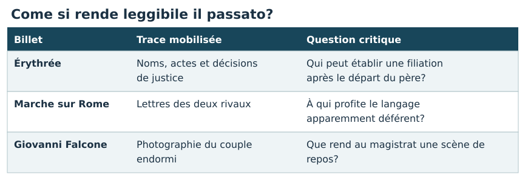

# ENS de Lyon · Séries LA/LV/SH (A/L) · Italien oral 2022 — Corrigé guidé

*Corrigé rédigé par IA, non officiel. Signalez toute erreur.*

**Rédaction** · GPT-6.2 Astra Ultra · vitesse non renseignée

Quatorze billets sont identifiés. Le poème de Gualtieri est demandé en entier et quatre lettres de Foscolo sont réparties sur deux billets bornés. Pour les onze textes de presse, l’article et le commentaire du jury renseignent l’analyse, mais le cahier ne reproduit pas le passage distribué.

## Lettere e arti · Stampa

### 1. Paolo Di Paolo, «25 aprile, adesso la festa ha un valore in più», *La Repubblica*, 24 aprile 2022

Il giorno della Liberazione unisce una data del 1945 a un atto di memoria che si ripete. La parola decisiva è «adesso»: nell’aprile 2022 la guerra in Ucraina riapre la questione di ciò che significa opporsi a un’invasione. Il confronto storico funziona soltanto se si conserva la differenza tra l’antifascismo italiano, la guerra d’occupazione di allora e la situazione contemporanea. Di Paolo chiede al lettore di ritrovare nella festa una responsabilità presente. Il richiamo conclusivo alla vignetta di Altan fa passare da un registro commemorativo alla sintesi ironica del disegno. Per spiegarlo sull’estratto, bisogna identificare insieme chi parla e quale distanza apre la battuta. Il rapporto segnala questo finale ma non riproduce la vignetta. [Archivio dell’autore](https://www.repubblica.it/autori/paolo_di_paolo/15/)

**Domanda. Che cosa cambia, se la data è sempre la stessa?** Cambia la domanda che le viene rivolta. Nel 2022 la parola “liberazione” torna a entrare nel linguaggio quotidiano attraverso una guerra vicina ai lettori.

### 2. Marco Ricucci, «Leopardi, il rapper Shade e la scuola. Così stiamo perdendo la lingua italiana», *Corriere della Sera*, 4 ottobre 2021

L’accostamento di un poeta canonico e di un rapper promette una provocazione. Il rischio sarebbe riassumere l’articolo dicendo che i giovani leggono meno o che la musica è nemica della scuola. La questione è invece quale padronanza della lingua la scuola permetta di acquisire. Riconoscere un riferimento popolare e saper leggere un periodo complesso sono capacità differenti. L’insegnante usa il contrasto e l’ironia per rendere visibile questa differenza. Il pronome nel titolo distribuisce la responsabilità tra adulti, istituzioni e studenti. Resta una domanda critica: quale passaggio autorizza a ricavare un giudizio generale da una scena scolastica particolare? [Articolo di Marco Ricucci](https://www.corriere.it/scuola/secondaria/21_ottobre_04/leopardi-rapper-shade-scuola-cosi-stiamo-perdendo-lingua-italiana-d1fe6420-24ed-11ec-807b-86d461d54829.shtml)

**Domanda. L’ironia è un ornamento?** Ha una funzione argomentativa: sposta il lettore dalla prevedibile contrapposizione fra gusti alla questione della competenza linguistica. Può però irrigidire quella contrapposizione se la si prende alla lettera.

## Langues vivantes · Explication d’un texte d’auteur (LV1)

### 1. Mariangela Gualtieri, «Sii dolce con me. Sii gentile», *Bestia di gioia*, sezione *Mio vero*, pp. 124–125, testo integrale

La ripetizione dell’imperativo potrebbe far pensare a un ordine, ma chi parla si espone chiedendo dolcezza. Le pause dopo le frasi brevi danno a ciascuna richiesta un respiro proprio. La tenerezza nasce dalla consapevolezza che le mani, il viso e il corpo che consentono la carezza non resteranno per sempre disponibili. La poesia trasforma questa consapevolezza del tempo in un invito a un gesto presente. Il passaggio dall’io e dal tu alla condizione comune dei viventi allarga l’indirizzo senza cancellare l’intimità del primo verso. Il rapporto parla a ragione di una possibile preghiera laica: la cadenza della supplica è riconoscibile, ma l’ascoltatore è anche il corpo vicino. [Lettura della poesia da parte dell’autrice](https://presidenti.quirinale.it/Elementi/182399)

**Domanda. Che cosa produce la ripetizione all’ascolto?** Ogni ritorno riprende un’esigenza che il verso precedente non ha esaurito. La voce rallenta e fa percepire la fragilità come motivo della richiesta.

### 2. Ugo Foscolo, *Ultime lettere di Jacopo Ortis*, pp. 9–12

Dall’intestazione dei colli Euganei, 11 ottobre 1797, fino a «e infamemente!». Il billet comprende le prime due lettere. Entrare nel romanzo attraverso una data e un luogo sottrae la disperazione al vago. Jacopo scrive dal momento in cui la sorte di Venezia gli appare decisa; il lettore ricostruisce il rapporto con Lorenzo da una sola voce. «Il sacrificio della patria nostra» è un esito annunciato prima ancora che la storia personale si svolga davanti a noi. Quello che viene dopo ha dunque insieme la tensione del presente per chi scrive e la forma di un ultimo documento per chi legge. Nella questione della fuga entrano la madre, gli affetti e il rifiuto di cambiare padrone. La successione dei due messaggi fa del conflitto politico un dilemma di condotta quotidiana. [Testo del romanzo](https://foscolo.letteraturaoperaomnia.org/foscolo_ultime_lettere_di_jacopo_ortis.html)

**Domanda. Perché conta che Jacopo si rivolga a Lorenzo?** Scrive a chi lo conosce e gli ha offerto un consiglio. Può lasciare impliciti alcuni fatti, mentre chi legge il romanzo deve inferirli dalle sue risposte e dai suoi silenzi.

### 3. Foscolo, *Ultime lettere*, pp. 91–92

Da «29 Maggio, all’alba» a «Tu mi hai ridotta così». Le due lettere dello stesso giorno contraggono l’intervallo tra esperienza e scrittura. All’alba Jacopo cerca Teresa e teme l’incontro; la immagina presente, poi il paesaggio gli rimanda la propria solitudine. L’accumularsi delle azioni e il brusco succedersi delle immagini danno al lettore il ritmo inquieto del desiderio. La sera compare uno sguardo reale, ma Teresa tace. Jacopo interpreta le pupille arrossate come se contenessero una frase che lo accusa. La conclusione non è una battuta pronunciata dalla donna. È una traduzione dello sguardo operata dall’innamorato. In questo punto il romanzo epistolare rende sensibile anche il limite della sua testimonianza. [Le due lettere del 29 maggio](https://www.libriantichionline.com/divagazioni/foscolo_ultime_lettere_jacopo_ortis_29_maggio_1798_alba_sera)

**Domanda. Possiamo assicurarci che Teresa pensi esattamente quelle parole?** Le lacrime sono osservabili. Il rimprovero è ciò che a Jacopo sembra di leggere nei suoi occhi. Questa distanza è parte della forza dell’ultima frase.

> [!INDICATION]
> À l’oral, annoncer le statut des paroles attribuées à Teresa avant de lire la dernière phrase. Pour le poème, ménager les fins de vers et écouter les reprises dans la lecture de Gualtieri.

## Langues vivantes · Analyse hors programme (LV1)

### 1. Vincenzo Giardina, «Figlie e figli delle colonie che l’Italia vuole dimenticare», *Internazionale*, 13 novembre 2021

Il sito mette *Figlie* prima di *figli*, il cahier inverte i due sostantivi. Un elenco di nomi raccolti in Eritrea dà al passato coloniale una forma verificabile. Molti padri italiani ripartirono senza riconoscere formalmente i figli. Una storia familiare può quindi essere nota a chi l’ha vissuta e restare invisibile sul piano giuridico. L’attività di padre Protasio Delfini, le prove raccolte e la richiesta rivolta alle autorità italiane fanno capire perché ricordare una discendenza non basti a ottenere il riconoscimento. Il reportage alterna le voci individuali e la serie dei casi: una cifra misura l’ampiezza del problema, un nome restituisce alla persona un posto nella storia. [Reportage di Vincenzo Giardina](https://www.internazionale.it/notizie/vincenzo-giardina/2021/11/13/italia-eritrea-colonialismo-figli)

**Domanda. Il verbo «dimenticare» indica soltanto una memoria difettosa?** Qui suggerisce anche un’azione istituzionale mancata. Un documento non riconosciuto può prolungare gli effetti del colonialismo sulla vita dei discendenti.

### 2. «Il mondo nuovo di Adriano Olivetti», *Strisciarossa*, 14 aprile 2022

Nelle macchine da scrivere, nelle fabbriche di Ivrea e nelle Edizioni di Comunità si incontrano produzione industriale, disegno degli oggetti e cultura. La domanda del testo riguarda la possibilità che l’impresa produca anche una certa idea di comunità. La biblioteca, l’editoria e la partecipazione degli intellettuali cambiano la descrizione della fabbrica: non è soltanto un luogo di lavoro. Ma trasformare Adriano Olivetti in un eroe isolato rischia di perdere le condizioni economiche e le altre persone che resero possibile l’esperimento. Tra utopia, mito e storia c’è dunque una differenza. Il mito invita all’ammirazione; la storia chiede quali istituzioni potrebbero sopravvivere all’imprenditore. [Testo di *Strisciarossa*](https://www.strisciarossa.it/il-mondo-nuovo-di-adriano-olivetti-tra-utopia-mito-e-storia/)

**Domanda. Perché parlare dei libri in un articolo su un industriale?** Perché la scelta degli autori pubblicati documenta l’idea di vita pubblica che l’azienda contribuiva a rendere possibile intorno alla produzione.

### 3. Ezio Mauro, «Il duello tra il Duce e il Vate», *La Repubblica*, 16 marzo 2022 nel fascicolo

Le lettere di Mussolini e D’Annunzio consentono di studiare le ambizioni concorrenti dietro le formule di deferenza. Chiamare l’uno «Duce» e l’altro «Vate» mette sulla scena due autorità costruite anche con le parole e con il pubblico. I simboli e i gesti messi in circolazione da D’Annunzio possono servire al fascismo; il loro inventore è però un potenziale rivale che Mussolini ha interesse a neutralizzare. Nel centenario della marcia su Roma, Mauro fa emergere attraverso l’ironia l’instabilità del rapporto prima che il regime appaia consolidato. La pagina web è datata 15 marzo. [Cronaca di Ezio Mauro](https://www.repubblica.it/cultura/2022/03/15/news/cronache_della_marcia_su_roma_il_duello_tra_il_duce_e_il_vate-341504016/)

**Domanda. Una lettera cortese prova l’accordo politico?** Bisogna leggere i destinatari, il momento e gli interessi. Una manifestazione di stima può accompagnare un tentativo di controllo.

## Langues vivantes · Analyse hors programme (LV2)

### 1. Michele Smargiassi, «Letizia Battaglia, addio alla fotografa dell’antimafia», *La Repubblica*, 14 aprile 2022

Il necrologio deve fare i conti con l’etichetta che rende Battaglia immediatamente riconoscibile. Fotografare la violenza mafiosa a Palermo significò intervenire su ciò che una comunità poteva vedere di se stessa. La macchina fotografica registra un istante, mentre la scelta della distanza, dell’inquadratura e del momento costruisce già un punto di vista. Ridurre tutta una carriera ai corpi delle vittime priverebbe la fotografa dei suoi altri sguardi sulla città, sulle donne e sull’infanzia. Le parole di Battaglia riportate nell’articolo permettono al necrologio di complicare il proprio titolo. [Ricordo pubblicato da *La Repubblica*](https://www.repubblica.it/dossier/cultura/2022/04/14/news/letizia_battaglia_la_fotografa_dellantimafia-345407434/)

**Domanda. Una fotografia di cronaca è una prova sufficiente?** Prova che qualcosa è stato visibile da quel punto e in quell’istante. Per attribuire responsabilità e ricostruire la storia servono altri documenti.

### 2. Ezio Mauro, «Il sortilegio di Berlusconi», *La Repubblica*, 26 dicembre 2021

Alla vigilia della scelta del nuovo presidente, l’eventualità che Berlusconi arrivi al Quirinale è ancora una congettura. Il «sortilegio» è il modo in cui un’ipotesi torna a occupare il dibattito anche quando i rapporti di forza sembrano sfavorevoli. L’autore adotta un registro fantastico per discutere un fenomeno politico concreto: la lunga capacità di un leader di imporre alla discussione l’immagine di se stesso. Il candidato immaginato obbliga gli altri a reagire come se la possibilità fosse già un fatto. Il contrasto con la funzione di garanzia del presidente rende più evidente la questione di fondo: che cosa accade quando la personalizzazione della politica raggiunge un ufficio chiamato a rappresentare tutti? [Riproduzione dell’editoriale](https://www.c3dem.it/wp-content/uploads/2021/12/il-sortilegio-di-berlusconi-e.-mauro.pdf)

**Domanda. Perché evitare di dare per acquisito il risultato dell’elezione?** Va rispettato il punto di vista temporale dell’editoriale. Nel dicembre 2021 l’incertezza è precisamente ciò su cui può agire il «sortilegio».

### 3. Sarah Gainsforth, «Il mare senza padroni», *L’Essenziale*, 18 maggio 2022

L’espressione del titolo mette una risorsa comune in contrasto con lo sfruttamento esclusivo di alcuni suoi accessi. Sulla costa pugliese la costruzione abusiva, le concessioni e l’erosione interagiscono. Rendere una spiaggia accessibile al pubblico è una questione di diritti, ma anche di sopravvivenza ambientale della spiaggia stessa. All’interesse degli operatori che hanno investito si oppone la difficoltà per l’ente pubblico di modificare usi ormai consolidati. L’articolo è efficace quando lega decisioni apparentemente tecniche a una domanda molto semplice: chi può davvero raggiungere il mare, e in quale stato lo troverà? [Ripresa del reportage](https://www.carteinregola.it/da-lessenziale-il-mare-senza-padroni/)

**Domanda. L’erosione si spiega tutta con il turismo?** Il fenomeno fisico ha più cause. Il commento deve specificare quali interventi documentati hanno reso un territorio già fragile più vulnerabile.

## Sciences humaines · Stampa

### 1. Francesco Boille, «Esterno notte di Bellocchio vuole scuotere il rimosso sul delitto Moro», *Internazionale*, 18 maggio 2022

Il critico parla del film di Bellocchio e insieme delle abitudini della memoria pubblica. Sapere come si conclude il sequestro di Aldo Moro nel 1978 non elimina la tensione drammatica. Spostando il punto di vista tra famiglia, istituzioni e altre figure, la narrazione fa sperimentare allo spettatore possibilità e cecità che la cronologia retrospettiva tende a cancellare. La parola «rimosso» designa qualcosa di noto nei fatti e tuttavia non elaborato sul piano collettivo. Boille valuta una forma cinematografica: la prova del suo giudizio sta nella relazione tra le scelte narrative e il passato che rendono nuovamente interrogabile. [Critica di Francesco Boille](https://www.internazionale.it/opinione/francesco-boille/2022/05/18/cannes-esterno-notte-bellocchio)

**Domanda. Perché una ricostruzione per immagini può dire altro da un manuale?** Può accostare tempi e punti di vista e far percepire l’incertezza di chi agiva, pur conoscendo lo spettatore l’esito storico.

### 2. Roberto Saviano, «Vi racconto l’eroe Falcone: era un uomo normale che però ha scelto il coraggio», *Corriere della Sera*, 20 maggio 2022

Una fotografia di Falcone e Francesca Morvillo addormentati sposta il punto di partenza della commemorazione. La vulnerabilità dei due corpi ricorda l’esistenza privata che gli obblighi di sicurezza e di lavoro limitavano. Se si immagina l’eroe immune dalla paura o naturalmente votato al sacrificio, il lettore non ha più nulla da imparare da una scelta che gli sembra estranea. Saviano rende invece il coraggio una condotta ripetuta da persone che potevano desiderare riposo e affetto. Anche il passaggio dalla fotografia alle circostanze del magistrato va rispettato: un’immagine suggerisce l’intimità, il ragionamento morale la interpreta. [Articolo di Roberto Saviano](https://www.corriere.it/sette/opinioni/22_maggio_20/vi-racconto-l-eroe-falcone-era-uomo-normale-che-pero-ha-scelto-coraggio-bd5fbdd0-d351-11ec-aac4-d5704cf08b36.shtml)

**Domanda. Perché insistere sul sonno in un testo sul coraggio?** Il riposo sottrae i protagonisti alla posa pubblica e rende concreto quanto potevano perdere. Da qui acquista senso la scelta di continuare.

### 3. Ernesto Galli della Loggia, «Noi, l’Europa e l’America: i veri interessi e quelli falsi», *Corriere della Sera*, 15 maggio 2022

L’editorialista comincia dando spazio alla tesi secondo cui l’interesse europeo imporrebbe di prendere le distanze dagli Stati Uniti nella risposta all’invasione russa dell’Ucraina. È importante riconoscere la concessione iniziale, altrimenti si finisce per attribuirgli l’opinione che intende confutare. La replica difende il legame transatlantico e contesta a chi invoca la prudenza il monopolio della parola «interesse». L’opposizione tra vero e falso rende polemica la definizione stessa della sicurezza europea. Un commento critico può interrogare le premesse del ragionamento e il peso attribuito all’autonomia europea, rispettando prima la direzione dell’argomento. [Editoriale di Galli della Loggia](https://www.corriere.it/editoriali/22_maggio_15/noi-l-europa-l-americai-veri-interessi-quelli-falsi-03fe5016-d489-11ec-8cdd-4a67b8015e8e.shtml)

**Domanda. Che cosa cambia passando da «noi» a «Europa» e «America»?** Cambia la scala dell’appartenenza presupposta. Il lettore deve stabilire quando l’autore si rivolge agli italiani e quando costruisce un interesse condiviso più ampio.

> [!INDICATION]
> Pour l’entretien, revenir au mot qui fait problème dans le titre, puis le confronter à un détail du texte, comme la photographie chez Saviano ou la concession initiale chez Galli della Loggia. Ce rapprochement permet de défendre une interprétation précise.

[Fascicule officiel des sujets](https://www.ens-lyon.fr/sites/default/files/2022-11/Italien2022_0.pdf) · [Rapport du jury](https://www.ens-lyon.fr/sites/default/files/2022-11/Italien%202022_0.pdf)
