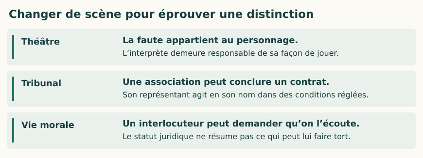

# Philosophie · Oral de spécialité SH · ENS de Lyon 2022 · Corrigé guidé

*Corrigé rédigé par IA, non officiel. Signalez toute erreur.*

**Rédaction** · GPT-6.2 Astra Ultra · vitesse non renseignée

**Portée.** Les 110 options publiées sont abordées, avec renvois pour les reprises de passage. Les choix effectivement décrits par le jury sont distingués des autres options.

## Préparer l’oral

**Choisir entre deux passages.** Pour chaque option, notez en deux phrases ce que l’argument remet en question et le mot ou l’exemple qui en fait changer la marche. Au § 355 de Nietzsche, distinguez l’objet à connaître et le besoin de retrouver du familier. Chez Montaigne, demandez qui juge lorsque le texte compare deux manières de percevoir. Un passage dont on connaît bien le thème peut être un mauvais choix si l’on ne sait pas encore en expliquer la dernière phrase.

**Lire et expliquer.** Au brouillon, séparez la voix de l’auteur, celle du contradicteur et celle de l’exemple ou de l’autorité citée. Pour la page 249 de Montaigne, l’invitation faite au savant de faire son propre compte n’a pas la même fonction que la citation biblique. Pour Nietzsche, ne remplacez pas une critique des mobiles d’une croyance par une réfutation de son contenu. Ces différences vous permettront de faire porter l’entretien sur ce qui est effectivement en jeu dans le passage.

**Préparer une leçon d’environ vingt minutes.** La discussion avec le jury dure ensuite environ dix minutes. Rédigez la difficulté que votre exemple initial fait apparaître, trouvez un cas qui oppose deux réponses possibles, puis préparez une objection à votre conclusion. Sur le principe inconditionné et le compromis, il peut s’agir de la même personne qui résiste à un favoritisme et qui accepte un aménagement justifié. Sur la personne fictive, distinguez la condamnation du personnage au théâtre et le contrat d’une association au tribunal. Ne prêtez pas au jury les développements proposés dans ce corrigé.

## Lire le fascicule de 2022

Le cahier officiel de cinq pages concerne la série Sciences humaines. Les pages 2 et 3 offrent respectivement douze paires de passages de Nietzsche et seize de Montaigne. Les pages 4 et 5 offrent vingt-sept paires de sujets de leçon. L’intertitre repris à la page 4 est celui de l’explication ; la rubrique du rapport et la nature des questions établissent qu’il s’agit de l’exposé. Le jury annonce vingt-sept candidats pour chacune des deux épreuves. Le nombre de paires publiées ne permet donc pas d’assigner chaque option à un candidat. Les notations en italique d’une partie du cahier n’ont pas de légende qui autorise une telle attribution.

Pour les explications, les livres et les bornes sont identifiés. Les textes sont lus dans des éditions de comparaison. Les citations de début suivent le cahier. Pour les leçons, on trouvera les deux sujets de chaque paire, une argumentation pour chacun et un exposé développé sur la fiction de la personne, dont le jury discute une prestation.

## Nietzsche. Les douze paires du livre V du *Gai savoir*

La page 2 des sujets donne vingt-quatre occurrences dont cinq portent sur un aphorisme entier (§§ 349, 364, 374 deux fois et 375). Les renvois ci-dessous conservent les trois reprises à l’identique. On compte donc vingt et un passages distincts. Les pages indiquées sont celles de la traduction de Patrick Wotling, GF, édition au programme. Les repères de paragraphe et les bornes du cahier ont été confrontés au livre V dans la traduction de Henri Albert. Les commentaires reformulent le texte ; leurs exemples sont proposés pour l’entretien. [Sujets 2022, p. 2](https://www.ens-lyon.fr/sites/default/files/2022-11/Philosophie2022_0.pdf#page=2) · [Texte de comparaison, traduction Henri Albert](https://fr.wikisource.org/wiki/Le_Gai_Savoir/Livre_cinqui%C3%A8me)

### Paire 1. Reconnaître le familier (§ 355) ou manquer de patrie (§ 377)

**A. § 355, p. 306, de l’exclamation sur la facilité à satisfaire les chercheurs jusqu’à la fin.** Un penseur ramène le monde à ce qu’il connaît déjà et s’émerveille de l’avoir expliqué. Nietzsche part du plaisir de la solution pour demander ce qui en est effectivement la cause. Quand on retrouve dans les choses des habitudes de calcul, les formes de sa logique ou la structure de ses désirs, le soulagement de la reconnaissance risque de se substituer à une raison de croire. Les chercheurs plus prudents seraient-ils exempts de ce travers ? Ils proposent de commencer par les faits de conscience, qui nous seraient plus accessibles. Le passage renverse cette méthode. Ce dont l’usage est le plus ancien ou le plus constant est précisément ce qu’on a le plus de mal à constituer en problème. Un locuteur emploie sans hésitation les temps de sa langue. Ce succès pratique ne lui donne pas immédiatement une théorie exacte de leurs usages. On comprend alors en quel sens les sciences de la nature peuvent avoir un avantage sur l’enquête psychologique : l’étrangeté de leur objet rend son statut de problème perceptible, tandis que l’enquête sur soi doit produire une distance au milieu de la familiarité.

**Relance.** Faut-il chercher ce qu’on comprend le moins ? L’étrangeté facilite le commencement d’une *question*. Rien n’en fait à elle seule le critère d’une bonne réponse.

**B. § 377, p. 342–343, du début jusqu’au refus d’un règne établi sur terre de justice et de concorde.** Qui parle au nom d’un « nous » qui se dit sans patrie ? L’expression prend d’abord une valeur temporelle. Les destinataires restent européens, mais aucun des idéaux qui trouvent encore asile dans leur présent ne leur offre de demeure. La métaphore de la glace articule deux affirmations différentes. Le terrain sur lequel leurs contemporains se tiennent a perdu sa solidité ; les « sans-patrie » contribuent eux-mêmes à le rompre. Ils peuvent donc observer une transition et y prendre part. La série des refus empêche bientôt de se faire de leur avenir une image convenue. Ni la conservation de l’ordre ancien ni les promesses modernes de progrès, d’égalité et de réconciliation ne les définissent. La difficulté de la dernière phrase est précisément qu’ils refusent de reconnaître dans la concorde universelle leur fin désirable. Il faut rendre compte de cette objection à un idéal qu’on aurait spontanément cru leur être favorable, tout en marquant la borne du sujet : le passage s’arrête avant les raisons et développements qui suivent dans l’aphorisme.

**Relance.** Toute opposition à l’ordre présent est-elle progressiste ? Le passage fournit un contre-exemple et oblige à distinguer ouverture de l’avenir et croyance que celui-ci doit satisfaire un idéal de progrès déjà déterminé.

### Paire 2. La surface consciente (§ 354) ou le corps du savant (§ 366)

**A. § 354, p. 304–305, de la définition du phénoménalisme jusqu’à la fin.** Qu’advient-il d’une expérience lorsque je la rends consciente et communicable ? Dire « j’ai peur » permet à quelqu’un de me secourir, mais le même signe peut désigner des états singuliers très différents. L’hypothèse du passage est que cette traduction en traits communs transforme ce qui parvient à la conscience. Nietzsche parle de surface, de signes et de simplification pour désigner ce qui demeure lorsqu’une expérience devient exprimable dans les termes partagés d’un groupe. Le procédé est assez puissant pour qu’une augmentation de la conscience puisse, sous ce rapport, aussi accroître la déformation. Il faut ensuite prendre au sérieux les deux refus de vocabulaire philosophique. Opposer sujet et objet suppose que nous connaissons déjà le découpage que la grammaire encourage. Opposer l’apparence à la chose en soi supposerait que nous puissions établir le second terme depuis un autre point de vue. Le diagnostic porte sur la portée de nos opérations de connaissance. Même l’utilité commune, invoquée pour expliquer la sélection de certains signes, est soumise in extremis à l’interrogation : ce que le groupe croit favorable pourrait lui être nuisible.

**Relance.** Si je traduis mal mon expérience, faut-il supposer que je la connais parfaitement avant sa traduction ? Le texte récuse précisément ce privilège. On peut repérer les effets simplificateurs d’un vocabulaire partagé sans disposer d’une description absolument complète de ce qu’il simplifie. Cette même découpe revient en 11A.

**B. § 366, p. 327, du début jusqu’au silence des retrouvailles.** Le mouvement physique de la pensée est ici un critère de lecture. Marcher, monter ou danser figurent une manière de changer de point de vue, mais le texte demande également d’imaginer des corps réels, à l’air libre ou repliés pendant des années sur un bureau. Se borner à célébrer la promenade ferait perdre le mouvement de l’explication. Le narrateur ferme un livre savant avec une émotion double, reconnaissance et soulagement. Il a reçu quelque chose de celui dont l’étroitesse l’oppresse. La spécialisation est ensuite présentée comme une déformation localisée de celui qui concentre ses moyens dans une seule direction. Enfin, l’observation se déplace du livre vers des amis retrouvés. Ils croyaient posséder une science ; elle a pris possession d’eux. La scène finale et son silence traduisent le coût humain de la réussite intellectuelle. Le passage ne démontre pas qu’un théorème soit faux du fait de la posture physique du mathématicien. Il donne à juger la forme de vie et les sacrifices devenus lisibles dans une œuvre.

**Relance.** Pourquoi terminer sur d’anciens amis ? La rencontre rend sensible un coût dans la durée que l’analyse d’un ouvrage achevé, isolé de son auteur, ne suffirait pas à faire apparaître.

### Paire 3. Pourquoi devenir conscient (§ 354) ou devenir comédien (§ 361) ?

**A. § 354, p. 302–303, de la question sur l’utilité de la conscience jusqu’au degré de cette utilité.** La question de départ suspend une évidence. Un organisme peut accomplir de nombreuses opérations sans se les représenter expressément. Pourquoi donc la conscience s’est-elle développée ? Nietzsche propose une relation entre son degré de finesse, la faculté de communiquer et le besoin de communication. Le passage formule une hypothèse à une échelle qu’il précise aussitôt. L’orateur le plus habile n’est pas nécessairement celui qui dépend le plus de son entourage pour ses nécessités personnelles. Une aptitude peut s’être développée sous la pression durable de besoins collectifs puis être dépensée par des individus qui n’éprouvent plus la même nécessité. Les artistes et les écrivains sont décrits comme les héritiers dépensiers d’une capacité accumulée. Cela permet de passer d’une corrélation observée à l’hypothèse d’une formation historique, sans confondre le besoin originaire et l’usage présent. La fin du passage en tire une conséquence limitée : le développement de la conscience aurait été commandé par la fonction qu’elle pouvait remplir dans les relations entre les hommes, dont les rapports de commandement et d’obéissance.

**Relance.** Cette conjecture rend-elle impossible la pensée solitaire ? Elle interroge les conditions de formation d’une aptitude que l’individu peut ensuite exercer ou détourner à d’autres fins, y compris lorsqu’il est seul.

**B. § 361, p. 320–321, du début jusqu’à la référence au génie.** Le « problème du comédien » est posé pour compliquer le concept de l’artiste. Comment un faux-semblant peut-il être pratiqué avec bonne conscience, au point d’altérer ce qu’on appellerait le caractère propre ? La capacité de prendre un rôle commence comme une faculté d’adaptation. Nietzsche en cherche une condition possible dans des familles exposées à l’incertitude et à la dépendance qui exigent de se montrer autrement pour faire face à des attentes contradictoires. La comparaison avec le mimétisme déplace la question de la condamnation morale du mensonge vers la formation de la faculté elle-même. Le point décisif est le retournement du rapport entre moyen et fin. L’adaptation servait d’abord un besoin immédiat. Une fois disponible en excès, elle peut s’imposer et commander d’autres tendances. Surgit alors une manière de créer des figures pour le plaisir ou sous la poussée de cette puissance. La série finale rapproche des formes artistiques réputées « hautes » des rôles du bouffon ou du valet. Elle oblige à reprendre l’histoire des facultés à partir desquelles on reconnaît du génie.

**Relance.** Nietzsche a-t-il fourni la biographie générale de tous les artistes ? Les précautions d’énonciation ont ici une valeur argumentative. Une généalogie hypothétique ébranle la représentation d’une origine pure ; elle ne fait pas de la condition sociale une preuve suffisante de talent.

### Paire 4. Le rôle devient caractère (§ 356) ou l’infini devient perspectif (§ 374)

**A. § 356, p. 306–307, du début jusqu’à l’évaluation de la durée.** Dans l’Europe décrite, chacun doit exercer un métier mais peu en déterminent seuls le choix. Même quand le choix semble libre, des circonstances contingentes y entrent. Avec l’âge, des manières de parler, d’anticiper ou de juger, acquises dans la profession, paraissent exprimer une nature personnelle originaire. Le bon jeu se retourne contre celui qui joue : il perd de vue les autres rôles qu’il aurait été capable de tenir. La remarque n’aboutit pourtant pas à une opposition simple entre masque et moi véritable. Le rôle *est devenu* caractère. Une origine contingente peut produire une disposition bien réelle. Le recours aux castes, corporations et privilèges héréditaires donne une dimension collective à ce mécanisme. L’idée qu’un métier est une destination exclusive peut rendre des institutions extrêmement durables. Le qualificatif sévère porté sur ces constructions contraste avec la valeur reconnue à leur durée. On peut estimer la puissance de stabilisation d’une croyance sans la tenir pour vraie ni juger juste tout ce qu’elle a stabilisé.

**Relance.** Une vocation découverte après coup est-elle toujours une illusion ? Les aptitudes développées peuvent être authentiques. L’illusion consisterait à faire de leur état présent la preuve que toute autre carrière était dès l’origine impossible.

**B. § 374, p. 340–341, aphorisme entier.** Peut-on prendre de la hauteur sur la pensée humaine pour décider si le caractère perspectif appartient au regard ou à toute existence ? L’aphorisme soumet cette alternative à l’épreuve qu’elle requiert. La plus rigoureuse des analyses reste une opération de l’intellect qu’elle analyse. Elle ne saurait donc garantir qu’elle a abandonné tout point de vue au moment de déterminer la portée de tous les points de vue. Le cas imaginé d’êtres qui éprouveraient le temps à rebours transforme une abstraction en difficulté repérable. La relation de cause à effet elle-même aurait pour ces êtres un autre visage. Le texte n’annonce aucune découverte sur l’existence de tels êtres. Il met à l’épreuve le droit de déclarer impossible tout mode de perception autre que le nôtre. D’où la signification nouvelle de l’infini : nous ne savons pas fermer le champ des interprétations possibles. La réserve finale vise le geste religieux qui ferait aussitôt de cet inconnu une perfection digne d’adoration. Rien dans l’ouverture des possibilités n’exclut la sottise ni l’erreur, à commencer par les nôtres. L’inconnu appelle l’examen sans fournir un nouvel objet d’obéissance.

**Relance.** Le perspectivisme affirme-t-il que toutes les interprétations se valent ? Le texte récuse le privilège d’un angle unique ; il va jusqu’à juger possibles de très mauvaises interprétations. La pluralité des perspectives n’impose pas l’égalité de leur valeur. Même option en 10B.

### Paire 5. Une Église en ruine (§ 358) ou l’horizon du savant (§ 373)

**A. § 358, p. 314–315, du début jusqu’à la comparaison avec le Nord.** L’ouverture tient le lecteur devant une ville en ruines. Certains édifices restent élevés ; d’autres sont tombés. Le retard avec lequel le nom de l’Église vient éclairer cette description permet de distinguer plusieurs temps de la destruction. La foi en Dieu, la persistance de l’idéal ascétique et la solidité d’une organisation ne suivent pas nécessairement le même rythme. Le christianisme comme construction romaine sollicite donc une explication historique étendue. Un événement unique ne peut suffire à rendre raison d’un édifice qui a longtemps résisté aux secousses. La difficulté se concentre ensuite sur un paradoxe : des hommes décidés à préserver le christianisme ont pu être les agents de sa dissolution. Leur intention de restaurer une croyance ne garantissait pas leur compréhension des formes d’autorité qui la faisaient durer. L’opposition polémique du Nord et du Sud attribue à l’institution romaine une intelligence complexe de la liberté et de la méfiance, de ce qu’on accorde aux hommes et de ce qu’on redoute de leurs mobiles. Il faut restituer le rôle de cette typologie dans l’argument sans la prendre pour un fait démontré sur les peuples.

**Relance.** Une croyance peut-elle perdre de sa force alors que ceux qui la défendent sont sincères ? Précisément. La solidité d’une institution est un problème différent de la ferveur de ses membres ou de la sincérité de ses réformateurs.

**B. § 373, p. 338–339, du début à l’apostrophe sur l’horizon.** Le texte interroge le choix des résultats qui passent chez certains savants pour désirables ou définitifs. Il commence par une assertion hiérarchique provocante sur la place intellectuelle des savants. Plutôt que d’en faire une prémisse admise, il faut voir ce que les exemples cherchent à établir. Spencer espère une conciliation de l’altruisme et de l’égoïsme ; l’avenir qui le satisfait inspire au locuteur du dégoût. Le fait philosophique intéressant est cet écart qui ne paraissait pas constituer pour Spencer un problème. Un horizon de valeurs décide en amont de ce qui pourra passer pour solution. Un second exemple déplace la question de l’espérance morale vers l’idée d’un monde entièrement commensurable à la pensée humaine. Une méthode de calcul peut donner des résultats sûrs dans son domaine. Est-on fondé à définir par son pouvoir de calculer la multiplicité entière de l’existence ? L’apostrophe finale en appelle au respect de ce qui déborde les habitudes du chercheur. Le passage expose le saut logique qui mène de l’efficacité d’une méthode au monopole d’une interprétation du réel.

**Relance.** Suffirait-il d’opposer son dégoût au jugement de Spencer ? À lui seul le dégoût ne réfute pas la doctrine ; il ouvre une question de valeur que le projet de conciliation tenait pour résolue.

### Paire 6. Le besoin de connaître (§ 355) ou une santé qui se risque (§ 382)

**A. § 355, p. 305–306, du début jusqu’à la question sur la moindre peur.** Nietzsche part d’une remarque entendue dans la rue. Reconnaître une personne dans un passant jusque-là indéterminé fait cesser une incertitude. Le philosophe, quand il prétend connaître le monde, poursuit-il un but profondément différent ? Une série d’interrogations fait passer de l’équivoque d’un mot à une hypothèse sur un mobile : reconnaître ce dont on a l’habitude peut procurer un sentiment de sécurité, et l’on pourrait prendre ce sentiment pour le signe d’une connaissance acquise. Il faut examiner la médiation des questions. Le texte n’établit pas que l’angoisse soit l’origine unique de toute recherche. Il demande si elle travaille même les entreprises intellectuelles qui revendiquent la plus grande pureté. Le philosophe qui ramène le monde à l’idée en fournit un essai. Sa doctrine a-t-elle rendu le monde intelligible ou l’a-t-elle reconduit à ce qu’il manie déjà avec aisance ? À la fin de l’extrait, c’est la légitimité du contentement qui se trouve ébranlée ; le bien-fondé de la doctrine elle-même reste à établir par d’autres raisons. Même option en 12A.

**Relance.** Pourquoi prendre la langue de la rue comme point de départ ? Elle permet de tester une continuité possible sous la coupure entre savoir ordinaire et philosophie savante ; elle n’est pas présentée comme un dictionnaire infaillible.

**B. § 382, p. 351–352, de la question sur l’insatisfaction jusqu’à la fin.** Les mots inauguraux renvoient à ce qui précède : des navigateurs ont aperçu des possibilités qui ont aiguisé leur faim. Le passage demande ce qui arrive aux idéaux de l’« homme actuel » une fois cette expérience faite. Leur perte d’évidence ne conduit pas à une nouvelle liste de normes applicables à chacun. L’idéal à venir est dit attirant, périlleux et difficile à recommander. Son signe est un jeu avec les valeurs tenues pour les plus hautes, jeu qui procède d’une plénitude et dont la transgression spectaculaire n’est pas l’intention. L’insistance sur son caractère involontaire empêche de réduire cette attitude à l’ironie de quelqu’un qui feint de ne rien prendre au sérieux. Il peut, vu du dehors, sembler inhumain là où son bien-être lui permettrait une autre bienveillance. Le dernier déplacement réintroduit le sérieux sous une forme inattendue. Libérer la valeur d’une solennité convenue pourrait être justement ce qui rend possible un authentique problème, donc une épreuve dont l’issue n’est plus écrite. La tragédie ne termine pas l’enquête sur un rire rassurant.

**Relance.** Pourrait-on prescrire à chacun de « jouer » avec les valeurs ? Imiter volontairement un geste extérieur de désinvolture ne crée pas la disponibilité à éprouver un idéal dont le texte cherche les conditions.

### Paire 7. La conservation (§ 349) ou le pouvoir du rôle (§ 356)

**A. § 349, p. 296–297, aphorisme entier.** Pourquoi un être vivant se conserve-t-il ? La réponse qui fait de sa conservation sa tendance première ne distingue pas encore un effet de son principe. Sous la menace, éviter la destruction suffit à occuper toute l’activité ; dans d’autres situations un être peut dépenser des ressources ou risquer sa sécurité afin d’accroître sa puissance d’agir. Nietzsche propose d’interpréter l’autoconservation comme la forme resserrée d’une activité plus large. Il retourne alors ce geste explicatif contre les doctrines qui la mettent au premier rang. La maladie attribuée à Spinoza, puis les conditions d’existence que Nietzsche prête aux familles des naturalistes, font l’objet d’une lecture symptomatique. Un horizon historique de pénurie pourrait orienter ce qu’on perçoit le plus volontiers dans le monde vivant. La mention du darwinisme relève de cette polémique avec une doctrine de la lutte ramenée à la survie. Elle ne constitue pas une réfutation expérimentale de la sélection naturelle. Le contraste final avec l’abondance et la dépense entend montrer ce que laisse hors champ un modèle tiré de la détresse. À analyser : le passage de l’observation d’une dépense à la thèse philosophique d’une volonté de puissance ; l’anecdote sur le penseur ne dispense pas d’en discuter les raisons.

**Relance.** Une dépense peut indirectement favoriser la conservation. Cela indique que les deux interprétations doivent expliquer des cas communs. Il importe donc de distinguer l’effet à long terme d’un comportement et la dynamique que le philosophe lui attribue.

**B. § 356, p. 307–308, des Grecs entrés dans la croyance au rôle jusqu’à l’avènement des comédiens comme maîtres.** Le propos examine l’effet d’une découverte : une fonction tenue pour une destinée naturelle peut se révéler être un rôle et, par conséquent, pouvoir être joué autrement. Nietzsche attribue aux Grecs une histoire qui pousse ce mécanisme à la limite. Une fois les rôles reconnus comme tels, la capacité de les endosser éblouit jusqu’au conquérant romain. L’allusion renverse l’échelle militaire de la victoire en demandant qui a déterminé les manières de voir, de parler et de se présenter. La suite transforme l’évocation historique en interrogation du présent moderne. Savoir qu’on joue modifie le genre d’acteurs susceptibles d’apparaître et les dispositions que la société promeut. Les images de flore et de faune expriment ce changement de milieu : des manières d’être naguère marginales trouvent de quoi prospérer. Appeler les comédiens les maîtres de l’époque, à la fin du passage, attribue un pouvoir social à la plasticité des conduites. Ce diagnostic mêle fascination et inquiétude ; le commentaire doit préserver cette ambivalence.

**Relance.** Une personne capable de changer de rôle est-elle nécessairement plus autonome ? Elle peut se libérer d’une assignation ou devenir tributaire des attentes changeantes d’un public. Le passage montre cette puissance sans en faire immédiatement une émancipation.

### Paire 8. La communication (§ 354) ou la probité du spécialiste (§ 366)

**A. § 354, p. 302–303, du développement de la conscience par nécessité jusqu’à la formule « main dans la main ».** Ce passage commence là où la conjecture précédente devient une explication suivie. Un être vulnérable a besoin de l’aide d’autres êtres. Afin de leur rendre son état intelligible, il doit pouvoir en distinguer certains traits, les fixer et faire usage de signes. Ce besoin de communication contribue ainsi à la formation de ce que nous nous représentons après coup comme une pure intériorité. Dans un appel au secours, je dois sélectionner le danger et ce dont j’ai besoin au milieu d’une expérience beaucoup plus riche et confuse. Le passage du groupe à l’individu ne signifie pas qu’il n’existe aucune activité mentale avant le langage. Nietzsche distingue expressément la pensée qui a lieu et le savoir que nous avons d’être en train de penser. Seule la part qui vient à la conscience sous une forme communicable est ici concernée. La formule finale fait aller de pair le développement du langage et celui de cette conscience réflexive ; elle ne permettrait pas d’identifier sans reste la raison à la parole, distinction que le texte indique lui-même.

**Relance.** L’analyse suppose-t-elle que chaque mot que je pense soit réellement adressé à un tiers ? L’hypothèse concerne la genèse et la structure partageable des signes. Une personne peut employer seule des moyens d’expression développés dans un monde de relations.

**B. § 366, p. 328–329, de l’adresse aux amis savants jusqu’à la fin.** L’éloge inattendu de la « bosse » du savant retourne un motif de la première partie de l’aphorisme. La vie du spécialiste a bien un coût. C’est justement la marque de cet apprentissage que la seconde partie oppose à celui qui se fait passer pour un expert sans s’être exercé. Le savant n’incarne pas une simple collection d’opinions échangeables. Une discipline de préparation et de moyens le rend comptable de la manière dont il atteint un résultat. La critique qui l’opposait à d’autres formes de vie est donc compatible avec l’estime de sa probité. La parenthèse finale sur les artistes déplace le diagnostic. Une grande faculté de produire des effets permet aussi de masquer les lacunes d’un apprentissage, voire d’inventer après coup des principes qui donnent à une réussite l’apparence d’une longue solidité méthodique. Mais parvenir à convaincre le public ne supprime pas la conscience que l’artiste peut avoir de cette opération. Le texte soumet le génie à une question de véracité qu’aucune admiration ne suffit à effacer.

**Relance.** Pourquoi ne suffit-il pas de dire que le livre condamne le savoir spécialisé ? La même trace professionnelle peut être évaluée sous deux rapports : elle limite certaines possibilités de vie et atteste une maîtrise à laquelle le brillant commentateur ne peut simplement se substituer.

### Paire 9. Évaluer un précepte (§ 345) ou interpréter une œuvre (§ 370)

**A. § 345, p. 289, des historiens de la morale à la comparaison du médicament.** Certains historiens sélectionnent pour traits essentiels du bien l’altruisme, le sacrifice et la compassion. Leur travail croit avoir porté sur la morale en général alors qu’il a emprunté à une morale historiquement située ses catégories de classement. Nietzsche examine ensuite deux inférences opposées. D’un accord entre peuples sur une règle on ne déduit pas sa validité absolue. De la diversité des règles on ne déduit pas non plus l’absence de toute obligation. Dans les deux cas, une information sur l’extension d’une croyance est invitée à décider à elle seule de sa valeur. Avec les plus subtils des critiques, la difficulté se déplace encore. Réfuter une croyance sur l’origine, la sanction ou l’arrière-plan d’un précepte ne suffit pas à évaluer ce que produit son application. Le patient peut comprendre très mal l’action du médicament qu’on lui propose, alors que celui-ci l’aide ou lui nuit effectivement. L’analogie n’assure pas que la morale soigne. Elle explique pourquoi la question de sa valeur demeure ouverte après la critique de plusieurs justifications erronées.

**Relance.** L’histoire serait-elle inutile à l’évaluation ? Elle aide à découvrir quelles fins une pratique sert, à quelles conditions elle apparaît et quels effets elle produit. Le raisonnement refusé consiste à tirer d’un seul constat historique un verdict normatif complet.

**B. § 370, p. 333–334, de la richesse vitale jusqu’au besoin qui commande une appréciation.** L’aphorisme invite à lire certaines productions spirituelles à partir du genre de souffrance ou de puissance dont elles procèdent. Le passage distingué commence avec le type dionysien. Une surabondance de vie permettrait de supporter, voire d’affirmer, la destruction parce qu’elle dispose des moyens de recréer. Le point de contraste est l’existence appauvrie qui chercherait dans la douceur, l’ordre logique ou la proximité d’un sauveur une protection contre la peur. La thèse porte sur une fonction possible de ces biens ; elle ne démontre évidemment pas qu’un raisonnement logique soit faux lorsqu’il rassure. Le rapprochement d’Épicure et du chrétien devient intelligible dans ces limites : des doctrines très diverses peuvent remplir une fonction comparable d’apaisement. Le dernier mouvement remonte du produit à celui qui en a besoin. Il est méthodologiquement essentiel que l’auteur souligne les erreurs possibles de cette inférence. Un même goût apparent peut servir des formes de vie différentes. L’hypothèse sur ce qui « commande » doit être éprouvée à partir de l’usage effectif de la pensée ou de l’œuvre.

**Relance.** De la représentation d’une catastrophe peut-on conclure que le créateur désire la destruction ? Il faut d’abord demander ce que la représentation permet de faire à celui qui la produit et à celui qui la reçoit : soutenir une intensité, reprendre prise sur une expérience, chercher une délivrance ou autre chose.

### Paire 10. À qui rend-on hommage (§ 351) ? Sous quelles perspectives (§ 374) ?

**A. § 351, p. 297–298, du début jusqu’à la vénération populaire de la sagesse.** Le mot *sage* suscite l’image d’un homme recueilli, paisible et accueillant. Or l’ardeur de celui qui poursuit les problèmes les plus difficiles peut s’accompagner de troubles et d’une lourde responsabilité. L’erreur serait de prendre l’absence de conflit apparent pour la marque de toute philosophie. Nietzsche met en scène ce contraste par deux paysages sensibles : la douceur pastorale, puis l’orage dans lequel demeure le chercheur. Mais le propos ne se termine pas par la simple condamnation d’un jugement populaire jugé inférieur. Il accorde à ceux qui expriment leur vénération qu’ils ont raison d’honorer les qualités qu’ils reconnaissent. C’est un *autre type d’homme*, la nature sacerdotale douce et grave, qu’ils distinguent sous le nom de sage. L’écart porte donc sur la figure effectivement reconnue par l’éloge. Le sujet s’arrête avant que l’aphorisme détaille les services rendus par ces hommes. Dans ces limites, on peut établir que deux idéaux sont souvent confondus, et non que tout prêtre accomplirait inévitablement la même tâche.

**Relance.** Le philosophe est-il d’autant plus authentique qu’il paraît agité ? L’orage figure sa responsabilité envers certains problèmes. Un tempérament inquiet ne suffit pas à la faire exister.

**B. § 374, p. 340–341, entier.** Cette option reprend le passage de 4B, sans changement de borne. Une manière d’en contrôler la lecture est de séparer trois affirmations : l’intellect humain examine à partir d’une perspective, il ne peut exclure des points de vue qu’il ne sait pas occuper, et cette ouverture ne prouve pas que l’inconnu soit bon ou divin. Le passage du premier au second point justifie la nouvelle figure de l’infini ; le dernier empêche d’en faire un substitut de Dieu.

### Paire 11. Les limites de la conscience (§ 354) ou les recettes de l’ermite (§ 364)

**A. § 354, p. 304–305, du phénoménalisme à la fin.** C’est la même option que 2A. Une bonne relance consiste à demander si le terme *utilité*, qui sert d’abord à expliquer la sélection de signes collectivement communicables, sort lui-même indemne de l’enquête. La dernière phrase lui refuse le statut d’une mesure indubitable et oblige la critique à s’appliquer aussi à son propre langage explicatif.

**B. § 364, p. 325, aphorisme entier.** L’identité du locuteur aide à entendre le texte. Un ermite expose un art des relations sociales. La métaphore du repas dont la cuisine inspire peu de confiance lui permet de formuler un problème de réception : comment demeurer en compagnie de quelqu’un qu’on n’a pas spontanément envie d’accueillir ? La faim qui rendrait tout appétissant n’est justement pas disponible à volonté. Les trois principes proposés sont autant d’opérations différentes. Le premier agit ouvertement sur soi : supporter la répugnance et jouir de son propre courage. Le second agit sur l’interlocuteur et sur l’image qu’on s’en forme : un éloge ou l’attention démesurée à une qualité peut faire apparaître un être plus facile à supporter. Le troisième règle la relation en produisant l’indifférence à la présence d’autrui. Le mot de la fin, *patience*, donne à cet engourdissement le nom d’une vertu ordinairement admirée. Son retard produit l’effet comique et oblige à réexaminer l’expérience qu’on nomme trop vite vertueuse. L’aphorisme nous apprend à interroger les mécanismes affectifs que recouvre un jugement moral flatteur.

**Relance.** Faut-il croire que toute patience soit indifférence ? L’attribution de la parole à l’ermite permet de reconnaître ce portrait pour une mise à l’épreuve d’un nom de vertu. Un diagnostic sur un usage du mot ne définit pas toutes les façons de prêter attention à autrui.

### Paire 12. La sécurité du familier (§ 355) ou le plaisir de tenir l’incertain (§ 375)

**A. § 355, p. 305–306, du début jusqu’à la question sur la peur.** Les limites sont celles de 6A. Le rapprochement avec le texte voisin dans l’enveloppe peut servir au choix du candidat. Dans ce passage, Nietzsche demande si la jubilation attachée à certaines solutions vient du retour à une sécurité familière. L’hypothèse concerne le désir qui oriente la reconnaissance ; la valeur d’une explication ne se déduit pas de l’émotion de celui qui la propose.

**B. § 375, p. 341–342, aphorisme entier.** Une même prudence devant les convictions ultimes peut-elle signaler des dispositions contraires ? L’expérience d’une croyance déçue rend d’abord plausible l’image de l’enfant échaudé. On hésite pour éviter d’être de nouveau trompé. Une autre interprétation s’ajoute, que l’auteur juge meilleure : celui qui se sentait prisonnier d’un angle de vue étroit se réjouit d’ouvrir le champ de l’enquête. Le refus de l’affirmation absolue exprime alors une curiosité positive. Le titre engage une comparaison avec l’épicurisme. L’aptitude à préserver le caractère interrogatif des choses, le rejet de certains gestes moraux grandiloquents et la pratique des réserves composent une physionomie de modération. La métaphore du cavalier oblige pourtant à réviser ce qu’on lisait sous cette apparence. Il faut de la maîtrise pour retenir un cheval lancé à vive allure ; il n’y a pas de mérite équivalent à retenir un animal immobile. La réserve peut manifester la vigueur du désir de certitude et la puissance de suspendre la conclusion prématurée. Ce que l’on prenait pour l’absence de goût du risque peut être l’exercice d’une liberté dans le risque.

**Relance.** Cette suspension retire-t-elle tout intérêt à la recherche de la vérité ? S’intéresser à une question exige précisément de ne pas fermer l’enquête au premier sentiment de certitude. Le dernier trait du texte laisse intacte la force de la recherche tout en modifiant le sens du geste qui la retient.

## Montaigne. L’« Apologie de Raymond Sebond »

La page 3 du fascicule donne seize paires tirées des *Essais*, II, XII, édition Folio classique. Les repères ci-dessous sont ceux de cette édition. Les premiers et derniers mots de chaque passage ont été retrouvés, avec les variantes orthographiques, dans la transcription de l’exemplaire de Bordeaux des *Essais* consultable sur Wikisource. Les trente-deux occurrences correspondent à vingt-quatre découpages distincts. Le lecteur peut retrouver les limites complètes dans le cahier de l’ENS. Les explications suivent l’argument dans l’intervalle ainsi repéré. [Chapitre de comparaison](https://fr.wikisource.org/wiki/Essais/Livre_II/Texte_entier)

### Paire 1

**A. Pages 288-289, « Quand nous disons… ».** Nous pouvons prononcer des formules sur l’éternité et l’unité des attributs de Dieu sans que notre intelligence saisisse ce que les mots enferment. Montaigne confronte cette disproportion à une présomption très concrète : juger telle intervention divine trop grande ou trop petite pour être digne de sa puissance. La série qui rapproche empire et feuille, bataille et saut d’une puce met en scène l’écart des mesures. La bataille importe davantage à celui qui risque de la perdre ; cet intérêt humain ne prouve pas qu’elle exige de la providence un effort supérieur. L’objection n’a donc pas pour conclusion le retrait de Dieu hors du détail. Elle défait une hiérarchie importée de nos propres soins dans le gouvernement que notre parole entreprend de décrire.

**B. Pages 346-347, « N’y a-t-il point… ».** Les philosophes font parfois des moments d’enthousiasme ou de fureur la condition d’exploits qui dépassent l’état de veille raisonnable. Montaigne se demande quelle autorité conserve une sagesse qui proclame elle-même son dépassement lorsque l’âme n’est plus dans l’état qu’elle juge le meilleur. Les renversements de la veille et du sommeil, de la sagesse et de la folie, font entendre la discordance dans le discours de la philosophie. Le dernier retour au tempérament assez peu exalté de l’auteur impose une borne supplémentaire : les états violents surviennent parfois sans laisser à l’âme le temps de se connaître en les éprouvant. Il ne faut donc ni les exalter par ouï-dire ni les rejeter pour la seule raison qu’ils dérangent l’image de la raison maîtresse de soi.

### Paire 2

**A. Pages 240-241, « Notre bien-être… ».** Définir le bien-être par la privation du mal semble supprimer tout contenu positif du plaisir. L’exemple de la fièvre rend compréhensible cette définition : une fois le mal éprouvé, son absence peut devenir un bien appréciable. Montaigne interroge dès lors la « simplesse » ; si elle épargne des douleurs d’imagination, elle peut contribuer au bonheur. Il en précise la limite. Une insensibilité de pierre supprimerait avec la souffrance la possibilité même d’une expérience humaine. La dernière balancée sur douleur et volupté déplace donc le critère : une douleur peut avoir sa part opportune dans une vie et le plaisir ne commande pas toujours de le suivre. En relance, distinguez l’absence de telle souffrance et l’incapacité de plus rien ressentir. Le passage accorde de la valeur à la première sans faire de la seconde un idéal.

**B. Pages 337-339, « Que les choses… ».** Si les choses entraient en nous par leur seule autorité, un même vin devrait se présenter de manière identique au malade et au bien-portant. La diversité des expériences fragilise donc la prétention d’accueillir l’essence sans médiation. Montaigne transpose ensuite la difficulté au jugement : les instruments humains auraient dû faire passer quelque vérité de l’un à l’autre avec l’unanimité qu’on attend d’un pouvoir partagé. Or les philosophes les mieux équipés se divisent jusque sur ce que la certitude commune croit indubitable. La conclusion porte sur la clarté de la prise que nous prétendons avoir, plutôt que sur l’inexistence du ciel au-dessus de nous. Si le désaccord ne démontre pas à lui seul qu’aucune proposition n’est vraie, il interdit d’identifier trop vite ma façon de la saisir à une évidence naturelle pour tous.

### Paire 3

**A. Pages 254-255, « Or cette assiette… ».** Les pyrrhoniens peuvent recevoir ce qui se présente sans donner leur assentiment à une thèse sur ce que la chose est en elle-même. Ce maintien du jugement ouvre la possibilité de l’ataraxie ; le calme dépend du moindre pouvoir des opinions qui nous agitent. Leur usage de l’argument devient alors compréhensible. Si l’interlocuteur adopte leur position comme une nouvelle assurance, ils peuvent défendre la position opposée. S’il déclare savoir qu’il doute, cette assurance même devra être éprouvée. Il serait contradictoire de leur prêter une doctrine selon laquelle il serait absolument certain que rien n’est certain. Le doute « se secoue » aussi lui-même. Sa rigueur se lit dans la réversibilité d’un exercice et dans ses effets sur celui qui s’y livre.

**B. Pages 398-399, « Autant en advient-il… ».** Le temps qui mesure le changement serait un mauvais modèle pour penser un être auquel la succession serait étrangère. Dire de Dieu « il fut » ou « il sera » transpose à son être les passages qui caractérisent les créatures. Montaigne accueille une réflexion païenne dont la conclusion lui paraît religieuse, puis la confronte à l’aspiration stoïcienne à s’élever au-dessus de la condition humaine. L’inflexion décisive porte sur la cause de l’élévation. Un homme pourrait-il se hausser au-delà de ses moyens en employant précisément ces moyens ? L’image du mouvement est conservée, mais il faut pouvoir être soulevé plutôt que se soulever seul. À l’entretien, distinguez l’accord possible sur l’insuffisance de l’homme et le désaccord sur l’origine de son dépassement. Cette distinction commande la dernière phrase entre foi chrétienne et vertu stoïque.

### Paire 4

**A. Pages 250-251, « L’ignorance qui était… ».** L’épi vide se redresse ; l’épi chargé de grain penche la tête. L’image propose une manière de reconnaître l’effet authentique du savoir qui inverse les signes sociaux les plus visibles de l’autorité. Montaigne lui donne un équivalent dans les témoignages des anciens : des auteurs qui consacrent leur vie à écrire demandent que l’on juge de l’utilité de leurs écrits, sans prétendre avoir fixé la vérité. Leur hésitation pèse ici davantage parce qu’elle survient au terme du travail. Reste une objection, portée par la situation même des *Essais*. Pourquoi publier des arguments qui apprennent la faiblesse des livres ? On peut apprendre d’un livre à conduire un examen, et non à lui déléguer la certitude de l’avoir achevé. L’ignorance éprouvée diffère de l’ignorance qui s’ignore.

**B. Pages 394-395, « Pour juger des apparences… ».** Pour vérifier une perception, nous exigeons un instrument de jugement. Pour justifier cet instrument, il nous faudrait une démonstration ; vérifier la démonstration exige de nouveau un instrument. Le « rouet » caractérise la circularité, puis la recherche d’une raison toujours antérieure entraîne une régression à l’infini. Montaigne aggrave le problème en distinguant l’objet et la modification de nos sens. Pour établir une ressemblance entre eux il faudrait les comparer, alors que nous n’atteignons l’objet qu’à travers cette modification. Choisir entre plusieurs apparences ne fournit pas encore le critère de ce choix. La dernière phrase ajoute à la mobilité de la connaissance celle du connaissant et du connu. Repérez ce changement de plan : le manque de garant n’est pas identique à l’absence de permanence de ce qu’il faudrait garantir.

### Paire 5

**A. Pages 249-250, « La participation que nous avons… ».** La participation de l’homme à la vérité est posée d’emblée comme reçue. Les verbes de don et d’acquisition empêchent de conclure de l’existence d’une vérité à l’autosuffisance des moyens humains qui prétendent la saisir. À l’appui théologique succède une expérience de pensée : qu’une personne instruite fasse le compte de ce qu’un long travail lui a effectivement acquis. Le fruit de l’étude pourrait être la reconnaissance de la faiblesse des instruments dont elle attendait une maîtrise accrue. Il ne s’agit pas d’une équivalence entre le savant et l’ignorant ; un long parcours est nécessaire pour déprendre le premier de sa certitude sur ses propres ressources. Il faudra aussi distinguer ce que le croyant affirme de la grâce et ce qu’un interlocuteur peut reconnaître par le seul examen de sa pratique.

**B. Page 340, « Quoi qu’on nous prêche… ».** Deux mains mortelles interviennent, celle qui transmet un enseignement et celle qui le reçoit. Ce redoublement empêche de placer toute la faillibilité d’un seul côté. Même assuré de l’autorité de ce qui vient de Dieu, le lecteur ne saurait attribuer sans examen cette autorité à chaque enseignement qu’un homme profère. Les changements successifs d’opinion offrent à chacun matière à modestie : les mêmes outils lui ont déjà fait recevoir comme certaines des propositions qu’il juge maintenant fausses. La joie et la mélancolie ne changent pas seulement la couleur d’un paysage ; elles modifient l’allure même de ce qui se présente à l’âme. Il faut donc rapporter le degré de son assurance aux conditions sous lesquelles on juge. La recommandation de retenue s’adresse autant à celui qui apprend qu’à celui qui prêche.

### Paire 6

**A. Pages 236-237, « Combien en a rendu de malades… ».** L’imagination du futur promet de nous renseigner sur notre condition. Elle a aussi le pouvoir de rendre le mal présent avant qu’il arrive. À celui qui ne pratique la médecine que pour un trouble qu’il lit dans des discours, Montaigne oppose le laboureur occupé de ce qu’il éprouve aujourd’hui. Le contraste sert une question de valeur : quel bien fait au premier sa supériorité supposée, si elle l’expose à des maux que le second ne connaît pas ? Le retour à la première personne complique l’antithèse. Montaigne peut tirer de la diversité des exemples motifs d’espérer autant que de craindre et choisir les comparaisons qui lui sont favorables. La réflexion ne prescrit pas l’ignorance médicale. Elle transforme une incertitude injustement convertie en pronostic fatal en marge de liberté.

**B. Pages 306-307, « Or n’y peut-il avoir… ».** Qui tient un principe pour acquis peut demander que la démonstration commence après lui. Qui en demande le titre découvre que les arguments qui le défendent s’appuient déjà sur des principes. Les réponses par le feu et la glace déplacent la difficulté : éprouver le chaud impose un effet sensible, mais ne justifie pas à soi seul la science qui en donne une théorie. À la fin, l’argument selon lequel on n’aurait sans cette science aucune connaissance est éprouvé par un contre-exemple de vie. Des peuples se conduisent et vivent sans connaître le nom de la physique aristotélicienne. Leur existence n’apporte pas la réfutation particulière d’une thèse de physique. Elle ruine la prétention à confondre la possession d’un système et la possibilité pour l’homme de faire l’expérience du monde.

### Paire 7

**A. Pages 178-179, « La présomption… ».** Le double superlatif de l’ouverture associe fragilité et orgueil. L’homme occupe une place corporelle peu enviable et s’élève en imagination au-dessus du ciel. La puissance contestée est celle de « tailler les parts » : à lui seul, il distribue aux animaux leurs facultés selon un partage qu’ils ne peuvent contester dans son langage. La chatte renverse ce dispositif. Les mêmes signes observables autorisent deux descriptions du jeu selon qu’on accorde l’initiative à l’homme ou à l’animal. Montaigne ne prétend pas avoir lu les pensées de la chatte. La symétrie de la question met à la charge de celui qui décrète l’infériorité la preuve qu’il avait oubliée. C’est ce déplacement de la charge de la preuve qui fait de l’anecdote un argument.

**B. Pages 387-388, « Ceux qui ont apparié… ».** Comparer la veille à un songe passe souvent pour une simple image de la fragilité de la vie. Montaigne la prend au sérieux en examinant ce que fait l’âme lorsqu’elle rêve : elle juge, agit et se laisse affecter. La lumière de la veille semble plus vive ; l’opposition entre jour franc et nuit complète cède pourtant à plusieurs degrés d’ombre. Au sein du sommeil les rêves ont des intensités variables et, éveillés, nous restons traversés de rêveries. La question finale étend l’objection. Si les sens sont le premier tribunal de nos jugements, pourquoi n’appeler au conseil que les témoins humains ? Le texte ne prouve pas que je dors maintenant ; il déplace l’exigence de garantie vers celui qui opposerait deux états absolument discontinus et tiendrait d’avance notre perception pour souveraine.

### Paire 8

**A. Pages 314-315, « Je dis de même… ».** La variété des doctrines a pour effet comique qu’un essayiste découvrira toujours chez quelque philosophe une formule qui semble annoncer sa manière de vivre. Montaigne renverse la chronologie de l’apprentissage. Il a déjà vécu quand il découvre sous quel « régiment » on pourrait ranger sa vie. L’image du philosophe qui ne s’était pas prémédité fait de la rencontre après coup un moyen de se décrire ; elle interdit d’en tirer la preuve qu’une doctrine avait commandé les conduites. La comparaison du pilote qui produit des effets différents en agissant sur différents agrès aide à penser l’unité d’une puissance au milieu d’une variété de manifestations. En relance, distinguez l’éclairage rétrospectif et la cause antérieure. Qu’un auteur permette de reconnaître un geste ne prouve pas que sa théorie en a été l’origine.

**B. Pages 387-388, « Ceux qui ont apparié… ».** Cet extrait est également le choix 7B. La lecture de cette option s’applique aux mêmes bornes.

### Paire 9

**A. Pages 228-229, « Au demeurant la part… ».** Montaigne accepte provisoirement le partage ordinaire entre hommes et animaux, puis en examine le prix. Les biens que l’homme se réserve sont souvent futurs ou imaginaires ; les avantages corporels des bêtes sont présents. Que préférerait le plus sage, s’il pouvait échanger sa sagesse contre la fin d’une maladie douloureuse ? L’échange imaginaire cède la parole aux philosophes eux-mêmes. L’histoire d’Ulysse et de Circé conduit jusqu’à la personnification finale : la sagesse préférerait être abandonnée plutôt que de loger dans le corps d’un âne. Voilà les défenseurs des biens de l’esprit obligés de reconnaître le prix qu’ils attachent au corps. Le paradoxe ne propose aucune conversion en animal. Il demande qui a gagné lorsque l’homme s’attribue les titres les plus honorifiques.

**B. Pages 392-393, « Sont-ce nos sens… ».** Le pain devient os, sang ou chair selon la fonction du corps qui le reçoit ; le même air produit des sons divers dans la trompette. Ces exemples préparent une alternative précise. Les sens trouvent-ils dans l’objet des qualités déjà distinctes, ou les engendrent-ils à partir de ce qu’ils reçoivent ? Même si l’on sait que le malade et le dormeur perçoivent autrement, on n’a pas encore trouvé une mesure extérieure qui dispenserait l’homme « bien portant » de rendre raison de sa propre transformation. L’image finale de la règle faussée transporte la difficulté du principe de mesure jusqu’à l’édifice entier. Des proportions cohérentes entre elles peuvent hériter du défaut de leur instrument. L’unanimité des perceptions d’un même type n’est donc pas encore une comparaison avec l’objet hors de toute perception.

### Paire 10

**A. Pages 223-224, « Pour suivre encore… ».** Si je pense à Paris, les pierres et les planches de ses maisons ne sont pas matériellement présentes dans mon esprit. Ce pouvoir de représenter l’absent passe pour un privilège spirituel de l’homme. Montaigne emprunte le critère de son adversaire et le transporte devant un cheval qui frémit dans son sommeil, puis devant le lévrier dont les pattes poursuivent un lièvre sans poil ni os. La chose poursuivie manque, mais l’organisation des mouvements fait sens comme poursuite. L’argument est analogique : des effets corporels apparentés rendent plausible chez l’animal une activité qu’on lui refusait. Il ne prononce pas un verdict sur la nature métaphysique de l’âme du chien. L’adversaire doit expliquer pourquoi il recourt à la représentation pour l’homme et l’écarte sans enquête pour la bête.

**B. Pages 367-368, « Les avocats et les juges… ».** Un juriste bien exercé peut tirer d’une même cause de quoi justifier des décisions différentes. Montaigne ajoute à la variation entre tribunaux celle d’une même compagnie qui revient sur son premier jugement. La confrontation avec les doctrines anciennes et avec la diversité des jugements moraux étend la difficulté. Comment une opinion prend-elle alors l’apparence d’une autorité ? L’image finale répond par un changement d’échelle. En descendant une rivière on la voit grossir ; la remonter à sa source fait découvrir un filet d’eau que l’on aurait à peine remarqué. Le nombre d’approbations et l’ancienneté peuvent accroître la force sociale d’un avis indépendamment de son titre initial. Cela n’établit pas que tout jugement soit arbitraire. Cela oblige celui qui l’invoque à distinguer la raison de la décision et l’histoire de son crédit.

### Paire 11

**A. Pages 281-282, « Toutefois nous lui… ».** L’homme tire de sa connaissance d’une partie du monde une liste des actes que Dieu pourrait ou ne pourrait pas accomplir. Montaigne conteste le passage : constater une régularité dans les effets observés ne permet pas de dresser l’inventaire de toutes les ressources de leur principe. Le changement d’adresse, du « nous » au « tu », place le lecteur à la barre de ce procès. La métaphore de la loi municipale distingue le droit valable dans une cité et une loi qui réclamerait partout la même autorité. Reconnaître les limites imposées à notre enquête n’autorise pas à les imposer à la réalité divine. Cela ne signifie pas que toute conjecture théologique serait rendue vraie. La critique vise précisément la prétention d’un sujet local à régler par sa seule force le champ du possible.

**B. Pages 346-347, « N’y a-t-il point… ».** Cet extrait est également le choix 1B. La lecture de cette option s’applique aux mêmes bornes.

### Paire 12

**A. Pages 330-331, « Vous, pour qui… ».** Le retour de la deuxième personne rappelle que l’*Apologie* est aussi une réponse adressée. À sa destinataire, Montaigne conseille la manière ordinaire d’argumenter. Le dernier tour d’escrime employé contre les prétentions humaines menace de désarmer ses deux adversaires. L’analogie du combat sans issue, puis l’histoire des prisonniers qui font courir à leurs gardiens un péril partagé, rendent concret le coût de la victoire sceptique. Montrer que l’adversaire n’a point de certitude expose aussi celui qui espérait avoir pour soi toutes les preuves. D’où la recommandation finale de modération. Il serait inexact de lire ici une rétractation générale de l’argument précédent. Montaigne indique ce que change son emploi dans une pratique de conversation et de controverse, où gagner au prix de tout critère n’est pas toujours servir sa cause.

**B. Pages 337-339, « Que les choses… ».** Cet extrait est également le choix 2B. La lecture de cette option s’applique aux mêmes bornes.

### Paire 13

**A. Pages 223-224, « Pour suivre encore… ».** Cet extrait est également le choix 10A. La lecture de cette option s’applique aux mêmes bornes.

**B. Pages 249-250, « La participation que nous avons… ».** Cet extrait est également le choix 5A. La lecture de cette option s’applique aux mêmes bornes.

### Paire 14

**A. Pages 254-255, « Or cette assiette… ».** Cet extrait est également le choix 3A. La lecture de cette option s’applique aux mêmes bornes.

**B. Pages 298-300, « N’est-ce pas une ridicule… ».** À propos des planètes, Montaigne distingue le phénomène dont on cherche un ordre et le corps imaginaire qu’on lui prête pour rendre l’explication manipulable. La variété des figures astronomiques et poétiques fait apparaître le travail de projection. Si la nature pouvait ouvrir son sein, nos idées nous paraîtraient-elles encore de fidèles portraits ? L’image d’une peinture voilée propose au contraire différentes lueurs auxquelles s’essaient les conjectures. La chute rapproche philosophie et poésie. Elle ne les déclare pas indiscernables selon tout critère ; elle vise la prétention à prendre pour la chose nue l’artifice qui en organise les apparences. On pourra demander si un modèle peut demeurer fécond sans fournir la matière réelle des astres. La question donne au soupçon de Montaigne une portée plus fine qu’une condamnation sommaire du calcul.

### Paire 15

**A. Pages 250-251, « L’ignorance qui était… ».** Cet extrait est également le choix 4A. La lecture de cette option s’applique aux mêmes bornes.

**B. Pages 392-393, « Sont-ce nos sens… ».** Cet extrait est également le choix 9B. La lecture de cette option s’applique aux mêmes bornes.

### Paire 16

**A. Pages 174-175, « Voyons donc si l’homme… ».** La question initiale retourne l’accusation portée contre Sebond. Ses arguments paraissent faibles ; à quelle mesure de force les objecteurs se fient-ils donc pour les condamner ? Montaigne rappelle la stratégie d’Augustin, qui opposait aux incrédules des faits admis dont leur discours ne sait pas donner raison. Puis il va plus loin. Il suffit de prendre l’expérience la plus ordinaire pour découvrir un écart entre l’existence reconnue d’une chose et notre aptitude à la déduire. Les questions oratoires finales s’appuient sur l’Écriture pour retirer à la présomption du savoir sa prétention religieuse. En entretien, distinguer la réfutation d’une objection et la preuve positive d’une croyance : avoir montré la fragilité du tribunal ne démontre pas encore ce dont ce tribunal doutait.

**B. Pages 341-342, « Ce ne sont pas seulement… ».** De la forte fièvre aux menus accidents, Montaigne compose une échelle presque continue des variations du jugement. Pourquoi nous apercevons-nous rarement des plus petites ? La raison continue à fournir des discours aussi bien lorsqu’elle « boite » que lorsqu’elle marche droit. La capacité à enchaîner des motifs n’est donc pas une preuve indépendante de sa justesse. Le plomb et la cire figurent la plasticité d’un instrument que des mains habiles peuvent adapter à des mesures contraires. L’argument ne consiste pas à opposer aux passions une raison qui les contemplerait de l’extérieur. Ce que chacun appelle raison peut déjà en avoir reçu la pente. Pour l’entretien, imaginez deux plaidoyers dont les arguments cohérents favorisent chacun l’ami de celui qui parle. Leur cohérence ne permet pas de départager les causes.

## Leçons. Les vingt-sept enveloppes

Les paires 1 à 14 portent sur la personne. Les paires 15 à 27 portent sur le principe. Les deux intitulés de chaque enveloppe étaient proposés au choix. Le fascicule donne des intitulés, le rapport décrit certaines prestations et les développements ci-dessous sont des propositions de corrigé. Une prestation est signalée uniquement quand le rapport permet de la rattacher à cet intitulé.

### Enveloppe 1 · La personne

**A. La personne est-elle une substance ?**

La question porte aussi bien sur ce qui soutient des changements que sur celui à qui on les attribue. Un ami change d’avis puis jure qu’il a toujours été le même. Pour lui rappeler sa promesse, nous n’avons pas à résoudre la question de savoir si son âme est une substance simple. Chez Locke, l’extension de la conscience à des actes passés explique en quel sens ils sont miens ; l’identité d’une substance ne suffirait pas, à elle seule, à les faire reconnaître. Mais l’amnésie ne délivre pas automatiquement d’un engagement. Le corps identifiable, les témoins et la continuité d’une histoire donnent des raisons d’imputer l’acte en l’absence de souvenir. L’idée de substance nomme donc un problème réel de permanence ; elle ne donne pas tous les critères de l’identité personnelle.

**B. Être là en personne**

Envoyer son portrait atteste une ressemblance, mandater un avocat produit des effets juridiques, se rendre au chevet d’un ami fait encore autre chose. Qu’apporte la présence en personne ? Le corps présent est exposé à la réponse imprévue de celui qui le reçoit : il faut pouvoir supporter un silence ou répondre de ce qu’on a dit. On comprend dès lors pourquoi une photographie resterait un substitut insuffisant et pourquoi un appel à distance peut être une présence personnelle véritable. Il rend possible une adresse et une réponse immédiates. La condition varie pourtant selon la situation : un médecin peut converser par écran mais certains examens requièrent le corps du patient. Être là en personne, c’est occuper une place dans l’action dont la délégation ou la représentation modifierait le sens.

### Enveloppe 2 · La personne

**A. Que peuvent avoir en commun deux personnes différentes ?**

Deux personnes ont en commun une langue, mais elles n’emploient jamais exactement les mêmes expressions ; deux sœurs partagent une enfance sans en avoir les mêmes souvenirs. Le commun ne saurait être mesuré par le seul décompte des propriétés identiques. Il peut désigner une œuvre à laquelle des contributions différentes sont indispensables. Des promeneurs qui tiennent ensemble une civière ont en commun la charge et la fin poursuivie, tout en l’éprouvant depuis deux positions opposées. Peut-on encore parler de commun lorsque les deux personnes se détestent ? La contestation même présuppose qu’elles puissent s’adresser des prétentions et répondre à une même question de justice. On distinguera donc les ressemblances contingentes, les biens partagés et la réciprocité de droit qui demeure possible au sein du conflit.

**B. Le développement personnel**

Développer un négatif photographique fait apparaître ce qui était déjà inscrit ; apprendre une langue étrangère donne accès à des possibilités qu’on n’aurait pu anticiper en soi. Dans lequel de ces sens se « développe » une personne ? Une activité choisie peut enrichir la capacité de se déterminer. Mais si l’on invite un salarié à gérer seul son stress alors que ses horaires sont incompatibles avec le repos, l’injonction à progresser reporte sur lui une contrainte institutionnelle. Il faut alors distinguer l’acquisition d’un pouvoir réel, la conformité à une performance demandée et la possibilité de juger cette demande. Le critère n’est pas une obligation d’accroître indéfiniment ses qualités : se développer peut consister à se rendre capable de renoncer à une fin que l’on suivait par habitude.

### Enveloppe 3 · La personne

**A. L’individuation de la personne.**

Une empreinte digitale distingue un individu parmi des millions. Elle n’explique pas comment cet enfant devient quelqu’un dont les proches comprennent l’humour et à la parole duquel on se fie. L’individuation désigne ici un processus, autant que le principe qui permet de compter les êtres séparément. Le nom reçu d’autrui ouvre une place dans un monde qui existait déjà ; les engagements singuliers font ensuite de cette place une histoire. Est-ce alors le groupe qui produit entièrement la personne ? On confondrait l'origine sociale des moyens de répondre avec l'impossibilité de répondre autrement qu'on ne nous y autorise. La dissidence suppose une langue commune et manifeste une initiative irremplaçable. La singularité se forme dans un tissu de relations sans se réduire au rôle qui y était d’avance disponible.

**B. Qu’est-ce qui fait la dignité d’une personne ?**

Que fait-on lorsqu’on dit qu’une personne conserve sa dignité malgré la perte de tout honneur ? L’honneur dépend d’un rang ou de l’opinion ; la dignité fonde une exigence qu’on peut encore adresser au groupe qui méprise. Kant distingue ce qui entre dans un échange et ce qui vaut comme fin en soi. Même offrir un prix très élevé pour disposer entièrement d’un autre traiterait encore sa personne comme un moyen disponible. Faut-il mériter sa dignité par l’usage actuel de sa raison ? L’enfant ou le malade momentanément inconscient ne perdent pas leur droit à être soignés. La dignité concerne la manière dont on doit traiter quelqu’un et dont ses possibilités de vivre et de répondre doivent être protégées, avant même l’évaluation de ses qualités personnelles.

### Enveloppe 4 · La personne

**A. Qu’est-ce qui est personnel en société ?**

*Repère du jury — p. 24, entretien rapporté.*

Un vêtement que l’on dit personnel provient d’une industrie, un accent que l’on reconnaît entre mille d’une langue collective. Ce qui m’est personnel n’a donc pas nécessairement en moi son origine exclusive. Il peut s’agir de la façon dont je réponds avec des matériaux communs. Plusieurs personnes disposent des mêmes mots pour promettre, une seule a néanmoins pris tel engagement devant tel autre. Cette singularité dépend de pratiques publiques qui permettent d’identifier qui a parlé. Un groupe peut-il décréter que tout ce qui est personnel doit rester privé ? Une histoire intime de discrimination peut révéler un mécanisme commun : la rendre publique ne la rend pas interchangeable. Le personnel désigne ici un foyer d’expérience ou de responsabilité, dont le caractère partageable ne supprime pas la première personne.

**B. Le respect de la personne peut-il être dissocié de sa dignité ?**

Si « respecter » veut dire montrer de la déférence, on peut respecter un rang et méconnaître la dignité du titulaire. Un caissier extrêmement poli peut être soumis à un dispositif humiliant qui lui refuse toute autonomie. À l’inverse, reconnaître la dignité d’un prévenu n’oblige pas à tenir sa conduite pour honorable : le laisser entendre l’accusation et lui permettre d’y répondre traitent en lui un interlocuteur. La dissociation des notions éclaire donc les faux respects. Peut-on respecter véritablement sans aucune idée de dignité ? Des égards pour une vulnérabilité particulière peuvent précéder toute théorie sur la valeur des personnes. Ils deviennent toutefois exigibles au-delà de la sympathie si l’on reconnaît une valeur qui appartient aussi à celui auquel nous ne tenons pas.

### Enveloppe 5 · La personne

**A. N’y a-t-il de personne qu’humaine ?**

*Repère du jury — p. 25, prestation évoquée sous une variante au pluriel.*

La langue du droit donne personnalité à une association qui ne possède ni corps sensible ni conscience unifiée. Le seul constat qu’il existe des personnes morales répond à la question dans un sens déterminé : l’imputation des droits et des dettes peut passer par des représentants. Il ne décide pas à lui seul du cas de l’animal ou d’un esprit étranger à l’espèce humaine. Si l’on entend par personne un être capable de répondre de ses raisons, l’appartenance zoologique ne constitue pas logiquement une condition suffisante ou nécessaire de cette capacité. Mais transformer une aptitude présentement mesurable en test d’admission exclurait aussi certains humains de protections essentielles. Plusieurs problèmes sont donc à répartir, capacité d’agir pour son compte, possibilité d’être lésé et titre à une protection. Le sujet humain en offre un cas décisif sans épuiser tous les emplois justifiés.

**B. Une personne peut-elle avoir plusieurs personnalités ?**

Les témoins parlent parfois « d’une autre personne » en voyant un ami calme au travail devenir expansif en famille. Conclure qu’il y en a réellement deux, c’est transformer la variation de conduites en critère de dénombrement. La personnalité désigne des manières relativement stables d’agir, la personne celui à qui l’on peut imputer ces conduites. Les rôles peuvent être si cloisonnés que l’individu se trouve embarrassé quand ses deux publics se rencontrent. Mais cet embarras même montre que le conflit est éprouvé et assumé par quelqu’un. Des ruptures plus graves de mémoire réclament un examen spécifique et ne se laissent pas trancher par une boutade psychologique. La pluralité de styles oblige à chercher des modes d’unité plus fins que l’uniformité des comportements.

### Enveloppe 6 · La personne

**A. Qu’y a-t-il de la personne dans le personnage ?**

Quand une actrice joue Antigone, sa voix et ses gestes sont bien les siens, même si l’action de braver Créon est attribuée au personnage. L’art du jeu ne suppose ni une identité complète ni une séparation absolue. Le texte et l’action scénique définissent des contraintes dans lesquelles l’actrice effectue des choix que n’aurait pas faits une autre interprète. Hors scène aussi nous rencontrons autrui dans des rôles. Un juge ne parle pas comme un voisin, mais sa manière de permettre à une partie de s’expliquer révèle quelque chose de sa personne. La sincérité signifierait-elle donc ôter tout rôle ? Une promesse faite dans l’exercice d’une charge peut engager personnellement son auteur. Le personnage peut donner une forme visible à la personne, tant qu’il reste possible de répondre de la manière dont on le joue.

**B. La protection des personnes relève-t-elle du droit ou de la morale ?**

Une interdiction juridique de publier des données privées protège celui qui ne peut pas se défendre lui-même. Elle ne dispense pas le dépositaire d’un secret de se demander si un usage permis serait humiliant. Droit et morale se distinguent par leurs motifs d’obligation et leurs modes de sanction, tout en se rencontrant dans l’attention au même être vulnérable. Pourquoi ne pas s’en remettre à la seule bonté ? Parce que le bénéficiaire d’un droit peut exiger une protection même de qui ne lui veut aucun bien. Pourquoi ne pas tout régler par la loi ? Un règlement ne peut déterminer à lui seul l’attention qu’exige, dans un cas concret, le consentement d’un malade. La protection relève donc des institutions qui la rendent opposable et du jugement moral qui en apprécie la justice et les lacunes.

### Enveloppe 7 · La personne

**A. La personne est-elle une ou multiple ?**

S’adresser à quelqu’un par un seul nom invite à le traiter comme un interlocuteur continu. L’introspection en revanche découvre plusieurs projets inconciliables et des affects qui se succèdent sans ordre. Hume souligne que chercher une impression constante du moi ne donne à rencontrer que des perceptions changeantes. Cela atteint la représentation d’une unité toujours offerte à l’observation, mais non la possibilité pratique d’une unité. Pour accomplir une promesse en dépit de son humeur nouvelle, il faut se rapporter à l’acte passé de quelqu’un qui est encore moi. Une telle unité n’est ni un état uniforme ni un pur récit arbitraire : d’autres peuvent rappeler ce qui a été dit et éprouver ce que vaut l’engagement. L’unité est aussi le travail de faire tenir ensemble plusieurs temps et plusieurs prétentions.

**B. En quoi les objets peuvent-ils être personnels ?**

La montre d’une grand-mère peut valoir très peu sur le marché et demeurer irremplaçable pour son petit-fils. Elle est personnelle en un autre sens que le rasoir dont un règlement réserve l’usage à son propriétaire pour des raisons d’hygiène. Dans le premier cas, une histoire d’usage et de transmission a inscrit la chose dans une mémoire ; dans le second, un régime d’accès garantit l’exclusivité. On ne saurait conclure que les objets ont eux-mêmes une conscience personnelle. Toutefois détruire les papiers ou les souvenirs de quelqu’un peut lui porter un tort qui dépasse la valeur de remplacement des biens. Si l’on reconnaît ce rôle à des supports matériels, la protection de la personne peut exiger de protéger certains rapports qu’elle entretient avec ses objets.

### Enveloppe 8 · La personne

**A. Ma personne m’appartient-elle ?**

*Repère du jury — p. 24, prestation évoquée.*

Le possessif de « ma personne » ressemble à celui de « ma maison ». Je peux pourtant vendre ma maison sans perdre le pouvoir de contracter, alors que me vendre intégralement supprimerait le sujet même appelé à autoriser l’opération. S’appartenir exprime un pouvoir de se déterminer et de refuser la prise d’autrui ; ce pouvoir n’est pas réductible au droit d’aliéner une chose. La distinction importe dans les demandes de consentement médical : être seul à pouvoir autoriser une intervention ne revient pas à traiter son corps comme un bien indifférent. Peut-on néanmoins engager librement une part de son temps de travail ? Oui, dans des limites qui maintiennent quelqu’un en état de consentir encore et de contester le contrat. L’autonomie justifie certaines indisponibilités au lieu de s’y opposer en bloc.

**B. Qu’est-ce qu’un drame personnel ?**

Une inondation figure dans les statistiques parmi les dommages matériels d’une commune. Elle devient pour telle personne la perte du lieu où elle croyait pouvoir poursuivre son existence. « Personnel » identifie ici un point de vue et l’ébranlement d’un projet de vie. Faut-il que le malheur soit sans témoin, voire sans cause collective, pour être personnel ? L’injustice sociale peut donner le même type de drame à une multitude d’existences irremplaçables. Au théâtre, le public peut en comprendre l’enchaînement sans se substituer à celui qui l’éprouve. Raconter le drame a parfois pour effet de le rendre politiquement visible ; cela ne suffit pas à en effacer la douleur singulière. Le mot indique une échelle de signification qui peut traverser un événement public.

### Enveloppe 9 · La personne

**A. Être reconnu en tant que personne.**

Reconnaître le visage de quelqu’un sur une photographie ne garantit aucunement qu’on le reconnaisse comme personne. Un service peut l’identifier avec précision et le traiter comme un dossier dont nul n’écoute la contestation. Le second sens engage donc une disposition à entendre une prétention et à répondre. On peut la rendre effective en instituant le droit d’être entendu, les moyens de corriger une erreur et une procédure de recours. Objection : ma qualité de personne dépendrait-elle du bon vouloir de mon employeur ou de l’État ? Le tort de la méconnaissance suppose précisément un titre que l’acte de reconnaissance doit honorer et dont son absence ne dispose pas. L’enjeu est de faire passer un statut exigible dans les pratiques par lesquelles on peut agir comme son titulaire.

**B. Les grandes personnes**

L’enfant appelle « grandes personnes » ceux qui lui demandent de justifier ce qu’il fait, mais dont la conduite ne semble pas susceptible du même examen. Le terme associe une taille, un âge, un pouvoir et une présomption de jugement. Ces seuils ne coïncident pas. La majorité juridique fixe un repère public nécessaire sans garantir qu’on a acquis l’autonomie au sens d’une capacité de penser par soi-même. Inversement, un enfant peut faire une objection décisive à une règle que les adultes répètent. Le cas évite deux confusions : la dignité n’attend pas la majorité, et l’égalité de dignité ne supprime pas les devoirs spécifiques de protection et d’éducation. Une « grande personne » digne de cette charge se reconnaîtrait aussi à sa capacité de rendre ses décisions discutables devant ceux qu’elles concernent.

### Enveloppe 10 · La personne

**A. La personne peut-elle être fictive ?**

*Repère du jury — p. 25, prestation évoquée.*

Au théâtre, une actrice annonce que son père est mort. On peut croire le personnage et prendre au sérieux son chagrin sans adresser ses condoléances à l’actrice après la représentation. Dans la vie civile, une association signe un bail. On peut lui réclamer le loyer alors que personne ne s’attend à rencontrer, dans le local, un être de chair appelé « l’association ». Dans le premier cas, la fiction permet de traiter comme quelqu’un un être qui existe dans un récit. Dans le second, l’attribution de la personnalité institue un véritable débiteur. Faut-il conclure que toute personne est un rôle socialement constitué ? Ce serait confondre le pouvoir de faire compter un être comme quelqu’un avec le pouvoir de créer par décret celui qui éprouve ce qu’on lui fait.

**Quelqu’un dans un monde représenté.** Un personnage possède au moins des traits permettant de le reconnaître au fil du récit. Dans l’*Antigone* de Sophocle, les deux sœurs sont d’abord placées devant le même édit. Ismène refuse de participer à l’ensevelissement puis voudrait partager le sort de sa sœur. Antigone refuse cette solidarité après coup. Si l’on échange leurs répliques, on transforme le sens de la scène. Le lecteur ne suit pas des silhouettes interchangeables mais deux êtres auxquels il peut attribuer des raisons et des décisions différentes. Dire qu’Antigone *est* une personne fait ici porter un jugement à l’intérieur de l’œuvre. Le spectateur peut apprendre à distinguer les mobiles de la désobéissance et même se découvrir plus proche d’Ismène qu’il ne l’aurait cru. Il ne saurait néanmoins obtenir devant un tribunal la révision de la condamnation prononcée par Créon. Les raisons du personnage sont déterminées dans un monde dont la convention dramatique nous fait comprendre la règle.

**Quelqu’un au nom de qui l’on agit.** Dans le chapitre XVI du *Léviathan*, Hobbes envisage la personne à partir de la parole et de l’action qu’on impute à quelqu’un. Celui qui parle pour son propre compte se distingue du représentant dont les actes sont rapportés à un autre. Une autorisation donne au second le pouvoir d’obliger celui pour qui il agit dans les limites déterminées. Revenons à l’association. Le président peut changer et le bail se poursuivre. L’association est susceptible d’une action en justice distincte des poursuites contre les personnes de ses membres. Sa personnalité exprime une continuité de droits et d’obligations qu’aucun de ses représentants ne possède pour son propre compte. Même si on nomme « fiction » ce procédé d’unification, il n’a rien d’un mensonge. Le contrat aura des effets et des créanciers bien réels. Le contraste avec la tragédie précise la difficulté. Une représentation publique peut nous faire éprouver l’existence d’un interlocuteur possible ; une règle instituée, elle, organise les conséquences des actes dans le monde commun.

**La reconnaissance fait-elle la personne ?** On pourrait alors tenir le statut de personne pour un artifice dont le groupe disposerait souverainement. Or le refus de reconnaître un être humain comme quelqu’un fournit précisément matière à protestation morale. Dans l’institution de l’esclavage, traiter des êtres humains comme des biens ne les privait pas de la capacité de faire des projets, d’éprouver un tort ou de demander justice. La fiction juridique capable de créer une association ne saurait conférer au groupe le pouvoir de rendre indifférent le sort d’autrui. La dignité qualifie ici le destinataire d’obligations que les institutions peuvent méconnaître. On peut rapporter cet argument à l’exigence kantienne de traiter l’humanité en chacun aussi comme une fin. Elle donne le moyen de juger les rôles institués au lieu de prendre leur simple existence pour une justification.

Cette objection éclaire en retour la fécondité de la fiction littéraire. Lorsque le lecteur se demande ce qu’Ismène doit à sa sœur, il s’exerce à répondre à une perspective singulière. Il ne suit pas un règlement qui déciderait qui mérite le titre de personne. Un personnage de fiction peut ainsi nous aider à reconnaître des personnes bien réelles auxquelles une institution refuse de faire place. Symétriquement, un rôle social peut empêcher toute rencontre lorsque nous exigeons de quelqu’un qu’il corresponde d’avance au type que nous avons imaginé pour lui.

La personne peut donc être fictive au sens narratif et artificielle au sens de la représentation institutionnelle. Ces deux opérations n’ont pas les mêmes critères de réussite. La première rend une conduite intelligible dans un monde représenté, la seconde organise publiquement l’imputation des actes et de leurs effets. Quand une personne vivante nous adresse une demande, son droit d’être entendue ne tient pas tout entier à la fiction qui nous a permis d’apprendre à l’entendre.

**Relance. Une entreprise éprouve-t-elle un tort ?** Elle peut subir la violation d’un droit et réclamer réparation par ses représentants. Cela ne suffit pas à lui attribuer une souffrance en première personne. Une même expression, « faire tort », peut recouvrir ici une lésion juridique ou une expérience vécue. L’indemnité peut être justifiée dans le premier cas même si personne ne souffre au sens du second.

**Travail guidé.** Imaginez qu’un acteur signe sur scène un faux bail avec le nom de son personnage, puis qu’après le spectacle la même personne signe le vrai bail de l’association qui gère le théâtre. Quels faits doivent être établis pour savoir qui est engagé dans chacun des deux cas ? Cette expérience donne aux comparaisons entre théâtre et tribunal une portée argumentative.

**B. Une personne en vaut-elle une autre ?**

Dans l’isoloir chaque voix compte pour une, mais demander à un parent si son enfant « en vaut un autre » paraît méconnaître le sens de leur relation. Qu’est-ce qui peut être égal sans être remplaçable ? L’égalité de statut empêche de diminuer la protection d’une vie parce que sa contribution sociale serait réputée moindre. L’attachement singulier détermine quant à lui des obligations qui ne valent pas indifféremment pour n’importe qui : tenir sa promesse à son ami ne se compense pas en donnant à un inconnu une satisfaction équivalente. Reste le cas d’une décision publique d’urgence. On doit pouvoir y invoquer des critères pertinents pour l’action, tels que l’efficacité d’un soin, sans les convertir en hiérarchie des valeurs personnelles. Égale dignité et singularité des liens peuvent ainsi s’éclairer réciproquement.

### Enveloppe 11 · La personne

**A. Le sujet et la personne**

Je peux dire « ça me fait mal » sans nommer ni caractériser celui qui éprouve. Ce foyer d’expérience suffit à poser la question du sujet ; il ne donne pas encore les conditions publiques suivant lesquelles on peut dire que la personne qui souffre est celle qui a signé hier ou qui a besoin aujourd’hui d’un représentant. Une personne morale peut d’ailleurs agir comme titulaire d’un droit sans posséder une première personne sensible. Faut-il séparer complètement ces notions ? Ce serait rendre difficilement intelligible le tort particulier qu’on commet en décidant pour quelqu’un sans l’écouter. La perspective du sujet éclaire l’exigence de le traiter comme un interlocuteur, tandis que la notion de personne permet de protéger cette perspective même à des moments où elle ne peut se faire entendre.

**B. Qu’est-ce qu’une « belle personne » ?**

L’expression peut louer une apparence, une tenue sociale, ou la façon dont quelqu’un sait faire une place à d’autres. Dans le dernier cas le jugement esthétique semble se charger de morale. Un hôte peut trouver le geste qui permet à un convive embarrassé de participer à la conversation sans attirer sur lui les regards. Au-delà de l’intention de bien faire, c’est la justesse de la manière qui suscite l’admiration. Une mise en scène charitable peut cependant produire le même effet pour le public en humiliant discrètement son bénéficiaire. Il faut alors demander pour qui le geste est beau et ce qu’il fait effectivement à l’autre. Employer l’expression avec discernement revient à admirer un style de conduite qui demeure justifiable du point de vue des personnes concernées.

### Enveloppe 12 · La personne

**A. Faut-il avoir conscience de soi pour être une personne ?**

Au moment du sommeil profond, le dormeur n’exerce pas une réflexion explicite sur lui-même. On continue néanmoins de lui attribuer un nom, une histoire et des droits. Il faut donc distinguer l’actualité de la conscience, la capacité d’y revenir et le statut d’être une personne. Locke fait de la conscience un critère décisif pour étendre à soi un acte passé et pour comprendre la responsabilité. Une telle analyse ne suffit pas à trancher à qui sont dus des soins, car un patient qui ne pourra plus rassembler ses souvenirs peut encore subir un tort. La conscience éclaire un sens de l’identité personnelle, particulièrement celui de l’imputation en première personne. Faire de son exercice présent une condition universelle de protection confondrait l’auteur capable de répondre et le destinataire de nos obligations.

**B. Qu’est-ce qu’une autobiographie nous dit d’une personne ?**

Une autobiographie donne au lecteur le point de vue à partir duquel des événements séparés comptent désormais comme une vie. Le narrateur sait ce qu’ignorait l’enfant qu’il décrit ; il peut ordonner rétrospectivement un épisode autour de ce qui en est résulté. Ce gain d’intelligibilité peut créer l’illusion que tout était joué d’avance. Avec les *Confessions* de Rousseau, la promesse de sincérité engage l’auteur à se montrer même lorsqu’un aveu le dessert. Elle ne donne pas au lecteur les moyens de vérifier la totalité de ses souvenirs. Faut-il alors renoncer à toute vérité de l’autobiographie ? Le choix d’adresser au public telle justification renseigne déjà sur une personne présente, distincte du personnage ancien. On apprend à la connaître dans la relation, révisable, qu’elle institue entre ses actes et ses mots.

### Enveloppe 13 · La personne

**A. Une personne peut-elle renoncer à sa personnalité ?**

*Repère du jury — p. 24, prestation évoquée.*

Quelqu’un peut vouloir se défaire d’un caractère jaloux, sortir d’un milieu où chacun le croit définitivement voué à un rôle ou renoncer à certaines prérogatives juridiques. Ces renoncements supposent encore celui qui en forme le projet. S’il prétendait abandonner tout pouvoir de répondre de lui-même, il se heurterait à une difficulté analogue à celle de la promesse de ne jamais exercer sa liberté. Il pourrait en revanche lutter contre l’illusion qu’être soi exige de toujours défendre ses traits habituels. Une conversion change parfois les valeurs à la lumière desquelles une vie est jugée ; elle ne crée pas un nouvel être qui serait quitte des torts antérieurs. Modifier sa personnalité pratique est possible. Le statut de personne et les obligations qui accompagnent une histoire ne se déposent pas de la même manière.

**B. Y a-t-il des caractéristiques requises pour être une personne ?**

La recherche d’une liste semble répondre à un besoin légitime : déterminer à qui imputer une action, à qui ouvrir un compte, qui peut être lésé. Mais ces besoins ne sélectionnent pas tous les mêmes caractéristiques. Un nouveau-né est vulnérable sans pouvoir signer de contrat ; une association peut en signer sans rien éprouver. Si l’on choisit uniquement la capacité de raisonner actuellement, le sommeil suffirait à suspendre certains droits essentiels. Si l’on choisit la simple continuité d’une organisation, une machine peut en présenter une sans que soit encore tranchée la question d’un intérêt propre. Il convient de préciser pour quelle attribution on demande un critère et d’examiner les cas aux limites. La protection contre le tort n’est pas la récompense accordée au terme d’une épreuve de compétence.

### Enveloppe 14 · La personne

**A. Personne, rôle, personnage.**

*Repère du jury — p. 24, prestation évoquée.*

Au tribunal, un magistrat doit se récuser lorsque des intérêts personnels rendent douteuse son impartialité. Le rôle n’efface donc pas sa personne : des conditions sont requises pour que la parole prononcée en fonction ait la valeur d’un jugement public. Sur scène, la situation s’inverse en partie : la mort d’un personnage laisse l’acteur vivant, et personne ne devrait juger l’acteur pour les fautes de son rôle. Ces deux exemples distinguent le rôle comme ensemble d’attentes réglées, le personnage comme figure construite dans une action et la personne comme terme d’imputation. Pourtant une manière d’interpréter un rôle peut former durablement une personne. La possibilité pratique d’un passage entre masques et caractère interdit à la fois de les confondre et de croire la personne entièrement indépendante des scènes où elle agit.

**B. Ne pas en faire une affaire personnelle**

Lorsqu’un collègue conteste un projet, lui répondre qu’il attaque ma personne soustrait le projet à l’examen commun. L’injonction peut, en ce sens, rendre la discussion plus juste. Elle peut aussi faire taire celui qui signale un traitement humiliant, en prétendant que seule une sensibilité excessive est en cause. Dans les deux situations il faut reconstruire ce qui est publiquement discutable : les raisons du projet, ou la façon dont la parole a été retirée à quelqu’un. Prendre au sérieux une atteinte personnelle peut conduire à reconnaître une règle qui protège tout le monde. La bonne distance ne consiste donc pas à éliminer toute première personne. Elle consiste à repérer si le désaccord porte sur la valeur d’un argument, sur la conduite ou sur les conditions mêmes dans lesquelles une personne est autorisée à répondre.

### Enveloppe 15 · Le principe

**A. Le principe inconditionné.**

On dit d’un serment qu’il engage sous certaines conditions. Le tenir seulement lorsqu’on y gagne reviendrait pourtant à lui retirer sa force au moment précis où il en a besoin. Par principe inconditionné, on peut donc entendre une exigence dont la validité ne dépend pas de l’intérêt du moment. Chez Kant la loi morale commande indépendamment du but particulier poursuivi. Faut-il en conclure que la personne qui agit peut se dispenser d’examiner les circonstances ? Face à deux promesses incompatibles, connaître les obligations effectivement contractées demande un travail de jugement. Une exigence peut être inconditionnée quant à son autorité et exiger des conditions précises pour déterminer ce qui la respecte. Confondre ces plans transforme la fermeté du principe en aveuglement dans la conduite.

**B. Pourquoi se fixer des principes ?**

Se fixer des principes semble paradoxal. Si je les ai choisis, qu’est-ce qui m’empêche de les changer chaque fois qu’ils me gênent ? Un journaliste qui s’interdit de recevoir des cadeaux des personnes sur lesquelles il enquête se donne un moyen de rendre sa conduite évaluable avant même que le cadeau ne se présente. La règle choisie le protège contre les rationalisations du moment et permet à des tiers de demander des comptes. Mais la fidélité ne vaut pas pour tout principe, un préjugé aussi peut être systématique. Se fixer des principes permet d’agir à travers le temps et de répondre de ses choix, à condition de pouvoir dire pour quelles raisons on les a adoptés et à quelle épreuve d’autres raisons pourraient les faire réviser.

### Enveloppe 16 · Le principe

**A. Un principe peut-il être relatif ?**

En géométrie euclidienne, certaines propositions sont admises au point de départ et d’autres démontrées. Une proposition peut devenir un théorème dans une axiomatisation différente. Elle est donc principe relativement à un ordre d’exposition. Cette dépendance ne la réduit nullement à un caprice subjectif : on peut préciser quels résultats en dépendent. Dans la pratique, donner priorité aux plus gravement malades est également relatif à la fin d’un service d’urgences. La même priorité ne déciderait pas d’un concours de piano. Mais un principe qui varierait à la seule convenance de l’agent au milieu de cas semblables perdrait son rôle de justification. Être relatif à un champ explicite peut donner une portée précise au principe ; être ajusté après chaque décision à la conclusion souhaitée le viderait de sa fonction.

**B. Le principe de vie**

Une graine contient-elle en miniature la plante future ? Si tel était le cas, on devrait encore expliquer comment ses parties déjà là se développent et maintiennent leur unité. Dans le *De anima*, Aristote appelle âme l’acte premier d’un corps naturel organisé ayant la vie en puissance. L’idée de principe invite à chercher ce qui organise comme activités d’un seul vivant sa nutrition et sa croissance. L’hypothèse d’une petite entité ajoutée à la matière laisserait entière la question de cette organisation. Les sciences de la vie peuvent ensuite distinguer des mécanismes de régulation déterminés et en éprouver le rôle. La recherche d’un principe conserve alors un sens si elle porte sur les conditions d’organisation de processus interdépendants. Elle devient un obstacle dès que le seul mot « vie » passe pour l’explication du vivant.

### Enveloppe 17 · Le principe

**A. Un principe peut-il être immanent**

Le principe d’un changement doit-il être extérieur à ce qui change ? Un lit de bois posé en terre pourrait, chez Aristote, produire des pousses en tant que bois, jamais de lui-même un nouveau lit en tant que lit. La nature désigne un principe de mouvement interne, là où l’objet fabriqué doit sa forme à une intervention. Cet exemple n’implique pas que l’arbre pourrait pousser en l’absence de soleil, d’eau ou de sol. Immanent désigne la manière dont le développement est organisé, non une indépendance absolue à l’égard de tout autre. Dans le domaine d’une pratique aussi, un critère de réussite peut se découvrir en examinant ses opérations. La difficulté est de montrer comment ce critère y agit et permet de distinguer une réussite d’une défaillance sans transformer toute habitude existante en norme légitime.

**B. En faire une question de principe**

Refuser un avantage modeste « par principe » paraît hors de proportion. Pourtant un premier cadeau accepté par un arbitre peut installer une relation qui compromettra des décisions autrement importantes. En faire une question de principe revient alors à rendre visibles les raisons généralisables que cache le petit cas. Mais l’expression sert aussi de fin de non-recevoir : quelqu’un refuse un aménagement d’horaire à un salarié et estime que le mot principe le dispense de dire lequel. Pour examiner la prétention, on demandera si la règle invoquée couvrirait des cas analogues lorsque les intérêts s’inversent, et si elle permet de rendre raison de l’importance donnée à cette occasion particulière. Le passage au principe éclaire le cas quand il accroît l’obligation de justifier au lieu d’y mettre fin.

### Enveloppe 18 · Le principe

**A. En quoi un principe fait-il autorité ?**

Un principe peut commander dans une démonstration parce qu’il a été admis au départ et que des inférences en dépendent. Ce pouvoir n’est pas celui d’un supérieur hiérarchique. Dans la pratique aussi il faut distinguer le fait qu’un mot ferme la discussion et le droit qu’il possède à orienter l’action. Une constitution fait autorité par des procédures publiques et par la possibilité qu’elle donne aux citoyens de contester une mesure au nom d’engagements communs. Une institution peut pourtant se donner des principes injustes. On évaluera donc à la fois leur titre institutionnel et les raisons qu’ils offrent à ceux qu’ils obligent. Ce qui fait autorité en droit positif peut manquer de justification morale. Inversement un principe moral encore méconnu peut autoriser à critiquer ceux qui décident.

**B. Connaît-on par principes ?**

Dans une démonstration, rattacher une conclusion à des prémisses permet de savoir pourquoi elle doit être vraie si elles le sont. Mais d’où vient la connaissance des principes eux-mêmes ? Aristote refuse de les faire démontrer indéfiniment par des principes antérieurs ; l’expérience et l’intelligence d’une structure générale ont un rôle différent de la déduction. En physique, un principe tel que la conservation d’une grandeur oriente les calculs, permet d’enquêter sur ce qui semble manquer et se juge aussi à travers les réussites d’un ensemble théorique. L’expérience ne se contente donc pas toujours d’illustrer une évidence acquise en amont. On connaît par principes au sens où des raisons organisées dépassent la collection des faits. On ne connaît pas tout à partir d’un petit stock de certitudes indépendantes de toute expérience.

### Enveloppe 19 · Le principe

**A. La quête du principe.**

Lorsque je remonte d’une inondation au débordement d’une rivière, puis à une suite de pluies, je cherche des antécédents. Lorsque je compare plusieurs crues pour comprendre la relation entre précipitations, saturation des sols et niveau des eaux, je cherche un principe d’intelligibilité. Le premier événement rencontré au terme d’une enquête n’est donc pas nécessairement son principe. La quête philosophique d’un commencement absolu exprime le désir de ne laisser aucun présupposé sans raison. Pourtant, demander toujours une preuve du premier terme risque de reconduire indéfiniment la question sous la même forme. Cette quête réussit parfois autrement : elle distingue les ordres de raisons et rend explicite la décision de méthode qui autorise à s’arrêter dans un ordre donné. Il faut encore pouvoir rouvrir le principe lorsque l’enquête le requiert.

**B. Qu’est-ce qu’un principe régulateur ?**

Chercher la plus grande unité possible entre des lois différentes n’équivaut pas à avoir constaté qu’elles dérivent toutes d’une loi unique. Kant appelle régulateur un usage de certaines idées de la raison qui guide l’enquête sans prétendre constituer un objet donné à connaître. Un chercheur peut tenter un rapprochement entre plusieurs phénomènes, en tirer des expériences nouvelles et découvrir que l’analogie échoue. Le principe a orienté un travail contrôlable, même si l’unité précise imaginée d’abord n’existe pas. Il faudrait donc distinguer son efficacité de la réussite de chacune des hypothèses qu’il inspire. Est-ce un simple encouragement psychologique ? Sa fonction va plus loin : il ordonne les questions, invite à poursuivre la recherche de connexions et interdit de présenter la connexion seulement cherchée comme déjà établie.

### Enveloppe 20 · Le principe

**A. Chacun peut-il avoir ses propres principes ?**

Une amie se fixe pour principe de répondre aux lettres manuscrites par une lettre. Un autre juge impératif de faire respecter un délai de recours même à ses adversaires. Dans le premier cas une histoire et une manière de vivre expliquent l’attachement singulier. Dans le second l’obligation s’adresse à qui se trouverait dans la même position institutionnelle. Peut-on dire pour autant que chacun a ses principes ? Il est possible, et souvent nécessaire, de se les approprier personnellement. Mais l’origine de cette appropriation ne détermine pas leur portée. Un principe qui impose une charge à d’autres doit pouvoir leur être justifié ; une règle de conduite strictement personnelle peut demeurer valable sans devenir universelle. Se dire fidèle à soi-même ne tranche donc ni le droit d’exiger d’autrui ni la valeur de ce qu’on choisit.

**B. Fondement, origine, principe**

L’origine d’une règle est peut-être un compromis entre deux groupes rivaux. Ce fait historique ne constitue pas nécessairement un bon fondement pour ceux qui l’appliquent aujourd’hui. Le fondement est ce qui soutient une prétention à la validité, tandis qu’on appelle principe ce à partir de quoi on construit un raisonnement ou conduit une action. Prenons une constitution : un événement politique en explique la naissance ; la reconnaissance publique de garanties peut en fonder la légitimité ; un de ses principes ordonne la séparation des pouvoirs. Ces fonctions peuvent se rencontrer mais leur distinction ouvre une enquête. Il faut parfois remonter à une origine pour découvrir la domination que masque une justification. Ce soupçon ne devient réfutation que si l’on montre par quel mécanisme cette origine affecte encore le fondement invoqué.

### Enveloppe 21 · Le principe

**A. Règle, loi, principe**

*Repère du jury — p. 24, prestation évoquée.*

Pour examiner une partie d’échecs, je dois connaître la règle qui détermine les déplacements du cavalier. Une loi pénale s’accompagne de procédures publiques d’édiction et de sanction qui ne se réduisent pas à celles d’un jeu. Un principe d’égalité, enfin, aide à interpréter la loi et peut conduire à critiquer une règle existante. Le principe est-il donc toujours plus général ? Une règle verbale très générale peut exiger une exécution mécanique, tandis qu’un principe dont le domaine est restreint peut demander de peser plusieurs raisons. Ces termes désignent des fonctions plutôt que trois boîtes étanches. Un même texte constitutionnel peut être loi en raison de son statut, règle pour l’action de certaines autorités et principe pour l’interprétation de textes ultérieurs. Il faut préciser quelle question l’on pose au texte.

**B. Qu’est-ce qu’une contradiction de principes ?**

Promettre de tout dire à un ami et promettre la confidentialité à un patient peut conduire un médecin à des réponses incompatibles. Il faut d’abord déterminer si l’incompatibilité est logique ou pratique. Les principes de franchise et de confidentialité peuvent être également sensés ; c’est leur application dans une même situation sans hiérarchisation qui crée le conflit. Une contradiction logique surgirait si l’on prétendait obliger catégoriquement un même agent, dans les mêmes conditions, à divulguer et à taire une même chose. L’analyse peut alors préciser les domaines des deux principes ou dire quelle obligation prime pour quelles raisons. Il restera parfois un regret moral à satisfaire un principe au détriment d’un autre. Le regret n’invalide pas le jugement ; il peut témoigner de la raison réelle que la décision ne pouvait suivre.

### Enveloppe 22 · Le principe

**A. Principes et conventions.**

Rouler à droite est une convention : la coordination aurait pu être obtenue en choisissant l’autre côté. La protection égale des usagers et la nécessité de rendre la circulation prévisible donnent pourtant des raisons de respecter cette convention. Ce qui peut être autrement au moment de l’institution cesse d’être indifférent dans la conduite de chacun après l’institution. Ainsi des conventions peuvent être les moyens d’un principe, et recevoir en retour de lui un critère critique. Une convention qui réserverait tous les passages sûrs à une minorité serait contestable même si elle était anciennement observée. Mais un principe peut lui aussi être institué, comme certains axiomes d’un système. La différence se lit dans le rôle : l’accord fixe une pratique commune, le principe fait dépendre de lui un ensemble de conséquences et de justifications.

**B. Y a-t-il un principe des principes ?**

On pourrait appeler principe des principes celui dont tous dépendraient. Le principe de non-contradiction est un candidat sérieux car qui argumente pour le rejeter doit encore distinguer la thèse qu’il affirme de sa négation. Aristote y voit un principe qu’on ne démontre pas de la manière ordinaire mais dont la contestation peut elle-même manifester la nécessité. En déduit-on une règle de distribution de la richesse ou une loi physique ? Non : la non-contradiction impose une condition du discours sans fournir le contenu de chaque science ou de chaque décision. Si l’on cherche un premier terme capable d’engendrer tous les savoirs, cette candidature échoue. Si l’on cherche une exigence que présuppose leur discussion, elle a une portée éminente qui ne supprime pas la pluralité des commencements.

### Enveloppe 23 · Le principe

**A. A-t-on besoin de principes ?**

*Repère du jury — p. 23–25, exposé et entretien évoqués.*

Savoir porter secours exige parfois d’agir avant de formuler une règle. Doit-on en conclure que les principes encombrent la conduite ? L’habitude compétente a pu être formée par des raisons que l’on n’a plus besoin d’énoncer à chaque geste. Quand deux cas semblables reçoivent des traitements différents, une personne lésée peut précisément demander quel principe les distingue. Il y a donc un besoin de principes dans la justification, même là où le geste immédiat dépend du discernement. Reste le danger de n’envisager les cas que comme des applications prévues. Une infirmière peut reconnaître dans un détail une situation d’exception que la consigne générale ne nomme pas. La fidélité à la fin du soin l’oblige alors à expliquer l’écart. Le besoin de principes et le besoin de jugement se manifestent dans la même décision.

**B. Un principe a-t-il une valeur explicative ?**

Énoncer que l’énergie totale d’un système isolé se conserve peut aider à comprendre pourquoi un moteur ne délivrera pas plus de travail que ne le permettent les transformations considérées. Ce principe explique une impossibilité en limitant les scénarios admissibles. Il ne dit pas encore quelle pièce s’est rompue ni à quel moment la panne est survenue. Il faut distinguer l’explication d’une limite de l’identification d’un mécanisme singulier. La notion ancienne de « vertu dormitive », en revanche, échoue à expliquer si elle ne fait que renommer le fait qu’une substance fait dormir. Un principe possède une valeur explicative lorsqu’il rattache le cas à des relations indépendamment déterminées, autorise des comparaisons ou exclut certaines issues. Sa position première dans un exposé ne suffit pas.

### Enveloppe 24 · Le principe

**A. Faire des compromis avec ses principes, est-ce se compromettre ?**

*Repère du jury — p. 23, entretien rapporté.*

Deux élus tiennent à ce que tous les élèves aient accès à la bibliothèque. L’un accepte une ouverture par étapes pour financer les travaux ; l’autre réserve l’accès aux seuls habitants qui peuvent payer. Dans les deux cas il y a concession, mais elle ne touche pas au même niveau. Le calendrier peut être un moyen négocié dont il reste à vérifier les effets. Le paiement peut exclure précisément ceux que le principe devait protéger. On ne sait donc si un compromis compromet qu’en précisant la fin, les conséquences prévisibles et la possibilité donnée aux intéressés de demander des comptes. Objection : les motifs les plus nobles justifient facilement des retards indéfinis. Le maintien d’engagements publics, d’échéances et de moyens effectifs permet d’éprouver la différence entre la fidélité praticable et la trahison sous couvert de réalisme.

**B. Postulat, hypothèse, principe**

Le postulat d’une parallèle unique en géométrie euclidienne n’attend pas sa confirmation par une expérience menée à la règle. Il est accepté dans une construction dont on étudie les conséquences. Une hypothèse physique sur la transmission d’un signal appelle au contraire des conséquences observables capables de la mettre en difficulté. Un principe peut fonctionner à un niveau encore différent en déterminant les contraintes imposées à toute hypothèse d’une théorie donnée. Ces emplois demeurent mobiles : une proposition reçue comme postulat dans un exposé peut être démontrée dans un cadre plus fort. La bonne question est alors ce qui est permis de faire avec la proposition et quel serait le sens d’un désaccord. Une hypothèse n’est pas seulement un principe auquel on croirait moins et un postulat n’est pas une vérité plus certaine.

### Enveloppe 25 · Le principe

**A. Un principe peut-il être construit ?**

Un juriste dégage d’une série de décisions le principe selon lequel nul ne doit tirer profit de sa propre faute. Le principe est construit en ce sens que le rapprochement entre les cas et sa formulation explicite demandent un travail. Mais la construction n’est pas arbitraire : des décisions résistantes peuvent obliger à préciser le domaine de la formule. D’autres principes, mathématiques par exemple, se construisent en choisissant les rapports qu’on veut explorer. Leur fécondité se juge ensuite par les distinctions ou les théorèmes qu’ils rendent possibles. Doivent-ils cesser d’être principes parce qu’ils ont une histoire ? Ce serait confondre la genèse de la formulation et sa fonction dans l’ordre des raisons. Un principe peut être résultat d’une recherche et devenir point de départ d’une nouvelle enquête.

**B. Être à cheval sur ses principes**

On admire parfois l’intransigeance de celui qui refuse une faveur à un proche, on condamne parfois la raideur du fonctionnaire qui applique une règle au détriment de sa propre finalité. L’expression « être à cheval » tient ensemble ces deux appréciations. Ce qui varie est la pertinence de la différence entre les cas. S’il suffit d’être l’ami du chef pour bénéficier d’un passe-droit, la fermeté protège l’égalité. Si une personne handicapée a besoin d’un aménagement pour exercer le même droit, refuser tout écart au nom de l’égalité peut en détruire le sens. Une exception motivée ne doit donc pas dépendre de la seule sympathie mais de raisons exposables à tous. La constance se place alors dans le critère de décision, au prix parfois d’une différence de traitement.

### Enveloppe 26 · Le principe

**A. Peut-on prouver l’existence d’un principe ?**

*Repère du jury — p. 24, prestation évoquée.*

Si prouver signifiait toujours déduire d’une raison antérieure, prouver le premier principe ferait perdre à celui-ci son rang. La difficulté concerne surtout la première place dans un ordre déterminé. On peut prouver, dans un cadre plus riche, une proposition posée comme première dans un autre. Pour certains principes, il existe aussi des justifications indirectes. Opposer un démenti au principe de non-contradiction suppose d’user de mots dont l’affirmation exclut quelque chose, faute de quoi le démenti ne serait pas même formulé. Cette défense ne dérive pas le principe d’une prémisse dont il dépendrait : elle examine ce que présuppose son contradicteur. Une dernière distinction porte sur l’existence. Prouver qu’un groupe suit en fait un principe par l’étude de ses conduites diffère d’établir que ce principe est légitime.

**B. Nos convictions intimes peuvent-elles nous tenir lieu de principes ?**

Une personne convaincue depuis l’enfance de l’égale dignité de tous a déjà là un puissant motif d’agir. Une autre est animée d’une conviction raciste tout aussi ferme. L’intensité intérieure garantit donc l’adhésion et ne décide pas du droit d’exiger. Pour servir de principe, la conviction doit se laisser formuler de telle sorte que l’on sache quelles conduites elle implique, à quels êtres elle s’applique et comment on répondrait à la contestation des personnes qu’elle affecte. Certains principes demeurent en partie personnels, un choix de sobriété par exemple. Dès qu’on les impose, l’exigence de justification change. Inversement un principe parfaitement argumenté peut demeurer sans effet s’il n’est jamais repris comme conviction vécue. L’examen porte ainsi sur le passage dans les deux sens entre force de croire et qualité des raisons.

### Enveloppe 27 · Le principe

**A. Principe et dogme.**

On soupçonne le dogmatique de prendre ses principes pour ce qui le dispenserait de penser. Un postulat admis au départ d’une démonstration ne commet pourtant aucune faute de ce genre lorsque le raisonnement indique clairement ce qui dépend de lui. Le mot dogme peut désigner une proposition définissant publiquement une tradition et engageant ceux qui y adhèrent ; le dogmatisme commence quand on prétend lui donner une portée que son mode de justification ne soutient pas ou quand on interdit l’examen des conséquences. Un principe se distingue donc moins du dogme par un degré moindre de fermeté que par sa fonction dans la discussion. Peut-on produire des raisons de le suivre, en délimiter le domaine et dire ce qui compterait contre son application ? La réponse distingue une fidélité raisonnée d’une immunisation contre toute objection.

**B. Qu’est-ce qu’une pétition de principe ?**

Dans un débat, on soutient qu’un arbitre est impartial parce qu’il rend des décisions équitables. Pour établir l’équité de ses décisions on donne ensuite pour seule preuve l’impartialité de l’arbitre. Les phrases diffèrent, mais la prémisse ne dispose d’aucun crédit indépendant de la conclusion contestée. C’est ce défaut de justification qu’Aristote vise dans l’analyse de la demande du point à établir. Il ne suffit pas de relever qu’une démonstration repose sur une thèse admise. Un axiome annoncé comme tel est proposé à l’examen de celui qui accepte d’explorer ses conséquences ; il ne prétend pas avoir prouvé ce qu’il pose. On sort d’une pétition de principe en apportant une prise indépendante, par exemple des critères publiés avant le procès et une comparaison des décisions dans les cas pertinents.

[Fascicule officiel de sujets](https://www.ens-lyon.fr/sites/default/files/2022-11/Philosophie2022_0.pdf) · [Rapport du jury](https://www.ens-lyon.fr/sites/default/files/2022-11/Philosophie%202022.pdf)
