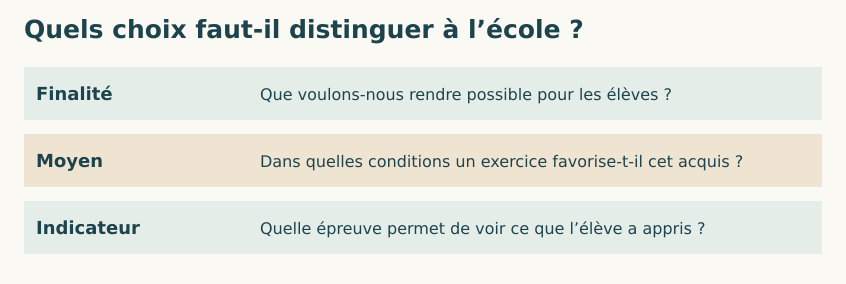
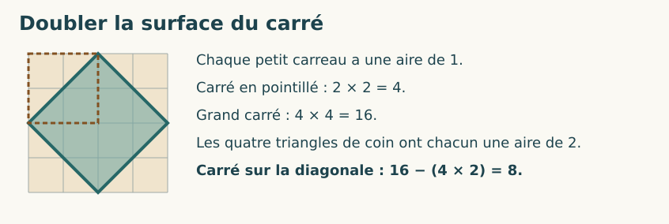

# ENS Paris-Saclay · Cycle master mathématiques — Français et culture générale 2022 · Corrigé brut

*Corrigé rédigé par IA, non officiel. Signalez toute erreur.*

**Rédaction** · GPT-6.2 Astra Ultra · vitesse non renseignée

**Autocontrôle** · GPT-6.2 Astra Ultra · vitesse non renseignée

## Sujet et consignes

Vendredi 18 mars 2022, de 8 h 30 à 11 h 30. La garde porte les mentions « École normale supérieure Paris Saclay », « CCM Mathématiques » et « Français ». Les calculatrices sont interdites. Durée de l’épreuve, trois heures. Les modalités du concours confirment p. 2 le statut d’écrit d’admission et son horaire.

François de Smet et Laurent Vercueil, « À l’école de l’homme neuronal », Esprit, septembre 2018, p. 14–17. Le titre placé en tête de l’extrait porte un point d’interrogation. Texte p. 2–4 du PDF et sept notes p. 4.

Résumer le texte en 250 mots (avec une marge de tolérance de + ou – 10%). Le nombre exact de mots utilisés sera indiqué en fin de résumé. La marge autorisée va de 225 à 275 mots.

Sous forme d’un développement construit, commenter, au choix, l’une des deux réflexions suivantes des auteurs : Chaque exercice vaut dix points. Un seul développement était demandé. Les deux choix figurent dans cette correction. Le rapport écrit rappelle le strict intervalle de mots, la nécessité de reformuler, de définir les notions et d’exploiter des exemples. Il cite Socrate comme figure pédagogique.

## 1. Résumé

La composition du conseil scientifique constitué pour éclairer les choix éducatifs du ministère français suscite une inquiétude qui dépasse les rivalités entre disciplines. Le cerveau deviendrait la mesure de toute réalité humaine et la recherche servirait des intérêts économiques. Cette suspicion risque pourtant de priver les élèves de savoirs utiles.

Les images du cerveau ont frappé le public, parfois abusé par des localisations simplistes. Mais le livre de Changeux avait rencontré son public avant leur diffusion. Les sciences cognitives avaient leur propre histoire avant leur rapprochement avec les neurosciences, dont les outils dépassent ces images. Puis Damasio a rendu sensible la participation du corps aux opérations mentales. Les interactions entre patrimoine biologique et milieu dessinent désormais un sujet en transformation.

Le conseil cherche des méthodes efficaces pour améliorer des résultats scolaires mesurés par des évaluations. Définir les capacités souhaitables pour les adultes de demain demande un choix politique. Éclairer les moyens de lire ou de compter relève en revanche de recherches dont pourraient bénéficier les enfants les plus exposés aux inégalités.

Enseigner demande certes des compétences pratiques. La médecine montre cependant comment un art tire parti de preuves. Une science travaille sur des modèles simplifiés pour apporter une information limitée. Ses résultats restent ouverts aux critiques et aux révisions. Cette fragilité assumée lui donne une force que les convictions idéologiques ignorent. Elle ne rend pas toutes les opinions équivalentes. Dans un monde exposé aux fausses nouvelles, soupçonner systématiquement les chercheurs compromettrait les bénéfices de cette méthode pour les moins favorisés.

**250 mots.**

## 2a. Un sujet libre peut-il être un sujet incarné ?

« Cette réinscription du corps au sein même du cerveau privait l’homme du fruit de sa modernité libératrice »

Il arrive qu’une même demande nous semble intolérable au soir d’une longue journée et raisonnable après le repos. Reconnaître que notre jugement dépend d’un corps suffit-il à retirer à ce jugement tout caractère libre ? Les auteurs décrivent l’effet intellectuel produit par le livre de Damasio. Le sujet moderne se pensait capable de se donner ses raisons. Il se découvre dépendant de dispositions organiques et d’une histoire. Demandons-nous quelle liberté cette découverte menace, et quel autre sens pourrait prendre l’autonomie une fois cette dépendance comprise.

L’image classique d’un sujet qui juge par lui-même soutient un geste d’émancipation. Si une autorité civile ou religieuse prétend décider à ma place, je peux lui demander pourquoi je devrais croire ce qu’elle affirme. Le doute de Descartes radicalise cette capacité en soumettant même les croyances familières à l’examen. Dans le passage du sujet, l’« homoncule » figure une interprétation forte de cet héritage, celle d’un décideur intérieur qui pourrait examiner les messages du corps comme des nouvelles envoyées du dehors. Si l’émotion et la perception corporelle participent à la décision elle-même, où loger ce décideur ? La difficulté est réelle pour une liberté définie comme la faculté de commencer à vouloir indépendamment de toutes ses conditions.

Toutefois, la modernité philosophique connaissait déjà les résistances que l’expérience oppose à cette image. Dans la sixième des *Méditations métaphysiques*, Descartes remarque que la douleur, la faim et la soif nous font éprouver une union étroite avec notre corps. Un pilote observe qu’une pièce de son navire est endommagée. Celui qui se blesse éprouve la blessure. En reprenant la comparaison, on comprend pourquoi le titre *L’Erreur de Descartes* a pu frapper les esprits sans autoriser à réduire tout Descartes au fantasme d’un esprit spectateur. Une explication physiologique de ce que ressent un sujet lui enlève un privilège d’exception dans la nature. Elle laisse ouverte la question de ce qu’il peut apprendre à faire de ce qu’il ressent.

Songeons à une élève que l’anxiété interrompt devant un problème qu’elle a su résoudre la veille. La déclarer incapable en raison de sa réaction présente transforme une observation située en verdict sur son avenir. Répéter une situation dans des conditions moins oppressantes, apprendre à demander une reformulation et retrouver le fil d’une preuve peuvent modifier sa capacité de juger. Le texte insiste sur la rencontre des dispositions biologiques et du milieu dans un sujet en devenir. Connaître ces conditions ouvre ici des possibilités d’action à l’élève comme à son professeur. Cet exemple ne démontre aucune méthode pédagogique universelle. Il montre ce que changerait, dans notre manière de la traiter, la confusion entre une condition actuelle et une destinée.

Une explication des causes et une justification adressée à quelqu’un répondent d’ailleurs à deux demandes distinctes. L’élève peut apprendre que sa tension a contribué à une réponse précipitée. Elle doit encore vérifier si les étapes de sa démonstration s’enchaînent. La première explication lui donne prise sur les conditions d’un prochain essai. La seconde lui permet de reconnaître elle-même la raison d’une conclusion. La liberté qu’une science du corps met en difficulté est l’indépendance absolue d’un décideur sans histoire. La liberté comme pouvoir de reprendre son jugement avec les autres et de transformer certaines de ses conditions demeure une conquête, jusque dans une conception pleinement incarnée du sujet.

## 2b. À quelles conditions un enseignant peut-il s’appuyer sur une science ?

« l’enseignement, […] est ‘un art et non une science’ »

Deux élèves donnent la même réponse fausse. L’un a mal lu une donnée, l’autre a tiré une conséquence qui ne suit pas. Appliquer une correction identique parce que le résultat écrit est identique risque de laisser leur difficulté entière. Zarka, que citent les auteurs, appelle « art » cette attention pratique à ce que demande une situation. Doit-on en conclure qu’une connaissance scientifique des apprentissages est étrangère à l’acte d’enseigner ? Pour répondre, distinguons l’invention du geste approprié, l’enquête sur ses effets et le choix des fins auxquelles il doit servir.

L’art du maître apparaît dans la manière d’obtenir de l’élève un indice sur ce qu’il comprend vraiment. Dans le *Ménon* de Platon, Socrate demande à un jeune interlocuteur de doubler la surface d’un carré. Le garçon propose d’en doubler le côté. Sur la figure, un carré de deux unités de côté a une aire de quatre. Celui de quatre unités de côté en aurait seize, alors qu’il fallait en obtenir huit. Socrate ne se contente pas de déclarer la première réponse fausse. Il conduit le garçon, en dessinant et en l’interrogeant, à apercevoir la difficulté. La diagonale du carré initial fournira le côté recherché. Le détour par l’erreur est ici un choix pédagogique qui s’ajuste à la réponse reçue. Un maître pourrait posséder parfaitement le théorème et manquer pourtant l’occasion de faire penser son élève.

Ce dialogue philosophique rend sensible une possibilité. Il ne suffit pas à mesurer l’effet d’une pratique pour tous les élèves. Un enseignant qui compare deux exercices peut prendre les progrès du groupe le plus avancé pour ceux de la méthode qu’il a reçue. Une enquête attentive aux acquis de départ, aux conditions de passation et aux résultats ultérieurs aide à éprouver ce jugement. Les auteurs rapprochent enseignement et médecine. Le diagnostic d’une personne singulière demande une appréciation située, tandis que la comparaison méthodique de plusieurs cas peut corriger des habitudes inefficaces. En classe également, savoir qu’un procédé a souvent aidé donne une raison de l’essayer dans des conditions voisines. Il faudra encore écouter cet élève et suivre ce que l’essai a changé pour lui.

Reste à préciser ce qu’on appelle un progrès. Un exercice chronométré peut mesurer la rapidité avec laquelle une réponse est trouvée. La capacité d’expliquer une erreur ou de transférer la démarche à une nouvelle figure demande une autre épreuve. Choisir ce que l’école entend former engage la collectivité, les enseignants et les élèves. Les auteurs craignent que la critique des usages politiques d’une mesure n’entraîne le rejet des connaissances éprouvées dont les élèves les plus défavorisés pourraient bénéficier. On peut demander dans quelles conditions une évaluation a produit un résultat, et simultanément contester que ce résultat suffise à définir une bonne éducation.

L’enseignement est un art en ce qu’une personne doit juger quelle intervention convient ici et en répondre devant d’autres. Cette responsabilité appelle les connaissances qui permettent d’en éprouver les effets. Elle exige aussi qu’on puisse discuter publiquement les fins proposées. La science perdrait son rôle en prescrivant seule ces fins. L’art du professeur perdrait le sien en prenant l’assurance de bien faire pour la preuve que l’élève a appris.

[Sujet officiel](https://ens-paris-saclay.fr/sites/default/files/CONCOURS/ANNALES_2C/2C_Math/2022_Sujet_Ecrit_2A_Maths_Francais.pdf) · [Rapport écrit du jury](https://ens-paris-saclay.fr/sites/default/files/CONCOURS/ANNALES_2C/2C_Math/2022_Rapport_Ecrit_2A_Math%C3%A9matiques_Fran%C3%A7ais.pdf) · [Modalités du concours](https://ens-paris-saclay.fr/sites/default/files/CONCOURS/Reglements/2022_Modalites_d_inscription_CCM.pdf#page=2)
