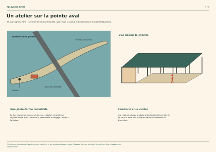
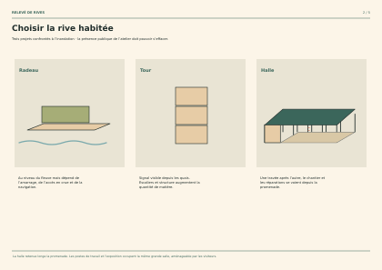
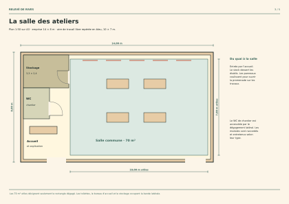
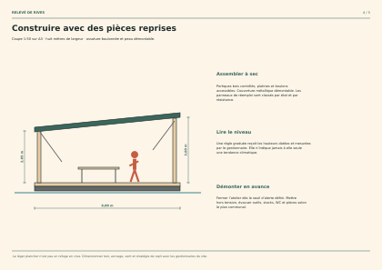
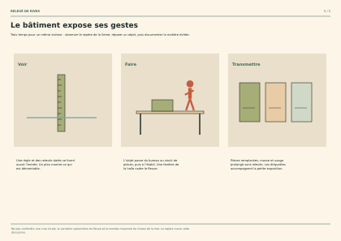

# ENS Paris-Saclay — Design d'espace 2022 · Corrigé brut

*Corrigé rédigé par IA, non officiel.*

**Rédaction** · GPT-6.2 Astra Ultra · vitesse non renseignée

Relevé de rives est une halle de réparation et d’exposition sur la pointe aval de l’île aux Cygnes. Sa salle commune de 70 m² laisse visibles le fleuve et les gestes de réemploi. Les 5 planches numérotées et anonymes sont au format 420 × 297 mm. Les échelles indiquées valent pour une planche seule imprimée sur A3 à 100 %.

## Planche 1 — Un atelier sur la pointe aval

L’ancienne digue de Grenelle est longue de 890 m mais sa promenade ne mesure souvent que 11 m de largeur. La plate-forme aval atteint environ 30 m sur 170 m. Le pavillon prend place sur cette partie élargie, après le pont de Grenelle et en retrait des berges. Le passage vers la réplique de la Statue de la Liberté demeure continu. Depuis l’allée, on voit les personnes réparer des objets sous un toit et un repère de hauteur met cet usage en relation avec les eaux du fleuve. Aucune cote hydrologique précise n’est déduite des photographies. L’orientation et la position définitives relèvent d’un relevé avec les services de la Ville.

## Planche 2 — Choisir la rive habitée

Le radeau rendrait la montée des eaux immédiatement sensible. Il suppose un accès mobile et un ancrage fluvial complexes. La tour donnerait un signal urbain mais multiplierait les niveaux et compliquerait la manipulation des objets. Le choix d’une halle réversible permet d’apporter les pièces en chariot depuis l’accès autorisé, de déposer une travée en cas de réparation et de tenir un atelier au même niveau que l’exposition. Le rapport du jury insiste sur la relation entre forme et insularité. Ici, le niveau de l’eau, la promenade et la logistique contrainte par les ponts déterminent l’architecture.

## Planche 3 — La salle des ateliers

L’emprise extérieure fait 14 × 8 = 112 m². Le rectangle libre mesuré dans la salle est de 10 × 7 = 70 m² et dépasse les 60 m² demandés. Les établis mobiles au centre passent en périphérie pour une exposition, avec panneaux suspendus le long des portiques. La bande de services regroupe la réception et le poste d’explication, un stock d’environ 7,9 m² et des toilettes de chantier implantées près du dégagement. Le choix d’une cabine accessible et l’ouverture de sa porte sont à étudier sur le matériel réellement loué. Les stocks lourds sont proches de l’accès de manutention. Des panneaux coulissants permettent de voir le travail depuis l’allée et de fermer pendant l’inoccupation.

## Planche 4 — Construire avec des pièces reprises

Les portiques franchissent la largeur pour libérer la salle. Un plancher sec sur appuis démontables répartit les charges. La couverture inclinée dirige l’eau vers le côté technique. L’éclairage de travail utilise l’alimentation prévue dans le sujet après étude électrique et accord de l’exploitant. Utiliser des pièces de réemploi demande un inventaire, une inspection de leur état et le calcul des assemblages. Un numéro de travée lie chaque élément à son ordre de démontage. Le plan de prévention des crues désigne un responsable, des seuils de fermeture validés par la Ville, un accès pour les engins et un stockage en zone sûre. Évacuer avant perte de l’accès par le pont. Ni les poteaux ni le plancher ne sont dimensionnés ici pour une submersion.

## Planche 5 — Le bâtiment expose ses gestes

Le parcours commence par des niveaux que le gestionnaire aura effectivement datés et que le public peut comparer. Il distingue crues de la Seine et montée du niveau marin qui menace certains atolls. Il conduit ensuite à un atelier de réparation de petit mobilier ou d’objets. Les visiteurs inscrivent les pièces utilisées et la durée d’usage que la réparation cherche à prolonger. L’exposition peut montrer les assemblages de la halle elle-même, la quantité réellement réemployée et les limites rencontrées au montage. La construction communique ainsi par ce que le visiteur peut mesurer, réparer et restituer à sa propre échelle.

[Énoncé et annexes du concours](https://ens-paris-saclay.fr/sites/default/files/CONCOURS/ANNALES_1C/1C_Design/2022_Sujet_Ecrit_DESIGN_Projet_Espace.pdf) · [Rapport du jury](https://ens-paris-saclay.fr/sites/default/files/CONCOURS/ANNALES_1C/1C_Design/2022_Rapport_Oral_DESIGN_Projet.pdf)
