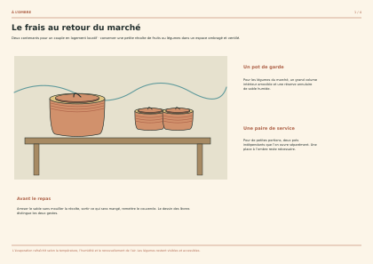
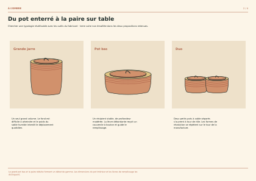
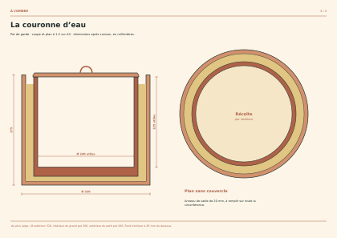
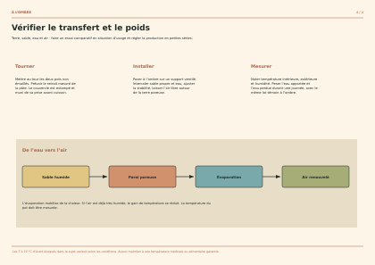

# ENS Paris-Saclay — Design de produit 2022 · Corrigé brut

*Corrigé rédigé par IA, non officiel.*

**Rédaction** · GPT-6.2 Astra Ultra · vitesse non renseignée

À l’ombre propose deux formats de Zeer pot en terre cuite non émaillée pour un couple qui achète régulièrement des fruits et légumes. La manufacture peut produire leurs volumes de révolution au tour. Les 4 planches numérotées et anonymes sont au format 420 × 297 mm. Les échelles indiquées valent pour une planche seule imprimée sur A3 à 100 %.

## Planche 1 — Le frais au retour du marché

Le couple fait un marché deux fois par semaine et dispose d’une loggia ombragée ou d’un coin bien ventilé. Il souhaite garder des fruits et des légumes entiers à portée de main. Le pot de garde reçoit la récolte. Les petits pots de service peuvent accueillir des portions séparées dans la même logique d’évaporation, avec moins d’ouverture de la grande réserve. Les récipients restent posés pleins. Ils se vident et se démontent pour les déplacer. Une alcôve fermée, un balcon en soleil direct ou une pièce durablement humide dégradent l’évaporation. La gamme ne prétend pas assurer la chaîne du froid des denrées qui l’exigent.

## Planche 2 — Du pot enterré à la paire sur table

La jarre profonde concentre la récolte mais oblige à déplacer les légumes du haut pour atteindre ceux du fond. Un modèle parallélépipédique par plaques s’intègre à une tablette mais demande des raccords fiables contre les fuites après cuisson. La recherche retient deux volumes tournés complémentaires. Le pot bas principal sépare le fond de légumes de l’anneau d’humidification. Dans le duo, chaque pot extérieur fait environ 180 mm de diamètre pour 140 mm de hauteur avec un contenant utile de 120 mm sur 90 mm, soit environ un litre par unité avant jeu et arrondis. Deux éléments autonomes permettent de choisir la quantité à garder fraîche. L’unité mobile est légère à vide. Chaque petit pot plein doit être soulevé par sa base, après contrôle de sa masse.

## Planche 3 — La couronne d’eau

Le pot extérieur de diamètre 320 mm a une paroi de 10 mm, soit 300 mm à l’intérieur. Le pot intérieur de diamètre extérieur 260 mm laisse donc (300 − 260)/2 = 20 mm de sable radial. Son diamètre utile de 240 mm et sa hauteur utile de 225 mm correspondent à environ 10,2 L cylindriques avant les arrondis. La base du récipient intérieur repose sur le lit de sable. Une petite différence de niveau entre les lèvres permet de verser l’eau dans l’anneau sans arroser les légumes. Un couvercle estampé poreux et mouillé couvre le contenant intérieur. On peut ajouter un linge propre et humide sur l’ensemble selon le climat. Le croquis simplifie en cylindre les flancs réellement légèrement dépouillés, à valider avec la manufacture.

## Planche 4 — Vérifier le transfert et le poids

La surface annulaire de sable vaut environ π(0,150² − 0,130²) = 0,0176 m². Sur environ 0,23 m de hauteur, cela représente 4,0 L, avant le sable du fond. Une masse volumique apparente de 1,5 kg/L à sec, donnée comme hypothèse, donne déjà 6 kg de sable. Terre cuite, eau et récolte augmentent nettement la masse. La grande pièce reste donc en place et ses deux pots sont transportés vides, séparément. Le fabricant reproduit le tournage avec un gabarit de profil et règle le retrait de cuisson sur une éprouvette. Il mesure la porosité et l’ajustement du couvercle sur le premier lot. En usage, l’évaporation absorbe de l’énergie et l’air emporte la vapeur. Un air sec et en mouvement augmente l’effet. L’écart de 7 à 10 °C cité par l’énoncé dépend des conditions. Comparer avec des légumes témoins dans le même local, contrôler la consommation d’eau, le nettoyage et les signes d’altération avant diffusion.

[Énoncé et annexes du concours](https://ens-paris-saclay.fr/sites/default/files/CONCOURS/ANNALES_1C/1C_Design/2022_Sujet_Ecrit_DESIGN_Projet_Produit.pdf) · [Rapport du jury](https://ens-paris-saclay.fr/sites/default/files/CONCOURS/ANNALES_1C/1C_Design/2022_Rapport_Oral_DESIGN_Projet.pdf)
