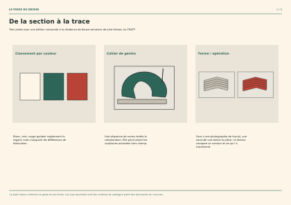
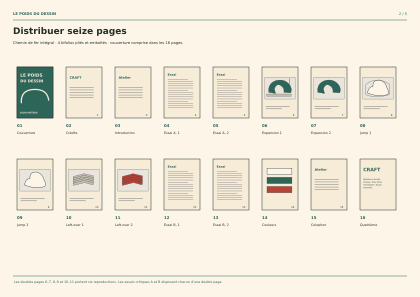
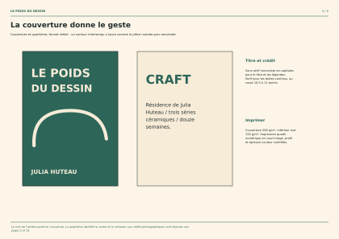
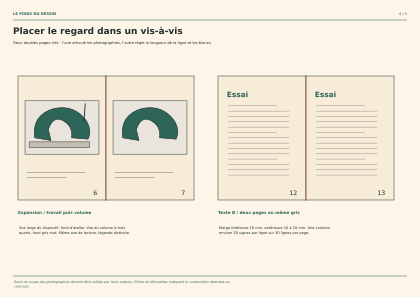
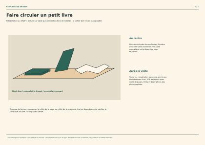

# ENS Paris-Saclay — Design graphique 2022 · Corrigé guidé

*Corrigé rédigé par IA, non officiel.*

**Rédaction** · GPT-6.2 Astra Ultra · vitesse non renseignée

Le poids du dessin est un projet de catalogue de la résidence de Julia Huteau au CRAFT. Six reproductions schématisées et deux essais critiques accompagnent Expansion, Jump et Left-over. Les 5 planches numérotées et anonymes sont au format 420 × 297 mm. Les échelles indiquées valent pour une planche seule imprimée sur A3 à 100 %.

## Planche 1 — De la section à la trace

> [!INDICATION]
> À partir de chaque série, nommer la matière, une opération et la trace qui demeure lisible après cuisson.

L’annexe présente Expansion, obtenue par estampage de grès et déformation, Jump, en porcelaine moulée et coulée, et Left-over, issue d’un profil extrudé. Trois couleurs visées, blanc franc, vert anglais et rouge Ferrari, traversent la recherche. Le classement par couleur aurait créé un nuancier, et le journal d’atelier risquait d’éclipser les pièces. Le poids du dessin associe six reproductions schématisées en trois diptyques. La double page confronte préparation et résultat. Elle laisse voir les mains, les mousses, le moule ou la filière quand ils aident à comprendre l’échelle. Le titre retient le nom **Julia Huteau**, tel que donné en tête du sujet et dans le rapport du jury.

## Planche 2 — Distribuer seize pages

> [!INDICATION]
> Compter les pages en incluant toutes les faces, puis plier une feuille miniature pour vérifier les vis-à-vis.

Format fermé A5, 148 × 210 mm après légère coupe, sens de lecture vertical. Quatre bifolios suffisent pour seize pages, reliés par deux agrafes au pli. Les pages 2 et 3 présentent crédits, résidence et parti des prises de vue. Les pages 4 et 5 donnent le premier texte de 3 000 signes. Les pages 6 à 11 comportent six reproductions, deux pour chaque série. Les pages 12 et 13 accueillent le second texte de 3 000 signes. La page 14 compare les recherches de couleurs avec leurs légendes. Le colophon est page 15 et la quatrième page 16. Les trois couples de photographies se voient chacun d’un seul regard, sans faire passer un détail important au fond du pli.

## Planche 3 — La couverture donne le geste

> [!INDICATION]
> Éloigner la maquette, vérifier si le nom et le titre sont encore distinguables, puis lire le résumé au dos.

La première de couverture pose le titre en deux lignes avec un contour interrompu. Le nom de l’artiste reste lisible lorsque le livre repose sur une table. La quatrième donne l’institution, les douze semaines de résidence et le sujet. Les titres et légendes utilisent une sans sérif humaniste comme Source Sans 3, les textes courants une sérif comme Source Serif 4. En contexte d’épreuve, le dessin indique les familles, proportions et niveaux de lecture. La couverture de 200 g/m² reste souple au pli. Un papier intérieur mat de 120 g/m² offre un compromis entre opacité et ouverture du cahier. Une impression numérique quadrichromique convient au petit tirage. Un bon à tirer comparé aux pièces sous éclairage neutre est indispensable pour les émaux.

## Planche 4 — Placer le regard dans un vis-à-vis

> [!INDICATION]
> Composer un paragraphe réel puis mesurer la largeur utile. Environ 30 lignes de 50 signes par page donnent 3 000 signes sur deux pages.

Pour les trois vues de travail, conserver assez de contexte pour comprendre le dispositif collectif. Pour les trois formes finies, choisir fond gris mat, lumière latérale diffuse et vue de trois quarts, en réservant une vue de profil plus frontale à la sortie d’extrusion. Le photographe indique série, étape, angle et crédit. Les légendes restent en dehors de l’image. La grille comprend une colonne de texte par page, interligne d’environ 13 points, pagination en pied et marges intérieures confortables. Les deux textes originaux qui suivent comptent chacun 3 000 signes, espaces comprises, en comptant chaque séparation de paragraphes comme une espace.

### Essai A — Qui tient la forme ?

Une petite forme extrudée rencontre une table. Ce pourrait être un accident en fin de travail. Julia Huteau en fait, pour Expansion, le début d’une sculpture dont la taille oblige plusieurs personnes à s’accorder. Il ne suffit pas d’agrandir la silhouette. Il faut trouver comment obtenir, dans une autre masse de terre, la différence entre un bord préservé et celui qui recevra le choc. Quelque chose passe de la première table à l’atelier du CRAFT, mais ce passage change les conditions mêmes du geste.

Les plaques de grès sont appliquées sur le plâtre. La fermeture du moule produit une enveloppe qui ne peut ensuite être retournée comme un petit objet. La mousse devient un berceau. Dans son récit, l’artiste distribue les actions entre Gaëtan, Violette, Fred et elle-même. L’un engage la bascule, une autre accompagne, quelqu’un tracte et reçoit. Le poids interdit de confondre ces places. Chercher le geste de l’artiste dans cette scène revient à suivre aussi les mains qui prennent le relais. Le moment du contact avec le sol dépend de la préparation collective de la roulade.

Une première photographie large peut rendre son encombrement à la forme. Une vue serrée, prise après coup, rendrait sensible l’écart entre les extrémités. À elle seule, elle risquerait de faire passer la déformation pour une fantaisie ajoutée au dessin. À l’inverse, ne regarder que le dispositif de manipulation ferait perdre ce que la terre a enregistré. Tourner la page ménage entre ces vues une brève interruption. Pendant ce temps, le lecteur peut mesurer l’écart entre ce qu’il attendait de la géométrie et ce qui s’est produit.

Jump déplace la question. Un modèle en terre brute précède le moulage et le coulage de la porcelaine. Le mot « filer » prend ici un sens technique précis, donné par l’artiste à propos de l’estompage des coutures. L’attention portée à cette opération est presque inverse de celle que demande la marque du choc dans Expansion. Une surface se construit en faisant disparaître une ligne de raccord. Ailleurs, il s’agissait de laisser paraître la rencontre avec le sol. Les deux opérations supposent de décider quelle trace pourra encore être lue.

La balançoire qui aide à retourner et à évider une forme de grande taille déplace encore la frontière entre moyen et résultat. Sur la photographie du travail, elle marque une échelle de corps et une temporalité. Sur la photographie de la pièce, elle a matériellement disparu. Le livre peut les tenir côte à côte sans simuler une continuité de film. En regardant tour à tour la suspension, l’arrondi et le poids que l’on imagine, on reconstitue une partie du travail. Cette lecture ne demande pas de connaître par avance le métier de céramiste. Elle commence lorsque l’on se demande ce qui a dû tenir un volume aussi longtemps que la terre en avait besoin. C’est la raison de conserver une marge autour de la pièce. Sur cette petite étendue de papier, l’œil retrouve le temps de revenir de la couture effacée au bord que le choc a déplacé.

### Essai B — Ce qui sort du dessin

Dans Left-over, le dessin se présente d’abord comme une question posée à une section. Quelle forme pourra sortir d’une filière et se retrouver, légèrement déplacée, dans une sculpture de plus grande dimension ? L’artiste décrit un profil entre le sapin et la navette spatiale, puis compte ses bourrelets. Ce détail de vocabulaire importe. On peut nommer presque gaiement ce qui doit ensuite se décrire avec la précision d’un dessin destiné à une machine. Entre les deux moments, l’idée n’a pas encore trouvé la manière dont elle pèsera.

Le tracé sur papier passe au dessin numérique. Au fablab, la fraiseuse sert à fabriquer la tête de sortie de l’extrudeuse. L’outil produit alors une longueur de terre dont la section répète celle qui a été préparée. Rien n’oblige pourtant les fragments obtenus à se ressembler une fois posés. Une coupe, une flexion, la rencontre avec un support déplacent le rapport du profil à l’espace. Dans l’image de la masse striée, la répétition se lit comme un rythme. Dans celle du fragment rouge isolé, le regard revient vers l’extrémité et l’angle que prend la pièce.

L’abondance de tirages évoquée par Julia Huteau n’efface donc pas les choix. Elle les conduit ailleurs. Le dessin initial demande d’anticiper ce qui peut s’emboîter. Les surfaces nouvelles donnent ensuite autant d’occasions de décider d’une orientation, d’un déplacement ou d’une couleur. L’atelier met à disposition des outils, des interlocuteurs et du temps. Le jeu dont parle l’artiste prend appui sur cette organisation très concrète. On en perdrait le sens en opposant simplement un premier temps rigoureux à une fin spontanée.

Le blanc franc, le vert anglais et le rouge Ferrari nomment des objectifs de recherche. Ils ne forment pas un nuancier qu’il suffirait de recopier chez soi. Les émaux de départ viennent de l’atelier de l’artiste et de celui du CRAFT. Les essais demandent des notes communes et des comparaisons après cuisson. L’annexe évoque également l’observation de l’application des couleurs de troisième feu. Entre une couleur nommée et une surface céramique regardée dans un lieu, des étapes se sont accumulées. Le papier imprimé les traverse encore d’une autre façon, avec son grain, le blanc de son fond et la lumière de la salle.

La double page réserve donc une petite place au bord du fond photographique. Cette limite rappelle que l’image est un point de vue construit. La légende distingue le nom de la série, l’étape représentée et le détail que l’on observe. Une photographie frontale décrit le profil, une vue oblique fait lire la longueur et l’ombre au sol. Ce que la répétition conserve et ce que la main infléchit deviennent alors comparables. Quand le lecteur referme le livre, les trois séries ne se résument plus à trois silhouettes. Elles gardent aussi la mémoire de trois façons de faire passer un dessin dans la matière. En ouvrant à nouveau la couverture, on peut repartir d’une seule extrémité, la scruter de page en page et éprouver la cohérence de la série.

## Planche 5 — Faire circuler un petit livre

> [!INDICATION]
> Suivre le livre depuis sa table de présentation jusqu’à une bibliothèque. À quelle étape faut-il l’ouvrir, le poser ou le lire seul ?

Sur place, une table présente un livre ouvert sur une série et une couverture dressée qui annonce l’artiste. Un autre exemplaire permet la manipulation assise, à proximité des sculptures et sous un éclairage sans reflet. Le centre pourrait produire un court tirage après devis, en réserver des exemplaires aux bibliothèques d’art et distribuer un PDF de lecture dans l’ordre des pages. Celui-ci reprend titres balisés, légendes et descriptions des images, avec accord des ayants droit. Aucune information de prix, de licence ni de tirage réel n’est fournie dans le sujet. Un prototype papier sert à vérifier l’ouverture, la transparence du papier et les contrastes avec des lecteurs avant impression.

[Énoncé et annexes du concours](https://ens-paris-saclay.fr/sites/default/files/CONCOURS/ANNALES_1C/1C_Design/2022_Sujet_Ecrit_DESIGN_Projet_Graphique.pdf) · [Rapport du jury](https://ens-paris-saclay.fr/sites/default/files/CONCOURS/ANNALES_1C/1C_Design/2022_Rapport_Oral_DESIGN_Projet.pdf)
