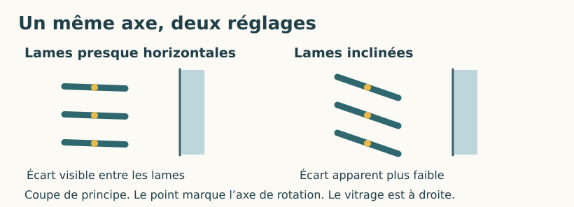
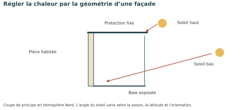

# Vivre avec le climat, à quel prix ? · Paris-Saclay 2022 · Corrigé guidé

*Corrigé rédigé par IA, non officiel. Signalez toute erreur.*

**Rédaction** · GPT-6.2 Astra Ultra · vitesse non renseignée

**Révision (tour 1)** · GPT-6.2 Astra Ultra · vitesse non renseignée · 26 novembre 2026

## Sujet de la session

Design : de l’objet à l’environnement (1900-1980).

« [Les] inventions mécaniques portent la gloire de l'orgueil humain et nous donnent le sentiment de maîtriser les éléments [...]. Nous pensons avoir "liquidé" le problème de la chaleur avec la climatisation artificielle et les glacières, comme si cette solution était possible partout et pour tous les budgets. Ce triste malentendu entre notre mode de vie et notre environnement nous fait vivre dans notre propre monde comme des "personnes déplacées", incapables de trouver le vrai bonheur car, au lieu d'être en paix avec le monde qui nous entoure, nos arbres, nos nuages, nos déserts et nos mers, nous avons choisi de combattre la nature comme notre plus féroce ennemi et de considérer toute solution non naturelle comme une victoire. »

Paul-Jacques Grillo, What is design?, 1960, Chicago: P. Theobald & Company.

Vous analyserez et discuterez cet extrait du designer Paul-Jacques Grillo en vous appuyant sur votre connaissance du programme et selon un propos argumenté.

[Feuillet officiel, p. 1](https://ens-paris-saclay.fr/sites/default/files/CONCOURS/ANNALES_1C/1C_Design/2022_Sujet_Ecrit_DESIGN_Histoire_de_lArt.pdf#page=1) · [Rapport écrit du jury](https://ens-paris-saclay.fr/sites/default/files/CONCOURS/ANNALES_1C/1C_Design/2022_Rapport_Ecrit_DESIGN_histoire%20de%20l%27art.pdf)

## Introduction

> [!INDICATION]
> Séparer le constat sur les coûts de la promesse de « vrai bonheur ». Ont-ils besoin des mêmes preuves ?

L’air frais sort de la grille au moment où l’on tourne le bouton. La facilité du geste cache la centrale, les conduites, l’entretien et la facture. En 1960, Paul-Jacques Grillo critique l’orgueil d’une maîtrise technique qui fait croire que le problème de la chaleur est partout résolu. Il avance aussi une proposition plus hardie. L’artifice nous ferait vivre comme des étrangers à notre propre milieu et nous priverait du bonheur. La première affirmation demande de comparer des équipements et des budgets. La seconde suppose que le designer sache quelle relation à la nature convient à chacun. À quelles conditions la critique d’un confort standardisé peut-elle guider un projet sans prescrire une autre manière universelle de bien vivre ?

Le conditionnement industriel du début du siècle, les façades de Rio puis le village de Gourna permettent de suivre le déplacement du problème. Régler l’humidité pour un travail précis, filtrer le soleil et organiser une manière d’habiter engagent des responsabilités différentes.

## I. Les équipements mécaniques répondent aussi à des besoins dont la seule orientation du bâti ne s’acquitte pas

> [!INDICATION]
> Mettre à l’épreuve le jugement de Grillo à partir d’un milieu et d’une fonction déterminés.

En 1902, Willis Carrier met au point à Brooklyn un système de conditionnement de l’air pour l’imprimerie Sackett-Wilhelms. L’humidité compromet la stabilité dimensionnelle du papier et le repérage des couleurs au fil des passages sous presse. Le problème de départ porte donc sur un procédé industriel, pas sur la fantaisie d’habitants qui auraient perdu le goût des saisons. Le contrôle de l’air ouvre un champ de productions que l’orientation d’une fenêtre ne permet pas à elle seule de garantir. Le dispositif donne cependant à un réglage mécanique, à un approvisionnement en énergie et à une maintenance spécialisée une importance nouvelle.

Lorsqu’une enveloppe vitrée est ensuite dessinée comme si le conditionnement mécanique allait de soi, l’outil ponctuel peut devenir la condition de l’habitabilité. L’exemple ultérieur d’une façade de bureaux à Rio permettra de demander quelles dépenses initiales, puis récurrentes, l’architecture transfère à ses occupants. Le « budget » de Grillo comprend ces frais et l’inégale capacité à y faire face. La même technique qui protège certaines personnes dans une forte chaleur peut fragiliser celles qui vivent dans un bâtiment inutilisable lorsque le système s’arrête. Aucune morale générale de l’« artificiel » ne dispense de cette enquête.

## II. Une façade peut travailler avec un climat tout en mobilisant une industrie

> [!INDICATION]
> Comparer les deux rayons du schéma et montrer ce que le dessinateur doit savoir du site.

Les écrans pare-soleil de l’ancien ministère de l’Éducation et de la Santé à Rio de Janeiro, réalisé dans les années 1930 et 1940 par une équipe brésilienne dirigée par Lúcio Costa, donnent au dispositif de façade une fonction climatique visible. Des lames mobiles protègent la grande façade nord en modifiant l’exposition directe. La surface du bâtiment n’est plus une simple frontière entre la pièce et l’extérieur. Elle filtre selon l’orientation, l’heure et les conditions de lumière. Le projet moderne, qui mobilise le béton armé, le verre et la conception en équipe, se montre ici capable d’apprendre du soleil local. La distinction entre « mécanique » et « naturel » ne suffit donc déjà plus à classer les réalisations.

Sur cette façade nord, l’unité répétée est un ensemble de lames horizontales que l’on peut incliner. Le mouvement change l’écart apparent entre les lames et la part du ciel que l’on aperçoit à travers elles. La grille conserve sa régularité même si ses bandes claires et sombres varient d’une travée à l’autre. Le dispositif associe ainsi deux caractères que Grillo pousse à séparer. Une pièce fabriquée en série donne à un bâtiment d’une échelle monumentale le moyen de tenir compte, localement, du mouvement du soleil.

La seconde figure propose un autre cas de principe, volontairement situé dans l’hémisphère Nord. Un débord fixe au-dessus d’une baie bien orientée peut couper un rayon haut d’été et laisser pénétrer un rayon plus bas en hiver. Le dessin explique pourquoi un débord de même profondeur ne rend pas partout le même service. À Rio, il faut tenir compte d’une autre latitude et d’un autre hémisphère. La protection mobile du ministère n’est pas le simple décalque du schéma. Dans les deux cas, la médiation construite change la quantité de lumière et de chaleur reçue plutôt que d’effacer l’existence du climat.

## III. Quel habitant décide de ce que signifie être chez soi ?

> [!INDICATION]
> Opposer à l’idéal de l’architecte un désaccord historique documenté sur les façons d’habiter.

Dans le projet de Nouveau Gourna, commencé en Égypte dans les années 1940, Hassan Fathy expérimente, pour un village de relogement, la brique de terre et la construction de voûtes en s’appuyant sur des savoir-faire régionaux. Le choix concerne à la fois le coût des matériaux et le rapport du bâti au climat. La terre et l’épaisseur du mur interviennent dans les variations de température intérieure. Mais reconstruire des formes locales ne garantit ni que les personnes souhaitent quitter l’ancien village, ni que les nouveaux logements conviennent à leurs activités. Le projet est resté partiellement réalisé. Son devenir interdit de lire la proximité des techniques vernaculaires comme une preuve immédiate du bonheur de ses destinataires.

Grillo parle de « personnes déplacées » pour caractériser un malaise de civilisation. L’exemple égyptien donne une portée concrète et politique à la formule. Qui choisit le lieu, les métiers possibles et les modalités du déplacement ? Un logement coûteux en énergie peut imposer son mode de vie, mais une administration persuadée d’avoir retrouvé une façon naturellement juste d’habiter peut en faire autant. L’ambition du designer trouve une limite dans les compétences et les souhaits des habitants, qui peuvent à leur tour modifier une construction et préférer des matériaux qu’un architecte juge trop modernes.

En 1973, l’ouvrage de Fathy paraît en anglais sous le titre *Architecture for the Poor*. Cette date de publication permet de distinguer le chantier des années 1940 de sa transmission ultérieure comme modèle. C’est aussi le moment du premier choc pétrolier. Le prix d’une énergie dont dépend l’usage ordinaire d’un bâtiment devient alors une question collective particulièrement visible. Ce rapprochement situe la critique de 1960 dans le temps. Il ne permet pas de prêter à Grillo la connaissance d’une crise postérieure à son texte.

## Conclusion

Grillo fait apparaître le coût caché d’une architecture dont la mécanique compenserait partout l’indifférence au site. L’histoire du climat construit montre néanmoins que l’artifice peut prolonger des conditions locales et que le contrôle de l’air peut répondre à un besoin précis. À l’orgueil de maîtriser les éléments, il serait dangereux de substituer la certitude de connaître le bonheur d’autrui. Un projet de confort se discute à partir du lieu, des dépenses et du pouvoir donné aux habitants.

## Vérifier sa démonstration

Sur la figure, allonger le débord, puis déplacer le dessin vers un autre climat. Dans le premier cas, expliquer le gain d’ombre et le risque de perdre de la lumière. Dans le second, préciser quelles informations manquent. On retrouve ainsi dans l’exemple lui-même la limite d’une recette universelle.

[IPHAN, dossier technique des brise-soleil de Rio, p. 1–2](https://www.gov.br/iphan/pt-br/acesso-a-informacao/licitacoes-e-contratos/iphan-rj_uasg-343006/licitacoes/concorrencia/2025/arquivos-2/5.pdf)
