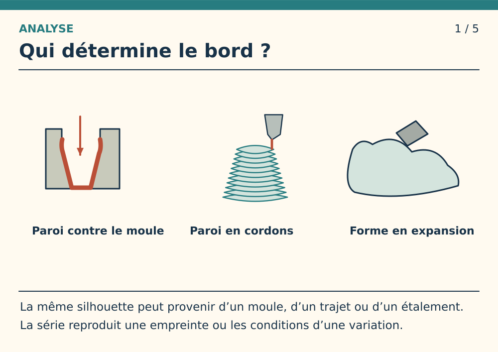
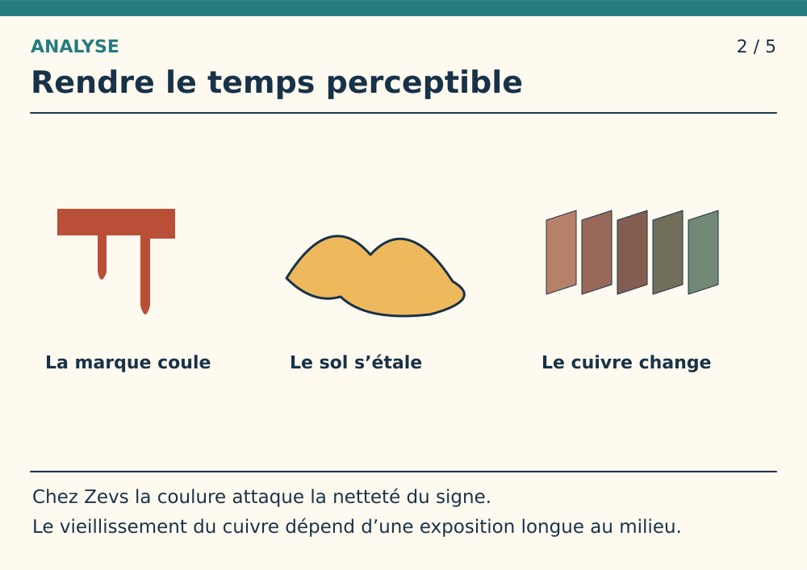
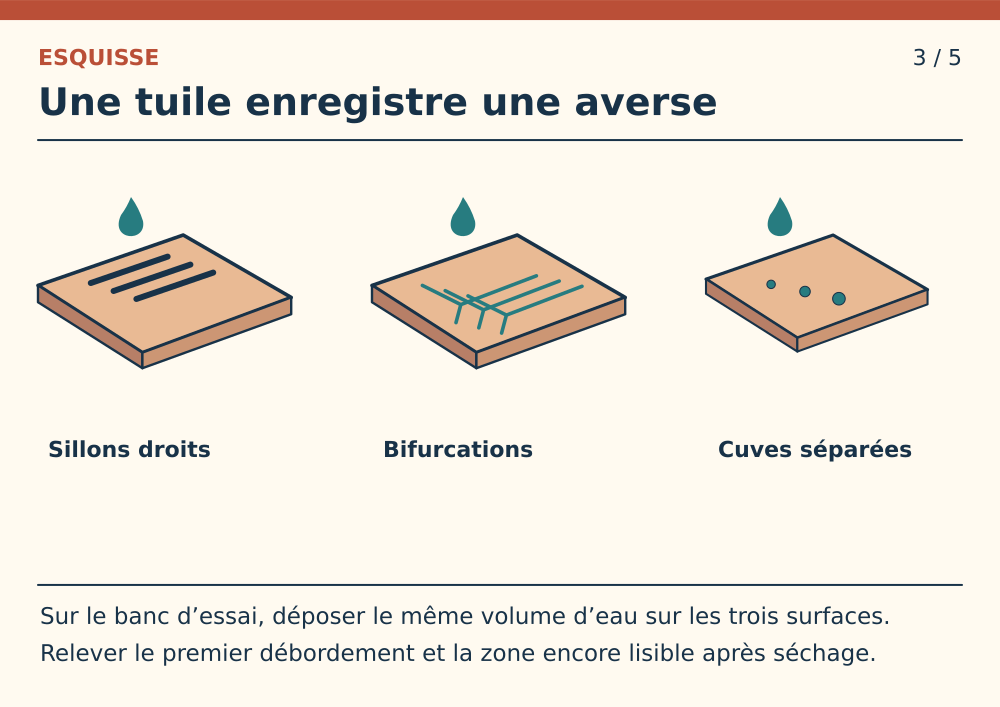
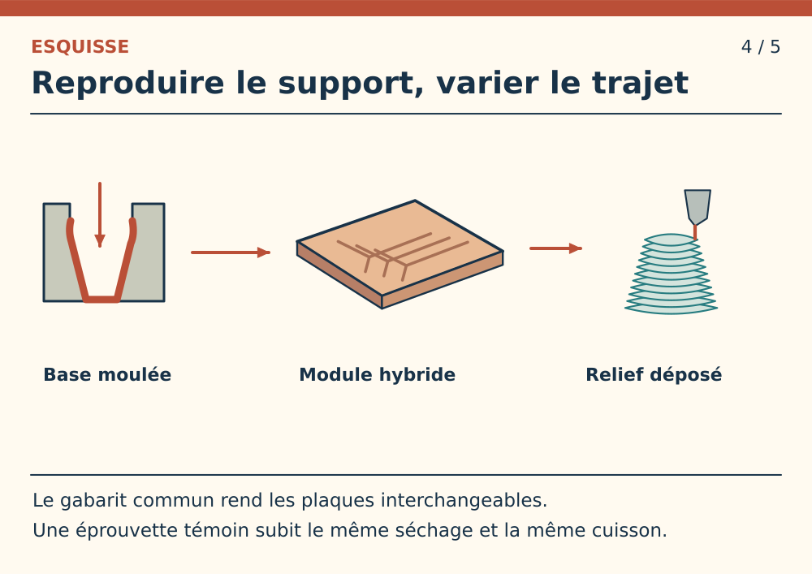
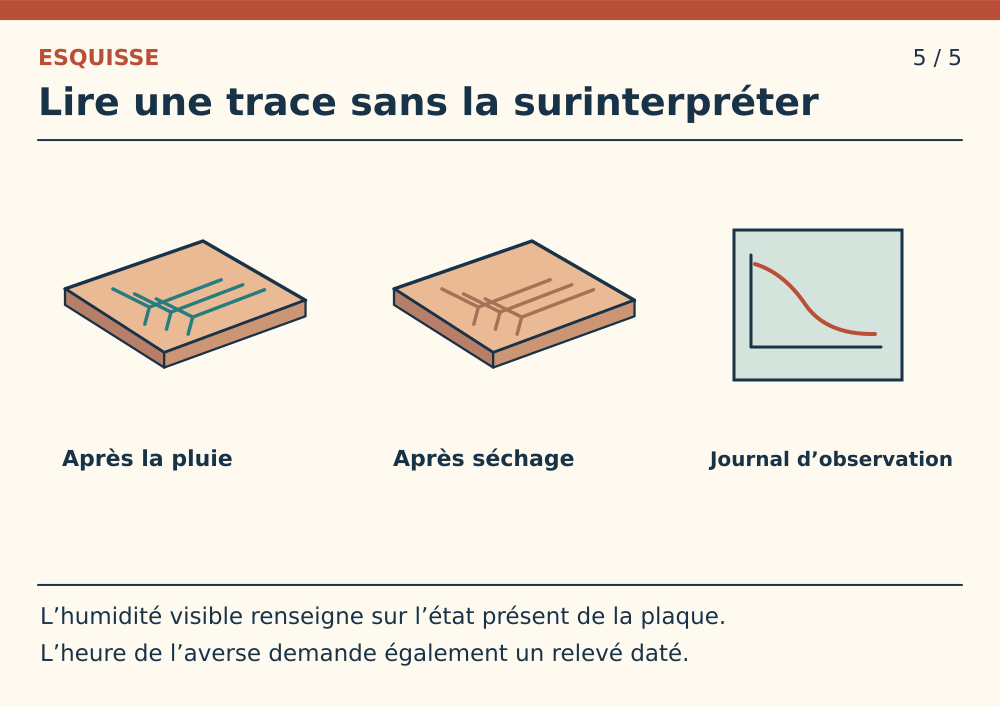

# ENS Paris-Saclay · Design 2022 · Techno-design · Corrigé brut

*Corrigé rédigé par IA, non officiel.*

**Lecture du rapport du jury** · GPT-6.2 Astra Ultra · vitesse non renseignée

**Rédaction** · GPT-6.2 Astra Ultra · vitesse non renseignée

**Révision (tour 1)** · GPT-6.2 Astra Ultra · vitesse non renseignée

## Donner un bord à ce qui coule

Le sujet laisse choisir son intitulé. Je compare des matières dont le contour se décide pendant la fabrication ou évolue après la pose. Une série de plaques amovibles met ensuite la pluie à la portée du regard dans le jardin d’une bibliothèque.

### Analyse 1 · Qui détermine le bord ?

En 2018, l’atelier Guarrigues coule une barbotine teintée dans un moule en plâtre. L’eau migre dans le plâtre poreux. Une paroi se forme à son contact, puis le surplus de barbotine est évacué. Le coût du modèle et du moule se répartit sur la série. Chez Alterfact, *One of a Kind* (2014), la buse dépose la pâte par trajets superposés, sans imposer une même empreinte à chaque vase. Une variation de trajet se programme, une déformation avant séchage se constate. Dans l’*Expansion* de César (1989), la matière déborde visuellement le petit pot de lait en inox. L’œuvre signée et numérotée articule l’apparence du débordement et l’édition. On ne peut dater ses opérations de fabrication à partir de la seule photographie.

### Analyse 2 · Rendre le temps perceptible

La peinture qui descend sous le logo chez Zevs prolonge un signe de marque et semble le dissoudre. Chez Gaetano Pesce, l’exposition milanaise *Altra bellezza* (2016) montre le travail à la résine et un sol dont le bord répond à la coulée. Ce changement d’échelle engage le déplacement du visiteur. Sur l’extension de bibliothèque de JKMM à Seinäjoki (2012), le cuivre forme toiture et bardage. Sa transformation de surface se poursuit après la pose. L’ordre des teintes dessiné ici représente une hypothèse de comparaison, pas une chronologie mesurée sur ce bâtiment. Comme le cadran solaire traduit une position en ombre, une surface de bibliothèque pourrait donner à lire un événement local, la dernière averse, sans l’écran d’une station météo.

### Esquisse 3 · Une tuile enregistre une averse

Première piste. À l’entrée d’une bibliothèque, un présentoir à hauteur de lecture accueille trois plaques de terre cuite. Une eau recueillie sur le dessus du présentoir s’écoule par gravité sur leurs reliefs. Sur maquette, je compare des trajets droits, ramifiés et interrompus en maintenant pente, dimensions et dose d’eau identiques. Une terre mouillée se fonce, un creux retient temporairement une flaque. Ces deux effets doivent être notés séparément. La proposition conserve l’eau dans un bac sans débordement sur le cheminement.

### Esquisse 4 · Reproduire le support, varier le trajet

Deuxième piste. Une base répétée dans un moule fixe l’emprise compatible avec le présentoir. Un cordon déposé en surface permet à un atelier de quartier de faire varier le motif. Une série en terre non cuite sert d’abord à repérer le gauchissement au séchage. Les éprouvettes destinées à l’extérieur seraient ensuite cuites et contrôlées par l’atelier de céramique. Je compare adhérence du relief, retrait et facilité de nettoyage. Si le cordon se détache, je retiens la gravure dans la base encore tendre, qui réduit le nombre d’interfaces.

### Esquisse 5 · Lire une trace sans la surinterpréter

Troisième piste. À côté des plaques, un carnet tenu par les agents consigne l’heure, la pluie observée, le vent et l’état des sillons. Deux plaques identiques placées l’une au soleil, l’autre à l’ombre peuvent sécher à des vitesses différentes. Le dispositif donne donc à voir un changement local plutôt qu’une mesure directe des millimètres tombés. Un atelier avec les lecteurs met à l’épreuve deux légendes, « la dernière pluie » puis « observé humide à… ». On conserve celle qui suscite les interprétations les mieux étayées, tout en laissant la surface libre de toute inscription permanente.

## Sources

Les sept pages du fascicule documentent les six références de la session. Le sujet et le rapport de techno-design sont disponibles.

[Fascicule officiel](https://ens-paris-saclay.fr/sites/default/files/CONCOURS/ANNALES_1C/1C_Design/2022_Sujet_Ecrit_DESIGN_Techno_Design.pdf) · [Rapport du jury](https://ens-paris-saclay.fr/sites/default/files/CONCOURS/ANNALES_1C/1C_Design/2022_Rapport_Ecrit_DESIGN_Techno_Design.pdf)
