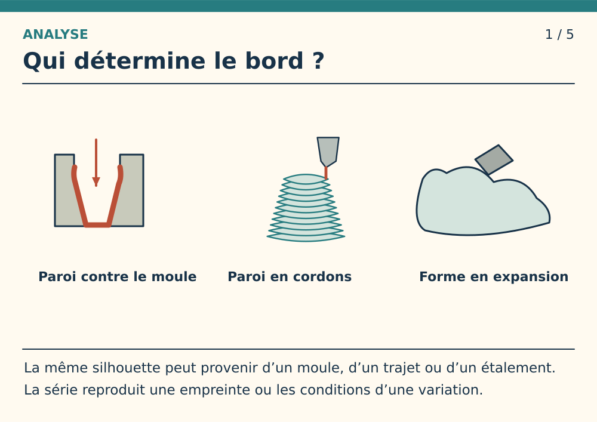
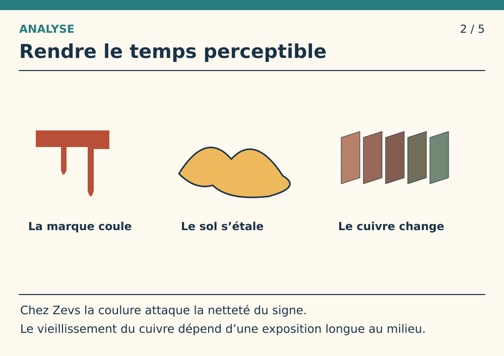
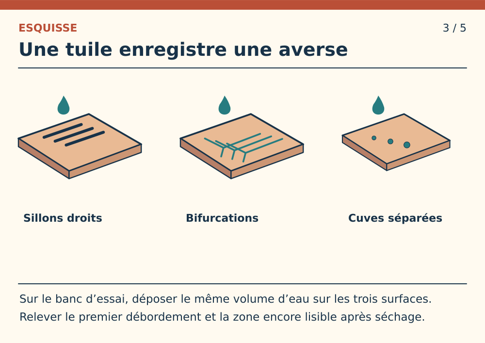
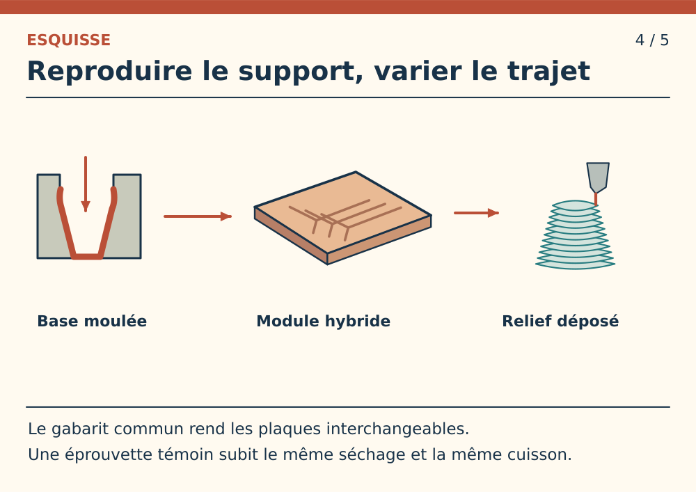
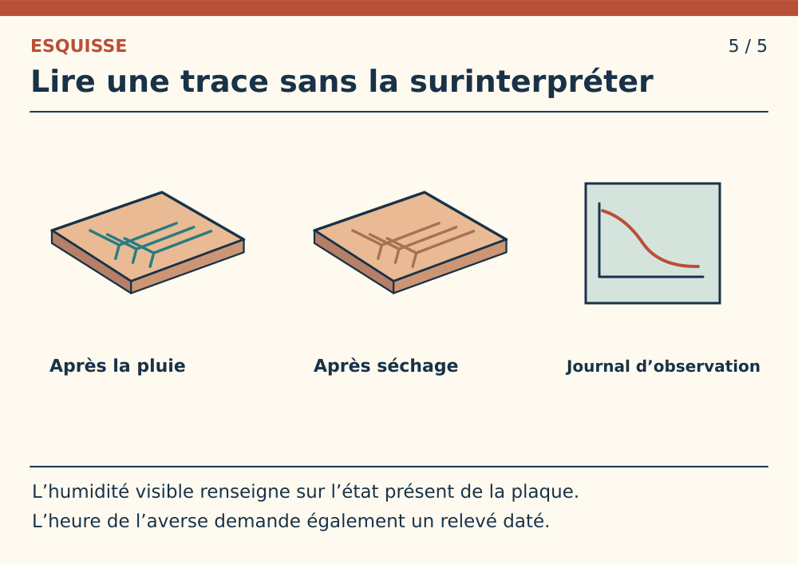

# ENS Paris-Saclay · Design 2022 · Techno-design · Corrigé guidé

*Corrigé rédigé par IA, non officiel.*

**Lecture du rapport du jury** · GPT-6.2 Astra Ultra · vitesse non renseignée

**Rédaction** · GPT-6.2 Astra Ultra · vitesse non renseignée

**Révision (tour 1)** · GPT-6.2 Astra Ultra · vitesse non renseignée

## Donner un bord à ce qui coule

Quatre A3 d’analyse et six d’esquisse sont les maxima annoncés. La proposition en utilise deux et trois. Selon le rapport, la comparaison entre moule et extrusion gagne à montrer deux schémas explicites et leurs conséquences économiques. On cherchera ensuite les conditions qui rendraient la recherche utile, et les observations qui obligeraient à la modifier.

### Analyse 1 · Qui détermine le bord ?

Comparer deux productions de porcelaine en isolant la source du contour. À quel moment apparaît le vide intérieur ?

Pour le pichet, représenter le moule en coupe et montrer le retrait de l’excès de pâte. Pour le vase imprimé, tracer le déplacement de la buse, le cordon et le passage supérieur. Un défaut de paroi et un choix de silhouette ne se départagent qu’en confrontant essai, réglage et résultat.

### Analyse 2 · Rendre le temps perceptible

Les trois traces ont-elles le même auteur et la même durée ?

Pour la peinture, relier le geste à la critique du signe. Pour le sol, placer un pied près de la limite de coulée. Pour le métal, distinguer son état lors de la pose et les transformations ultérieures. Cette différence de temps motive la recherche d’une trace réversible de pluie.

### Esquisse 3 · Une tuile enregistre une averse

Comment observer séparément la migration dans la pâte et l’écoulement à la surface ?

Sur un échantillon sec puis sur un échantillon déjà mouillé, déposer une même dose d’eau. Dessiner la limite de la flaque et celle de la zone foncée deux fois à intervalle fixé. Refaire le relevé après séchage complet.

### Esquisse 4 · Reproduire le support, varier le trajet

Quelle partie vaut la peine de répéter, quelle partie gagne à rester variable ?

Relever l’encombrement avant et après séchage. Glisser ensuite chaque plaque dans le même support et passer une brosse souple dans les sillons. Une variation graphique qui empêche l’entretien rendrait la série rapidement illisible.

### Esquisse 5 · Lire une trace sans la surinterpréter

Comment détecter une lecture séduisante mais injustifiée ?

Présenter aux lecteurs les deux plaques de même fabrication dans des expositions différentes, puis demander ce qu’ils peuvent conclure de la pluie. Ajouter le carnet et refaire la question. L’essai porte aussi sur le conseil éditorial qui accompagne l’objet.

## Sources

Les sept pages du fascicule documentent les six références de la session. Le sujet et le rapport de techno-design sont disponibles.

[Fascicule officiel](https://ens-paris-saclay.fr/sites/default/files/CONCOURS/ANNALES_1C/1C_Design/2022_Sujet_Ecrit_DESIGN_Techno_Design.pdf) · [Rapport du jury](https://ens-paris-saclay.fr/sites/default/files/CONCOURS/ANNALES_1C/1C_Design/2022_Rapport_Ecrit_DESIGN_Techno_Design.pdf)
