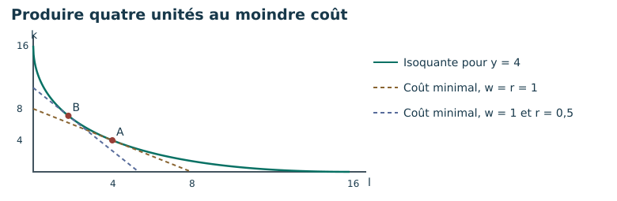
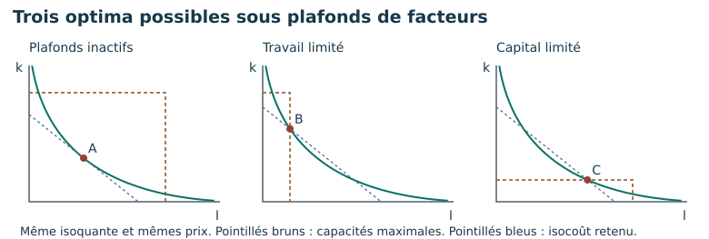
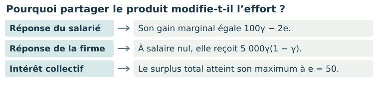
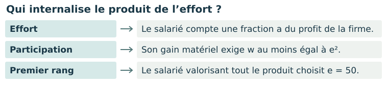

# ENS Paris-Saclay · Analyse économique générale 2022 — Corrigé brut

*Corrigé rédigé par IA, non officiel. Signalez toute erreur.*

**Rédaction** · GPT-6.2 Astra Ultra · vitesse non renseignée

Épreuve d’analyse économique générale des concours ENS Paris-Saclay, ENSAI civil et INSEE attaché statisticien (D2_1), mardi 19 avril 2022, quatre heures, calculatrice interdite. Aucun rapport distinct de cet écrit n’est identifié sur la page d’annales de la session. [Sujet officiel](https://ens-paris-saclay.fr/sites/default/files/CONCOURS/ANNALES_1C/1C_D2_1/2022_Sujet_Ecrit_Economie_Gestion_Option1_AEG.pdf)

## Première partie. Technologie et profit

**1.1. Rendements d’échelle.** Pour $a>1$, $y(al,ak)=\sqrt a\,y(l,k)<a y(l,k)$ lorsque la production est positive. La technologie est homogène de degré $1/2$ et présente des rendements décroissants.

**1.2. Demandes de facteurs.** Aux prix strictement positifs $p,w,r$, maximiser $p(\sqrt l+\sqrt k)-wl-rk$. Les deux conditions intérieures sont $p/(2\sqrt l)=w$ et $p/(2\sqrt k)=r$. La stricte concavité et les produits marginaux initiaux infinis assurent l’unicité. Ainsi $l=p^2/(4w^2)$ et $k=p^2/(4r^2)$.

**1.3. Substitution.** À production fixée, une diminution du travail peut être compensée par une augmentation du capital le long de l’isoquante. Les demandes conditionnelles de 1.8 ont des effets croisés positifs. Aux prix du produit et des facteurs donnés, la demande de travail de 1.2 est en revanche indépendante du prix du capital. Les demandes brutes croisées sont nulles ici.

**1.4. Élasticité.** Le taux marginal de substitution technique en valeur absolue est $MP_l/MP_k=\sqrt{k/l}=w/r$. Sur l’isoquante, $k/l=(w/r)^2$. L’élasticité $d\ln(k/l)/d\ln(w/r)$ est donc égale à 2.

**1.5. Offre.** En remplaçant les facteurs optimaux, $y(p,w,r)=p(1/w+1/r)/2$.

**1.6. Profit.** Les recettes valent $p^2(1/w+1/r)/2$ et le coût total de facteurs vaut la moitié de ce montant. Il reste $\pi(p,w,r)=p^2(1/w+1/r)/4$.

**1.7. Lemme de Hotelling.** $\partial\pi/\partial p=p(1/w+1/r)/2=y$. De même, $-\partial\pi/\partial w=p^2/(4w^2)=l$ et $-\partial\pi/\partial r=p^2/(4r^2)=k$. Le signe négatif vient du fait qu’une hausse du prix d’un facteur réduit le profit optimisé.

## Première partie. Coût minimal et capacités

**1.8. Demandes conditionnelles.** Fixons $Y=\bar y>0$. Posons $a=\sqrt l$, $b=\sqrt k$. La contrainte est saturée, soit $a+b=Y$, et le coût à minimiser vaut $wa^2+r(Y-a)^2$. La dérivée $2(w+r)a-2rY$ s’annule en $a_0=rY/(w+r)$, $b_0=wY/(w+r)$. Les demandes conditionnelles sont donc $l^c=r^2Y^2/(w+r)^2$ et $k^c=w^2Y^2/(w+r)^2$.

**1.9. Coût.** En reportant les demandes dans le coût, $C(w,r,Y)=wrY^2/(w+r)$.

**1.10. Tangence.** Dans le plan $(l,k)$, l’isoquante pertinente est $k=(Y-\sqrt l)^2$ pour $0\le l\le Y^2$. Une droite d’isocoût a pour pente $-w/r$. La moins coûteuse qui atteigne l’isoquante la touche à la combinaison calculée en 1.8. En A sur la figure 1, $w=r=1$, $Y=4$ et $l=k=4$.

**1.11. Capital meilleur marché.** Si $r$ baisse à $w,Y$ donnés, la valeur absolue de la pente d’isocoût augmente. La nouvelle tangence B se trouve plus haut et à gauche. Dans l’exemple $r=1/2$, $l=16/9$, $k=64/9$ et le coût baisse de 8 à $16/3$.

**1.12. Lemme de Shephard.** $\partial C/\partial w=r^2Y^2/(w+r)^2=l^c$ et $\partial C/\partial r=w^2Y^2/(w+r)^2=k^c$. Ces dérivées fixent $Y$ et mesurent l’effet à la marge d’une hausse du prix sur la dépense minimale.

**1.13. Relation d’échelle.** Doubler $Y$ multiplie le coût par quatre, car il faut multiplier les deux facteurs optimaux par quatre pour doubler la production. Le coût moyen $wrY/(w+r)$ est croissant et le coût marginal est son double. Ces propriétés traduisent les rendements décroissants.

**1.14.1. Capacités.** Les plafonds $l\le\bar l$, $k\le\bar k$ délimitent un rectangle. Le sujet suppose $Y<\sqrt{\bar l}+\sqrt{\bar k}$, donc la cible est faisable. La partie de l’isoquante qui reste dans ce rectangle est un arc. La tangence libre peut y appartenir. Sinon l’optimum se trouve à l’une de ses extrémités.

**1.14.2. Conditions exactes.** Dans la variable $a$, l’intervalle admissible est $[L,H]$ avec $L=\max(0,Y-\sqrt{\bar k})$ et $H=\min(Y,\sqrt{\bar l})$. Le coût réduit est strictement convexe. Sa minimisatrice est donc $a^*=\min(H,\max(L,a_0))$.

- Si $L\le a_0\le H$, garder $l=a_0^2$, $k=(Y-a_0)^2$.
- Si $a_0>H$, le travail libre demandé excède le plafond. Prendre $l=\bar l$, $k=(Y-\sqrt{\bar l})^2$.
- Si $a_0<L$, le capital libre demandé excède le plafond. Prendre $k=\bar k$, $l=(Y-\sqrt{\bar k})^2$.

L’égalité avec une borne donne la même solution par les deux expressions adjacentes. Sous la faisabilité stricte du sujet, les deux plafonds ne peuvent lier simultanément sur l’isoquante efficace.

## Seconde partie. Effort caché et partage du profit

**1.1.1. Choix de l’employé.** À salaire donné, $G=w-e^2$ est maximal sur $e\ge0$ en $e^*=0$.

**1.1.2. Choix de la firme.** Anticipant cette réponse, la firme obtient $-w$ et propose $w^*=0$. L’employé est alors indifférent entre accepter et son option extérieure de gain nul. Le refus conduit aux mêmes gains nuls.

**1.1.3. Inefficacité.** Le total des gains matériels est $S(e)=100e-e^2$, indépendant du salaire. Il peut atteindre 2 500 en $e=50$, alors qu’il vaut zéro à l’équilibre. La séparation entre le bénéficiaire du produit et celui qui supporte l’effort explique ce résultat.

**1.2.1. Optimum avec effort imposable.** Pour un effort fixé, le salaire le plus faible compatible avec $G\ge0$ est $w=e^2$. La firme maximise alors $100e-e^2$, d’où $\hat e=50$, $\hat w=2\,500$, $G=0$ et $\pi=2\,500$.

**1.2.2. Applicabilité.** Ce couple satisfait la participation, mais le salaire forfaitaire n’incite pas le salarié à fournir l’effort prévu. Une fois le salaire acquis, il choisirait zéro. Cet optimum sert de référence lorsque l’effort est vérifiable ou que l’on peut construire une incitation équivalente.

**1.3.1 à 1.3.3. Part de 40 %.** $G=0{,}6w+40e-e^2$ est maximal en $e=20$. La firme garde $0{,}6(2\,000-w)$ et choisit $w=0$, compatible avec la participation puisque $G=400$. Son gain est $1\,200$. Les deux agents y gagnent relativement au salaire forfaitaire. Le surplus $1\,600$ reste inférieur à $2\,500$.

**1.3.4. Part de 20 %.** Le salarié maximise $0{,}8w+20e-e^2$ et choisit $e=10$. Le salaire fixe est encore nul, $G=100$, $\pi=800$. En passant de 20 à 40 %, la firme retient une fraction plus faible d’un produit suffisamment accru pour que son profit augmente.

**1.3.5.1. Taux quelconque.** Pour $0\le\gamma\le1$, $G=(1-\gamma)w+100\gamma e-e^2$ et $\pi=(1-\gamma)(100e-w)$.

**1.3.5.2. Réaction.** Le gain marginal du salarié est $100\gamma-2e$, d’où $e=50\gamma$.

**1.3.5.3. Contrat préféré par la firme.** Pour $\gamma<1$, le salaire fixe optimal est zéro. La participation est satisfaite puisque $G=2\,500\gamma^2$. La firme maximise $5\,000\gamma(1-\gamma)$, parabole dont le sommet est $\gamma=1/2$. À l’équilibre $e=25$, $w=0$, $G=625$ et $\pi=1\,250$. Au bord $\gamma=1$, la firme reçoit zéro, ce qui l’écarte.

**1.3.5.4. Pareto.** Le total des gains matériels vaut $1\,875$ au lieu de $2\,500$. Si l’on peut imposer l’effort et répartir le surplus, choisir $e=50$, $w=3\,500$ dans le contrat forfaitaire donnerait $G=1\,000$ et $\pi=1\,500$, deux améliorations strictes. L’équilibre d’intéressement n’est donc pas un optimum de Pareto de l’ensemble technologiquement réalisable. La restriction aux contrats linéaires avec salaire de base non négatif explique la difficulté d’implémentation.

**1.3.5.5. Salaire de 3 000.** L’effort conditionnel reste $50\gamma$. En revanche le profit à maximiser devient $(1-\gamma)(5\,000\gamma-3\,000)$. Sa dérivée vaut $8\,000-10\,000\gamma$, donc $\gamma=0{,}8$ et $e=40$. Les gains sont $\pi=200$ et $G=2\,200$. Si l’obligation porte sur un minimum de 3 000, le minimum est choisi à l’optimum. Le salaire change le taux préféré par la firme même si, à taux donné, il ne modifie pas directement l’effort.

## Seconde partie. Préférences altruistes

**1.4.1.1. Effort.** Le salarié donne un poids $1/2$ au profit de la firme et maximise $G+\pi/2=w/2+50e-e^2$. Il choisit $e=25$, quel que soit le salaire.

**1.4.1.2. Salaire.** La contrainte imprimée porte toujours sur le gain matériel $G=w-e^2\ge0$. La firme maximise $2\,500-w$ et verse donc $w=625$. Les gains matériels sont $G=0$ et $\pi=1\,875$. Son objectif altruiste donne au salarié une utilité de $937{,}5$, malgré son gain matériel nul.

**1.4.1.3. Variation du poids.** Pour un poids $a\ge0$ sur le profit dans l’objectif du salarié, l’effort devient $50a$. Avec emploi et participation matérielle, le salaire minimal est $2\,500a^2$ et le profit $5\,000a-2\,500a^2$. Lorsque $a$ monte de $1/2$ vers 1, l’effort et le surplus augmentent. Le surplus atteint son maximum en $a=1$. Au-delà, la surproduction d’effort fait décroître le surplus. Si $a>2$, même le salaire minimal rendrait l’embauche déficitaire pour une firme libre de proposer ou de refuser le contrat.

**1.4.2. Altruisme réciproque de poids $1/2$.** La réponse du salarié demeure $e=25$. À effort anticipé, l’objectif de la firme vaut $\pi+G/2=100e-w/2-e^2/2$. Sa pente en salaire vaut $-1/2$. Elle choisit le minimum compatible avec la participation, soit $w=625$. Les gains matériels restent $0$ et $1\,875$. Les deux objectifs altruistes valent respectivement $937{,}5$ pour le salarié et $1\,875$ pour la firme. Attribuer un poids au salarié ne suffit pas ici à modifier le salaire choisi.

**1.4.3. Possibilité du premier rang.** Avec les deux poids égaux à $1/2$, l’effort demeure inférieur à 50. En revanche, si les deux agents accordent au gain d’autrui un poids unitaire, leurs objectifs coïncident avec $G+\pi=100e-e^2$. L’effort choisi vaut alors 50 et le surplus est maximal. Un salaire entre 2 500 et 5 000 assure les deux participations matérielles. Plus généralement, dans ce modèle séquentiel, c’est le poids du profit dans la décision de l’employé qui détermine directement son effort. Avec un poids de 1 et une firme qui valorise le gain du salarié à un poids inférieur à 1, le salaire minimal de 2 500 met également en œuvre le premier rang. L’existence d’intentions altruistes ne suffit donc pas à déterminer l’efficacité sans en préciser l’intensité.

