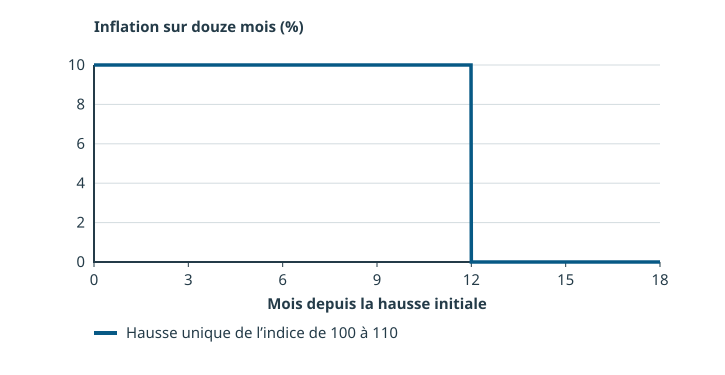

# ENS Paris-Saclay · Analyse monétaire et/ou politique économique 2022 — corrigé guidé

*Corrigé rédigé par IA, non officiel. Signalez toute erreur.*

**Rédaction** · GPT-6.2 Astra Ultra · vitesse non renseignée · 26 novembre 2026

## Sujet

L’inflation est-elle réellement de retour ?

## Construire la copie

### Fixer la date du diagnostic

Au 22 avril 2022, le chiffre définitif de mars pour la zone euro et le CPI américain de mars sont connus. Les décisions monétaires et les statistiques des mois suivants ne le sont pas. Classez sur le brouillon ce que vous pouvez observer (indice, énergie, ruptures d’approvisionnement) et ce qu’il faut encore tester (répétition des hausses, répercussion dans les salaires, révision des anticipations longues).

### Éviter deux erreurs de mesure

Si l’indice mensuel passe de 100 à 110 puis reste fixe, que vaut l’inflation mensuelle au deuxième mois ? Zéro. Que vaut encore le glissement annuel six mois après le saut ? 10 %, si l’indice était à 100 le même mois l’année précédente. Revenez au graphique pour expliquer pourquoi un glissement élevé ne prouve pas, isolément, une hausse qui se répète à chaque mois.

### Comparer deux économies sans conclure trop tôt

Chiffrez la hausse observée aux États-Unis et en zone euro avec le mois, l’indice et le dénominateur. Cherchez ensuite les mécanismes : ampleur de la relance, exposition à l’énergie importée, tensions du marché du travail et institutions de fixation des salaires. Une différence d’indice ou de panier interdit de lire leur écart brut comme l’effet causal d’une seule politique.

## Dissertation

En mars 2022, les prix à la consommation en zone euro dépassent de 7,4 % leur niveau de mars 2021 selon l’indice harmonisé définitif publié en avril. Aux États-Unis, le CPI des consommateurs urbains affiche 8,5 % sur douze mois. Pour des économies dont les banques centrales avaient passé une partie des années 2010 à combattre une inflation trop faible, la rupture est manifeste. Pourtant, le mot « retour » peut désigner deux phénomènes : une forte hausse mesurée aujourd’hui ou le rétablissement d’un régime où les prix augmentent largement et durablement. L’inflation désigne la progression du niveau général des prix ; la hausse relative de l’énergie peut y contribuer sans que tous les prix évoluent au même rythme. À la date du concours, le 22 avril 2022, quels indices permettent de distinguer un renchérissement exceptionnel d’une dynamique susceptible de s’entretenir ?

### I. Une inflation observée bien réelle peut provenir d’un choc qui ne se répète pas

Un indice de prix à la consommation agrège des variations individuelles en fonction du poids des biens et services dans les dépenses. Une hausse du gaz ou du carburant élève donc directement l’indice, même si le prix de plusieurs services reste stable. La perte de pouvoir d’achat est réelle pour un ménage à revenu nominal donné, et particulièrement sensible lorsque l’énergie absorbe une forte part du budget. L’indice n’est toutefois pas le coût exact de la vie de chaque ménage ; un ménage rural chauffé au fioul et dépendant de l’automobile ne subit pas le même choc qu’un ménage dont les déplacements sont réduits.

La comparaison sur douze mois peut prolonger l’apparence statistique d’un phénomène ponctuel. Si l’indice reste longtemps à 100, saute à 110 et ne bouge plus, il affiche encore une hausse annuelle de 10 % pendant douze observations consécutives. Puis le glissement annuel revient à zéro car la comparaison se fait désormais avec 110. Le ménage ne retrouve pas pour autant ses anciens prix. En 2021–2022, comparer un prix de l’énergie à son niveau comprimé par les confinements peut donc amplifier le taux annuel ; des variations mensuelles répétées ou une diffusion de la hausse à beaucoup de postes fournissent des indices de persistance plus solides.

L’inflation sous-jacente exclut certaines composantes volatiles ou administrées selon les conventions statistiques. La comparer à l’indice d’ensemble permet de rechercher une propagation, sans faire disparaître les dépenses énergétiques réellement payées. Il faut également séparer hausse intérieure et hausse importée : une économie importatrice d’énergie peut s’appauvrir relativement à ses fournisseurs si elle doit exporter davantage pour acheter le même volume d’énergie. Aucun simple ajustement nominal des revenus ne restaure automatiquement le revenu réel national ainsi perdu.

### II. Les déséquilibres apparus depuis la pandémie combinent demande et offre

La pandémie a interrompu des chaînes de production et réduit les achats de certains services, tandis que la demande s’orientait vers des biens d’équipement du logement ou des produits électroniques. À la réouverture, des commandes se sont heurtées à des capacités logistiques, des composants et une main-d’œuvre difficiles à adapter en quelques mois. Une entreprise en rupture peut relever son prix même lorsque le taux de chômage reste élevé dans un autre secteur. Un choc d’offre défavorable élève ainsi les prix et peut réduire la production, contrairement à une poussée de demande qui augmente généralement les deux tant que l’offre n’est pas saturée.

Les transferts publics ont préservé une partie du revenu disponible ; l’épargne accumulée pendant les restrictions a permis aux ménages qui la détenaient de reprendre rapidement certaines dépenses. Les États-Unis ont mené un soutien budgétaire particulièrement important. Une demande nominale dynamique face à une offre momentanément peu élastique peut généraliser les pressions de prix. Dans la zone euro, la dépendance à l’énergie importée et la hausse du gaz ouvrent un autre canal. L’invasion de l’Ukraine en février 2022 augmente les inquiétudes sur les approvisionnements énergétiques et alimentaires. Elle aggrave des tensions déjà visibles en 2021 ; elle ne peut expliquer à elle seule leur chronologie.

Une lecture monétaire souligne que, pour une production et une vitesse de circulation données, une progression durable de la dépense nominale au-delà de l’offre réelle entraîne une hausse des prix. Mais la création de réserves de banque centrale lors des achats de titres ne se transforme pas mécaniquement en achats de consommation : crédit bancaire, demande de liquidités et épargne changent. Les politiques monétaires très accommodantes de la décennie précédente avaient d’ailleurs coexisté avec une inflation basse. Attribuer la hausse de 2022 à la seule quantité de monnaie négligerait donc le changement des conditions d’offre et de dépense effectives.

### III. Le retour d’un régime inflationniste dépend de la propagation des anticipations et du partage du choc

Une entreprise peut d’abord absorber une hausse de coûts dans sa marge. Si le choc se prolonge, elle peut la répercuter dans plusieurs vagues de prix. Les salariés peuvent négocier des compensations ; si les salaires nominaux augmentent plus vite que la productivité sans compression des marges, les coûts unitaires augmentent à leur tour. Une hausse de salaire rattrapant une partie d’une perte passée ne suffit cependant pas à prouver une boucle prix-salaires : il faut que les hausses se répètent et s’incorporent aux anticipations et aux contrats futurs. Le degré d’indexation, le pouvoir de négociation et les tensions de recrutement conditionnent cette dynamique.

La comparaison avec les années 1970 éclaire le risque et ses limites. Des chocs pétroliers répétés ont alors coïncidé avec des régimes de négociation salariale, des mécanismes d’indexation et des politiques monétaires différents selon les pays. En avril 2022, les banques centrales disposent de cibles explicites ; la BCE vise depuis 2021 une inflation de 2 % à moyen terme de manière symétrique. Observer les anticipations à moyen et long terme, la diffusion sectorielle, les négociations salariales et les marges est donc plus instructif qu’une analogie automatique. Les anticipations de marché elles-mêmes incluent des primes de risque et de liquidité : les confrontations avec les enquêtes améliorent le diagnostic.

Si la hausse n’est qu’un changement temporaire de prix relatifs, un resserrement brutal de la demande ne produit ni gaz ni composants et risque d’aggraver la baisse d’activité. Si elle se diffuse et désancre les anticipations, retarder excessivement la réaction peut rendre la désinflation future plus coûteuse. En mars 2022, la Réserve fédérale a déjà relevé son taux directeur ; en zone euro, l’arbitrage dépend notamment du poids du choc d’offre importé. Une aide budgétaire ciblée sur les ménages exposés peut répartir la perte de revenu, tandis qu’un soutien généralisé de la demande ou des prix administrés durablement inférieurs aux coûts peuvent accroître les tensions ou déplacer la dépense vers le budget.

L’inflation est donc réellement de retour dans les indices et dans le budget des ménages à la date de l’épreuve. La persistance d’un régime comparable à celui des années 1970 reste, en avril 2022, une hypothèse à tester. La réponse dépend de la durée des chocs, de leur transmission aux prix intérieurs et des décisions par lesquelles ménages, entreprises et autorités répartissent la perte de revenu réel.

Les chiffres disponibles à cette date sont publiés dans les communiqués de mars, parus en avril. [Eurostat, 21 avril 2022](https://ec.europa.eu/eurostat/web/products-euro-indicators/-/2-21042022-ap) · [Bureau of Labor Statistics, 12 avril 2022](https://www.bls.gov/news.release/archives/cpi_04122022.htm)

## Sources

[Sujet officiel](https://ens-paris-saclay.fr/sites/default/files/CONCOURS/ANNALES_1C/1C_D2_1/2022_Sujet_Ecrit_Economie_Gestion_Option1_AMPE.pdf)
