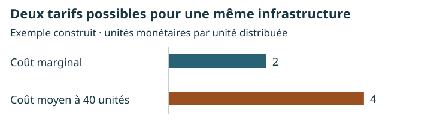

# ENS Paris-Saclay · Dominante économique 2022 — corrigé brut

*Corrigé rédigé par IA, non officiel. Signalez toute erreur.*

**Rédaction** · GPT-6.2 Astra Ultra · vitesse non renseignée · 26 novembre 2026

## Sujet

Privatisation et libéralisation depuis les années 1970 en Europe et aux États-Unis.

### Deux transformations dont les calendriers diffèrent

En 1978, les États-Unis relâchent les contrôles qui régissaient les tarifs et les lignes des compagnies aériennes. Au Royaume-Uni, la vente d’actions de British Telecom au public en 1984 modifie la propriété d’une entreprise. Ces deux décisions sont souvent rassemblées dans un même récit. Pourtant l’une ouvre l’accès à un marché, l’autre transfère des droits sur les revenus et les décisions d’une société. Depuis les années 1970, ces transformations ont modifié le rôle de l’État dans des économies confrontées à des contraintes budgétaires, technologiques et commerciales différentes.

### Remettre en question les monopoles administrés

Après la guerre, des gouvernements ont nationalisé des industries nécessitant de lourds investissements et une desserte durable du territoire. À partir des années 1970, les critiques portent notamment sur l’absence de comparaison des coûts et l’influence des intérêts établis sur l’autorité de tutelle. Aux États-Unis, la déréglementation du transport aérien permet aux transporteurs de choisir davantage leurs prix et leurs dessertes. Des entrants proposent des offres à moindre coût. La concentration autour de grandes plateformes et la vulnérabilité de certaines petites liaisons montrent cependant que la baisse moyenne d’un tarif et l’amélioration du service pour tous les usagers sont deux questions distinctes.

Le Royaume-Uni de Thatcher cède des entreprises pour étendre l’actionnariat, modifier les incitations des dirigeants et obtenir des recettes. Ces dernières améliorent ponctuellement la trésorerie publique. La valeur économique de l’opération dépend du prix de cession rapporté aux revenus abandonnés et des performances ultérieures. En France, la vague de nationalisations de 1982 précède des privatisations engagées à partir de 1986. Ce trajet illustre la diversité des séquences nationales derrière un vocabulaire partagé.

### Organiser l’entrée là où l’infrastructure demeure unique

Dans les télécommunications ou l’électricité, la concurrence peut porter sur les services fournis au moyen d’un réseau dont la duplication serait très coûteuse. Une entreprise qui possède le réseau et vend des services peut décourager ses rivales par les conditions d’accès. Fixer des règles d’interconnexion et séparer certaines activités permet d’ouvrir les services. La directive européenne de 1996 sur le marché intérieur de l’électricité organise une ouverture progressive. Elle ne prescrit pas la vente de tous les opérateurs publics.

Un calcul expose le travail du régulateur. Avec un coût fixe de 80, un coût marginal de 2 et 40 unités distribuées, le coût moyen vaut 4. Un tarif d’accès égal à 2 envoie un signal d’usage économe mais laisse l’investissement fixe à financer. Un tarif moyen de 4 équilibre les comptes au volume retenu tout en pouvant décourager des usages utiles. Il reste à arbitrer entre couverture du coût, accès des entrants et service universel, que le réseau soit public ou privé.

### Le transfert des actifs change de sens dans les économies en transition

Après 1989, les économies d’Europe centrale et orientale restructurent simultanément propriété, prix, financement et commerce. En Russie, les coupons de privatisation des années 1990 diffusent juridiquement la propriété, tandis que les conditions de contrôle et de financement en permettent ensuite la concentration. Une entreprise cédée avec un monopole local et des tribunaux peu capables d’assurer l’exécution des contrats peut changer de propriétaire sans que les consommateurs disposent d’un nouveau choix. Là où l’entrée, la supervision financière et les règles de concurrence se consolident, les investisseurs potentiels ont davantage de raisons d’apporter des capitaux productifs.

Le passage de l’État propriétaire à l’État régulateur modifie donc les compétences publiques requises. Gains de productivité, amélioration de l’accès et maintien de l’investissement doivent être mesurés séparément. Les ventes d’actifs n’offrent un gain durable que si la structure des incitations et la régulation rendent possible une amélioration du service dont le coût collectif demeure acceptable.

## Sources et périmètre

La dissertation occupe la page 2. Les documents du cas Julien de Sachs se rapportent à la gestion. Le rapport de la dominante économique demande de distinguer propriété et concurrence, d’intégrer l’Europe anciennement socialiste et d’expliquer l’organisation des industries de réseau. Le réseau chiffré est un exemple pédagogique.

[Cahier officiel, page 2](https://ens-paris-saclay.fr/sites/default/files/CONCOURS/ANNALES_1C/1C_D2_1/2022_Sujet_Ecrit_Economie_Gestion_Option1_Option.pdf#page=2) · [Rapport du jury de la dominante économique](https://ens-paris-saclay.fr/sites/default/files/CONCOURS/ANNALES_1C/1C_D2_1/2022_Rapport_Ecrit_Economie_Gestion_Option1_Economique.pdf) · [Index des annales](https://ens-paris-saclay.fr/admission/concours/concours-pre-master/annales-concours-pre-master?field_orientation_1c_target_id%5B%5D=289&field_year_target_id%5B%5D=572)
