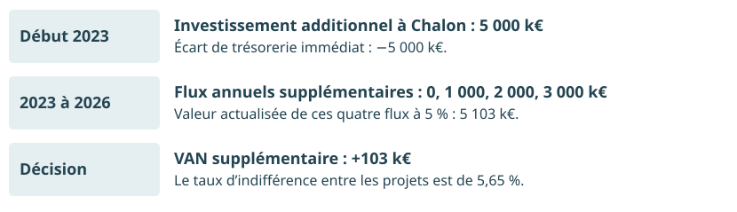

# ENS Paris-Saclay · Épreuve à option — dominante gestion 2022 — corrigé brut

*Corrigé rédigé par IA, non officiel. Signalez toute erreur.*

**Rédaction** · GPT-6.2 Astra Ultra · vitesse non renseignée · 26 novembre 2026

## Étude de cas

Le lancement des vêtements décontractés en janvier 2020 précède les deux arrêtés comptables disponibles. Les documents 1 à 3 décrivent la marque entière ; les prévisions du document 6 sont en milliers d’euros, et les honoraires d’avocate du document 5 en euros.

## Résolution des dossiers

### Première partie — Gestion financière et comptable

**1. Conséquences sur les rentabilités.** À défaut de bilans d’ouverture 2020, on utilise les capitaux propres $E$ et les dettes financières $D$ de clôture pour les deux années. On mesure le rendement avant impôt des fonds apportés par $R_e=RE/(E+D)$ et celui des actionnaires par $R_f=RN/E$. Pour comparer des rendements après impôt, on applique $1-0{,}28$ au résultat d’exploitation.

| Comptes et ratios | 2020 | 2021 |
|---|---:|---:|
| Chiffre d’affaires (k€) | 25 478 | 29 172 |
| Résultat d’exploitation (k€) | 1 325 | 1 643 |
| Marge d’exploitation | 5,20 % | 5,63 % |
| Fonds propres + dettes financières (k€) | 12 578 + 10 585 = 23 163 | 12 002 + 6 508 = 18 510 |
| Rendement économique avant impôt | 5,72 % | 8,88 % |
| Rendement économique après impôt | 4,12 % | 6,39 % |
| Rentabilité financière (bénéfice/fonds propres) | 784 / 12 578 = 6,23 % | 725 / 12 002 = 6,04 % |

Les ventes gagnent 14,50 % et le résultat d’exploitation 24 %. La progression de la marge et la baisse des capitaux de clôture relèvent le rendement économique. On peut aussi mesurer l’actif économique opérationnel par les immobilisations nettes plus le BFR d’exploitation, en supposant les postes circulants hors disponibilités et dettes financières liés à l’exploitation. On obtient $18\,782+7\,697-5\,213=21\,266$ k€ en 2020 et $14\,849+6\,010-3\,850=17\,009$ k€ en 2021, soit 6,23 % puis 9,66 % avant impôt. La direction du changement est identique. La collection décontractée et le canal en ligne ont accompagné la progression des ventes malgré la chute du marché du costume. Les comptes ne séparent pas leurs effets : les deux observations sont postérieures au lancement. Le bénéfice net recule de 59 k€ et la rentabilité financière de 0,19 point.

**2. Effets de l’endettement.** Le lancement est intégralement financé par dette ; la part de la dette dans l’ensemble $D+E$ s’établit à 45,70 % fin 2020 et 35,16 % fin 2021. Le levier $D/E$ recule de 84,15 % à 54,22 %. La couverture des intérêts par l’exploitation se dégrade pourtant de $1\,325/236=5{,}61$ fois à $1\,643/636=2{,}58$ fois. Les 400 k€ d’intérêts supplémentaires dépassent le gain opérationnel de 318 k€. Le résultat avant impôt passe de 1 089 à 1 007 k€ ; avec 28 % d’IS on retrouve environ 784 et 725 k€.

Sur le principe, $R_f\simeq [R_e+(R_e-i)D/E](1-t)$ pour des bases homogènes. Le coût avant IS donné par le document 3 monte de 3,63 % à 6,01 %, soit 2,61 % puis 4,33 % après IS. Les rendements économiques avant impôt du tableau dépassent ces taux de 2,09 puis 2,87 points : sur cette comparaison prévisionnelle l’emprunt peut accroître le rendement des fonds propres ; il amplifie aussi les pertes en cas de baisse du rendement sous le coût de la dette.

Pour réconcilier le levier avec le résultat observé, il faut utiliser le même encours que dans le rendement économique. Les ratios comptables intérêts/dette de clôture sont 2,23 % et 9,77 %, différents des 3,63 % et 6,01 % annoncés. En les substituant à $i$, la contribution du levier après impôt représente environ **+2,12 points** puis **−0,35 point** ; ajoutée à 4,12 % puis 6,39 %, elle restitue les rentabilités financières au centième près. Un encours en fin d’année peut différer de celui qui a porté intérêt pendant l’année. Faute d’échéancier, il serait hasardeux d’en déduire une renégociation précise ou d’intervertir les bilans.

**3. Passifs au 31 décembre 2021.** Un passif externe traduit une obligation née d’un événement passé envers un tiers, dont l’extinction entraînera probablement ou certainement une sortie de ressources sans contrepartie au moins équivalente. Une dette a une échéance et un montant suffisamment déterminés. Une provision correspond à une obligation probable dont le montant ou l’échéance reste incertain et dont le coût est estimable.

- **Plainte.** L’avocate estime la condamnation peu probable. Le dépôt de plainte et le plafond de 750 € ne suffisent pas à constituer une provision à ce montant. Selon l’importance et le caractère possible du risque, l’information relève des passifs éventuels en annexe ; si le risque de sortie est très faible, l’information peut être omise.
- **Don de 15 000 €.** Le bénéficiaire n’est pas choisi et l’annonce n’interviendra qu’en février. Rien n’indique, au 31 décembre, une obligation légale ou un engagement public ayant créé chez un tiers une attente légitime. La décision interne encore révocable ne crée donc pas de dette à cette date.
- **Honoraires.** Le conseil a été fourni en 2021. La facture du 5 janvier permet de mesurer la charge à rattacher à 2021, $8\times120+250=1\,210$ € HT. La TVA est de 242 € et la dette TTC de 1 452 €. Constater la charge et une facture non parvenue à la clôture, sous le régime de TVA applicable aux prestations. Il s’agit du prix d’un service reçu, indépendant de l’issue de la plainte.

**4. Comparaison financière (k€).** Les débours sont immédiats ; les flux d’exploitation arrivent en fin d’année. Pour une mise $I_0$, $\mathrm{VAN}(r)=-I_0+\sum_{t=1}^{4}F_t/(1+r)^t$. Le TRI annule cette expression. Les deux séries de flux changent une seule fois de signe.

| Indicateur | Participation à Jakarta | Usine à Chalon |
|---|---:|---:|
| Mise de départ | 15 000 | 20 000 |
| Flux de fin 2023 à fin 2026 | 5 500 ; 5 000 ; 4 500 ; 4 000 | 5 500 ; 6 000 ; 6 500 ; 7 000 |
| Valeur actuelle des encaissements à 5 % | 16 951,32 | 22 054,13 |
| **VAN à 5 %** | **1 951,32** | **2 054,13** |
| **TRI** | **10,80 %** | **9,16 %** |
| Indice de profitabilité (valeur des flux / mise) | 1,1301 | 1,1027 |
| Délai simple de récupération | 3 ans | 3 ans + 2 000/7 000 ≈ 3,29 ans |

Le délai fractionnaire suppose une répartition uniforme au cours de la quatrième année ; avec encaissement strict en fin d’année, Chalon récupère sa mise à la quatrième échéance. Jakarta offre le meilleur rendement par euro engagé. Pour des projets exclusifs sans rationnement des fonds, la VAN retient Chalon au taux prescrit. Le supplément de 5 000 k€ donne les flux 0, 1 000, 2 000 et 3 000 ; sa VAN vaut 102,81 k€ et son TRI environ 5,65 %. Il suffit donc d’une variation modeste des hypothèses pour inverser le classement.

**5. Coût du capital.** C’est le rendement que les apporteurs de capitaux peuvent exiger d’un autre placement de même risque. Pour des flux disponibles pour tous les financeurs, un coût moyen pondéré cohérent est $k=w_Ek_E+w_Dk_D(1-t)$, avec des pondérations cibles en valeur de marché et une fiscalité adaptée. Le taux de 5 % représente ici le prix du temps et du risque retenu dans les deux évaluations. Déduire les intérêts des flux déjà actualisés à ce taux ferait compter deux fois le financement.

**6. Limites des critères.** La VAN en euros dépend du taux, des devises et des volumes, et des perspectives retenues après 2026 : aucun prix de revente n’est fourni. Le TRI classe un taux de rendement, sensible à l’échelle et au calendrier, alors que les investissements sont exclusifs. Le délai ignore la marge gagnée après le remboursement de la mise et, dans sa version simple, le temps. Une compression des coûts assurée par des conditions de travail dégradées améliorerait artificiellement une comparaison financière qui n’intégrerait ni les risques humains ni les coûts de rupture d’approvisionnement. Tester coûts des matières, défauts, change, coûts sociaux de mise en conformité et prix de vente, puis examiner séparément les engagements difficilement monétisables.

**7. Décision.** Je retiendrais Chalon si la capacité et les compétences de l’usine sont confirmées et si le financement laisse une réserve de trésorerie. À 5 %, le projet crée 2,05 M€ de valeur et rapproche conception et confection. Son avantage financier de 0,10 M€ sur Jakarta est limité ; la décision doit donc aussi documenter la capacité à remplacer environ 60 % de la confection et à contrôler les pratiques sociales. La proximité facilite des visites et les retours qualité, mais ne garantit ni le respect des travailleurs ni les délais. Si les 5 M€ supplémentaires restent inaccessibles ou si une montée en charge trop lente efface le surplus, la participation majoritaire mérite d’être réexaminée avec des garanties de gouvernance, des droits d’audit et un dispositif de recours pour les salariés sur place.

**8. Financer le choix.** Les disponibilités fin 2021 ne sont que de 2,025 M€, contre 15 ou 20 M€ à engager ; il faut conserver en outre un volant pour exploiter l’usine. Des bénéfices conservés et une cession d’actifs disponibles peuvent former un apport. Une augmentation de capital auprès des associés ou d’un partenaire industriel limite le risque de défaut mais partage droits de vote et profits. Un emprunt à long terme ou un emprunt obligataire échelonne la sortie de fonds en contrepartie d’intérêts et de garanties ; vérifier la couverture dégradée. Le crédit-bail peut financer certains équipements et un crédit-vendeur fractionner le prix de reprise. Étudier les aides au développement industriel si leurs conditions sont remplies, puis assortir le plan d’un budget de mise en route et de BFR.

### Deuxième partie — Management

**9. Choisir sur la performance globale.** La performance réunit l’efficacité (atteindre l’objectif), l’efficience (résultats obtenus avec les ressources disponibles) et la capacité de l’activité à durer. Le prix d’achat doit être rapproché des critères pour lesquels l’internalisation a été décidée.

| Critère et épreuve de vérification | Jakarta | Chalon-sur-Saône |
|---|---|---|
| Financement et débouchés | Mise moindre, flux décroissants ; tester le risque de change et les coûts d’importation. | Mise supérieure, flux croissants ; tester le prix accepté et un retard de montée en charge. |
| Maîtrise industrielle | Vérifier les volumes réellement disponibles, le taux de défaut, la conformité des lots et les délais jusqu’aux marchés européens. | Mesurer les heures qualifiées disponibles, la capacité, les rebuts, le temps de réassort et les besoins de formation. |
| Gouvernance sociale | Examiner la majorité des votes, le pouvoir sur les sous-traitants, la rémunération des ouvriers, la sécurité et la possibilité d’alerter sans représailles. | Vérifier conditions de travail, sécurité, recrutement et dialogue social sur le site ; documenter l’origine des étapes restant sous-traitées. |
| Environnement et confiance | Mesurer les émissions par vêtement livré, transport et énergie compris ; publier un suivi vérifiable des remédiations. | Mesurer les mêmes émissions et effets locaux. Les gains de transport peuvent être compensés par l’énergie ou les procédés de teinture. |

Un minimum de conformité sociale et de qualité doit être démontré avant de classer les projets admissibles selon la VAN et les critères de service. Pour les deux options, préparer la transition afin qu’une rupture brutale avec l’ancien fournisseur ne laisse les travailleurs touchés sans recours.

**10. Retenir les salariés.** La dégradation de l’ambiance peut venir d’une rupture entre le discours de la marque et les pratiques observées. Une prime seule ne répare pas cette perte de confiance. Dans un premier temps, conduire des entretiens confidentiels de maintien et de départ, distinguer les équipes les plus affectées et reconnaître les deux problèmes devant le personnel. Examiner la campagne avec des représentants et instaurer une validation des créations assortie d’un canal de signalement. Pour les fournisseurs, publier des objectifs précis, des délais de correction et les résultats d’audits indépendants ; désigner une personne responsable des suites.

Les conditions matérielles comptent également. Vérifier équité des rémunérations, charge, horaires et moyens disponibles lors du changement de fournisseur. Dans la perspective de Herzberg, corriger ces sources d’insatisfaction et offrir des responsabilités, de la formation et des perspectives internes répondent à des besoins distincts. Confier par exemple à des salariés volontaires des visites croisées et des responsabilités qualité, avec du temps reconnu. Rendre compte trimestriellement des départs volontaires par équipe, de l’absentéisme, du délai de résolution des alertes et du sentiment de confiance mesuré anonymement. Un taux de départ qui baisse ne suffit pas si les salariés cessent de s’exprimer.

**11. Communiquer entre Paris et Nevers.** Le témoignage met en cause la double saisie, des ordres successifs incompatibles et l’achat de matières inadaptées. Le siège a besoin d’une vision des commandes, des marges et du réseau ; le site a besoin de nomenclatures fiables, de priorités stables et d’une autonomie de réaction.

- **Au siège**, consolider prévisions web et boutiques, commandes, stocks et enveloppes achats. Tenir une réunion mensuelle ventes–opérations où Paris propose des priorités et Nevers valide les capacités. Publier une version datée du programme et geler un court horizon de production. Toute urgence doit entraîner un arbitrage explicite sur la commande déplacée.
- **À l’usine**, organiser un suivi par ordre de fabrication : quantité prévue et produite, heures, rebuts, défaut par lot et disponibilité matière. Le chef d’atelier doit pouvoir suspendre un lot défectueux et demander au service achats une réponse datée. Un responsable qualité des deux sites valide les spécifications avant engagement d’un nouveau fournisseur.
- **Entre les deux**, un progiciel partagé ou une interface entre les applications existantes relie article, lot, commande et version de nomenclature. L’événement est saisi une fois à sa source ; chaque rôle ne voit que les données nécessaires. Un tableau de bord commun suit, entre autres, respect du plan, taux de service, rebuts et délai de clôture des anomalies. Mesurer aussi le temps de saisie évité. Tester d’abord une famille de produits avec les utilisateurs et retirer les rapports redondants.
- **Dans les relations de travail**, organiser des visites réciproques, une courte réunion d’écarts chaque semaine et un registre des décisions avec responsable et échéance. Le site voit alors ce qui a été fait de ses alertes ; le siège peut expliquer le compromis commercial ou financier qu’il a retenu. L’outil soutient une responsabilité partagée au lieu d’ajouter une nouvelle obligation de reporting.

## Repère

## Sources

Cahier officiel de gestion, cas Julien de Sachs. Les comptes du document 1 présentent 2021 avant 2020 ; ceux du document 2 adoptent l’ordre inverse. Les calculs conservent chaque millésime imprimé. Le projet français de la question 7 est situé à Chalon-sur-Saône ; le témoignage de la question 11 porte sur le site retenu ensuite à Nevers.

[Sujet de la dominante, p. 3](https://ens-paris-saclay.fr/sites/default/files/CONCOURS/ANNALES_1C/1C_D2_1/2022_Sujet_Ecrit_Economie_Gestion_Option1_Option.pdf#page=3) · [Annales institutionnelles](https://ens-paris-saclay.fr/admission/concours/concours-pre-master/annales-concours-pre-master?field_orientation_1c_target_id%5B%5D=289&field_year_target_id%5B%5D=572)
