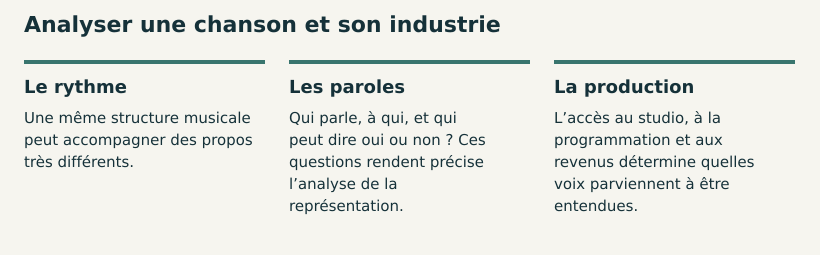

# ENS Paris-Saclay — Économie-gestion option 1 · Espagnol oral 2022 · Corrigé brut

*Corrigé rédigé par IA, non officiel. Signalez toute erreur.*

**Rédaction** · GPT-6.2 Astra Ultra · vitesse non renseignée

Le jury accordait trente minutes de préparation, recommandait environ quinze minutes de restitution et de commentaire et prévoyait un entretien de quinze minutes au plus. Les extraits duraient entre 4 min 30 et 5 min. Le jury a utilisé deux émissions distinctes de RNE lors du passage de quatre candidats.

Les deux titres désignent des émissions retrouvées dans le catalogue de RNE. Leurs notices permettent des comptes rendus documentés. Le premier original dure 6 min 08, le second 4 min 43. Le jury indique une fourchette commune de 4 min 30 à 5 min ; seules les bornes de l’enregistrement d’épreuve permettraient d’en restituer exactement le montage. Les questions d’entretien sont proposées pour s’entraîner.

## 1. El reggaetón toma una dimensión de género

**Compte rendu de l’émission identifiée.** El reportaje de RNE del veintiocho de marzo de 2022 parte de una aparente contradicción. Desde que se difundió por todo el mundo a comienzos de siglo, el reggaetón ha recibido críticas por la imagen que muchas letras dan de las mujeres. Sin embargo, un ritmo no dicta por sí solo lo que una canción debe decir. El periodista Tomás O’Reilly habla con la cantante dominicana Cristabel Acevedo. La presentación de la emisora relaciona la creciente presencia de mujeres en la música con la aparición de letras que dan cabida a una realidad más diversa y más igualitaria. La tensión entre la reputación del género y lo que están haciendo algunas de sus intérpretes organiza la pieza. [Reportage et notice de RNE](https://www.rtve.es/play/audios/reportajes-5-continentes/reggaeton-dimension-genero/6469279/)

**Commentaire.** ¿Qué cambia cuando una mujer ocupa el lugar de quien enuncia el deseo en una canción? En una letra que habla de una mujer sin darle voz, el público sólo conoce lo que otra persona cree saber sobre ella. Si la primera persona femenina expresa lo que quiere o fija los límites de una relación, la posición de quien escucha cambia. No es una garantía automática de igualdad. Una artista puede reproducir un cliché rentable y un intérprete masculino puede cuestionarlo. Para sostener el análisis habría que atender a quién toma la iniciativa, quién puede responder y qué consecuencias tiene ese intercambio dentro de la letra.

La pista de baile introduce otra dimensión. Dos personas pueden disfrutar del mismo ritmo y rechazar de manera distinta las palabras que lo acompañan. Decirle a una mujer qué música le está permitido bailar corre el riesgo de sustituir una imposición por otra. Eso tampoco impide criticar una canción concreta ni preguntar qué alternativas ofrecen las emisoras y las plataformas. La variedad que llega al público depende de quién consigue grabar, financiarse, actuar en un festival o conservar los derechos sobre su trabajo. Me parece más esclarecedor examinar esas posibilidades reales que esperar de una sola cantante que represente por sí misma a todas las mujeres del Caribe.

**Relance proposée.** *¿Basta con contar cuántas mujeres hay en un cartel para medir el cambio?* Es un primer dato. Miraría también a qué hora actúan, quién decide el repertorio y si reciben condiciones comparables. Una presencia excepcional puede abrir una puerta sin cambiar todavía la distribución del poder en la industria.

## 2. La falta de control en las armas de fuego

**Compte rendu de l’émission identifiée.** El veinticinco de mayo de 2022, la mesa de corresponsales del informativo 24 horas parte de la reapertura en Estados Unidos del debate sobre las armas de fuego. La emisora propone mirar qué significa su presencia en otras dos sociedades. Íñigo Herraiz informa desde Ciudad de México y María Gámez desde Jerusalén. Para México, la ficha de RNE pone el acento en la dimensión transfronteriza. Atribuye al gobierno mexicano una estimación anual de medio millón de armas que entrarían ilegalmente en el país. En el caso israelí, la presencia visible de personas armadas en la calle coexiste, según la presentación, con un régimen de autorizaciones y límites individuales. La comparación documentada reúne realidades distintas bajo la pregunta de cómo ejerce cada Estado el control. [Émission de RNE et correspondants crédités](https://www.rtve.es/play/audios/24-horas/falta-control-armas-fuego/6548669/)

**Commentaire.** ¿De qué sirve una regulación nacional cuando una parte del problema atraviesa fronteras? El ejemplo mexicano invita a distinguir entre tener una norma y poder hacerla efectiva. Una restricción interior pierde eficacia cuando las instituciones que deben aplicarla carecen de información fiable o cuando la cooperación entre Estados no funciona. De ahí no se deduce que cualquier esfuerzo sea inútil. Un convenio que permita investigar responsabilidades, intercambiar datos verificables y mejorar la calidad de los registros ofrece un criterio concreto para juzgar esa cooperación.

La comparación del reportaje también permite preguntar qué se está midiendo. Lo que ve un peatón en una calle, una estimación del flujo anual y las lesiones registradas por los hospitales son tres observaciones diferentes. Un aumento de las incautaciones puede ser consecuencia de mejores inspecciones y no necesariamente de un crecimiento equivalente de la circulación. Daría prioridad a indicadores que reflejen los daños sufridos por las personas, además de evaluar la calidad de las investigaciones y la atención a las víctimas. Trasladar sin más la conclusión de un país al otro dejaría sin explicar quién controla la aplicación de la ley, cómo se corrigen los errores y qué resultados pueden comprobar los ciudadanos.

**Relance proposée.** *¿Por qué no bastaría con comparar el texto de dos leyes?* Porque su aplicación depende de recursos, instituciones y mecanismos de revisión diferentes. Para saber si una medida protege a la población habría que observar resultados comparables, durante periodos semejantes, y reconocer los límites de los datos.

[Rapport du jury](https://ens-paris-saclay.fr/sites/default/files/CONCOURS/ANNALES_1C/1C_D2_1/2022_Rapport_Oral_Economie_Gestion_Option1_espagnol.pdf)
