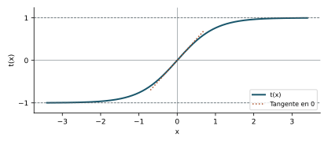

# ENS Paris-Saclay · Économie-gestion option 1 · Mathématiques et statistiques 2022 · Corrigé brut

*Corrigé rédigé par IA, non officiel. Signalez toute erreur.*

**Rédaction** · GPT-6.2 Astra Ultra · vitesse non renseignée

**Révision (tour 1)** · GPT-6.2 Astra Ultra · vitesse non renseignée

Trois problèmes indépendants, en quatre heures et sans calculatrice. Le rapport du jury insiste sur trois justifications reprises ci-dessous : traiter l’équation fonctionnelle sans présupposer sa solution, préciser l’indépendance dans la loi du maximum et construire la bijection entre deux commutants.

## Problème 1 · De la tangente hyperbolique à l’équation fonctionnelle

### Question 1

Le dénominateur est strictement positif. En multipliant par $e^x$, on obtient $t(x)=(e^{2x}-1)/(e^{2x}+1)$. Ainsi $-1<t(x)<1$ et
$$t'(x)=\frac{4e^{2x}}{(1+e^{2x})^2}=1-t(x)^2>0.$$
La fonction est impaire et $t(0)=0$. Son tableau est
$$\begin{array}{c|ccc}x&-\infty&0&+\infty\\\hline t'(x)&+&1&+\\\hline t(x)&-1\nearrow&0&\nearrow1\end{array}$$
Les deux limites viennent de $e^{2x}\to0$ à gauche et de la division par $e^{2x}$ à droite. En outre $t''=-2tt'$ est positive à gauche de zéro et négative à droite, d’où le point d’inflexion à l’origine.

### Question 2

Posons $u=e^{2x}$ et $v=e^{2y}$. Avec le dénominateur commun $(u+1)(v+1)$, les numérateurs de $t(x)+t(y)$ et de $1+t(x)t(y)$ valent respectivement $2(uv-1)$ et $2(uv+1)$. Leur quotient est $(uv-1)/(uv+1)=t(x+y)$. La division est licite puisque $uv+1>0$.

### Question 3

Pour chaque $y$, $f(y)[1+f(0)f(y)]=f(0)+f(y)$. Il vient $f(0)(1-f(y)^2)=0$. Comme $|f(y)|<1$, le second facteur est positif et $f(0)=0$.

### Question 4

Pour $x,h\in\mathbb R$, la relation donne
$$f(x+h)-f(x)=\frac{f(h)(1-f(x)^2)}{1+f(x)f(h)}.$$
Pour $x$ fixé, $f(h)\to f(0)=0$ quand $h\to0$. Le numérateur tend vers zéro, le dénominateur vers un. Donc $f$ est continue en tout $x$.

### Question 5

La dérivabilité en zéro entraîne la continuité en zéro, et $f(h)/h\to f'(0)$ puisque $f(0)=0$. Pour $h\ne0$, le taux d’accroissement en $x$ vaut $[f(h)/h](1-f(x)^2)/(1+f(x)f(h))$. Sa limite existe. On obtient $f'(x)=f'(0)(1-f(x)^2)$ pour tout $x$.

### Question 6

Comme $f(0)=0$ et $1+f(x)f(-x)>0$, l’équation en $(x,-x)$ donne $f(x)+f(-x)=0$. Ainsi $f$ est impaire.

### Question 7

Pour $y\ge x$, la différence $f(y)-f(x)$ a le signe de $f(y-x)$, car $1-f(x)^2$ et $1+f(x)f(y-x)$ sont strictement positifs. Le signe constant admis sur $\mathbb R_+$ entraîne que toutes ces différences sont positives ou nulles, ou toutes négatives ou nulles. Cela prouve la monotonie. On peut aussi lire son sens sur $f'(0)$ grâce à la question 5.

### Question 8

Notons $u=f(x)$ et $v=f(a)$. En appliquant la loi d’addition, $1+f(x+a)=(1+u)(1+v)/(1+uv)$ et $1-f(x+a)=(1-u)(1-v)/(1+uv)$. Le quotient donne $g(x+a)=g(x)g(a)$. Tous les facteurs $1\pm f$ sont strictement positifs. Ainsi $g(x+a)/g(x)=g(a)$, indépendant de $x$.

### Question 9

Puisque $f$ est dérivable et que $1-f>0$, $g$ est dérivable et $g(0)=1$. En dérivant $g(x+a)=g(x)g(a)$ par rapport à $a$ en $0$, on obtient $g'(x)=c g(x)$ avec $c=g'(0)=2f'(0)$. La dérivée de $e^{-cx}g(x)$ est nulle, et sa valeur en zéro vaut $1$. Ainsi $g(x)=e^{cx}$ et
$$f(x)=\frac{e^{cx}-1}{e^{cx}+1}=t(cx/2),\qquad c\in\mathbb R.$$
Réciproquement, chaque paramètre donne une fonction à valeurs dans $]-1,1[$, dérivable en zéro et satisfaisant l’équation par la question 2. Le paramètre nul donne la solution constante nulle.

## Problème 2 · Estimation et détection de la dernière erreur

### Question 1

$X_j$ suit une loi de Bernoulli de paramètre $p$. Elle prend la valeur $1$ avec probabilité $p$ et $0$ avec probabilité $1-p$. Son espérance est $p$.

### Question 2

Par linéarité, $\mathbb E[\widehat p]=n^{-1}\sum_{j=1}^n p=p$. L’estimateur est sans biais. Comme $X_j^2=X_j$, sa variance individuelle vaut $p-p^2$. Les covariances entre indices distincts sont nulles par indépendance, d’où $\operatorname{Var}(\widehat p)=p(1-p)/n$.

### Question 3

Le biais est nul. Donc $\mathbb E[(\widehat p-p)^2]=\operatorname{Var}(\widehat p)+(\mathbb E[\widehat p]-p)^2=p(1-p)/n\le1/(4n)\to0$. Cela assure aussi la convergence en probabilité par l’inégalité de Bienaymé–Tchebychev.

### Question 4

Pour $0<p<1$, posons $q=1-p$. L’événement $Y_j=k$, $k\ge1$, exige $k-1$ échecs puis un succès. Les relecteurs étant indépendants, $\mathbb P(Y_j=k)=q^{k-1}p$. C’est la loi géométrique sur $\{1,2,\ldots\}$. Pour $p=1$, $Y_j=1$ presque sûrement. À $p=0$, l’erreur n’est jamais détectée et le temps d’attente est infini.

### Question 5

Pour $0<p<1$, $G_j(t)=0$ si $t<1$. Si $t\ge1$, les $\lfloor t\rfloor$ premiers relecteurs manquent tous l’erreur avec probabilité $q^{\lfloor t\rfloor}$. Donc $G_j(t)=1-q^{\lfloor t\rfloor}$. Pour $p=1$ la fonction vaut $\mathbf1_{[1,\infty[}(t)$, et pour $p=0$ elle est nulle à tout seuil fini.

### Question 6

$X=\max_{1\le j\le n}Y_j$. Les suites d’essais correspondant à des erreurs distinctes sont indépendantes dans le modèle du sujet. Pour un seuil entier $k\ge1$, on obtient
$$\mathbb P(X\le k)=\prod_{j=1}^n\mathbb P(Y_j\le k)=\big[1-(1-p)^k\big]^n.$$
La fonction de répartition $F(t)$ est nulle si $t<1$ et vaut $[1-(1-p)^{\lfloor t\rfloor}]^n$ sinon. Cette écriture donne aussi les cas $p=0$ et $p=1$ pour tout seuil fini.

### Question 7

Pour $0<p<1$ et $k\ge1$,
$$\mathbb P(X=k)=(1-q^k)^n-(1-q^{k-1})^n.$$
En particulier, $\mathbb P(X=1)=p^n$ et $\mathbb P(X=0)=0$ pour $n\ge1$. Pour $p=1$, la masse entière est en $1$. Pour $p=0$, aucune masse n’est portée par un entier fini.

### Question 8

Après $k$ relecteurs de qualité $1/2$, la probabilité de détection est $1-2^{-k}$. Elle atteint $3/4$ dès que $2^{-k}\le1/4$, donc dès $k=2$. Un seul relecteur donne $1/2<3/4$. Le minimum demandé est deux.

### Question 9

Pour deux erreurs, les probabilités sont $(1-2^{-k})^2$ et $(3/4)^2=9/16$. La fonction carré est croissante sur $[0,1]$, donc le minimum est encore deux. Pour tout nombre $n\ge1$ d’erreurs, les mêmes bases sont élevées à $n$ et le minimum reste deux. Plus généralement, pour des qualités $0<p,r<1$, le plus petit nombre de relecteurs de qualité $p$ égalant ou dépassant en probabilité un relecteur de qualité $r$ vaut
$$\left\lceil\frac{\ln(1-r)}{\ln(1-p)}\right\rceil.$$
Le logarithme du dénominateur étant négatif, la condition $k\ln(1-p)\le\ln(1-r)$ fournit bien un minorant de $k$.

## Problème 3 · Matrices qui commutent

### Question 1.a

La matrice nulle et $I$ commutent avec $A$, puisque leurs produits avec $A$ valent respectivement $0$ et $A$ dans les deux ordres. La matrice $A$ elle-même appartient aussi à $C(A)$.

### Question 1.b

Définissons $\Phi_A:\mathcal M_3(\mathbb R)\to\mathcal M_3(\mathbb R)$ par $\Phi_A(M)=AM-MA$. Pour tous scalaires $s,t$, la distributivité donne $\Phi_A(sM+tN)=s\Phi_A(M)+t\Phi_A(N)$. Son noyau est $C(A)$, qui est donc un sous-espace vectoriel de $\mathcal M_3(\mathbb R)$.

### Question 1.c

Si $BM=MB$ et $BM'=M'B$, alors $B(MM')=(BM)M'=(MB)M'=M(BM')=M(M'B)=(MM')B$. Ainsi $MM'\in C(B)$.

### Question 1.d

Lorsque $M$ est inversible, $M^{-1}(BM)M^{-1}=M^{-1}(MB)M^{-1}$ donne $M^{-1}B=BM^{-1}$. Ainsi $M^{-1}\in C(B)$.

### Question 2.a

Pour $M=(m_{ij})$, $(DM)_{ij}=\lambda_i m_{ij}$ et $(MD)_{ij}=m_{ij}\lambda_j$. La condition nécessaire et suffisante est donc $(\lambda_i-\lambda_j)m_{ij}=0$ pour chaque $i,j$. Les trois entrées diagonales sont libres. Hors diagonale, une entrée n’est libre que si les deux valeurs propres correspondantes coïncident.

### Question 2.b

Si $i\ne j$, le facteur $\lambda_i-\lambda_j$ est non nul et $m_{ij}=0$. Ainsi $M$ est diagonale. Réciproquement deux diagonales commutent, donc $C(D)$ est exactement l’espace des matrices diagonales.

### Question 2.c

Pour $\lambda_1=\lambda_2\ne\lambda_3$, les indices $1,2$ forment un bloc et l’indice $3$ reste isolé. On a
$$C(D)=\left\{\begin{pmatrix}a&b&0\\c&d&0\\0&0&e\end{pmatrix}:a,b,c,d,e\in\mathbb R\right\}.$$
Une base est $(E_{11},E_{12},E_{21},E_{22},E_{33})$, où $E_{ij}$ a un unique $1$ en position $(i,j)$. Cette famille engendre par lecture des cinq coordonnées et est libre puisque chaque coordonnée se lit en une position distincte. La dimension vaut cinq.

### Question 2.d

$D=\lambda_1 I$, donc $DM=\lambda_1 M=MD$ pour tout $M$. Ainsi $C(D)=\mathcal M_3(\mathbb R)$ de dimension neuf.

### Question 3.a

Pour $v=(x,y,z)^T$, $Av=(x+y-z,x+y+z,x+y+z)^T$. Pour $Av=0$, les deux premières équations donnent $z=0$, $y=-x$. Pour $Av=v$, la différence des deux dernières composantes impose $y=z$, puis $x=-y$. Enfin $Av=2v$ impose $y=z$ puis $x=0$. On prend pour colonnes ces trois vecteurs propres :
$$P=\begin{pmatrix}1&-1&0\\-1&1&1\\0&1&1\end{pmatrix},\quad D=\operatorname{diag}(0,1,2).$$
Ils vérifient $AP=PD$ et $\det P=-1$, donc $A=PDP^{-1}$.

### Question 3.b

Posons $N=P^{-1}MP$. Alors $P^{-1}(AM-MA)P=DN-ND$. La multiplication par $P^{-1}$ à gauche et $P$ à droite est inversible, donc $AM=MA$ si et seulement si $DN=ND$, ce qui est l’équivalence demandée.

### Question 3.c

L’application $C(A)\to C(D)$ définie par $M\mapsto P^{-1}MP$ est linéaire. Son inverse est $N\mapsto PNP^{-1}$, à valeurs dans $C(A)$ par 3.b. C’est donc un isomorphisme. Comme $D$ a trois valeurs propres distinctes, son commutant est l’espace diagonal, de dimension trois. Ainsi $\dim C(A)=3$.

### Question 3.d

$I,A,A^2$ commutent avec $A$. Si $aI+bA+cA^2=0$, l’application à un vecteur propre non nul de valeur $\lambda$ donne $a+b\lambda+c\lambda^2=0$. Le polynôme $a+bX+cX^2$, de degré au plus deux, s’annule en $0,1,2$. Il est nul, donc $a=b=c=0$. La famille est libre de cardinal trois dans $C(A)$ de dimension trois. C’est une base.
