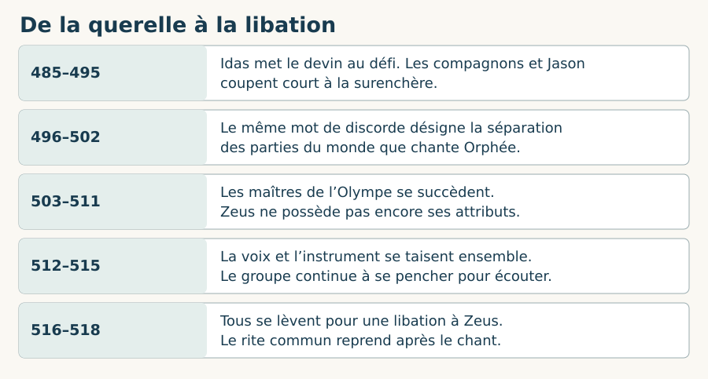

# ENS-PSL · CNEL Lettres — Apollonios de Rhodes — les Argonautiques 2022 · Corrigé guidé

*Corrigé rédigé par IA, non officiel. Signalez toute erreur.*

**Lecture du rapport du jury** · GPT-6.2 Astra Ultra · vitesse non renseignée

**Rédaction** · GPT-6.2 Astra Ultra · vitesse non renseignée

**Autocontrôle** · GPT-6.2 Astra Ultra · vitesse non renseignée

## Distinguer les deux fins de la dispute

- **Vers 485–495.** Les compagnons et Jason interviennent avant le chant. L’irréel permet de savoir à qui attribuer l’arrêt de l’altercation.
- **Vers 496–502.** Comparez le grec *neikos* du récit au génitif *neikeos* dans l’histoire racontée. Un même mot désigne une querelle et la discorde qui dissocie les éléments du monde.
- **Vers 503–511.** Ophion et Eurynomé précèdent Cronos et Rhéa. Zeus est encore enfant. Interprétez les repères temporels en tenant compte de ce que les auditeurs savent déjà du dieu adulte.
- **Vers 512–518.** Orphée se tait, les auditeurs demeurent en position d’écoute, puis ils se lèvent. Ces trois temps permettent de définir le charme autrement que par une impression vague.

Pour passer au projet, comparez des gestes effectivement observables d’auditeurs dans plusieurs épopées. Le fait qu’un personnage chante ne suffit pas à prouver une même fonction pour tous les chants.

## Comment Orphée refait un équipage

La querelle des *Argonautiques* menace une entreprise à laquelle chaque héros doit apporter une aptitude particulière. Idas revendique une puissance qui pourrait tenir tête aux dieux et provoque le devin Idmon. Aux vers 485 à 518 du premier livre, le retour à la vie commune s’accomplit en deux temps. Les compagnons et Jason interrompent la dispute. Orphée donne ensuite aux anciens adversaires une même chose à écouter. Le récit fait éprouver la différence entre arrêter des paroles et transformer l’attention des hommes qui viennent de les prononcer.

Le rire d’Idas s’adresse à un interlocuteur qu’il regarde de travers. Dans sa bouche, la prédiction devient une épreuve dont il fixerait lui-même les conditions. Il somme le fils d’Apollon d’annoncer si le dieu lui réserve le sort des Aloades. La note du sujet rappelle que ces deux géants avaient prétendu porter la guerre dans l’Olympe. L’exemple pourrait inviter Idas à se défier de sa propre bravade. Il le profère avec la certitude de pouvoir démentir celui qui lui répondrait. Sa question lie ainsi deux temps que la divination devrait distinguer, l’issue future annoncée par le devin et l’intimidation présente qui vise à réduire celui-ci au silence. Le narrateur ouvre brièvement une autre suite possible par un irréel, la querelle serait allée plus loin sans l’intervention du groupe et de l’Aisonide. Cette branche du récit aussitôt refermée rend à Jason une part de l’autorité que la provocation initiale semblait lui enlever.

Orphée entre au moment où s’arrête cet échange de répliques. Un geste, la cithare tenue de la main gauche, précède le chant. Le poète ne rapporte pas ses vers au discours direct. Les propositions en « comment », à la suite du verbe « il chantait », permettent d’entendre le mouvement d’un récit sans confondre Orphée avec le narrateur des *Argonautiques*. La première matière du chant est une séparation. La terre, le ciel et la mer ont été unis dans une même forme avant que la discorde ne les répartisse chacun à sa place. Le nom grec de la querelle, *neikos*, revient pour cette discorde au génitif. Le mot qui désignait le danger immédiat prend une dimension cosmique. Orphée peut faire entendre aux disputeurs un monde né du conflit sans les prendre nommément à partie.

Le développement prête des routes aux astres et des voix aux fleuves. Les Nymphes naissent avec ceux-ci. L’ordonnance spatiale et temporelle qui en résulte permet de concevoir un monde dans lequel un équipage pourra se déplacer, contempler le ciel et faire escale. Vient ensuite l’histoire des maîtres successifs de l’Olympe. Le premier couple, Ophion et Eurynomé, cède ses prérogatives à Cronos et Rhéa. Ce récit ne reproduit pas simplement la série des souverains popularisée par Hésiode. Il fait entendre une autre mémoire de l’origine. Le jeune Zeus habite alors l’antre de Dicté. Les répétitions d’« encore » et « pas encore » supposent que l’auditeur connaît les attributs qui garantiront sa suprématie future. Après l’assurance d’Idas face aux dieux, raconter une force divine qui a elle-même une histoire déplace la question du pouvoir. Dépendre de prédécesseurs ou de dons ne condamne pas l’autorité à l’impuissance.

Le dernier mouvement en montre l’effet sans prêter aux héros un commentaire explicatif. Voix et instrument se taisent ensemble. Les hommes gardent pourtant les têtes tendues, l’oreille dressée. Le contraste temporel entre l’arrêt du son et la persistance de l’écoute donne au charme poétique une manifestation visible. Les mots qui désignaient un adversaire isolé dans la première scène font place à l’expression « tous ensemble ». Leur immobilité n’est que provisoire. Ils se lèvent et accomplissent la libation en l’honneur de Zeus selon le rite. La note précise qu’un sacrifice précédait la dispute. L’acte final renoue donc un geste collectif interrompu et inscrit l’évocation du jeune dieu dans un présent qui reconnaît son autorité. Le repos nocturne achève ce retour à un temps partagé.

Pour un projet sur les récits enchâssés dans l’épopée hellénistique, on pourrait confronter la voix rapportée d’Orphée avec celle des aèdes de l’*Odyssée*. Il faudrait relever la manière dont le récit-cadre désigne l’instrument, où il coupe ou résume le chant, puis ce que font exactement les auditeurs. Chez Apollonios, la mesure la plus concrète du pouvoir de la poésie est cet intervalle pendant lequel des hommes en désaccord continuent à écouter le même silence.

[Sujet officiel](https://www.ens.psl.eu/sites/default/files/dsa-cnel2022-5.pdf) · [Rapport du jury](https://www.ens.psl.eu/sites/default/files/dsa-rapport-cnel2022.pdf)
