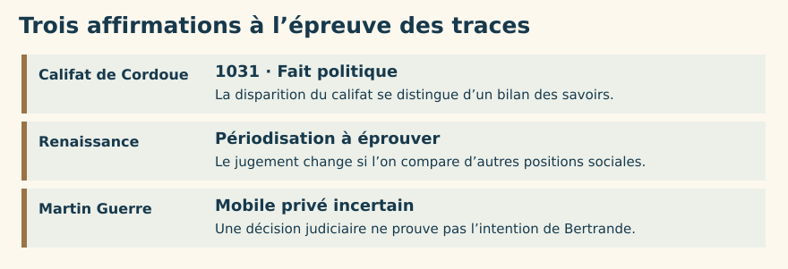

# ENS-PSL · CNEL Lettres — Histoire — l’opération historique 2022 · Corrigé guidé

*Corrigé rédigé par IA, non officiel. Signalez toute erreur.*

**Lecture du rapport du jury** · GPT-6.2 Astra Ultra · vitesse non renseignée

**Rédaction** · GPT-6.2 Astra Ultra · vitesse non renseignée

**Autocontrôle** · GPT-6.2 Astra Ultra · vitesse non renseignée

La feuille de l’écrit départemental demande de commenter et de discuter, à partir de lectures historiques précises, un extrait de Savoir et pouvoir en al-Andalus au XIe siècle d’Emmanuelle Tixier du Mesnil (2022, p. 14).

## Suivre la métaphore jusqu’aux deux limites

Le début de l’extrait admet la découverte de matériaux nouveaux. Il élargit ensuite le travail historique au changement d’agencement et à la déconstruction. Enfin, le « si ce n’est » limite le « sans fin ». Omettre cette réserve ferait dire à l’autrice que toute histoire serait également recevable.

**Comment une pièce peut-elle changer de rôle ?** Une appréciation sévère de l’émiettement politique andalou peut renseigner sur l’idéal politique d’un auteur. Elle ne constitue pas à elle seule une mesure de la production savante du XIe siècle. Nommez la question ancienne, puis la question nouvelle.

**Pourquoi mobiliser plusieurs périodes ?** Kelly montre les effets d’un changement de critère dans une périodisation. Ginzburg mesure ce que l’on gagne en resserrant sur un cas. Davis fait apparaître dans la narration les bornes de la conjecture. Chaque lecture effectue une opération différente.

**Comment rendre une hypothèse discutable ?** Distinguez l’acte public constaté par une institution, ce que des pratiques comparables rendent plausible et le mobile privé qu’aucune pièce ne livre directement. Reliez chaque niveau à un mode d’écriture précis. Une conditionnelle n’est pas un ornement de prudence, elle règle ce que la phrase demande au lecteur de croire.

## Une histoire peut devenir nouvelle sans attendre une archive inédite

Découvrir un manuscrit jusque-là ignoré peut changer une histoire. Mais il arrive qu’une page connue de longue date change de valeur lorsqu’on cesse de lui demander ce qu’elle attestait pour ses premiers éditeurs. Dans la citation de Savoir et pouvoir en al-Andalus au XIe siècle, Emmanuelle Tixier du Mesnil donne à cette seconde possibilité une image architecturale. « Bouger les pierres » conserve le matériau en transformant les relations qui le rendent intelligible. « Déconstruire » pose un problème plus difficile, puisqu’il faut parfois mettre au jour que ce que l’on avait pris pour une pierre était déjà le résultat d’un classement. L’auteur termine par deux bornes, le champ des possibles et l’éventail des écritures. De quelle liberté de reconstruire l’historien dispose-t-il lorsqu’il doit à la fois répondre de ses matériaux et choisir comment raconter leur agencement ?

## Les matériaux de l’histoire ont déjà été disposés

L’ouvrage de Tixier du Mesnil porte sur le XIe siècle andalou. La disparition du califat de Cordoue en 1031 et la division de son territoire en royaumes de taïfas pourraient offrir le fil directeur d’un récit continu de déclin. Elles établissent un fait politique de première importance, que la relecture n’a aucun intérêt à nier. Elles ne déterminent pourtant pas par elles-mêmes la valeur de la production savante de tout le siècle. Que des auteurs conservent le souvenir de l’unité perdue ou jugent sévèrement les conflits de leur temps constitue un renseignement sur la situation et les intérêts depuis lesquels ils écrivent. Ce jugement ne saurait servir sans médiation de verdict de l’historien sur toutes les cours où travaillent les savants.

Changer la disposition des pierres consiste ici à tenir ensemble la fragmentation politique et la richesse des productions intellectuelles. Une carte des pouvoirs et une géographie des entreprises de savoir ne se recouvrent pas nécessairement. Le chercheur peut alors interroger les relations entre milieux de cour, savoir et mise en récit du passé califal. Il n’a pas besoin de supposer que la prospérité intellectuelle efface les effets des divisions politiques. Il a besoin de renoncer à faire de la fin du califat une réponse prête à l’emploi à toutes ses questions.

L’opération ne consiste donc pas seulement à choisir un autre ordre d’exposition à la fin de la recherche. Le nom donné à une période, le genre que l’on attribue à un texte et la décision de réunir tels documents dans une série déterminent ce qui comptera comme fait comparable. Les matériaux ont une existence qui précède l’enquête, mais la pierre d’un récit peut devenir l’objet à décomposer dans un autre.

## Défaire une périodisation rend d’autres preuves nécessaires

Lorsque Joan Kelly demande en 1977 si les femmes ont eu une Renaissance, le mot controversé désigne une construction historiographique aussi bien qu’une période. On peut reconnaître la transformation des arts et des savoirs en Italie et demander simultanément si l’autonomie économique, sociale ou politique des femmes a suivi le même mouvement. Les œuvres jusque-là prises pour indices d’un épanouissement commun ne disparaissent pas. Leur représentativité et les critères du bilan changent. L’examen de la place faite aux femmes dans les milieux de cour oblige par exemple à distinguer l’idéal d’une personne cultivée et les conditions dans lesquelles elle peut agir ou disposer de biens.

Le gain se mesure à une exigence supplémentaire. Dire « les femmes » ne suffit pas à établir que toutes ont connu la même évolution. Une dame de cour et une travailleuse urbaine ne sont pas documentées de la même façon ni contraintes par les mêmes institutions. La révision d’un grand récit peut elle-même fabriquer un collectif trop homogène. Il faut donc reprendre à un niveau plus fin la relation entre les traces dont on dispose, les milieux qu’elles décrivent et ce que l’on affirme sur la période entière. Le « travail sans fin » prend ici une signification méthodique. Une question féconde produit des distinctions nouvelles sur lesquelles l’enquête peut revenir.

Le déplacement peut également jouer sur l’échelle. Dans *Le Fromage et les vers*, Carlo Ginzburg part du cas de Menocchio, meunier frioulan interrogé par l’Inquisition. Au lieu d’utiliser ses paroles comme simple illustration d’une doctrine déviante, il examine leur rapport à ses lectures et aux interprétations qu’il en tire. Le changement d’échelle rend visibles les transformations que subit un texte quand un lecteur le fait entrer dans un univers de parole plus large. Il ne démontre pas que tous les meuniers du XVIe siècle auraient pensé comme celui-ci. Ce qui peut être généralisé, sous conditions, est une question sur la circulation et l’appropriation des savoirs, et non le contenu singulier d’une cosmogonie.

## L’écriture manifeste les limites de l’enquête ou les dissimule

Le dernier membre de la citation empêche de confondre l’ouverture du chantier avec l’indifférence des résultats. Dans *Le Retour de Martin Guerre*, Natalie Zemon Davis reconstitue une affaire d’imposture dans la France du XVIe siècle. Le jugement et les récits de juristes permettent d’identifier des événements publics. Ils ne donnent pas accès de la même manière à ce que Bertrande de Rols savait ou croyait au long de sa vie avec l’homme qui avait pris la place de son mari. Le récit historique peut chercher à restituer des possibilités de conduite en s’appuyant sur des usages sociaux et des documents comparables. Il doit conserver une différence sensible entre une action attestée, une inférence probable et une possibilité qui demeure ouverte.

La controverse entre Davis et Robert Finlay sur la place accordée à une collaboration possible de Bertrande rend cette exigence concrète. Il ne suffit pas de déclarer toute conjecture interdite, puisque des sources judiciaires formées dans une procédure et pour une décision particulière laissent de nombreuses actions hors champ. Il ne suffit pas davantage qu’une scène soit vraisemblable pour qu’elle devienne une preuve du mobile individuel. Une note sur l’origine des renseignements, un conditionnel ou la confrontation de deux explications permettent au lecteur de mesurer l’écart. La pluralité des écritures devient alors l’instrument d’une histoire contrôlable.

L’écriture à petite échelle, la comparaison de séries et le récit suivi n’exposent pas les mêmes rapports. Une série met en évidence une distribution que l’histoire d’une personne ne permettrait jamais d’estimer. Une enquête sur une personne fait apparaître des alternatives que la catégorie statistique a réunies. Il est possible de changer de forme pour éprouver la portée d’une conclusion. Il demeure impossible de produire par un simple effet d’écriture le témoignage individuel que l’archive ne contient pas.

L’opération historique décrite par Tixier du Mesnil unit donc des gestes distincts. On peut ouvrir des fonds, déplacer la question adressée à un matériau déjà étudié, démonter une catégorie ou faire percevoir par le récit le degré d’incertitude qui subsiste. Sa fécondité vient de ce que nul agencement n’épuise les possibles. Sa rigueur tient au fait que le passé laisse des traces qui autorisent certaines reconstructions, en contredisent d’autres et, parfois, obligent à laisser plusieurs réponses en suspens.

[Feuille de l’écrit](https://www.ens.psl.eu/sites/default/files/histoire-cnel2022.pdf) · [Rapport du jury](https://www.ens.psl.eu/sites/default/files/histoire-cnel2022-v2.pdf) · [MéMo, livre de Tixier du Mesnil](https://memo.parisnanterre.fr/publications/savoir-et-pouvoir-en-al-andalus-au-xie-siecle) · [Ginzburg, The Cheese and the Worms](https://press.jhu.edu/books/title/53948/cheese-and-worms) · [American Historical Association, controverse sur Bertrande](https://www.historians.org/perspectives-article/teaching-analytical-thinking-through-the-ahr-forum-and-the-return-of-martin-guerre/)
