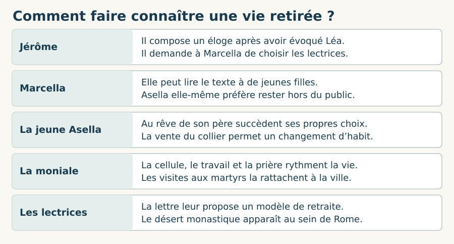

# ENS-PSL · CNEL Lettres — Jérôme — la vie d’Asella 2022 · Corrigé brut

*Corrigé rédigé par IA, non officiel. Signalez toute erreur.*

**Lecture du rapport du jury** · GPT-6.2 Astra Ultra · vitesse non renseignée

**Rédaction** · GPT-6.2 Astra Ultra · vitesse non renseignée

**Autocontrôle** · GPT-6.2 Astra Ultra · vitesse non renseignée

## Faire circuler l’exemple d’une femme qui refuse d’être vue

À Rome, à l’automne 384, Jérôme adresse à Marcella une lettre sur Asella, issue comme sa destinataire de l’aristocratie et engagée dans la vie consacrée. Le geste a quelque chose de paradoxal. L’auteur voudrait que les jeunes filles connaissent une vie dont il vante le secret, tout en demandant à Marcella de ne pas lire la lettre à l’intéressée. Le texte construit donc à la fois un modèle ascétique et les conditions particulières de sa publicité. À qui l’exemple est-il destiné, et comment le rendre visible sans en détruire la valeur ?

Le premier paragraphe défend l’écriture de l’éloge comme celle du blâme. En corrigeant les uns, on instruit les autres. En louant les meilleurs, on stimule le désir de vertu. Jérôme inscrit la lettre sur Asella dans une petite série. Il vient d’évoquer Léa, défunte, et passe de la condition de la veuve à celle de la vierge. Il parle de sa « chère Asella » et prie Marcella de choisir avec discernement les destinataires secondaires. La lettre d’amitié se définit comme un texte à lire à plusieurs, spécialement aux adolescentes. La délicatesse attribuée à Asella justifie qu’elle soit exclue de cette lecture. L’auteur obtient ainsi la possibilité de publier une conduite sans imputer à son héroïne le désir de sa propre renommée. Ce contrôle des voix importe au portrait. Le lecteur n’entend jamais Asella commenter elle-même ses pratiques.

Le deuxième paragraphe se donne pour une omission. Jérôme affirme passer sur les signes d’une élection très précoce, mais les fait connaître en les énumérant. Le père aurait vu en rêve sa fille offerte dans un récipient de cristal. Encore vêtue comme une enfant, elle aurait été consacrée avant d’avoir dépassé sa dixième année. Le discours qui suit distingue ces signes du travail qu’Asella peut revendiquer elle-même. Jérémie, Jean et Paul servent à penser des vocations qui précèdent l’action consciente. La grâce et la prescience divine ne rendent pas sans objet l’effort personnel. Le latin réunit ensuite des verbes d’action, choisir, saisir, garder, commencer, achever. « Après la douzième année » marque le passage à la responsabilité propre. Cette seconde série permet de proposer à l’imitation ce qui, dans une vocation racontée comme exceptionnelle, semblait d’abord hors de portée.

Le paragraphe 3 joue sur une transformation de l’espace. L’étroitesse d’une cellule devient l’étendue du paradis. Une même terre nue sert à la prière et au repos. Avoir faim et prendre nourriture cessent d’avoir pour mesure le plaisir ordinaire. Un pain avec du sel et de l’eau froide suffisent à décrire le régime évoqué. Ces détails corporels ont pour fonction d’inscrire une orientation religieuse dans les objets les plus communs du quotidien. La lettre ne donne pas le journal de l’ascète. Elle choisit des traits qui rendent lisible son refus des signes de richesse et de distinction. La reprise « ce que j’aurais dû dire au début » déplace dans le récit une scène fondatrice. Asella vend en secret, à l’insu de ses parents, son collier d’or et s’achète la tunique sombre que sa mère lui refusait. Le changement d’habit signifie aux proches la décision déjà prise et retourne un bien de l’aristocratie contre la représentation mondaine de ce rang. Le consentement de la maisonnée vient après l’initiative de la jeune fille.

La dernière partie multiplie les manifestations d’un retrait qui n’est jamais une absence complète de relations. Asella évite certains regards, même celui d’une sœur qu’elle aime. Elle travaille de ses mains et fonde cette pratique sur la parole scripturaire reliant travail et nourriture. Ses entretiens avec l’Époux divin prennent la forme de prière ou de psalmodie. Ses déplacements auprès des tombeaux des martyrs relient le secret de la cellule à la géographie chrétienne de Rome. Elle peut ainsi participer à une mémoire collective tout en évitant d’attirer l’attention. Les jeûnes sont décrits selon plusieurs échelles, celle de l’année et celle du carême. Le narrateur les pousse jusqu’à un degré exceptionnel, puis insiste sur la gaieté du visage et l’intégrité du corps parvenu à la cinquantaine. Ce tableau de santé est offert comme un effet de la grâce et comme une preuve d’éloge. Il se lit dans ce régime littéraire et ne saurait établir une proposition médicale générale.

La cadence finale donne au paradoxe spatial sa formule la plus frappante. Asella a trouvé dans la ville tumultueuse le désert des moines. La cellule étroite du début est devenue un lieu capable de modifier le sens de la ville entière. Pour un projet sur les réseaux de femmes du christianisme romain, on pourrait suivre le trajet social de la lettre, de Jérôme à Marcella, puis de Marcella aux jeunes lectrices, et le comparer aux déplacements plus discrets de l’héroïne. Il faudrait compter parmi les conditions de cette vie domestique le rang social de la famille et la médiation d’un auteur masculin qui transforme le secret d’une femme en exemple pour d’autres.

[Sujet officiel](https://www.ens.psl.eu/sites/default/files/dsa-cnel2022-14.pdf) · [Rapport du jury](https://www.ens.psl.eu/sites/default/files/dsa-rapport-cnel2022.pdf)
