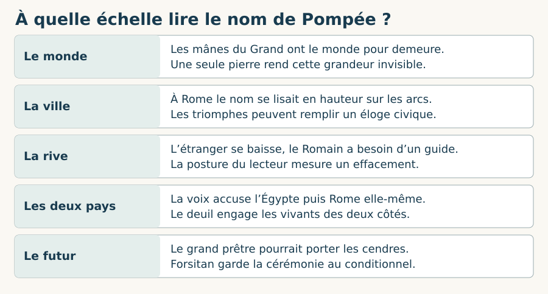

# ENS-PSL · CNEL Lettres — Lucain — la mort de Pompée 2022 · Corrigé brut

*Corrigé rédigé par IA, non officiel. Signalez toute erreur.*

**Lecture du rapport du jury** · GPT-6.2 Astra Ultra · vitesse non renseignée

**Rédaction** · GPT-6.2 Astra Ultra · vitesse non renseignée

**Autocontrôle** · GPT-6.2 Astra Ultra · vitesse non renseignée

## Un nom trop grand pour la pierre qui le porte

Au livre VIII de la *Guerre civile*, l’espoir de trouver refuge en Égypte après Pharsale s’est achevé par la mort de Pompée. L’extrait des vers 793 à 850 déplace l’attention de l’événement de 48 avant notre ère vers la question de sa mémoire publique. Un homme a ménagé au défunt une sépulture modeste. Pourquoi la voix du poète proteste-t-elle d’abord contre l’existence de ce tombeau avant de réclamer le retour des cendres à Rome ? Le passage fait varier ce que doit être une sépulture selon celui qui la regarde, la lit ou assume le devoir de l’entretenir. Les points de suspension du sujet séparent trois séquences conservées et interdisent d’inventer leur liaison exacte.

L’apostrophe à Fortune transforme un objet humble en décision scandaleuse sur la grandeur de Pompée. Lucain imagine que César préfère encore cette sépulture médiocre à une privation complète de terre. Le désigner comme *socer*, beau-père, rappelle le lien familial qui a autrefois uni les adversaires. Le drame public porte la marque d’une parenté déchirée. L’adresse suivante vise la main qui a élevé le tombeau. Il est d’usage qu’une sépulture fixe les mânes et mette fin à leur errance. Ici, le verbe *includis* fait de cette clôture une captivité. Si l’on s’en tient à la valeur du mort, les confins du monde romain sont seuls à donner la mesure qu’appelle son surnom de *Magnus*. L’indignation ne porte donc pas sur le soin privé accordé au corps en tant que tel. Elle vise l’équivalence que la pierre risque d’imposer entre modestie de la tombe et petitesse d’une vie.

Le cas d’Hercule, dont l’Œta entier devient monument, et celui de Bacchus, associé aux hauteurs de Nysa, préparent la chute sur *unus ... lapis*, une seule pierre en Égypte. Le jeu d’échelle est aussi un jeu de nombre. Dans la séquence suivante, les trois triomphes réels de Pompée et les nombreux autres que la voix épique lui fait offrir à la patrie donnent à l’énumération la force d’un éloge civique. Reprendre la toge après la guerre signifie ici reconnaître la qualité de citoyen au-delà du commandement. C’est un portrait partisan. La voix qui célèbre le héros de son épopée sélectionne les actes à inscrire et laisse en retrait les tensions de sa carrière. La question « quel tombeau peut contenir cela ? » met à l’épreuve le langage ordinaire des honneurs funéraires.

Un second dispositif de mesure mobilise le corps des lecteurs. À Rome, le nom se lisait en hauteur, sur les temples et sur les arcs. Sur la rive égyptienne, il frôle le sable. Un étranger qui reste debout ne le lit pas. Un Romain qui traverse le lieu doit se faire montrer la pierre. La différence entre gloire ancienne et effacement présent devient un écart entre deux gestes de lecture. Dans l’hexamètre, le surnom *Magnus* se déploie à des endroits où précisément la stèle ne peut le faire voir. Le poème accomplit ainsi lui-même un travail commémoratif dont il déplore l’absence dans le paysage.

L’accusation change ensuite d’adresse. La terre d’Égypte se trouve traitée comme une personne qui aurait manqué aux obligations d’hospitalité réciproque. Rome a ouvert ses sanctuaires aux dieux égyptiens, Isis et Osiris notamment. L’énumération rituelle sert au poète à demander ce que cette ouverture a reçu en retour. Sa malédiction sur le Nil vise jusqu’au principe de fécondité du pays. Ce portrait polémique appartient à une voix romaine engagée dans le deuil. Il ne constitue pas une description désintéressée de la religion des Égyptiens. Surtout, l’apostrophe *Tu quoque* retourne vers Rome une part du grief. La ville a su accorder des temples au tyran victorieux et n’a pas réclamé les restes de Pompée. L’ombre demeure en exil par la négligence des siens autant que par le lieu de sa mort.

Le futur final est gouverné par *forsitan*. Une crise touchant Rome pourrait la rendre de nouveau attentive à celui qu’elle oublie. Sur l’ordre des dieux, le grand prêtre porterait ses restes dans la ville. Le livre ne raconte donc pas le transfert comme accompli. La poésie ouvre une cérémonie possible, alors que le sable et les flots menacent encore la sépulture réelle. Un projet sur l’inscription funéraire et sa lecture dans l’épopée pourrait partir de cette pierre presque illisible et de ses lecteurs fictifs. On comparerait le nombre de mots que peut recevoir le monument avec la liberté d’adresse, d’amplification et de rappel dont dispose le poème.

[Sujet officiel](https://www.ens.psl.eu/sites/default/files/dsa-cnel2022-4.pdf) · [Rapport du jury](https://www.ens.psl.eu/sites/default/files/dsa-rapport-cnel2022.pdf)
