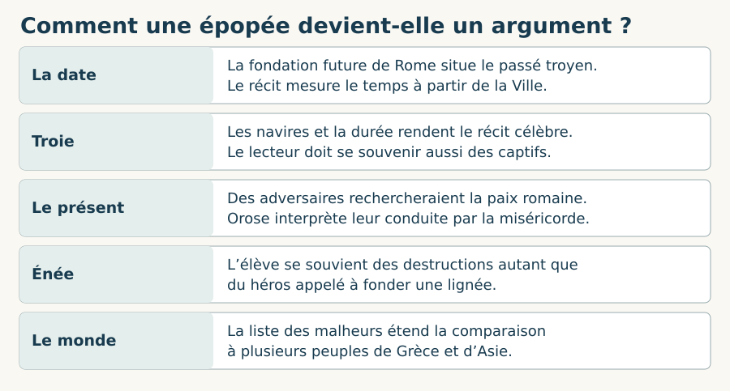

# ENS-PSL · CNEL Lettres — Orose — les Histoires contre les païens 2022 · Corrigé guidé

*Corrigé rédigé par IA, non officiel. Signalez toute erreur.*

**Lecture du rapport du jury** · GPT-6.2 Astra Ultra · vitesse non renseignée

**Rédaction** · GPT-6.2 Astra Ultra · vitesse non renseignée

**Autocontrôle** · GPT-6.2 Astra Ultra · vitesse non renseignée

## Lire les temps du récit et ceux de la démonstration

- **Avant quelle fondation ?** Celle de Rome. *Ante urbem conditam* donne un repère relatif. La scène appartient à un passé antérieur à la Ville.
- **Pourquoi louer Homère ?** Plus le poète enseigné est célèbre, moins son public peut prétendre ignorer les malheurs qu’il raconte.
- **De qui vient l’interprétation providentielle ?** D’Orose. Les propositions sur les ennemis contemporains sont insérées dans son argument pour une miséricorde divine secrète.
- **Quel auteur est cité au chapitre 18 ?** Virgile est un intertexte naturel pour l’histoire d’Énée. C’est toutefois l’enseignement à l’école que le passage nomme comme témoin.
- **Que produit la dernière liste ?** Plusieurs malheurs deviennent les éléments d’une crise étendue à l’Asie et à la Grèce. Il faut examiner le geste de totalisation avant de reprendre chaque synchronisme pour son compte.

Pour votre projet, vous pouvez comparer les mots de la mémoire scolaire et les choix de résumé. Les expressions latines courtes donnent des points de contrôle à cette comparaison.

## Faire témoigner la culture scolaire contre l’idéalisation du passé

Au début du Ve siècle de notre ère, Orose entreprend à la demande d’Augustin une histoire universelle qui répond à ceux qui voient dans le christianisme la cause des malheurs de leur temps. Dans les chapitres 17 et 18 du livre I, il aurait pu opposer des autorités chrétiennes à ses contradicteurs. Il choisit plutôt de les reconduire à deux histoires qu’ils ont apprises à admirer, celles de Troie et d’Énée. Comment faire témoigner une épopée héroïque contre la nostalgie des temps héroïques ? Orose prend l’éclat même de son enseignement pour garantie qu’on ne saurait avoir oublié les malheurs qu’elle raconte.

La date se lit selon un calendrier romain, quatre cent trente ans avant la fondation de la Ville. Le chiffre fourni par le texte ne date donc pas l’événement de 430 avant notre ère. Il institue Rome en point de repère avant même que Rome existe. La première série nominale contracte l’enlèvement d’Hélène, la coalition des Grecs, les mille navires, les dix années de siège et la ruine finale. Le passif *praedicatur* rappelle que cette histoire fait l’objet d’une proclamation ou d’une tradition. Le narrateur ne se présente pas comme son découvreur. Les liens de succession suffisent à identifier les événements célèbres. Le changement de ton vient des interrogatifs de quantité qui font des peuples entraînés et éprouvés par le même tourbillon le véritable objet de l’enquête. Derrière le nombre prestigieux des navires apparaissent la durée de l’épreuve et la multiplicité des victimes.

L’éloge d’Homère surprendrait si la défense du christianisme supposait de rejeter tout le savoir antérieur. Sa poésie est éminente, son chant d’une clarté éclatante. Ces qualités permettent justement de renvoyer ses lecteurs à une connaissance acquise en commun. Il serait trop long de reprendre l’histoire dans l’ordre, déclare Orose. Le refus de redéployer le récit a une fonction argumentative. Dès lors que ses adversaires savent, la question se déplace de l’établissement du fait vers l’usage qu’ils font de leur mémoire. Le verbe *didicerunt*, « ils ont appris », commande *videant*, « qu’ils examinent ». Celui qui accepte de louer le passé héroïque devra expliquer pourquoi il ne compte pas ses captifs et ses villes détruites lorsqu’il juge la situation actuelle.

La comparaison qui suit est orientée par la *misericordia Dei*, qualifiée de secrète. Dieu n’apparaît pas comme un intervenant visible dans le récit de Troie. Il est le principe d’interprétation d’une conduite contemporaine qui paraît paradoxale. Les ennemis que les Romains redoutent seraient capables de poursuivre la guerre, mais rechercheraient la paix, offriraient des otages et s’exposeraient eux-mêmes contre d’autres peuples. La formule concessive et l’objection anticipée sur un prétendu goût de la tranquillité organisent cette démonstration. Même les ennemis conserveraient de la vigueur tout en œuvrant pour la paix romaine. Le texte ne fournit pas ici les éléments pour identifier sans réserve chacune des populations visées. Il fait surtout voir comment une pratique diplomatique peut être lue comme signe providentiel. Cette inférence est celle de l’apologiste et suppose un accord théologique que le lecteur doit pouvoir distinguer des faits allégués.

Le chapitre 18 ramène ensuite le malheur au cœur de l’ascendance romaine. Énée est d’abord un exilé de Troie. Son arrivée en Italie suscite trois années de guerre et implique de nombreux peuples dans la haine et la destruction. Le récit national qui pouvait donner un sens aux souffrances initiales est relu du côté du coût humain de ce commencement. La culture virgilienne est reconnaissable mais le chapitre ne nomme pas Virgile, tandis qu’il avait nommé Homère. Le témoin explicitement cité est ici l’école. L’image du souvenir « marqué au fer », *inustum*, associe la solidité de la mémoire scolaire à la violence dont elle porte la trace. En incluant sa propre mémoire, l’auteur se place du côté de ses lecteurs avant de contester leur manière de choisir ce qu’ils y retiennent.

L’énumération finale des retours malheureux, des revers péloponnésiens, de Codros et des Thraces élargit simultanément le cadre à l’Asie et à la Grèce. Le rapprochement condense des traditions qui n’ont ni le même degré d’attestation ni la même fonction dans leurs récits premiers. Cette compression donne sa force à l’histoire universelle d’Orose et en fixe aussi une limite documentaire. Pour un projet sur l’enseignement antique de l’épopée, on comparerait la place de la mémoire commune chez Orose et les textes mêmes auxquels elle pouvait donner accès. Il s’agirait de demander ce qu’un résumé apologétique sélectionne dans une formation littéraire dont il reste profondément tributaire.

[Sujet officiel](https://www.ens.psl.eu/sites/default/files/dsa-cnel2022-12.pdf) · [Rapport du jury](https://www.ens.psl.eu/sites/default/files/dsa-rapport-cnel2022.pdf)
