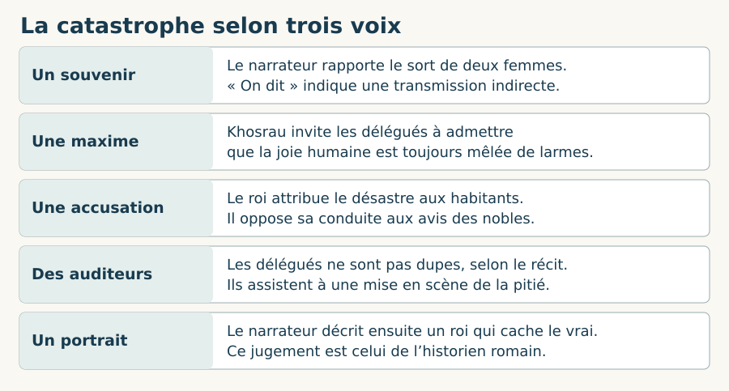

# ENS-PSL · CNEL Lettres — Procope — la prise d’Antioche 2022 · Corrigé guidé

*Corrigé rédigé par IA, non officiel. Signalez toute erreur.*

**Lecture du rapport du jury** · GPT-6.2 Astra Ultra · vitesse non renseignée

**Rédaction** · GPT-6.2 Astra Ultra · vitesse non renseignée

**Autocontrôle** · GPT-6.2 Astra Ultra · vitesse non renseignée

## Repérer qui atteste quoi

1. Le narrateur introduit l’anecdote des deux femmes par « on dit ». Un détail concret peut être transmis indirectement.
2. Le roi part d’une maxime commune avant d’appliquer cette maxime à sa victoire. Comparez les pronoms de l’ouverture au « je » qui revendique une compassion personnelle.
3. Les souffrances décrites dans le récit précèdent l’accusation du roi contre les habitants. L’ordre de lecture fait déjà travailler la contradiction.
4. La maxime finale sur les prisonniers appartient au personnage. Le paragraphe suivant invite explicitement à la réévaluer.
5. Pour conclure, distinguez la version du roi telle que la compose Procope et le portrait politique qu’en tire ensuite l’historien. Ce dispositif littéraire ne donne pas une transcription indépendante des paroles prononcées en 540.

Le projet de recherche peut comparer, dans plusieurs ambassades racontées par Procope, le public présent dans la scène et le public futur auquel l’historien veut apprendre à juger.

## Après la prise de la ville, qui aura le dernier mot ?

Dans le livre II des *Guerres contre les Perses*, Procope revient sur la prise d’Antioche par Khosrau en 540, sous le règne de Justinien. Le sujet rappelle que les habitants ont refusé de monnayer leur salut. L’extrait commence au milieu du récit et s’achève sur un portrait moral du souverain sassanide. Entre les deux, le lecteur entend un discours qui prétend rendre compte du même événement. Comment un historien dénonce-t-il une parole mensongère après lui avoir ménagé tant de place ? En faisant précéder et suivre la voix du roi de deux récits différents, Procope invite son lecteur à juger les opérations par lesquelles se construit une version officielle de la catastrophe.

La fin du chapitre VIII présente d’abord un malheur collectif. Le texte évoque l’ampleur des pertes et l’indifférence des vainqueurs à l’âge de ceux qui se présentent devant eux. À cette notation générale succède le sort de deux femmes de familles éminentes. Il est introduit par « on dit », *phasi*. L’historien marque par cette formule le mode de transmission du détail. Le lecteur ne peut donc pas attribuer à Procope la qualité de témoin oculaire de la scène. Le geste du voile et la disparition des femmes dans l’Oronte donnent une forme singulière à la peur des violences. Le narrateur les désigne par leur place dans la cité. Leur parole reste absente, mais leur peur prend place dans l’histoire publique de la ville. Revenant des deux vies à l’ensemble des habitants, la dernière phrase referme ce tableau sur la diversité de leurs malheurs.

Le changement de chapitre donne la parole à l’homme dont les habitants viennent de subir la victoire. Khosrau ne commence ni par un ordre ni par un bilan. Il choisit une vieille maxime sur les biens mêlés de maux. Le pluriel de la première personne associe momentanément le roi, les délégués et tous les hommes à une expérience commune, celle de la joie mêlée de larmes. Cette ampleur proverbiale a un effet diplomatique. Elle propose une région d’accord avant même que soient discutées les responsabilités. Lorsqu’il applique la maxime au cas d’Antioche, le locuteur s’attribue une sensibilité capable de souffrir jusque dans la victoire. Il fait de la renommée de la ville un hommage aux vaincus, mais cette valeur ajoute aussi au prestige de celui qui vient de la soumettre. La mention « comme vous l’avez vu » tente d’annexer le témoignage des délégués à l’interprétation du vainqueur.

Le mot « trophée » concentre la tension du discours. Alors qu’il devrait rendre la victoire visible dans toute sa gloire, le sang dont le roi le dit baigné paraît en annuler la joie. Le roi donne en revanche à ce spectacle une causalité qui l’innocente. Les habitants d’Antioche seraient les auteurs de leur propre malheur pour avoir résisté. À cette première translation du blâme s’en ajoute une seconde, des décisions royales vers le conseil des nobles perses. Ceux-ci auraient réclamé la rigueur extrême tandis que le souverain aurait favorisé le salut des fugitifs. La fin du discours revient à une maxime, celle qui interdit d’accabler les prisonniers. Symétrique de l’ouverture proverbiale, cette sentence prétend enfermer les faits dans le cadre d’une sagesse commune. Le lecteur se souvient pourtant des femmes dont la peur avait inauguré l’extrait.

Le chapitre IX, paragraphes 7 et 8, ôte au roi le contrôle de sa propre parole. Les délégués n’auraient pas été dupes du motif allégué. Le passage imprimé ne donne pas à cet endroit le détail d’une autre explication et il serait imprudent de combler le silence. Procope passe du jugement sur ce discours à une caractérisation habituelle de Khosrau. Dire le faux, cacher le vrai, déplacer le blâme constituent trois opérations distinctes, comme le montre leur coordination. Les serments aussitôt oubliés, l’avidité et le visage façonné pour paraître vertueux composent enfin un portrait de l’hypocrisie politique. Au discours singulier succède un caractère supposé permanent. Cette généralisation révèle aussi le pouvoir du narrateur romain. On ne contrôle pas l’authenticité littérale des paroles du roi en adoptant simplement le jugement que porte sur lui son adversaire.

Un projet sur les discours diplomatiques dans l’historiographie grecque pourrait prendre pour point de départ les changements de statut de la parole dans cette page. Il distinguerait le témoignage introduit comme ouï-dire, le discours direct composé pour le lecteur, les destinataires qui y assistent et le commentaire qui en requalifie le sens. La catastrophe d’Antioche apparaît alors comme un conflit mémoriel autant qu’un événement daté de l’histoire romano-perse.

[Sujet officiel](https://www.ens.psl.eu/sites/default/files/dsa-cnel2022-13.pdf) · [Rapport du jury](https://www.ens.psl.eu/sites/default/files/dsa-rapport-cnel2022.pdf)
