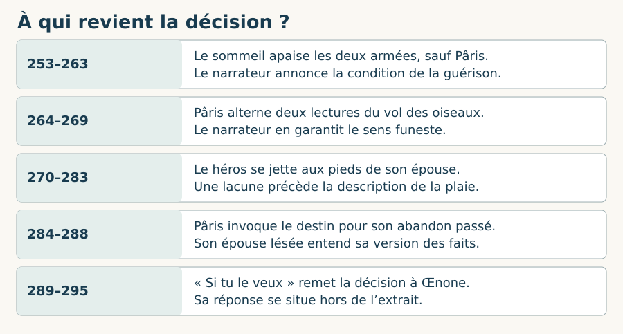

# ENS-PSL · CNEL Lettres — Quintus de Smyrne — la Suite d’Homère 2022 · Corrigé brut

*Corrigé rédigé par IA, non officiel. Signalez toute erreur.*

**Lecture du rapport du jury** · GPT-6.2 Astra Ultra · vitesse non renseignée

**Rédaction** · GPT-6.2 Astra Ultra · vitesse non renseignée

**Autocontrôle** · GPT-6.2 Astra Ultra · vitesse non renseignée

## À quelles conditions l’épouse délaissée peut-elle sauver Pâris ?

À la fin de l’*Iliade*, les Troyens ensevelissent Hector. Dans le livre X de la *Suite d’Homère*, la perspective de perdre un autre prince troyen ramène le récit auprès d’une femme absente de la grande scène iliadique, Œnone, première épouse de Pâris. Le titre du livre et la connaissance du mythe rendent la mort de Pâris prévisible. Pourtant, aux vers 253 à 295, l’intérêt tient à la clause qui pourrait encore le sauver. Le narrateur et le suppliant formulent presque dans les mêmes termes la condition dont tout dépend. Entre les deux énoncés s’ouvre un espace où la responsabilité personnelle peut être interrogée jusque dans un monde régi par les destins.

Le récit commence au plus près de la voix et du cœur de Pâris. À ses cris répond le mouvement empressé des médecins. L’élargissement soudain du cadre aux deux armées semble d’abord promettre à tous la même interruption. Troyens et Danaens regagnent leurs lieux respectifs, puis une seule nuit se répand sur toutes les paupières. Le sommeil est dit protecteur contre les peines. Sa puissance ressort du geste presque maternel par lequel la nuit le verse. Au vers 259, le retour de son nom après l’adversative exclut un seul corps de ce bénéfice commun. Pâris reste éveillé jusqu’à l’aube. Après avoir séparé le personnage de ses compagnons, le poète isole parmi tous les soigneurs une personne momentanément absente. Le balancement entre la bonne volonté inefficace des uns et la volonté encore inconnue d’Œnone s’achève sur la brève condition « si elle y consent ». La place des mots laisse au lecteur le temps de prendre la guérison pour une promesse avant de découvrir de qui cette promesse dépend.

La route transforme l’annonce du destin en embarras moral. Pâris obéit à l’oracle et se rend auprès de sa véritable épouse « malgré lui ». Les oiseaux tantôt l’effraient, tantôt lui paraissent voler en vain. L’alternance appartient à la conscience hésitante du blessé. Le narrateur, lui, confirme la valeur funeste du signe. Cette différence de savoir n’abolit pas l’intensité de l’attente. Elle fait mesurer ce qu’il en coûte à l’homme qui a abandonné Œnone de reconnaître qu’il a besoin d’elle. Au moment de l’arrivée, les regards des servantes et celui de l’épouse convergent sur le corps de Pâris. Il tombe à ses pieds. La lacune signalée par l’éditeur après ce geste impose de laisser en suspens la liaison exacte avec la description de la plaie. On peut en revanche suivre le mouvement du texte conservé, de la surface visible jusqu’à la moelle, puis de ce détail corporel à la longue comparaison de la soif.

Le comparant est ici un malade anonyme. Son âme semble voleter sur des lèvres sèches, désireuse dans le même mouvement de vie et d’eau. Un héros de l’épopée est représenté à travers un besoin qui pourrait être celui de n’importe qui. Le retour au comparé reprend le motif de la brûlure intérieure. Sur ces lèvres qui paraissaient devoir ne laisser passer que l’âme vient pourtant un dernier discours. La comparaison prépare ainsi à entendre une parole matériellement difficile. La faible voix n’en manie pas moins avec force les ressources de la supplication.

Pâris appelle Œnone « femme vénérable » avant de lui rappeler qu’il l’a laissée seule. Le verbe de l’abandon, à la première personne, reconnaît un acte dont la formule « malgré moi » déplace aussitôt la responsabilité vers les Destins. On entend la même formule que dans le récit de sa marche vers Œnone. Mais, dans cette seconde occurrence, c’est Pâris qui explique son ancienne conduite à la femme lésée et qui attend d’elle une faveur. La scène laisse au lecteur le soin de mesurer la différence entre contrainte annoncée par le poète et excuse avancée par un personnage. Le souhait impossible de mourir autrefois dans ses bras, avant Hélène, substitue une autre fin imaginaire au passé réel. Il sollicite la pitié tout en rouvrant la blessure conjugale.

L’appel aux dieux, à la couche et à l’ancienne intimité conduit aux impératifs qui demandent l’apaisement et la guérison. Les mains d’Œnone, annoncées au début de l’épisode, peuvent enfin agir. La condition à la troisième personne devient une seconde personne, « si tu le veux ». Dans l’ultime alternative, sauver ou refuser relèvent d’un même sujet. Aucune réponse d’Œnone n’est encore donnée dans l’extrait. Placer ce terme après la longue voix masculine confère au silence de l’épouse une autorité que la conduite passée de Pâris lui avait refusée.

Un projet possible sur les scènes de supplication dans les prolongements d’Homère comparerait ce geste aux genoux et les appels à la mémoire conjugale avec les appels à la mémoire familiale dans la rencontre de Priam et d’Achille au chant XXIV de l’*Iliade*. On examinerait qui peut se souvenir avec qui, qui parle au nom du mort ou du mourant, et à quel moment le récit révèle la décision de la personne sollicitée.

[Sujet officiel](https://www.ens.psl.eu/sites/default/files/dsa-cnel2022-3.pdf) · [Rapport du jury](https://www.ens.psl.eu/sites/default/files/dsa-rapport-cnel2022.pdf)
