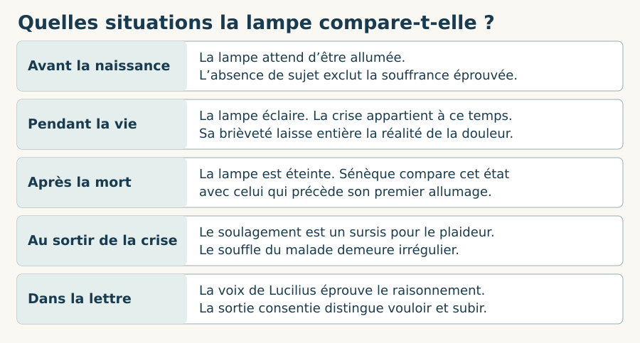

# ENS-PSL · CNEL Lettres — Sénèque — la Lettre 54 2022 · Corrigé guidé

*Corrigé rédigé par IA, non officiel. Signalez toute erreur.*

**Lecture du rapport du jury** · GPT-6.2 Astra Ultra · vitesse non renseignée

**Rédaction** · GPT-6.2 Astra Ultra · vitesse non renseignée

**Autocontrôle** · GPT-6.2 Astra Ultra · vitesse non renseignée

## Trois temps à garder distincts

Le *suspirium* appartient au présent douloureux du vivant. L’absence d’existence avant la naissance et l’absence d’existence après la mort constituent les deux termes de l’analogie. Les confondre conduirait à nier la douleur pourtant décrite par Sénèque.

1. **Pourquoi l’image du plaideur ?** Le report d’une audience ne vaut pas victoire. De même, le répit après une crise ne supprime pas la mortalité.
2. **Quelle comparaison contient *antequam accenditur* ?** La lampe éteinte et la lampe avant d’être allumée. Vérifiez le latin, car la formulation française imprimée abrège ici la seconde situation.
3. **Comment Sénèque se parlait-il sans souffle ?** Il le précise au paragraphe 6 : ses exhortations étaient silencieuses. La forme écrite rend cette parole intérieure partageable.
4. **Que peut vouloir le sage ?** Il peut consentir à la nécessité sans cesser d’aimer vivre. Il ne commande ni l’événement ni le fonctionnement du corps.

Pour relier le passage à une recherche, on peut relever d’autres *inquis* dans le recueil et demander ce que l’objection fictive fait accomplir à l’argument. La difficulté réelle de la lettre est d’articuler l’expérience d’une crise et une thèse sur l’absence de sujet après la mort.

## Le temps de reprendre souffle et le temps d’apprendre à mourir

La Lettre 54 des *Lettres à Lucilius* s’ouvre sur un retour soudain de la maladie. Le lecteur pourrait attendre le récit rassurant d’un ami qui écrit parce qu’il a échappé au danger. Sénèque se défie précisément de cette interprétation. La lettre enchaîne description du *suspirium*, examen de l’idée de mort et résolution personnelle. L’exercice philosophique demeure pris dans un corps dont le souffle n’est pas redevenu régulier.

Dans les deux premiers paragraphes, la soudaineté du mal se traduit par un changement de rapport grammatical : c’est la maladie qui envahit le locuteur. Sénèque imagine les questions de Lucilius et se donne un mot latin, *suspirium*, dont il juge qu’il suffit à exprimer ce qu’il éprouve. L’écrivain rend un savoir sur le corps accessible dans la langue commune. L’attaque est brève comme une tempête ; une question incisive fait jouer sur *exspirat* l’expiration corporelle et l’idée d’être à l’extrémité de la vie. Les médecins nomment l’affection un exercice de la mort. Sénèque s’empare de la formule : ce que le corps essaie souvent réussira un jour. L’effet de la phrase tient à la disproportion entre la brièveté répétée d’une crise et l’échéance unique qu’elle annonce.

Au paragraphe 3, le malade se compare à un plaideur qui confondrait le renvoi d’une audience avec une victoire au procès. La crise a cessé, tandis que la condition mortelle subsiste. Distinguer le sursis de la guérison transforme la question du correspondant imaginaire : comment peut-on écrire avec assurance si l’on sait que l’issue reste certaine ? La réponse prend la forme d’un discours intérieur dont le corps empêchait l’émission à voix haute. Le récit épistolaire donne donc aujourd’hui une voix à une pensée qui devait hier se parler en silence. La maladie est tout ensemble l’obstacle matériel à la parole et l’épreuve qui rend son contenu nécessaire.

Le centre de la lettre retourne les termes de l’expérience. La mort me met souvent à l’épreuve, mais je l’ai moi-même longtemps éprouvée, dit Sénèque. *Quando ?* L’interlocuteur relaie l’étonnement du lecteur : personne n’a de souvenir de sa propre mort. Le raisonnement déplace le sens d’éprouver : le non-être après la mort n’a pas plus de sujet pour le subir que le non-être avant la naissance. S’il constituait en lui-même une souffrance, le temps antérieur aurait dû être éprouvé comme une souffrance aussi. Or il n’y avait pas alors de sujet souffrant. L’image de la lampe précise l’analogie. Le latin oppose explicitement l’état de la lampe éteinte à celui qui précède son allumage, *antequam accenditur*. La traduction en regard ramasse imprudemment ce second terme en une comparaison avec la lampe allumée. Pour comprendre la démonstration, il faut conserver les deux dehors de la vie et l’intervalle éclairé entre eux. La douleur contemporaine d’une crise appartient précisément à cet intervalle. La thèse n’en nie pas la réalité.

Le paragraphe 6 ramène le lecteur au devenir sensible de la respiration. Les intervalles s’élargissent, mais le souffle garde des hésitations. Aucune guérison miraculeuse ne récompense l’exercice philosophique. Le jeu de mots sur le soupir corporel et le soupir de l’âme porte plutôt sur un second domaine d’action. Sénèque ne choisit pas librement ni le retour ni la durée de la crise. Il entend cependant soustraire son consentement à la panique qui prétend faire du non-être un avenir indéfiniment souffert. La description d’une sensation persistante empêche la résolution finale de passer pour une indifférence facile.

Enfin l’amitié épistolaire fait passer de « je » à « tu », puis à la figure du sage. Il faut pouvoir prendre plaisir à vivre sans exiger que ce plaisir soit garanti contre la mort. Le dernier paradoxe, dans la série *eicior*, *exeam*, *inuitus*, distingue être expulsé et sortir : le même événement nécessaire change de signification si le sujet ne prétend plus y opposer une volonté impuissante. Il ne décide pas de sa mort ; il peut vouloir faire bon usage d’une vie qui comprend cette nécessité. Le *vale* rend la leçon au correspondant concret auquel la lettre souhaite de se bien porter.

Un projet de recherche possible serait de comparer la façon dont les lettres de Sénèque mettent en scène les objections d’un ami absent. Dans celle-ci, *inquis* et les questions courtes empêchent la thèse stoïcienne d’être un monologue sans épreuve. Il faudrait distinguer la fonction du dialogue fictif, l’expérience vécue qui lui sert d’occasion et les analogies qui rendent un argument transmissible à Lucilius.

[Sujet officiel](https://www.ens.psl.eu/sites/default/files/dsa-cnel2022-9.pdf) · [Rapport du jury](https://www.ens.psl.eu/sites/default/files/dsa-rapport-cnel2022.pdf)
