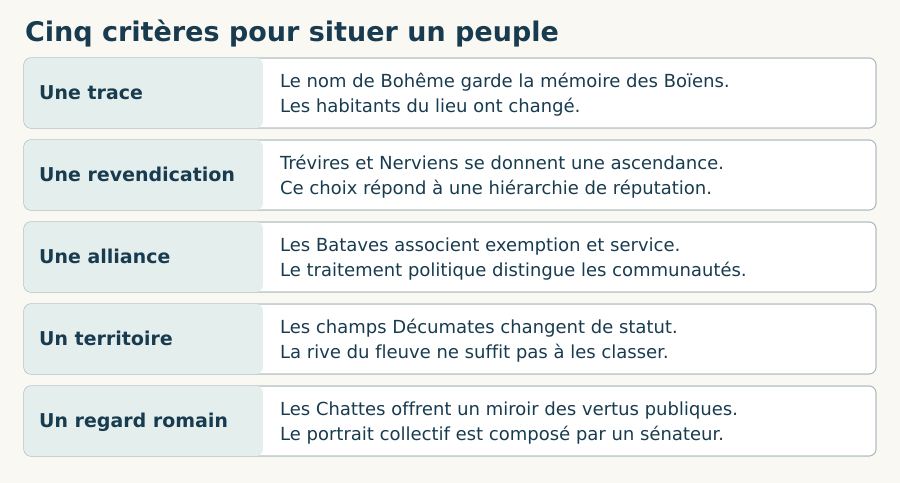

# ENS-PSL · CNEL Lettres — Tacite — les peuples de Germanie 2022 · Corrigé brut

*Corrigé rédigé par IA, non officiel. Signalez toute erreur.*

**Lecture du rapport du jury** · GPT-6.2 Astra Ultra · vitesse non renseignée

**Rédaction** · GPT-6.2 Astra Ultra · vitesse non renseignée

**Autocontrôle** · GPT-6.2 Astra Ultra · vitesse non renseignée

## Le Rhin, frontière politique et mémoire des passages

La seconde partie de la *Germanie* présente des peuples particuliers après une description générale. Dans les chapitres 28 à 30, Tacite aborde les communautés proches de la Gaule et de Rome. On pourrait s’attendre à ce qu’un fleuve sépare deux populations aux caractères fixes. Le premier chapitre s’ouvre au contraire sur une migration des Gaulois et le deuxième exclut de la Germanie un territoire pourtant situé au-delà du Rhin. Que fait l’enquêteur quand ascendance, langue, réputation, résidence et droit politique donnent des réponses différentes à la question de l’appartenance ? Il compose un classement qui garde les traces d’une histoire et porte le regard d’un sénateur romain sur sa propre société.

Tacite commence par l’autorité du divin Jules. César rapporte qu’autrefois les Gaulois furent les plus forts. Si les positions de puissance ont varié, le fleuve ne pouvait à lui seul empêcher les groupes de le franchir. La question sur le faible obstacle d’un cours d’eau fait intervenir le moment où les royaumes n’avaient pas encore partagé leurs territoires. À la preuve littéraire s’ajoute celle du nom de Boihaemum. La région conserve la mémoire des Boïens alors que ses habitants ont changé. Un nom peut donc être un témoin fidèle d’une présence ancienne précisément là où il ne décrit plus la population actuelle. Les Aravisques et les Oses donnent ensuite une limite à la capacité de trancher. Une langue, des usages et des institutions identiques ne permettent pas de déterminer dans quel sens le déplacement s’est produit. Le mot *incertum* ménage une place à la suspension du jugement dans l’ethnographie antique.

La prétention des Trévires et des Nerviens à une origine germanique introduit un autre type de témoignage. Cette revendication aurait pour enjeu de les soustraire au discrédit que le narrateur attribue à la « mollesse » des Gaulois. Ainsi rapportée, l’ascendance revendiquée renseigne aussi sur la hiérarchie de valeurs dans laquelle les groupes sont décrits. Le cas des Ubiens ajoute l’histoire d’une nomination romaine. Ils préfèrent le nom lié à Agrippine et à la colonie, sans avoir à rougir pour autant de leur origine selon Tacite. Le motif de leur installation est lui-même interprété politiquement. Rome les aurait placés sur sa rive comme gardiens, par confiance en leur fidélité. L’honneur du service explique comment une communauté située dans l’Empire continue à être désignée par une appartenance germanique.

Le chapitre 29 rend plus visible encore la diversité des statuts. Les Bataves seraient issus des Chattes à la suite d’une dissension. Leur alliance et leur ancienne contribution au service de Rome leur valent de ne pas verser le tribut ordinaire. La relation à l’Empire associe un privilège et une obligation. Qualifier ce peuple par sa valeur guerrière est une manière romaine de faire coïncider admiration ethnographique et intérêt impérial. Le propos peut être replacé dans le souvenir de la révolte batave de 69–70, au moment où Vespasien prit le pouvoir. Cette révolte n’est toutefois pas racontée ici. Les Mattiaques dépendent eux aussi de Rome en demeurant sur la rive opposée. Tacite distingue leur résidence de leur adhésion politique en disant que leur esprit et leur cœur sont avec les Romains. Cette image d’intériorité est une affirmation de loyauté produite par le texte, pas le témoignage autonome de chacun des intéressés.

La phrase sur les champs Décumates met enfin à l’épreuve l’extension du nom même de Germanie. « Je ne compterais pas » parmi ses peuples ceux qui occupent ces terres, bien qu’ils soient au-delà du Rhin et du Danube. Des Gaulois s’y seraient installés alors que la possession en était disputée. L’organisation d’une limite et la présence romaine les ont ensuite intégrées à l’espace provincial. La frontière se révèle le résultat d’une histoire. Ce tableau garde la mémoire des transformations du Ier siècle et des entreprises flaviennes dans la région. L’œuvre, généralement datée de 98, appartient au début du règne de Trajan. L’inscrire dans les perspectives de l’époque flavienne oblige donc à distinguer mémoire récente et date de rédaction.

Au début du chapitre 30, les Chattes entament une série nouvelle. La forêt d’Hercynie et le relief accompagnent leur entrée en scène, puis le portrait convoque corps, expressions et dispositions morales. L’accumulation leur attribue jugement, discipline et capacité à reconnaître l’autorité. L’éloge s’achève sur une qualité que Rome elle-même aurait rarement obtenue, attendre davantage du chef que de l’ensemble de ses hommes. L’admiration des étrangers offre au sénateur une occasion de confronter Rome à ses propres valeurs. La généralisation est un procédé du portrait collectif, non une propriété vérifiée de chaque habitant.

Pour éclairer des périodes ultérieures, un projet possible suivrait dans les inscriptions les noms civiques des Ubiens et de la colonie de Cologne, puis dans des documents plus tardifs les transformations de la désignation du territoire. Une continuité de toponyme, une continuité de population et une continuité institutionnelle demandent trois démonstrations différentes. Le texte du début de l’Empire fournit une comparaison datée, particulièrement précieuse parce qu’il décrit déjà des changements. Il ne donne pas l’origine immobile de nations modernes.

[Sujet officiel](https://www.ens.psl.eu/sites/default/files/dsa-cnel2022-15.pdf) · [Rapport du jury](https://www.ens.psl.eu/sites/default/files/dsa-rapport-cnel2022.pdf)
