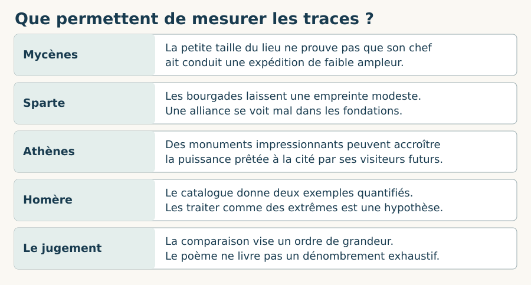

# ENS-PSL · CNEL Lettres — Thucydide — les vestiges et la puissance des cités 2022 · Corrigé brut

*Corrigé rédigé par IA, non officiel. Signalez toute erreur.*

**Lecture du rapport du jury** · GPT-6.2 Astra Ultra · vitesse non renseignée

**Rédaction** · GPT-6.2 Astra Ultra · vitesse non renseignée

**Autocontrôle** · GPT-6.2 Astra Ultra · vitesse non renseignée

## Une expérience de pensée pour juger les traces de l’histoire

Mycènes a-t-elle pu dominer une expédition de toute la Grèce alors que sa ville paraît si petite ? Au chapitre X du livre I de la *Guerre du Péloponnèse*, cette objection porte sur la possibilité même de comparer la grandeur des entreprises anciennes et présentes. Thucydide répond en demandant à son lecteur de se faire un instant l’archéologue de deux villes encore habitées. Ayant éprouvé sur son propre présent la fragilité d’un indice visuel, il pourra revenir à la tradition homérique et la soumettre à une autre enquête.

La première phrase distingue la grandeur de l’expédition et celle de l’agglomération d’où serait parti son chef. Entre les deux, il faudrait une relation assez stable pour que la petite taille de la seconde infirme la première. Or c’est précisément cette force probante que l’historien refuse à l’indice, *sêmeion*. Il ne tranche pas encore la question de la vérité du récit homérique. Il écarte une mauvaise raison de lui refuser toute créance. Le présent du lecteur, pour qui Mycènes paraît petite, et le passé auquel il voudrait attribuer la même petitesse doivent être dissociés.

Sparte fournit une expérience contrôlée par le savoir des contemporains. Supposons la ville déserte et ses bâtiments réduits aux sanctuaires et aux fondations. Un observateur futur douterait de l’ampleur de sa puissance. Thucydide lui oppose ce qu’il peut savoir au moment où il écrit. Les Lacédémoniens administrent deux cinquièmes du Péloponnèse, exercent leur hégémonie sur l’ensemble et disposent d’alliés extérieurs. Ces trois échelles de pouvoir ne coïncident pas avec trois cercles de constructions visibles. Une organisation par bourgades et l’absence de grands édifices d’apparat produisent une empreinte différente de celle que pourrait laisser une agglomération concentrée. Le lecteur mesure ainsi ce que perd une image des lieux lorsqu’elle efface les liens de commandement et d’alliance.

Athènes apporte la contre-épreuve. La même disparition des habitants y laisserait un spectacle susceptible de suggérer une puissance double de la puissance réelle. Le verbe de conjecture désigne bien une estimation du futur observateur. « Double » caractérise la force de l’illusion, pas la valeur d’une conversion entre surface monumentale et puissance politique. Si Sparte seule avait été citée, on aurait pu croire qu’il suffit de corriger toutes les traces à la hausse. Le second exemple montre que l’erreur peut jouer en sens inverse. La prudence est une méthode de comparaison, non un coefficient universel. Elle permet de tenir ensemble deux propositions. Troie a donné lieu à une entreprise plus grande que les précédentes, laquelle demeurait pourtant inférieure aux entreprises du temps de l’historien.

Le passage à Homère met une autre source à l’épreuve. Le poète pourrait avoir embelli les faits pour les grandir. Même en lui concédant cet embellissement, l’historien relève que son propre récit n’impose pas de conclure à une masse exceptionnelle. Le catalogue donne mille deux cents navires selon Thucydide, mais n’indique la taille des équipages que dans deux cas, cent vingt pour les Béotiens et cinquante pour les compagnons de Philoctète. Y voir le plus grand et le plus petit effectifs est déjà une hypothèse, signalée comme telle par « à mon avis ». Rien n’indique combien de bateaux appartiennent à chaque catégorie. La recherche d’un ordre de grandeur ne saurait donc donner un total documenté. Une autre observation du catalogue précise que plusieurs fonctions reviennent aux mêmes personnes, ce qui empêche de dénombrer deux populations distinctes. La question n’est jamais de refaire la guerre de Troie. Le texte montre comment interroger le contenu informatif d’un poème dont on reconnaît le travail d’embellissement.

Ce chapitre associe ainsi deux exercices de contrôle réciproque. Une trace matérielle peut sous-évaluer ou surévaluer un pouvoir connu. Une tradition poétique qui tend à grandir son objet conserve des détails permettant de prendre la mesure de cette amplification. Pour un projet sur la mémoire monumentale des cités, on pourrait comparer les indices utilisés ici à des inscriptions d’alliance et à la distribution de sanctuaires. Il faudrait préciser chaque fois si l’indice renseigne sur la densité de l’habitat, la richesse investie dans un lieu ou une relation politique susceptible de n’y laisser aucune trace.

[Sujet officiel](https://www.ens.psl.eu/sites/default/files/dsa-cnel2022-6.pdf) · [Rapport du jury](https://www.ens.psl.eu/sites/default/files/dsa-rapport-cnel2022.pdf)
