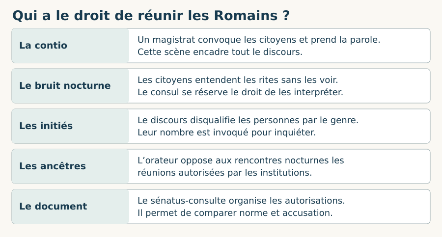

# ENS-PSL · CNEL Lettres — Tite-Live — les Bacchanales 2022 · Corrigé guidé

*Corrigé rédigé par IA, non officiel. Signalez toute erreur.*

**Lecture du rapport du jury** · GPT-6.2 Astra Ultra · vitesse non renseignée

**Rédaction** · GPT-6.2 Astra Ultra · vitesse non renseignée

**Autocontrôle** · GPT-6.2 Astra Ultra · vitesse non renseignée

## Entendre trois niveaux de parole

L’historien compose, le consul parle et le peuple écoute. Les bruits attribués aux rites proviennent du récit de Postumius ; ils ne sont pas une description par les initiés. Relire les apostrophes *Quirites* aide à suivre la transformation de l’auditoire en corps civique.

1. **Pourquoi commencer par la prière ?** Les auditeurs viennent d’accomplir un rite reconnu et sont invités à juger les autres pratiques à partir de cette expérience.
2. **Pourquoi le consul hésite-t-il entre parler et se taire ?** Cette hésitation lui donne l’apparence du scrupule et suggère en même temps que le danger déborde les paroles.
3. **La foule est-elle faible ou puissante ?** Le discours combine dépréciation présente et menace d’accroissement. C’est un ressort de persuasion.
4. **Que vérifie l’inscription de Tiriolo ?** L’existence et la forme d’un encadrement sénatorial. Elle ne certifie pas toutes les accusations morales de l’orateur de Tite-Live.

Une piste de recherche sur les mots de la réunion et de l’interdiction donne au projet une prise textuelle précise.

## Une assemblée civique mise en garde contre d’autres assemblées

Tite-Live fait parler le consul Postumius devant les citoyens de Rome à propos de l’affaire des Bacchanales de 186 avant notre ère. L’extrait XXXIX, 15, 2-14 ne montre aucune cérémonie bachique directement. Il donne la parole à une autorité qui prétend avoir découvert le sens véritable des réunions et qui doit persuader son auditoire d’accepter leur répression. Le propos a d’autant plus de force qu’il est lui-même prononcé en assemblée : le consul distingue les bons rassemblements des mauvais devant des citoyens dont la présence lui fournit immédiatement un exemple des premiers. Le discours fait ainsi du trouble religieux une épreuve de la maîtrise civique des corps et de la parole.

L’appel *Quirites* et l’évocation de la prière qui vient de précéder le discours construisent un accord antérieur à toute démonstration. Les auditeurs ont déjà accompli ensemble le geste honorable qui doit permettre de juger des gestes condamnés. La distinction entre les dieux révérés par les ancêtres et les cultes qualifiés d’étrangers n’est donc pas un relevé impartial du panthéon. La série des verbes de vénération prête aux *maiores* le pouvoir d’instituer une conduite commune, tandis que les pratiques rejetées sont accusées de capturer l’esprit. Un contraste entre deux religions devient un contraste entre une communauté capable de se gouverner et des personnes dont la volonté aurait été aliénée.

Le consul se présente alors comme embarrassé par ce que son devoir l’oblige à dire. Se taire serait négligence, tout dévoiler provoquerait une terreur excessive. Cette mise en scène de la retenue renforce paradoxalement l’accusation : le public est invité à croire que tout ce que l’orateur pourra dire restera en deçà de l’atrocité réelle. À l’opposition entre parler et taire s’ajoute celle entre percevoir et savoir. Les citoyens ont entendu des bruits nocturnes dans la ville ; ils ont recueilli une rumeur. Postumius leur concède ce savoir d’expérience pour disqualifier leurs interprétations possibles : culte particulier, divertissement autorisé, petit groupe sans importance. La nuit et les sons permettent de suggérer une présence partout perceptible et pourtant soustraite aux regards. L’autorité de l’enquêteur consiste à prétendre relier ce qui était entendu à ce que personne dans l’assemblée ne pourrait vérifier seul.

L’annonce de plusieurs milliers d’adeptes doit exciter la crainte, mais elle soulève aussitôt une difficulté. Comment expliquer qu’une telle foule soit restée peu redoutable jusqu’ici ? Le discours la présente comme faible par la qualité supposée de ses membres et dangereuse par sa croissance. Les femmes seraient à l’origine du mal. Les hommes sont décrits comme efféminés, corrompus et corrupteurs. Veilles, vin et bruit semblent supprimer la maîtrise de soi. Le vocabulaire genré produit une hiérarchie normative : est tenu pour propre à la cité celui qui répond au modèle masculin que l’orateur attribue à ses auditeurs. Il faudrait d’autres témoignages pour décrire les identités des participants. Ici, ces qualifications servent surtout à expliquer une absence de puissance actuelle et à prophétiser son rapide accroissement. Le terme *coniuratio* convertit enfin les réunions en association dirigée contre l’ordre commun.

La seconde invocation des *maiores* porte le débat sur la forme du rassemblement. Les comices, le conseil de la plèbe et la *contio* réunie par un magistrat sont donnés comme modèles de réunion légitime. Leur autorité vient d’une convocation déterminée et d’un responsable reconnu. La parole de Postumius acquiert ainsi une justification réflexive : elle s’exerce dans l’une des conditions qu’elle vient de rappeler. Les réunions bachiques sont au contraire qualifiées par la nuit, la mixité et l’absence de contrôle par les autorités. Les interrogations finales obligent l’auditoire à se prononcer sur la place des jeunes initiés dans la communauté des soldats et des pères. Le mot *sacramentum*, en suggérant un engagement rival de l’engagement civique, transforme une pratique rituelle en problème de fidélité publique. Demander aux auditeurs de penser à leurs femmes et à leurs enfants fait de chacun le garant personnel de la norme que le magistrat entend imposer.

Comme source historique, le discours est donc précieux d’abord pour la manière dont Tite-Live, à l’époque augustéenne, reconstruit un conflit républicain sur l’autorité de rassembler. On peut confronter cette représentation au sénatus-consulte de 186 connu par l’inscription de Tiriolo : ce texte fixe des interdictions et des procédures d’autorisation, là où le récit dramatise une menace morale. Un projet possible comparerait dans les deux documents les mots du collectif, les instances qui peuvent autoriser et la place attribuée à la publicité des décisions. Il permettrait de mesurer la distance entre régulation attestée et construction littéraire de la peur, sans faire du discours consulaire un procès-verbal de 186.

[Sujet officiel](https://www.ens.psl.eu/sites/default/files/dsa-cnel2022-1.pdf) · [Rapport du jury](https://www.ens.psl.eu/sites/default/files/dsa-rapport-cnel2022.pdf)
