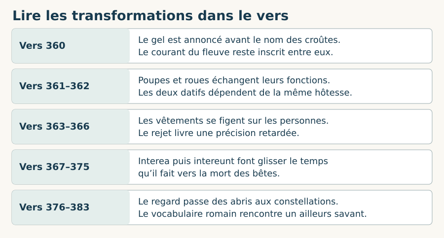

# ENS-PSL · CNEL Lettres — Virgile — la langue poétique des Géorgiques 2022 · Corrigé brut

*Corrigé rédigé par IA, non officiel. Signalez toute erreur.*

**Lecture du rapport du jury** · GPT-6.2 Astra Ultra · vitesse non renseignée

**Rédaction** · GPT-6.2 Astra Ultra · vitesse non renseignée

**Autocontrôle** · GPT-6.2 Astra Ultra · vitesse non renseignée

## Dire le gel en faisant changer de fonction aux mots

Les vers 360-383 du troisième livre des *Géorgiques* évoquent un hiver septentrional qui bouleverse l’expérience familière des matières, des bêtes et des hommes. La consigne demande d’en dégager les traits de la langue poétique latine. Une liste de figures ne suffirait pas. L’hexamètre, l’ordre flexible des mots, les transferts de sens et les noms savants servent ici une même opération : faire éprouver au lecteur la transformation progressive d’un monde dont le langage quotidien paraît d’abord décrire les réalités sans peine.

Dès le vers 360, *concrescunt* fait entendre la solidification avant que le sujet *crustae*, à la fin du vers, ne nomme les plaques formées. Entre les deux s’insère *currenti in flumine*. La course du fleuve subsiste grammaticalement à l’intérieur de l’énoncé qui l’arrête. Au vers suivant, l’eau porte sur son « dos » des roues cerclées de fer, *ferratos ... orbis*. Le raccourci désigne le véhicule par ses roues et attribue une surface portante à l’onde. Le vers 362 oppose par des datifs symétriques les embarcations qu’elle recevait autrefois et les chariots qu’elle accueille à présent. Le mot *hospita* fait de l’eau l’hôtesse paradoxale d’un trafic devenu terrestre. Le jeu des temps, *prius* et *nunc*, suffit à dire le changement de saison sans exposé de météorologie.

Les coordinations en *-que* ajoutent airain fendu, vêtements raidis, vin que l’on débite et glaçons pris aux barbes. L’expression *umida vina* conserve au vin son caractère de liquide au moment même où le verbe lui impose le comportement d’un solide. L’effet poétique vient de deux informations également nécessaires et devenues matériellement incompatibles dans l’attente ordinaire du lecteur. Le rejet d’*indutae* au début du vers 364 oblige à prolonger la lecture du vers précédent : les vêtements durcissent alors même qu’ils sont portés. La poésie latine peut ainsi profiter des désinences pour éloigner des mots dont la relation grammaticale reste intelligible. L’hexamètre dactylique organise ces attentes, avec la possibilité de substituer des spondées aux dactyles dans les quatre premiers pieds. On le constate dans ce texte moins en attribuant mécaniquement une émotion à chaque pied qu’en écoutant l’accord ou le désaccord entre fin du vers et fin de la construction.

Avec *interea* puis *intereunt*, la proximité sonore fait passer de la neige qui continue de tomber à la disparition du bétail. Le nom *corpora*, rejeté après *stant circumfusa pruinis*, substitue un instant l’image des masses immobiles à celle des animaux vivants. Les cerfs se laissent d’abord voir par ce qui dépasse encore, le haut des bois ; la neige devient *mons* du point de vue des animaux qui s’y heurtent. Dans la scène suivante, la répétition de *non* suspend les gestes de chasse qu’attendrait le lecteur avant de faire apparaître la vulnérabilité des bêtes. À leur son grave répond le *clamor* joyeux des hommes. Le passage oppose ainsi mouvement et immobilité, douleur et satisfaction par des rythmes et des voix. La relation entre ces valeurs peut être éprouvée sans que le narrateur énonce explicitement un jugement moral sur chacun des gestes.

À partir d’*ipsi*, ce sont les humains et leur habitat qui structurent le tableau. Le groupe *secura ... otia*, interrompu par la localisation souterraine et la limite du vers, transpose un terme familier de la vie romaine dans le monde des populations lointaines. Les hyperboles sur les arbres entiers donnés au feu rendent sensible la démesure des conditions. Les buveurs imitent avec une boisson fermentée le produit de la vigne. Le vocabulaire du connu permet de représenter la différence, mais le verbe *imitantur* trahit aussi le point de vue méditerranéen à partir duquel celle-ci est construite. Enfin la clausule des vers 381-383 élargit le paysage : constellation du Septentrion, vent de l’espace riphéen, adjectif hyperboréen, peuple dit *effrena*. Le registre géographique et mythique enveloppe le tableau d’une distance que le concret des barbes, des cornes et des vêtements avait momentanément effacée.

La langue poétique n’est donc ni une langue artificielle composée de seuls mots rares, ni la traduction ornée d’un savoir préalable. Des mots communs désignant l’eau, le dos, le vin ou les corps changent de force selon leur voisinage, leur place dans le vers et le point de vue qu’ils imposent. En reliant ces effets à l’enquête des *Géorgiques* sur les conditions de vie des êtres, Virgile fait d’une description de l’hiver une expérience des pouvoirs du latin en vers.

[Sujet officiel](https://www.ens.psl.eu/sites/default/files/dsa-cnel2022-2.pdf) · [Rapport du jury](https://www.ens.psl.eu/sites/default/files/dsa-rapport-cnel2022.pdf)
