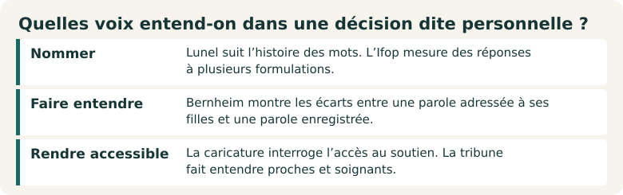

# Le suicide assisté · ENS-PSL 2022 — corrigé brut

*Corrigé rédigé par IA, non officiel. Signalez toute erreur.*

**Rédaction** · GPT-6.2 Astra Ultra · vitesse non renseignée · 26 novembre 2026

Épreuve écrite. Le rapport du jury attend une problématique qui organise la mise en relation des documents et une analyse attentive à leur genre.

Dans la caricature reproduite au milieu du dossier, deux services disposent chacun d’une enseigne et d’une porte d’entrée. Vu de loin, le bâtiment pourrait sembler offrir deux possibilités. Vu depuis la place de la personne en fauteuil, le dessin change de sens. L’un des accès exige de franchir un escalier, l’autre dispose d’une rampe. Ce décalage entre des possibilités nommées et des possibilités effectivement ouvertes donne une entrée dans le débat sur la fin de vie. L’histoire du droit, un récit familial, une enquête d’opinion et une tribune professionnelle interrogent à leur tour ce que nous faisons lorsque nous disons qu’une décision est personnelle. De quelles conditions de parole, de soutien et de responsabilité faut-il tenir compte pour entendre la singularité d’une demande sans décider d’avance de sa signification ?

## Les mots qui rendent une demande intelligible

Alexandre Lunel ouvre sa comparaison entre les époques par un vers de La Fontaine. La maxime énonce au présent ce qui paraît une préférence universelle des hommes. Le décalage avec le vocabulaire contemporain invite précisément à en faire un objet d’histoire. À mesure que la médecine peut prolonger la vie, la question de son terme se pose en des circonstances différentes. La mort, autrefois inséparable selon l’auteur de cadres religieux et juridiques, se trouve investie par des interrogations scientifiques et éthiques. L’image de l’hydre exprime le paradoxe de problèmes nouveaux qui accompagnent les progrès médicaux. Elle ne suffit pas à conclure que ces progrès auraient une signification univoque pour les personnes qui en bénéficient.

Ce changement se lit dans les déplacements de vocabulaire. « Dignité » peut servir à demander qu’une parole soit entendue ou à rappeler les obligations d’une société envers une personne dépendante. La force du terme ne permet pas, à elle seule, de trancher un désaccord entre ces deux exigences. La dignité d’une vie n’est pas conditionnée par la santé, l’autonomie physique ou la possibilité d’exprimer publiquement une préférence. Mettre les mots en histoire permet de percevoir leur charge affective et politique. Cela ne fait disparaître ni les désaccords contemporains ni les différences entre des pratiques que le débat public rapproche parfois.

Le document de l’Ifop constitue à cet égard un objet particulièrement précis. Les réponses à plusieurs formulations ne sont pas identiques. Une question sur ce que la loi devrait permettre aux médecins obtient 93 % d’approbation dans le contexte décrit, une autre sur l’autorisation du suicide assisté en recueille 89 %. Le souhait que l’Assemblée nationale débatte du sujet est encore une autre question. Approuver l’ouverture d’un débat et choisir personnellement dans une situation vécue sont deux actes différents. Les résultats proviennent d’un questionnaire en ligne d’avril 2021 auprès de 1 013 adultes, selon une méthode de quotas, pour une association engagée dans ce débat. Nommer le commanditaire et les conditions de formulation permet d’interpréter ce que mesure l’enquête. Cela n’autorise ni à écarter les résultats ni à les transformer en consentement individuel ou en norme morale.

## La demande à l’épreuve de ses destinataires

Le récit d’Emmanuèle Bernheim fait précisément entendre des paroles changées par la présence de leur destinataire. Le père a donné à une cousine une version des faits qui attribuait à ses filles un rôle dont elles se défendent. Dans la scène, la narratrice se trouve à la fois fille, témoin et personne chargée de recueillir la parole de son père devant une caméra. Une même phrase peut être pour lui une manière d’écarter une objection et pour elles une déclaration qui engage gravement leur responsabilité. Le récit fait sentir cette dissymétrie sans installer au-dessus des personnages un narrateur qui connaîtrait leurs intentions véritables.

La première personne raconte un écart entre l’étreinte que souhaiterait offrir la fille et le geste modeste de tendre un mouchoir. Plus tard, le visage du père change lorsqu’il entend l’avis de l’avocat, tandis que la pâleur de Pascale est aperçue lorsqu’elle sort. Les paroles prononcées avec assurance composent donc avec des signes corporels qui restent partiellement opaques. La caméra ajoute un paradoxe. Elle est censée attester une volonté qui soit bien celle du locuteur, alors qu’un premier enregistrement donnait l’impression d’un texte appris. La recherche d’une parole manifestement spontanée modifie les conditions dans lesquelles elle est prononcée. Le lecteur ne peut déduire de ces tensions une conclusion médicale ou juridique sur le père. Il peut en revanche comprendre ce qu’un chiffre d’opinion laisse nécessairement hors champ, la transformation d’une demande quand elle entre dans l’histoire d’une famille.

Un autre destinataire entre dans le débat avec la tribune d’Angellier, Bouleuc et Dolbeault. Ses autrices interrogent la place de professionnels à qui l’on confierait une responsabilité nouvelle et l’effet d’une telle responsabilité sur les proches. Elles écrivent à une date précise, en mai 2022, à propos du droit alors discuté et de la place accordée au soulagement de la souffrance. Les mots choisis expriment une prise de position et des conséquences qu’elles anticipent. Leur thèse ne vaut pas enquête sur la réaction de tous les soignants. Elle montre toutefois ce qu’une déclaration de principe au seul singulier peut faire oublier. La décision dont discute le dossier concerne plusieurs personnes, aux devoirs différents, qui devront pouvoir continuer de se parler.

## L’autonomie suppose des possibilités réelles

Revenons aux portes de la caricature. À gauche, l’enseigne du programme de prévention surmonte un escalier. À droite, l’autre porte est desservie par une rampe. Le fauteuil de dos, au premier plan, détermine l’angle sous lequel le spectateur doit apprécier cette distribution. Le paradoxe graphique tient à ce que le bâtiment paraît matériellement capable d’assurer l’accessibilité, mais la réserve à une seule entrée. Rendre les formes d’aide et de prévention également accessibles, écouter les personnes concernées et faire une place à leur expérience sont dès lors des exigences concrètes. On n’a pas besoin de prêter au personnage un souhait quelconque pour lire la critique du dessin. Il suffit d’observer l’inégalité qui pèse sur ses possibilités.

La satire déplace ainsi la question adressée aux personnes interrogées par l’Ifop. Une formulation qui suppose une demande libre et une souffrance insupportable invite à exprimer un principe. Elle ne montre pas les circonstances matérielles dans lesquelles une personne est entendue, les obstacles qu’elle rencontre pour être soutenue ni la façon dont les réponses de l’entourage peuvent évoluer. La caricature ne réfute pas un pourcentage. Elle donne à interroger des conditions qu’une question fermée ne peut décrire. En sens inverse, le sondage rend visible l’intérêt public pour une discussion que le récit de Bernheim situe dans une chambre. L’enjeu est de faire circuler ces questions entre leurs échelles, tout en respectant le genre de preuve propre à chaque document.

Lunel permet enfin de mesurer ce qui se joue dans le changement du rôle assigné à la médecine. Les progrès du soin créent des possibilités de soulagement et d’accompagnement et soulèvent en même temps des questions sur leurs fins. La tribune privilégie une réponse professionnelle déterminée, le récit montre le poids d’une parole partagée, le dessin rend palpable l’importance de l’accessibilité du soutien. Ils se rejoignent au moins sur un point de méthode. Pour apprécier un choix, il faut s’interroger sur ce qu’une personne peut effectivement demander, sur les réponses qu’elle reçoit et sur celles qui lui restent inaccessibles. Le respect de l’autonomie engage ainsi une responsabilité collective envers les conditions de vie et de soin.

Le dossier ne fait entendre la volonté de personne à l’état pur. Il nous montre des formulations datées, des réponses à un questionnaire, des gestes ambigus dans une famille, une critique graphique et un désaccord professionnel. Les rapprocher permet de tenir ensemble deux exigences, écouter une parole singulière et rendre effectivement accessibles le soin, le soutien et les interlocuteurs dont elle a besoin. L’image finale à garder est celle des deux entrées. Leur simple existence dans les mots ne garantit pas que chacune soit praticable.

## Sources

Le dossier de quatre pages rapproche Alexandre Lunel sur l’histoire du droit (2017), *Tout s’est bien passé* d’Emmanuèle Bernheim (2013), une caricature attribuée à Amy Asbrouk et publiée avec un texte de Mike Ervin (2016), un sondage Ifop pour l’ADMD (avril 2021) et une tribune d’Élisabeth Angellier, Carole Bouleuc et Sylvie Dolbeault (mai 2022). Les propos juridiques et les résultats d’opinion sont étudiés dans leur contexte de publication.

[Sujet conservé](https://www.ens.psl.eu/sites/default/files/sujet-a-mh2022.pdf) · [Rapport du jury](https://www.ens.psl.eu/sites/default/files/rapport-jury-mh2022docx.pdf) · [Annales de l’ENS-PSL](https://medecine-humanites.ens.psl.eu/sujets-et-rapports-du-concours-2018/)
