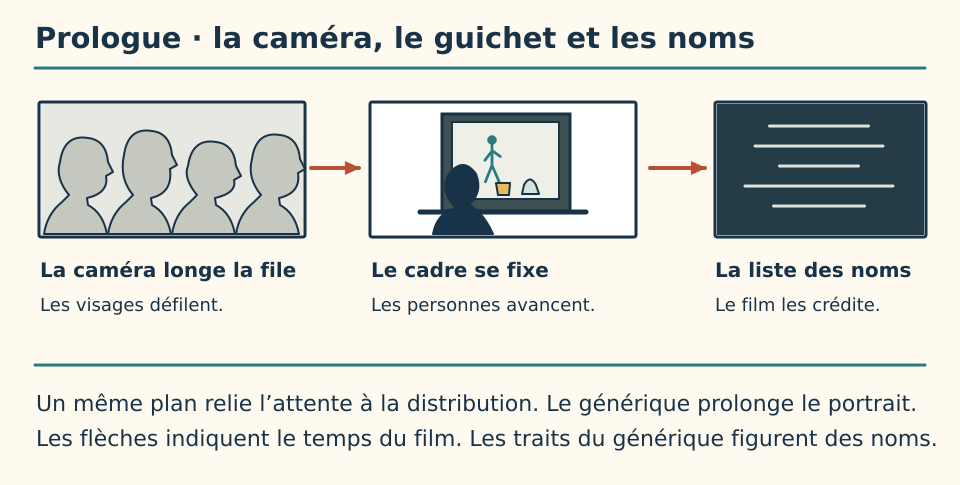

# ENS-PSL · Sélection internationale Lettres · 2022 · Corrigé brut

*Corrigé rédigé par IA, non officiel.*

**Rédaction** · GPT-6.2 Astra Ultra · vitesse non renseignée

**Révision (tour 1)** · GPT-6.2 Astra Ultra · vitesse non renseignée

## Prologue de Béla Tarr · commentaire de film

**Couverture partielle.** Le lien du jury permet d’identifier l’œuvre. Le contenu exact de la copie projetée en 2022, ses bornes et l’inclusion de son générique restent à vérifier. Le commentaire porte sur le court métrage documenté dans son intégralité.

Au début de Prologue, la caméra en noir et blanc longe des personnes debout contre un mur de briques. Une file se dessine avant que le spectateur découvre à quoi elle mène. À la fenêtre où l’on distribue à manger, l’attente acquiert rétrospectivement un motif. Quel portrait peut naître de ce délai entre la rencontre de plusieurs visages et la découverte de leur situation commune ?

### Voir quelqu’un avant de connaître sa situation

Le travelling fait entrer, puis sortir du cadre les personnes qui attendent. Dans une image du film, un bonnet de laine occupe le premier plan, tandis qu’une casquette et une moustache se détachent juste derrière. Les têtes se recouvrent en partie. On ne peut embrasser toute la file d’un seul regard. Le mur rend mesurable le glissement de la caméra et les différences de hauteur interrompent l’alignement. Le film nous accorde un moment pour distinguer chacun tout en réservant encore le sens de la scène.

### Quand le cadre s’immobilise

Au bout de la file, une femme donne un sachet et un gobelet à chaque personne. La distribution se répète dans un cadre devenu stable. Le premier mouvement appartenait à la caméra. Le mouvement appartient désormais aux personnes qui viennent recevoir leur portion, vues de dos au guichet. Nous comprenons alors pourquoi elles attendaient. La distance parcourue le long du mur prend une mesure sociale : chaque visage déjà rencontré correspondait à quelqu’un qui devait attendre son tour.

### Le son maintient ensemble des expériences distinctes

Le motif musical de Mihály Víg revient pendant que les visages se succèdent. La reprise permet de sentir combien la file se prolonge. En même temps, elle rend plus perceptibles les différences entre deux attitudes, entre une tête légèrement inclinée et une autre redressée. Le guichet répond à la question matérielle que posait le travelling. Il laisse ouverte celle de la vie de chacun avant et après l’arrivée dans cette file.

### Rendre les noms au portrait collectif

Au générique, les personnes filmées sont nommées. Après le passage des visages, cette autre succession demande au spectateur de prendre le temps de lire. La contribution hongroise au film collectif Visions of Europe paraît en 2004, année de l’entrée de la Hongrie dans l’Union européenne. Tarr donne une échelle quotidienne à l’image publique d’un continent. Le partage d’une situation de besoin devient visible, et la dernière liste garde la trace de ceux qui l’éprouvent chacun pour soi.

## Sources

Le feuillet de l’ENS renvoie à la vidéo IkxBoGYu1-w. Le programme du Doctorado en Semiótica de juin 2014 associe cet identifiant à Prologue de Béla Tarr. L’institut hongrois du cinéma confirme le titre original Prológus, l’année 2004 et une durée de cinq minutes pour l’œuvre. Les analyses de l’East European Film Bulletin et de L’Atalante documentent le plan et le générique.

[Sujet de l’ENS](https://www.ens.psl.eu/sites/default/files/sujets-arts-sil2022._.pdf)

[Lien vidéo du feuillet](https://www.youtube.com/watch?v=IkxBoGYu1-w) · [Programme du séminaire, même lien](https://doctoradosemiotica.blogspot.com/2014/06/normal-0-21-false-false.html) · [Institut hongrois du cinéma](https://nfi.hu/en/films/prologue.html) · [Photogramme du film](https://syncrofilmfest.com/prologue/) · [Analyse du plan dans l’East European Film Bulletin](https://eefb.org/retrospectives/bela-tarrs-prologue-2004/) · [Étude du générique dans L’Atalante](https://revistaatalante.com/index.php/atalante/article/download/700/594)
