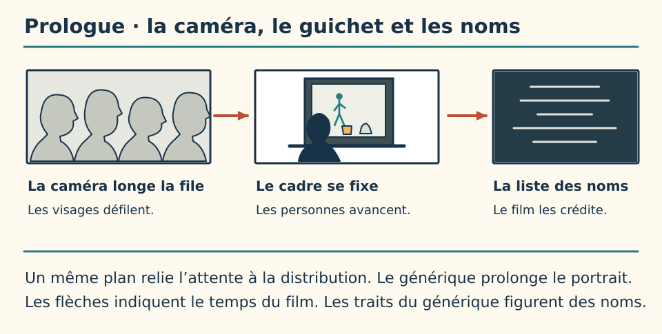

# ENS-PSL · Sélection internationale Lettres · 2022 · Corrigé guidé

*Corrigé rédigé par IA, non officiel.*

**Rédaction** · GPT-6.2 Astra Ultra · vitesse non renseignée

**Révision (tour 1)** · GPT-6.2 Astra Ultra · vitesse non renseignée

## Prologue de Béla Tarr · commentaire de film

**Couverture partielle.** Le lien du jury permet d’identifier l’œuvre. Le contenu exact de la copie projetée en 2022, ses bornes et l’inclusion de son générique restent à vérifier. Le commentaire porte sur le court métrage documenté dans son intégralité.

On peut partir d’un changement qui survient à l’intérieur du même plan. Au début, la caméra avance le long de personnes qui attendent. Une fois le guichet atteint, les personnes passent devant un cadre immobile. Cette inversion donne un fil conducteur à l’oral.

### Suivre la caméra et le bord du cadre

Relevez d’abord ce qui arrive par le bord de l’image. Une casquette, un profil, puis le visage qui se tenait derrière lui deviennent momentanément visibles. Utilisez le mur de briques comme repère fixe. Le mot « travelling » se justifie par le déplacement du point de vue le long du mur et de la file. Que changerait une vue d’ensemble dès le début ? Elle renseignerait plus vite sur le lieu mais laisserait moins de temps à la découverte successive des personnes.

### Construire le commentaire du guichet

Essayez de raconter le premier moment sans employer le mot « repas ». Puis nommez ce qui vous autorise à l’introduire : une ouverture dans le mur, la femme qui distribue le sachet et le gobelet, et la personne suivante qui se présente pour les recevoir. Reprenez alors la première image de mémoire. L’intérêt du plan est précisément de faire travailler une deuxième fois ce que nous avions déjà vu.

### Écouter la répétition et suivre le générique

Repérez ce qui se répète dans la musique de Mihály Víg. Associez à ce retour un changement visible dans la file. La répétition accompagne une suite de visages différents. Dans le film entier, le générique inscrit leurs noms. Une bonne relance consisterait à demander ce que ce générique ajoute : le film reconnaît à chaque personne une existence qui se prolonge au-delà du geste de recevoir de quoi manger.

### Mettre le projet européen à l’épreuve des images

Le court métrage appartient à Visions of Europe. Faites apparaître ce renseignement après la description du guichet. Le spectateur peut alors saisir pourquoi une simple distribution constitue une proposition sur l’Europe de 2004. On peut discuter de la condition commune montrée par le film tout en laissant ouverte l’histoire personnelle de chaque participant. Pour une copie écourtée, situez le générique dans l’œuvre complète et fondez le commentaire détaillé sur les images projetées.

## Sources

Le feuillet de l’ENS renvoie à la vidéo IkxBoGYu1-w. Le programme du Doctorado en Semiótica de juin 2014 associe cet identifiant à Prologue de Béla Tarr. L’institut hongrois du cinéma confirme le titre original Prológus, l’année 2004 et une durée de cinq minutes pour l’œuvre. Les analyses de l’East European Film Bulletin et de L’Atalante documentent le plan et le générique.

[Sujet de l’ENS](https://www.ens.psl.eu/sites/default/files/sujets-arts-sil2022._.pdf)

[Lien vidéo du feuillet](https://www.youtube.com/watch?v=IkxBoGYu1-w) · [Programme du séminaire, même lien](https://doctoradosemiotica.blogspot.com/2014/06/normal-0-21-false-false.html) · [Institut hongrois du cinéma](https://nfi.hu/en/films/prologue.html) · [Photogramme du film](https://syncrofilmfest.com/prologue/) · [Analyse du plan dans l’East European Film Bulletin](https://eefb.org/retrospectives/bela-tarrs-prologue-2004/) · [Étude du générique dans L’Atalante](https://revistaatalante.com/index.php/atalante/article/download/700/594)
