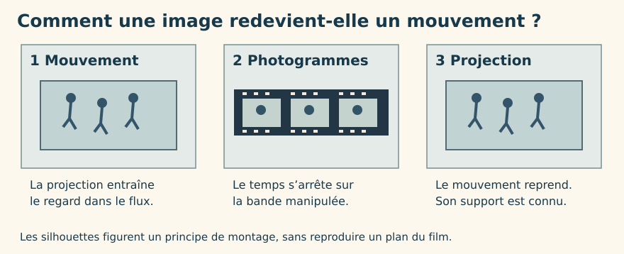

# ENS-PSL · Sélection internationale Lettres — Cinéma — le documentaire et ses faux-semblants 2022 · Corrigé brut

*Corrigé rédigé par IA, non officiel. Signalez toute erreur.*

**Rédaction** · GPT-6.2 Astra Ultra · vitesse non renseignée

**Autocontrôle** · GPT-6.2 Astra Ultra · vitesse non renseignée

Sujet écrit 1. La citation interroge les rapports du cadrage et du montage à la vie, dans le documentaire comme dans la fiction. La feuille imprime « François Nivey ». L’auteur du livre est François Niney, selon la notice de son éditeur Klincksieck.

## Où commence le travail du film ?

Des ouvrières et des ouvriers franchissent un portail. Le même geste, accompli dans la rue, pourrait passer inaperçu. Dans la *Sortie d’usine* de Louis Lumière, il devient le mouvement principal d’un plan que l’on peut revoir. À propos de la promesse du cinéma, François Niney place au cœur de sa phrase deux verbes dont les directions diffèrent. Le cinéaste peut « tirer » un sens de la vie, mais aussi lui en « donner ». Le premier verbe suppose quelque chose à découvrir et qui résiste. Le second suppose une initiative. Comment le cadre et le montage tiennent-ils ensemble ces deux exigences, jusque dans les œuvres qui inventent leurs personnages ?

## Tirer un sens d’une situation

Le portail de l’usine Lumière inscrit un cadre dans le cadre. Les corps sortent d’une ouverture relativement étroite, se dispersent et disparaissent par les bords. Les différences de rythme, les trajectoires divergentes, la masse puis la raréfaction du flot deviennent sensibles depuis un point fixe. Un autre emplacement, à l’intérieur de l’usine, aurait donné une autre expérience de ce même passage. Cependant le cinéaste ne décide pas séparément de chacun des gestes que le plan enregistre. Un spectateur peut revoir cette vue en s’attachant à une personne à la lisière de l’image. La durée conservée laisse à l’événement plus de détails que n’en épuise une première interprétation.

Avec *L’Homme à la caméra* de Dziga Vertov, en 1929, le montage prend pour objet sa propre puissance. Le mouvement s’immobilise. Des photogrammes apparaissent sur une bande manipulée par la monteuse Elizaveta Svilova. Les images reprennent vie à la projection. Le passage de la rue à la table de montage oblige à redéfinir ce qu’on avait vu. Les gestes de la ville ont bien été effectués et enregistrés. Ils acquièrent une allure collective par le travail de personnes qui tournent, trient, rapprochent et projettent. Le monde fournit des mouvements observables. Le film fait découvrir entre eux des rapports qui ne se laisseraient pas observer depuis un seul trottoir.

## Donner du sens sans donner des ordres au réel

Dans *Les Glaneurs et la Glaneuse* en 2000, Agnès Varda rencontre des personnes qui ramassent ce qui a été laissé au bord des récoltes ou des marchés. Des pommes de terre rejetées pour leur forme ou leur calibre existent avant son arrivée. Lorsqu’elle choisit notamment une pomme de terre en forme de cœur et la conserve, l’objet entre aussi dans un répertoire affectif propre à la cinéaste. Filmer sa propre main vieillissante avec une petite caméra déplace encore la question. La main qui glane des images appartient au même monde périssable que ce qu’elle ramasse. Le rapprochement gagne sa justesse à conserver les différences. La liberté d’une artiste qui choisit un objet singulier n’annule pas la nécessité économique qui fait glaner d’autres personnes.

On objectera que pousser cette liberté à l’extrême permettrait de soutenir presque n’importe quelle thèse. Raccorder deux regards enregistrés en des lieux différents peut faire croire à une rencontre qui n’a jamais eu lieu. La séduisante cohérence obtenue à l’écran n’établit pas le fait qu’elle évoque. Pour un documentaire, les personnes et les situations dont le public croit apprendre quelque chose imposent des obligations précises. La relation proposée doit pouvoir être expliquée, discutée ou rectifiée. En qualifiant le sens de cadré et monté, Niney donne au spectateur deux prises concrètes pour exercer cette vigilance.

## Ce que la fiction peut donner à voir

À la fin du *Voleur de bicyclette* de Vittorio De Sica, en 1948, Antonio, qui cherchait son vélo volé, a tenté à son tour d’en prendre un. Son fils Bruno a vu son humiliation. La main que l’enfant donne à son père, puis leur disparition dans la foule, font comprendre un déplacement moral qu’aucun énoncé général sur la pauvreté ne rendrait aussi exactement. L’enfant a vu son père perdre le rôle de protecteur et il lui offre, à son tour, un soutien. Ce geste joué ne documente pas la biographie d’un père nommé Antonio. Son insertion dans une Rome reconnaissable rend pensable une expérience sociale sans faire dépendre le jugement du spectateur de l’existence des personnages.

La promesse avancée par Niney tient ainsi à une liberté qui change selon ce que le film demande de croire. Le documentaire répond de personnes et d’événements singuliers, et peut faire apparaître leur sens par un rapprochement inattendu. La fiction construit une situation où se découvrent des rapports que le spectateur pourra reconnaître ailleurs. Dans les deux cas, une reproduction toujours plus détaillée du visible pourrait enrichir le matériau du cinéma. Elle ne déciderait ni du moment où il faut regarder cette main ni de la raison pour laquelle sa place dans le film nous importe.

[Feuillet officiel des sujets, p. 1](https://www.ens.psl.eu/sites/default/files/sujets-arts-sil2022._.pdf)

[François Niney, notice de l’éditeur](https://www.klincksieck.com/livre/9782252037126/le-documentaire-et-ses-faux-semblants) · [Catalogue Lumière, Sortie d’usine I](https://catalogue-lumiere.com/sortie-dusine-i/) · [IDFA, analyse de la séquence de montage chez Vertov](https://www.idfa.nl/en/film/caa98726-cddc-499b-9b48-61dd6029855a/man-with-a-movie-camera/) · [Ciné-Tamaris, Les Glaneurs et la Glaneuse](https://cine-tamaris.fr/agnes-varda/les-glaneurs-et-la-glaneuse-2000/) · [Criterion, Le Voleur de bicyclette](https://www.criterion.com/films/210-bicycle-thieves)
