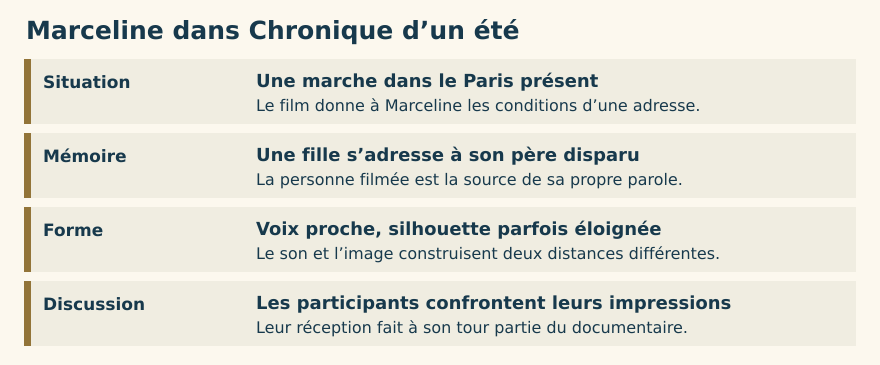

# ENS-PSL · Sélection internationale Lettres — Cinéma — les choix esthétiques du documentaire 2022 · Corrigé brut

*Corrigé rédigé par IA, non officiel. Signalez toute erreur.*

**Rédaction** · GPT-6.2 Astra Ultra · vitesse non renseignée

**Autocontrôle** · GPT-6.2 Astra Ultra · vitesse non renseignée

Sujet écrit 2. La phrase proposée relie l’illusion de réalité d’un film aux décisions esthétiques qui le constituent jusque dans le documentaire. La feuille ne donne pas de nom d’auteur pour cette seconde citation.

## Qu’est-ce qui semble réel à l’écran ?

Un spectateur peut croire à un geste fictif et douter d’une parole réellement prononcée devant une caméra. Le sentiment de présence et la valeur d’un témoignage sont donc deux problèmes différents. Le sujet demande pourquoi un film relève toujours de choix esthétiques, y compris quand il produit une impression de réalité presque complète. « Provoquer » cette impression et la « cultiver » ne se confondent pas. Un détail imprévu peut emporter l’adhésion, tandis qu’une méthode de tournage peut entretenir délibérément cette même adhésion. Le réalisateur choisit comment voir et entendre. Jusqu’où peut-on rapporter à son choix ce qu’une image donne à connaître ?

## Quand un parti pris passe inaperçu

Un cadre fixe devant une porte ouverte paraît offrir le point de vue le plus simple. Dans la vue Lumière de la sortie de l’usine, cette simplicité ordonne pourtant le monde. Le travail à l’intérieur du bâtiment reste hors champ. La sortie se donne comme un événement collectif, puisque des personnes différentes traversent l’ouverture dans la même durée. La version I décrite par le catalogue Lumière laisse notamment voir une voiture attelée de deux chevaux après le flot des travailleurs. Ce détail augmente la sensation d’avoir assisté à quelque chose qui se poursuit de soi-même. Aucun spectateur ne peut cependant déduire de ce seul plan le déroulement de toute la journée des personnes filmées. Une décision de cadre distribue ainsi ce qui paraît évident et ce qu’il faut chercher ailleurs.

Le mot « esthétique » engage ici la forme sensible du film, jusque dans les moyens les plus discrets. Garder le silence qui suit une réponse peut faire entendre une hésitation. Couper à la fin des mots rendrait le propos plus assuré. Ces deux présentations peuvent conserver la même phrase exacte. Un son trop éloigné, un événement imprévu ou le refus d’un participant bornent pourtant les possibilités du cinéaste. Conserver la trace d’une de ces limites constitue parfois le choix décisif. Cela interdit de supposer un auteur tout-puissant derrière chaque détail enregistré.

## Une parole suscitée peut avoir valeur de témoignage

Dans *Chronique d’un été* de Jean Rouch et Edgar Morin, sorti en 1961, Marceline marche dans Paris et adresse la parole à son père disparu en déportation. La présence d’un dispositif d’enregistrement et le trajet proposé lui donnent les conditions d’une parole singulière. La voix demeure proche alors que l’espace visible autour d’elle s’élargit et que, par moments, la figure se voit de loin. Cet écart rend sensible la solitude d’une personne qui se remémore quelqu’un au milieu de la ville présente. Le témoignage concerne son expérience. L’impression d’entendre une confidence a, elle, une histoire technique et formelle. Reconnaître l’une aide à entendre l’autre.

La projection des images aux participants, vers la fin, change les conditions du jugement. Un comportement qui paraît sincère à certains paraît joué à d’autres. L’échange ne tranche pas en dernier ressort la vérité de chaque parole. Le film conserve en revanche un désaccord que le montage aurait pu effacer. Rouch et Morin, discutant ensuite de cette réception, appartiennent eux-mêmes au monde que le film expose à l’examen. Le choix de donner une place à l’objection fait du documentaire une enquête dont le public peut aussi juger la méthode.

## Discuter l’illusion sans déprécier la preuve

Le néoréalisme fournit l’épreuve inverse. À la fin du *Voleur de bicyclette*, de Vittorio De Sica, la foule, les passants et le tracé des rues donnent son épaisseur à Rome. Le visage de Bruno nous ramène au drame précis de son père pris sur le fait. Le jeu des interprètes et la construction de la scène nous attachent à la situation avec une intensité qui peut ressembler à celle du témoignage. La ville de 1948 a laissé des traces dans le tournage. L’histoire d’Antonio relève néanmoins de la fiction. Des images également convaincantes peuvent donc soutenir des affirmations de nature différente.

Cette distinction permet enfin de préciser le mot « toujours ». Une prise continue conserve à certains égards davantage d’incertitude qu’une série de réactions montées séparément. Elle ne garantit ni que l’action était spontanée ni que tout ce qui permettrait de l’interpréter se trouvait dans le champ. Inversement, la discussion montée de *Chronique d’un été* apporte une connaissance réelle sur les désaccords des participants. La vérité documentaire exige qu’on sache à quoi on peut se fier dans une proposition de cinéma, qui parle, dans quelle situation et avec quelle possibilité de répondre. La forme qui rend ces conditions perceptibles ajoute à la force du témoignage.

[Feuillet officiel des sujets, p. 1](https://www.ens.psl.eu/sites/default/files/sujets-arts-sil2022._.pdf)

[Catalogue Lumière, Sortie d’usine I](https://catalogue-lumiere.com/sortie-dusine-i/) · [Criterion, tournage et réception de Chronique d’un été](https://www.criterion.com/current/posts/2674-chronicle-of-a-summer-truth-and-consequences) · [International Documentary Association, la marche de Marceline](https://www.documentary.org/column/playback-jean-rouch-and-edgar-morins-chronicle-summer) · [Criterion, Le Voleur de bicyclette](https://www.criterion.com/films/210-bicycle-thieves)
