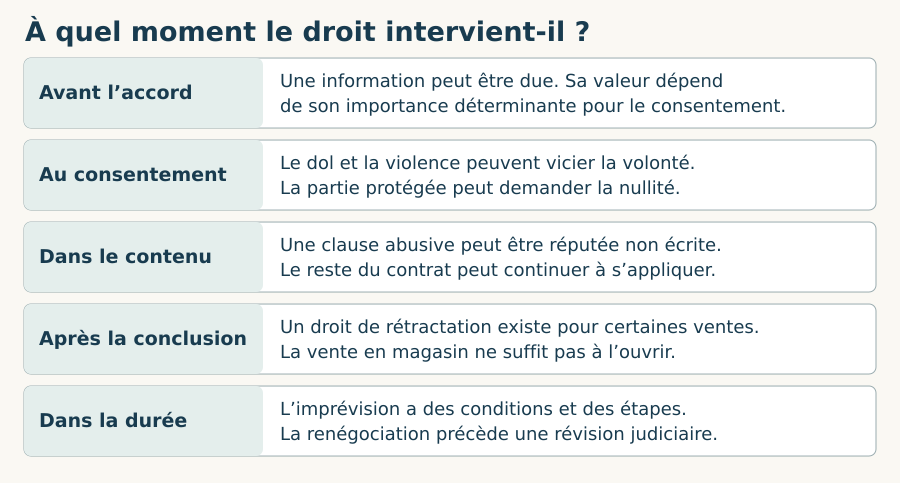

# ENS-PSL · Sélection internationale Lettres — Droit — histoire et philosophie du contrat 2022 · Corrigé brut

*Corrigé rédigé par IA, non officiel. Signalez toute erreur.*

**Lecture du rapport du jury** · GPT-6.2 Astra Ultra · vitesse non renseignée

**Rédaction** · GPT-6.2 Astra Ultra · vitesse non renseignée

**Autocontrôle** · GPT-6.2 Astra Ultra · vitesse non renseignée

**Révision (tour 1)** · GPT-6.2 Astra Ultra · vitesse non renseignée

## Quatre questions de droit

Sélection internationale ENS Lettres, écrit d’Histoire et Philosophie du Droit 2022. Le feuillet unique demande quatre réponses argumentées sur cinq points chacune. Le rapport du jury de droit traite de la sélection des dossiers. Le projet individuel auquel renvoie la quatrième question ne figure pas dans ces documents.

**1.** Décrivez les grandes étapes du développement du droit des contrats et de sa théorisation, notamment autour des notions de consensualisme, de liberté contractuelle et d'autonomie de la volonté.

**2.** Quelles sont, à votre avis, les évolutions marquantes du droit français des contrats de 1804 à aujourd'hui (notamment avec la réforme de 2016) ?

**3.** Quels sont les divers moyens, en droit civil et en droit de la consommation, de rééquilibrer les contrats entre parties fortes et parties faibles? Vous pouvez citer plusieurs systèmes juridiques à l’appui de votre analyse.

**4.** Avec quelles méthodes comptez-vous procéder pour la réalisation du projet présenté dans votre candidature?

## 1. Consentir, choisir et se donner une règle

Le consensualisme concerne le mode de formation du contrat. La rencontre des consentements suffit en principe, sauf exigence particulière de forme ou de remise d’une chose. La liberté contractuelle désigne notamment le choix de contracter ou de s’abstenir, du partenaire et du contenu dans les limites de la loi. L’autonomie de la volonté est une théorie du fondement de l’obligation. Le sujet gagne à garder séparées ces trois questions. Une vente peut se former sans formalité et être largement encadrée quant aux garanties dues par le vendeur.

Le droit romain connaît des opérations définies par une forme ou une remise, à côté de contrats consensuels nommés, tels la vente ou le louage. Tout accord informel ne produit donc pas indistinctement une action. Cependant la place de la bonne foi et la reconnaissance de certains échanges fondés sur le seul accord fournissent des ressources durables. Dans les droits savants du Moyen Âge, la réflexion canonique sur la parole donnée et la réception du droit romain contribuent, selon des voies différentes, à élargir la portée de l’engagement. L’histoire n’est pas celle d’une abolition progressive de toute forme. L’écrit et la publicité continuent de protéger les parties, les tiers ou la preuve.

Les juristes du droit naturel moderne pensent davantage l’obligation à partir de personnes capables de s’engager. Chez Domat et Pothier, l’accord s’inscrit également dans des catégories, des exigences de justice et un ordre juridique déjà constitué. Le Code civil de 1804 donne une expression forte à la force obligatoire des conventions légalement formées. Son ancien article 1134 associe cette force à l’exécution de bonne foi. Le mot « légalement » est décisif. La volonté n’institue pas à elle seule toutes les conditions de son efficacité. L’élaboration doctrinale qui fait ensuite de l’autonomie de la volonté un principe central ne doit pas être projetée sans nuance sur toutes les règles du Code ni attribuée identiquement à tous ses rédacteurs. L’essor du travail salarié, de l’assurance et des contrats de masse rend notamment visible ce qui sépare consentement formel et pouvoir réel de négocier.

## 2. De 1804 à la session de 2022

Une première évolution tient au travail conjoint des juges et des législateurs. Tandis que le Code conservait longtemps ses principales formules, la jurisprudence a précisé la formation de l’accord, les obligations implicites et les remèdes à l’inexécution. Des droits spéciaux ont encadré les situations où l’autonomie de négociation est faible. Le droit du travail, les baux protégés et le droit de la consommation répondent à des situations distinctes. L’accès au crédit, la vente à distance et les conditions générales rédigées par une seule partie ont déplacé l’enjeu vers l’information, la loyauté et le contrôle du contenu. Le droit européen contribue notamment à la protection des consommateurs contre les clauses abusives.

L’ordonnance du 10 février 2016, entrée en vigueur le 1er octobre, puis la loi de ratification du 20 avril 2018 réorganisent le droit commun. Les articles 1102, 1103 et 1104 rapprochent liberté contractuelle, force obligatoire et bonne foi, cette dernière gouvernant négociation, formation et exécution. Les articles 1112 et suivants encadrent les négociations sans les transformer en obligation de conclure. Celui qui détient une information déterminante doit, sous les conditions légales, la communiquer à l’autre qui l’ignore légitimement ou lui fait confiance. L’estimation de la valeur de la prestation est exclue du devoir de l’article 1112-1. Les conditions actuelles de validité sont le consentement, la capacité et un contenu licite et certain. La disparition du terme de « cause » dans cette liste n’a pas fait disparaître toute sa fonction de contrôle. Une contrepartie illusoire ou dérisoire dans un contrat à titre onéreux est par exemple sanctionnée par l’article 1169.

L’imprévision illustre une inflexion de fond. Sous les conditions de l’article 1195, un changement de circonstances imprévisible rend l’exécution excessivement onéreuse pour une partie qui n’en avait pas accepté le risque. Celle-ci peut demander la renégociation tout en continuant d’exécuter. Après refus ou échec, les parties peuvent convenir de la résolution ou demander ensemble l’adaptation au juge. À défaut d’accord dans un délai raisonnable, une partie peut demander au juge de réviser le contrat ou d’y mettre fin. Une simple baisse de profit ne remplit pas nécessairement ces conditions. En application concrète, il faut dater le contrat, examiner le droit transitoire et distinguer les dispositions issues de l’ordonnance de leurs modifications en 2018. Les contrats antérieurs au 1er octobre 2016 demeurent en principe régis par le droit antérieur, sous réserve des exceptions légales.

## 3. Rééquilibrer sans annuler indistinctement

Avant la conclusion, une information compréhensible et, lorsque la loi le prévoit, un délai de réflexion permettent de décider en connaissance de cause. Après la conclusion, le consommateur peut, dans les cas prévus, exercer un droit de rétractation. Pour les contrats de consommation conclus à distance ou hors établissement, le délai de principe est de quatorze jours, avec les exceptions prévues par la loi. Pour une prestation de services, le délai court en principe de la conclusion du contrat. Pour une vente de biens, il court en principe de la réception par le consommateur ou le tiers qu’il a désigné, autre que le transporteur. L’achat ordinaire en magasin n’ouvre pas par lui-même ce droit. Le formalisme de protection offre ainsi un exemple de limite au consensualisme établie pour que le choix soit effectif.

À la formation, le dol et la violence protègent l’intégrité du consentement. L’article 1143 vise celui qui abuse de l’état de dépendance dans lequel son cocontractant se trouve à son égard pour obtenir un engagement qu’il n’aurait pas souscrit sans cette contrainte et en tirer un avantage manifestement excessif. Il faut établir ces éléments, et non déduire la violence de toute différence de fortune. L’action en nullité relative protège la partie dont le consentement a été vicié. À l’inverse, une simple absence d’équivalence entre prestations ne suffit en principe pas à annuler un contrat synallagmatique. L’article 1168 réserve les exceptions prévues par la loi.

Le contrôle des clauses agit autrement. Au sens de l’article 1171 dans sa rédaction applicable en 2022, dans un contrat d’adhésion, une clause non négociable, déterminée à l’avance par l’une des parties et créant un déséquilibre significatif est réputée non écrite. L’appréciation ne porte ni sur l’objet principal ni sur l’adéquation du prix à la prestation. En droit de la consommation, les articles L. 212-1 et suivants organisent un régime spécial des clauses abusives dans le rapport professionnel-consommateur, éclairé par la directive 93/13. Une clause qui permet au professionnel de conserver arbitrairement des sommes sans contrepartie pourrait ainsi être contrôlée selon son économie précise et les textes applicables. La sanction peut retirer la clause tout en maintenant le contrat si celui-ci peut subsister. Enfin, les actions collectives ou celles d’associations habilitées contre certaines clauses évitent que la faiblesse de chaque préjudice ne rende la règle inopérante. Le rééquilibrage tient à la façon dont une garantie peut être effectivement invoquée autant qu’à son énoncé.

## 4. Une méthode de projet, à titre d’exemple hypothétique

Mon projet hypothétique porterait sur une question circonscrite. Comment les juridictions françaises distinguent-elles, depuis la ratification de 2018, la stipulation non négociable et la clause retirée du contrat pour déséquilibre significatif dans les contrats d’adhésion entre professionnels ? Je commencerais par définir l’unité étudiée, une décision analysant effectivement l’article 1171. Je sélectionnerais des décisions rendues publiques entre octobre 2018 et le printemps 2022 en contrôlant la date de formation du contrat. Un premier corpus exploratoire servirait à construire une grille de lecture. Une recherche complémentaire par renvois jurisprudentiels et formulations proches réduirait le biais d’une sélection sur un seul mot-clé.

Pour chaque affaire, je distinguerais les circonstances de négociation établies, la catégorie de contrat, la règle invoquée, l’existence d’un régime spécial, le sens de la décision et la sanction vraiment prononcée. Je consignerais les décisions qui écartent le texte. Les décisions publiées ne représentent ni tous les contrats ni toutes les demandes. Il serait donc illégitime de déduire de ce corpus la fréquence nationale des clauses abusives. En revanche, des comparaisons qualitatives entre affaires analogues permettraient de tester l’hypothèse que la preuve d’une négociation concrète joue un rôle distinct de l’appréciation du déséquilibre. Je présenterais le résultat sous la forme d’une typologie argumentée, accompagnée des cas qui la contredisent et de leurs motifs.

Cette dernière réponse illustre un projet possible. La feuille officielle donne quatre questions à cinq points. Le rapport de droit précise que la candidature proposée pour l’audition n’a pas été retenue en délibération commune. Le sujet publié permet de travailler ces questions sans attribuer ce projet à la candidate.

[Sujet officiel](https://www.ens.psl.eu/sites/default/files/droit-ecrit.pdf) · [Rapport du jury](https://www.ens.psl.eu/sites/default/files/rapport-droit-sil2022.pdf) · [Code civil à la date de la sélection](https://www.legifrance.gouv.fr/codes/texte_lc/LEGITEXT000006070721/2022-06-01) · [Ordonnance du 10 février 2016](https://www.legifrance.gouv.fr/jorf/id/JORFTEXT000032004939) · [Directive 93/13/CEE](https://eur-lex.europa.eu/legal-content/FR/TXT/?uri=CELEX:31993L0013) · [Directive 2011/83/UE](https://eur-lex.europa.eu/legal-content/FR/TXT/?uri=CELEX:32011L0083)
