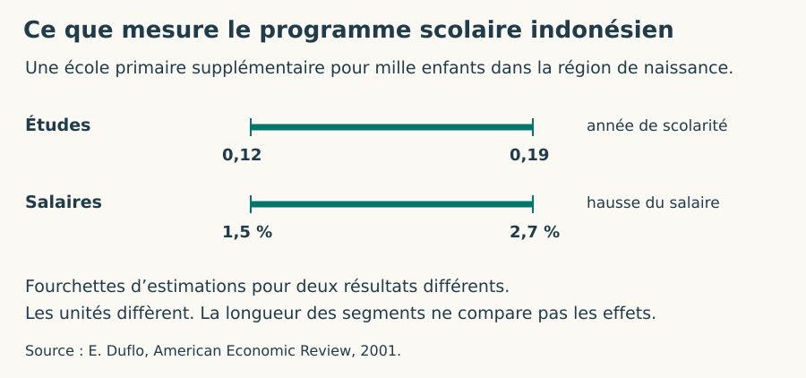

# ENS-PSL · Sélection internationale Lettres — Économie — à quoi sert l’éducation (oral) 2022 · Corrigé brut

*Corrigé rédigé par IA, non officiel. Signalez toute erreur.*

**Lecture du rapport du jury** · GPT-6.2 Astra Ultra · vitesse non renseignée

**Rédaction** · GPT-6.2 Astra Ultra · vitesse non renseignée

**Autocontrôle** · GPT-6.2 Astra Ultra · vitesse non renseignée

**Révision (tour 1)** · GPT-6.2 Astra Ultra · vitesse non renseignée · 26 novembre 2026

**Couverture vérifiée.** Oral, sujet individuel 1 de la feuille officielle. Le rapport rattache le projet sur le rôle des politiques d’éducation et de formation face à la désindustrialisation à cette épreuve et à l’écrit « La fin de la croissance ». Les deux exposés relient les compétences acquises, le signal du diplôme et les bénéfices collectifs à la décision de financer une formation. Les résultats chiffrés de Duflo, leur population d’étude et leurs unités ont été vérifiés. La comparaison régionale et intergénérationnelle est appliquée ensuite à un exemple de reconversion.

## Exposé proposé — À quoi sert l’éducation ?

Entre 1973 et 1978, l’Indonésie a implanté des écoles primaires en nombre variable selon les régions. Une génération plus tard, ceux qui avaient été assez jeunes pour en bénéficier avaient étudié plus longtemps et gagnaient davantage que les cohortes comparables. Faut-il en conclure que l’éducation sert d’abord à obtenir un salaire ? La question demande de distinguer ce que l’on apprend, ce que les autres déduisent d’un diplôme et ce qu’une société gagne à instruire des personnes qui ne capteront pas tous les fruits de cet enseignement. J’examinerai ces trois mécanismes avant d’en tirer une conséquence pour la politique de formation.

**Apprendre peut augmenter les capacités productives et la liberté de choisir.** Une année d’études requiert du temps, des ressources pédagogiques et un revenu auquel l’élève ou sa famille renonce parfois. Dans la théorie du capital humain, cette dépense est un investissement parce qu’elle augmente les compétences mobilisables par la suite. Un technicien qui comprend un plan, une infirmière qui maîtrise un calcul de dose ou un salarié qui peut apprendre un nouvel outil disposent de possibilités concrètes. Leur valeur n’est pas limitée au salaire du premier emploi. Elle comprend la capacité de s’adapter, de changer de métier ou de mieux comprendre une information hors du travail. Inversement, prolonger la scolarité sans donner accès à des apprentissages effectifs ne crée pas mécaniquement ces capacités.

Le problème empirique est que les diplômés diffèrent aussi par leurs conditions de départ. Comparer leur salaire moyen à celui des personnes sorties plus tôt additionne apprentissage, sélection et conditions familiales. Esther Duflo a comparé à la fois des régions indonésiennes inégalement touchées par le programme de construction et des générations qui avaient ou non l’âge de l’utiliser. Une école primaire supplémentaire pour mille enfants correspond, dans cette étude, à 0,12 à 0,19 année de scolarité supplémentaire et à une hausse de salaire de 1,5 à 2,7 %. Il s’agit de l’effet de cette variation de l’offre scolaire, dans un contexte et pour des populations donnés. Ce n’est pas une prime salariale universelle de 1,5 à 2,7 % par année de cours. La stratégie suppose notamment que les régions les plus dotées n’auraient pas connu, indépendamment des écoles, une évolution différente précisément pour les cohortes exposées.

L’enquête utilisée par Duflo suit des hommes nés entre 1950 et 1972. Elle permet de relier leur région de naissance et leur âge lors de la construction des écoles à leurs études et à leurs salaires ultérieurs. L’identification repose sur une double différence. On compare l’écart entre cohortes jeunes et anciennes dans les régions où beaucoup d’écoles ont été construites au même écart dans les régions moins dotées. Une hausse commune à toute une génération, ou une différence permanente entre régions, est ainsi écartée. Une autre réforme touchant au même moment surtout les jeunes des premières régions resterait une explication concurrente.

**Le diplôme informe et classe.** Dans le modèle de signal de Spence, l’employeur observe imparfaitement la productivité avant l’embauche. Si l’obtention d’un diplôme coûte moins à certains candidats, il peut utiliser le titre pour les distinguer, même à apprentissage limité. Cette fonction n’annule pas celle du capital humain. Une certification de maîtrise d’une langue peut à la fois sanctionner un apprentissage réel et rendre cet apprentissage crédible auprès d’un employeur. La différence importe pour le rendement collectif. Une hausse générale du niveau requis pour une tâche demeurée identique peut déplacer les places dans une file d’attente sans augmenter autant la production. On chercherait à distinguer ces effets en comparant les étudiants situés juste de part et d’autre d’un seuil de délivrance du diplôme, à parcours et compétences observées voisins. Ce dispositif renseignerait surtout sur la valeur locale du titre à ce seuil.

**L’éducation prépare aussi la coopération sociale et la transmission.** Lire couramment permet d’utiliser des droits, de contrôler une information et de participer à la vie publique. Une formation scientifique peut produire des idées utilisées par d’autres. Ces retombées sont difficiles à rémunérer intégralement sur un marché. Les décisions individuelles peuvent donc conduire à un investissement inférieur à ce qui serait souhaitable collectivement. De plus, un ménage sans accès au crédit peut renoncer à une formation rentable, même en connaissant son rendement. Une politique de bourses, de formation initiale ou de financement collectif peut répondre à ces problèmes différents. Elle doit aussi prendre en compte les conditions sociales de réussite. L’école enregistre et transforme des écarts de ressources culturelles, de logement, de temps disponible et d’accès à l’information.

Que peut-elle face à la désindustrialisation, thème du projet auquel le jury rattachait cet oral ? Faciliter une reconversion peut augmenter les possibilités d’embauche d’une personne, tout en laissant ouverte la question des emplois disponibles localement. Si tous les salariés d’un territoire sont formés pour les mêmes postes rares, la sélection peut devenir plus sévère sans que le nombre d’emplois augmente. Inversement, un investissement productif peut échouer si les qualifications nécessaires font défaut. Il faut alors coordonner formation, mobilité, implantation d’activités et accompagnement social. On suivrait l’emploi durable, les salaires, les trajectoires de mobilité et la qualité des postes, y compris pour les personnes qui n’ont pas suivi le programme.

L’éducation sert finalement à produire des capacités, à les rendre reconnaissables et à donner accès à des formes de vie collective. Choisir un seul indicateur ferait disparaître au moins une de ces fonctions. Pour juger une intervention précise, il faut annoncer l’objectif, observer ce qui aurait eu lieu sans elle et examiner la distribution de ses bénéfices et de ses coûts.

[Sujet officiel](https://www.ens.psl.eu/sites/default/files/eco-oraux-sil2022.pdf) · [Rapport du jury](https://www.ens.psl.eu/sites/default/files/rapport_sil_economie_2022.pdf) · [E. Duflo, programme scolaire indonésien](https://doi.org/10.1257/aer.91.4.795)
