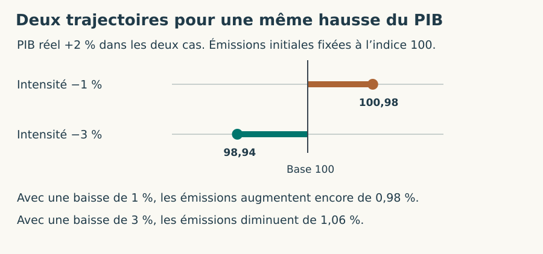

# ENS-PSL · Sélection internationale Lettres — Économie — décroissance ou croissance verte (oral) 2022 · Corrigé brut

*Corrigé rédigé par IA, non officiel. Signalez toute erreur.*

**Lecture du rapport du jury** · GPT-6.2 Astra Ultra · vitesse non renseignée

**Rédaction** · GPT-6.2 Astra Ultra · vitesse non renseignée

**Autocontrôle** · GPT-6.2 Astra Ultra · vitesse non renseignée

## Exposé proposé — Décroissance ou croissance verte ?

Imaginons une économie dont le PIB réel augmente de 2 % et dont les émissions par euro de valeur ajoutée baissent de 3 %. Ses émissions totales sont multipliées par 1,02 puis par 0,97, soit 0,9894. Elles diminuent d’environ 1,06 %. Ce calcul suffit à établir que croissance et baisse d’émissions sont compatibles en arithmétique. Il ne dit ni si une telle baisse peut se poursuivre, ni si elle sera suffisante assez tôt, ni qui portera l’effort. Je distinguerai donc la possibilité d’une croissance verte, la justification d’une réduction choisie de certaines activités et les instruments qui permettent de juger des deux stratégies.

**La croissance verte repose sur un découplage absolu suffisamment rapide.** Un PIB réel qui croît plus vite que les émissions réalise seulement un découplage relatif si celles-ci augmentent encore. Pour le climat, le résultat dépend des émissions absolues cumulées. On peut séparer dans l’explication le PIB, l’énergie mobilisée par unité de PIB et le contenu carbone de cette énergie. L’efficacité des bâtiments ou des procédés agit sur le deuxième facteur. La substitution d’électricité décarbonée aux énergies fossiles agit sur le troisième, à condition que l’ensemble du système de production et du cycle de vie soit pris en compte. À long terme, l’innovation et la modification du contenu de la consommation peuvent déplacer la composition de la valeur vers des services moins matériels. Elles requièrent des capitaux, des compétences et des délais.

Que sait-on en 2022 ? Le GIEC identifiait au moins dix-huit pays ayant durablement réduit les émissions de gaz à effet de serre liées à la production sur leur territoire et les émissions de CO₂ associées à la consommation, pendant plus de dix ans. Cette observation interdit de tenir les réductions absolues prolongées pour impossibles. Elle ne dit pas que ces pays ont tous atteint le rythme compatible avec une limite de température, ni que l’ensemble de la planète suivait la même trajectoire. Les émissions mondiales nettes de gaz à effet de serre étaient en 2019 environ 12 % plus élevées qu’en 2010. Enfin le carbone n’épuise pas la question écologique. La baisse du CO₂ territorial peut aller de pair avec des importations intensives en matières, de l’artificialisation ou d’autres atteintes aux écosystèmes.

**La décroissance défend une transformation voulue de la production et des usages.** Elle se distingue d’une récession désordonnée qui détruit des emplois, laisse des capacités inutilisées et aggrave des inégalités. Son argument central porte sur l’échelle physique. Les gains d’efficacité peuvent être absorbés par l’augmentation des usages, par exemple si une baisse du coût par kilomètre encourage davantage de trajets. La sobriété vise alors la demande de services matériels en agissant sur les infrastructures et l’organisation collective. Un aménagement urbain qui réduit les distances obligées ne se résume pas au choix individuel de moins se déplacer. Des limites ciblées à des consommations très intensives peuvent aussi dégager des ressources pour le logement, les soins ou les transports collectifs. Ces derniers secteurs peuvent croître dans une trajectoire dont le PIB total stagne.

La difficulté est de savoir si une baisse du PIB constitue une condition indispensable, un résultat possible ou une cible. Une baisse uniforme de toutes les activités pénaliserait des besoins essentiels et pourrait compromettre les investissements nécessaires à la décarbonation. À l’inverse, promettre que toute production actuelle sera rendue propre au même rythme évite de distinguer les secteurs pour lesquels des substituts existent déjà de ceux qui dépendent d’infrastructures ou d’innovations incertaines. Les besoins d’un pays où l’accès à l’électricité ou aux soins est insuffisant diffèrent de ceux d’une économie riche fortement consommatrice. La répartition de l’effort au sein de chaque pays compte autant que les moyennes nationales.

**La politique publique peut trancher des décisions concrètes sans attendre de connaître le PIB futur.** Un prix des émissions ou un plafond couvrant les activités concernées corrige une externalité. Des investissements publics et un soutien à l’innovation rendent possible la substitution. Des normes et des politiques d’aménagement évitent que le signal de prix ne frappe les personnes dépourvues d’alternative. Pour une région dépendante d’une activité fossile, il faut prévoir reconversion et protection du revenu avant la fermeture. Des comptes d’émissions territoriales et de consommation, des indicateurs de matières, de biodiversité et de conditions de vie permettent ensuite de vérifier les résultats. Le projet associé à l’oral par le jury portait sur la transition entre énergies fossiles et renouvelables. Il invite notamment à regarder si une capacité renouvelable supplémentaire remplace effectivement une production fossile ou s’ajoute à un système dont la demande augmente.

Ma réponse est donc conditionnelle. Une croissance peut être qualifiée de verte lorsqu’on documente un découplage absolu, suffisant à l’échelle pertinente, sans déplacement des dommages ni dégradation des conditions de vie des plus vulnérables. Une diminution particulière de production peut être souhaitable lorsque les usages ne justifient pas leurs coûts environnementaux et que les alternatives sont organisées. Le choix collectif porte d’abord sur des besoins à satisfaire dans des limites mesurables. Le signe du taux de croissance enregistre une partie du résultat sans suffire à en juger.

[Sujet officiel](https://www.ens.psl.eu/sites/default/files/eco-oraux-sil2022.pdf) · [Rapport du jury](https://www.ens.psl.eu/sites/default/files/rapport_sil_economie_2022.pdf) · [GIEC, rapport de 2022, résumé pour les décideurs](https://www.ipcc.ch/report/ar6/wg3/chapter/summary-for-policymakers/)
