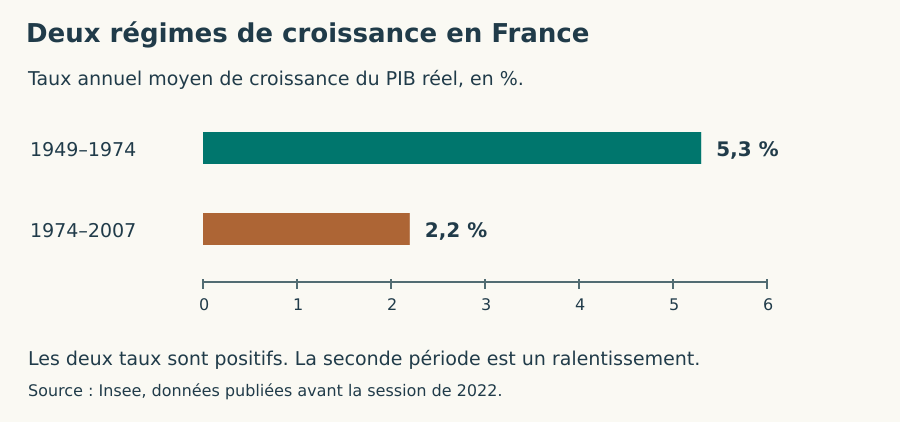

# ENS-PSL · Sélection internationale Lettres — Économie — la fin de la croissance 2022 · Corrigé guidé

*Corrigé rédigé par IA, non officiel. Signalez toute erreur.*

**Lecture du rapport du jury** · GPT-6.2 Astra Ultra · vitesse non renseignée

**Rédaction** · GPT-6.2 Astra Ultra · vitesse non renseignée

**Autocontrôle** · GPT-6.2 Astra Ultra · vitesse non renseignée

**Révision (tour 1)** · GPT-6.2 Astra Ultra · vitesse non renseignée · 26 novembre 2026

**Couverture vérifiée.** Écrit, sujet individuel 1 de la feuille officielle. Le rapport rattache le projet sur le rôle des politiques d’éducation et de formation face à la désindustrialisation à cette épreuve et à l’oral « À quoi sert l’éducation ? ». La dissertation et son guide traitent le ralentissement observé, les mécanismes de stagnation et la finalité de la croissance. Les taux français et leurs périodes de référence ont été rapprochés de la figure 1 de l’Insee. Une troisième période et une application au bassin industriel relient les séries nationales au projet décrit par le jury.

## Repérer les mécanismes du ralentissement et ses enjeux

1. **Le taux baisse.** À 2,2 % par an, le PIB réel double encore en près de trente-deux ans. Calculez avec le facteur annuel 1,022, puis interprétez.
2. **La demande est insuffisante.** Recherchez les capacités inemployées et les évolutions de l’investissement. Une politique conjoncturelle peut modifier la trajectoire.
3. **La croissance potentielle ralentit.** Décomposez la production par habitant entre productivité horaire, durée du travail et emploi.
4. **La contrainte devient écologique.** Comparez l’intensité carbone et les émissions absolues. La première peut baisser alors que les secondes augmentent.
5. **La finalité est discutée.** Donnez au moins deux indicateurs qui complètent le PIB et expliquez quelle décision ils éclairent.

Le jury rattache cet écrit à un projet sur les politiques de formation face à la désindustrialisation. Une application pertinente consiste à comparer les parcours d’emploi de travailleurs exposés différemment à une fermeture industrielle. Le dossier individuel n’étant pas publié, cette piste ne préjuge pas de la stratégie du candidat.

**Vérifier les ordres de grandeur.** Le facteur qui double une base 100 en 32 ans est proche de $1{,}022^{32}$. Pour comparer des taux sur cinq ans, on calcule de même $100(1{,}001)^5$ et $100(1{,}022)^5$. Ce sont des trajectoires lissées destinées à interpréter les moyennes historiques. Pour décrire la récession d’une année particulière, il faut les observations annuelles.

## La fin de la croissance

La France a connu entre 1949 et 1974 une croissance moyenne du produit intérieur brut en volume de 5,3 % par an, contre 2,2 % entre 1974 et 2007 selon l’Insee. La seconde période a pourtant produit une augmentation considérable de la production. À 2,2 % par an, une grandeur double en environ trente-deux ans. Un taux qui baisse, un taux nul et une baisse du niveau de production décrivent trois trajectoires différentes. Annoncer la « fin » de la croissance pose aussi une question de finalité. Doit-on craindre l’interruption durable de la hausse du PIB réel ou repenser la place donnée à cet indicateur dans les politiques publiques ? Ces deux questions se rejoignent lorsqu’on mesure ce qui rend la croissance possible et ce qu’elle coûte.

### Pourquoi le ralentissement peut durer

Le PIB réel par habitant peut se décomposer en production par heure, heures travaillées par personne en emploi et proportion des personnes en emploi dans la population. Une réduction choisie du temps de travail et une diminution subie de l’emploi ont des effets arithmétiques analogues sur le PIB, mais des significations sociales différentes. La croissance exceptionnelle des pays européens après 1945 doit beaucoup à la reconstruction, à l’accumulation du capital, au transfert de main-d’œuvre et au rattrapage technologique. Plus une économie se rapproche de la frontière de productivité, moins elle peut compter sur la seule adoption de techniques déjà éprouvées. Dans le modèle de Solow, approfondir le capital par travailleur rencontre des rendements décroissants. À long terme, le progrès technique entretient l’augmentation de la production par travailleur. Il serait donc erroné de prolonger indéfiniment le rendement d’une phase de rattrapage.

Il faut toutefois séparer un ralentissement de l’offre potentielle d’une demande durablement insuffisante. Des perspectives de débouchés médiocres peuvent dissuader les entreprises d’investir, même quand le financement est peu coûteux. Le vieillissement, les inégalités d’épargne et l’incertitude peuvent accentuer ce risque. Une demande déficiente dégrade à son tour le potentiel lorsque les chômeurs perdent des compétences ou que les investissements de recherche sont différés. Des séries sur le travail, l’investissement, la productivité horaire et les capacités inemployées aideraient à départager ces mécanismes. Leur distinction change la réponse publique. Maintenir la demande dans une économie momentanément déprimée ne supprime pas une contrainte physique de long terme.

La même étude de l’Insee offre un troisième point de comparaison. De 2007 à 2012, le PIB français en volume ne progresse en moyenne que de 0,1 % par an. À taux constant, 100 deviendrait environ 100,5 en cinq ans, contre environ 111,5 à 2,2 %. Le premier intervalle inclut la récession de 2009. En déduire une disparition définitive des gains de productivité confondrait les effets de la crise sur la demande avec les déterminants du potentiel productif. Une fermeture d’usine illustre la difficulté à l’échelle locale. La valeur ajoutée régionale peut chuter alors même que l’économie nationale croît. Pour apprécier ce que change une politique de formation, il faudrait suivre simultanément les trajectoires des salariés déplacés et les recrutements dans les activités qui se développent, y compris hors du territoire initial.

### Ce qui peut encore croître et à quelles conditions

Les théories de la croissance endogène mettent en avant des connaissances dont l’usage par une entreprise n’empêche pas l’usage par une autre. L’éducation, les infrastructures scientifiques et l’organisation productive peuvent donc soutenir la croissance au-delà de la simple accumulation d’équipements. La présence d’effets externes explique que l’investissement privé soit parfois insuffisant. Une invention diffusée largement peut accroître le bien-être sans que son inventeur en capte tout le rendement. Le numérique illustre cependant une difficulté empirique. De nouveaux services peuvent produire des gains importants pour leurs utilisateurs sans relever aussi fortement la productivité agrégée mesurée. Cela ne suffit pas à attribuer tout le ralentissement statistique à une erreur de mesure.

La production s’appuie aussi sur des flux matériels, énergétiques et environnementaux. Les externalités climatiques rendent artificiellement rentable une activité qui ne paie pas le coût social de ses émissions. Le GIEC estimait, dans son rapport disponible en 2022, les émissions mondiales nettes de gaz à effet de serre à environ 59 milliards de tonnes équivalent CO₂ en 2019, en hausse d’environ 12 % depuis 2010. Une plus grande efficacité par unité produite ne garantit donc pas la baisse du total. Une économie peut produire davantage de valeur avec moins de carbone, mais l’évolution pertinente est la vitesse de réduction des émissions absolues, compte tenu du budget carbone et des importations. Une substitution technologique doit être démontrée secteur par secteur. Certains processus ou services peuvent s’électrifier plus facilement que d’autres, et une baisse du coût d’usage peut susciter des consommations supplémentaires.

### Que devient la politique économique si la croissance est faible ?

Le PIB additionne des valeurs ajoutées. Il ne renseigne directement ni sur leur distribution, ni sur l’utilisation des ressources non renouvelables, ni sur le travail domestique non rémunéré. Une catastrophe peut accroître les dépenses de reconstruction tout en laissant la population plus pauvre que sur une trajectoire sans destruction. À l’inverse, des soins ou une isolation thermique peuvent améliorer une vie et compter positivement dans le PIB. Une politique sérieuse n’a donc pas à substituer au culte de la hausse un culte uniforme de la baisse. Elle doit choisir les activités à développer, celles à réduire et les indicateurs qui permettront d’en juger. Revenu médian réel, pauvreté, santé, temps disponible, émissions territoriales et empreinte de consommation éclairent des dimensions différentes.

Une croissance durablement faible complique certains compromis. Une dette à taux d’intérêt réel supérieur au taux de croissance pèse davantage relativement aux recettes à solde primaire donné. Le partage des gains devient plus conflictuel lorsqu’il y en a peu, et une reconversion industrielle impose des coûts aux salariés et aux territoires. La formation, l’assurance sociale et l’investissement dans les infrastructures peuvent accompagner la transformation, à condition d’évaluer qui bénéficie réellement des emplois créés et à quelle échéance. Au niveau mondial, demander la même trajectoire à un pays pauvre qui doit étendre son réseau de santé et à un pays riche qui peut réduire certaines consommations méconnaîtrait les différences de besoins et de responsabilités.

Le ralentissement des économies avancées est un fait historique. Leur stagnation définitive ne l’est pas. La conclusion de politique économique dépend de la variable que l’on veut préserver. Face à une récession, sauvegarder emploi et investissement peut être urgent. Face à un budget carbone, il faut obtenir des réductions absolues au rythme requis. Dans les deux cas, les institutions ont intérêt à pouvoir assurer des conditions de vie décentes même lorsque le taux de croissance déçoit.

[Sujet officiel](https://www.ens.psl.eu/sites/default/files/eco-ecrits-sil2022.pdf) · [Rapport du jury](https://www.ens.psl.eu/sites/default/files/rapport_sil_economie_2022.pdf) · [Insee, trente ans de vie économique et sociale](https://www.insee.fr/fr/statistiques/fichier/1374366/HISTO14_b_D1_eco.pdf) · [GIEC, rapport de 2022, résumé pour les décideurs](https://www.ipcc.ch/report/ar6/wg3/chapter/summary-for-policymakers/)
