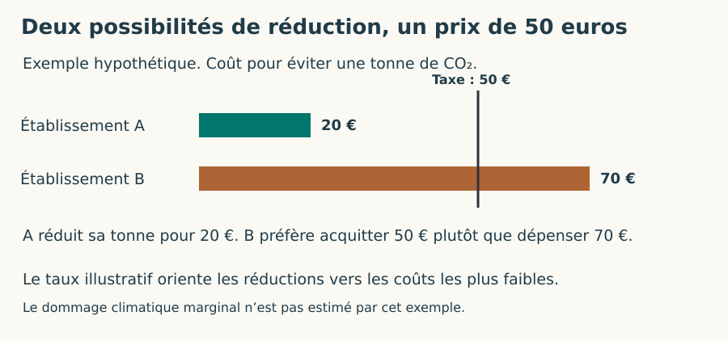

# ENS-PSL · Sélection internationale Lettres — Économie — les instruments de la politique climatique 2022 · Corrigé brut

*Corrigé rédigé par IA, non officiel. Signalez toute erreur.*

**Lecture du rapport du jury** · GPT-6.2 Astra Ultra · vitesse non renseignée

**Rédaction** · GPT-6.2 Astra Ultra · vitesse non renseignée

**Autocontrôle** · GPT-6.2 Astra Ultra · vitesse non renseignée

**Révision (tour 1)** · GPT-6.2 Astra Ultra · vitesse non renseignée · 26 novembre 2026

**Couverture vérifiée.** Écrit, sujet individuel 2 de la feuille officielle. Le rapport rattache le projet sur la transition entre énergies fossiles et renouvelables à cette épreuve et à l’oral « Décroissance ou croissance verte ? ». La dissertation et son guide examinent la taxe, les quotas, les normes, l’innovation, l’adaptation et la redistribution. Le coût réel de réduction est distingué des paiements de taxe et de quotas. L’estimation de Bayer et Aklin a été contrôlée en précisant le contrefactuel, la période et le caractère cumulé des tonnes évitées.

## Les instruments de la politique climatique

Une tonne de dioxyde de carbone ajoute à un stock mondial dont les dommages se manifestent sur plusieurs décennies. L’émetteur supporte le coût de son combustible, mais rarement l’intégralité du dommage futur infligé aux autres. En 2019, les émissions mondiales nettes de gaz à effet de serre atteignaient environ 59 milliards de tonnes équivalent CO₂ selon le GIEC. Le sujet porte sur la manière de transformer ce diagnostic en décisions. Quel instrument peut orienter des millions de choix différents tout en respectant un budget d’émissions, des contraintes de financement et une exigence de justice ? Il faut partir de l’externalité, puis expliquer les raisons précises d’une combinaison d’instruments.

### Faire entrer le carbone dans la décision

Une taxe par tonne incite chaque émetteur à réduire tant que sa dernière tonne évitée coûte moins que la taxe. Considérons deux établissements qui pourraient éviter chacun une tonne pour 20 ou 70 euros. À 50 euros la tonne, le premier réduit son émission et le second acquitte la taxe. Sous réserve que la mesure des émissions soit fiable et que les acteurs puissent répondre au signal, les efforts sont ainsi dirigés vers les réductions les moins coûteuses. Le taux qui internaliserait le dommage externe marginal n’est pas donné par cet exemple. Il dépend de l’évaluation du dommage, des risques, de l’actualisation et de la trajectoire retenue. Un calendrier annoncé aide à orienter des investissements qui dureront bien au-delà du taux appliqué aujourd’hui.

Un marché de quotas négociables fixe un volume de droits et laisse leur prix émerger des échanges. Avec échange concurrentiel et contrôle crédible, la tonne évitée tend vers le même coût marginal chez les participants. La taxe fixe davantage le prix et laisse varier les quantités. Le plafond règle la quantité couverte et expose davantage le prix aux variations de la conjoncture et de la technologie. Une entreprise qui reçoit certains droits gratuitement conserve un coût d’opportunité à les utiliser si elle peut les vendre. Les modalités d’allocation modifient cependant les rentes et les choix d’investissement. Dans le système européen d’échange de quotas, lancé en 2005, une étude de Bayer et Aklin estime qu’environ 1,2 milliard de tonnes de CO₂ ont été évitées au total de 2008 à 2016 par rapport à un scénario reconstruit sans marché. Ce résultat est une estimation contrefactuelle. Il ne se déduit pas de la simple observation d’une baisse pendant la crise financière.

Pour comparer directement taxe et quotas, reprenons les deux établissements de la figure. Chacun émettrait une tonne sans mesure. Le régulateur émet un seul quota, attribué à A. B doit alors réduire sa tonne au coût de 70 euros ou acheter le droit. A peut réduire la sienne pour 20 euros et le vendre. À un prix négocié de 50 euros, A dépense 20 euros et en reçoit 50, B verse 50 euros et économise les 70 euros de réduction. Il reste une tonne émise, pour une dépense réelle de réduction de 20 euros dans l’ensemble des deux établissements. Le versement de 50 euros change de mains. Avec une taxe de 50 euros, A réduirait aussi sa tonne pour 20 euros, tandis que le versement de B alimenterait le budget public. Le rapprochement repose sur les deux coûts et les deux possibilités d’action posés dans l’exemple.

### Corriger d’autres obstacles que le seul prix du carbone

Un ménage locataire paie une facture de chauffage tandis que le propriétaire choisit l’isolation. Une entreprise innovante ne capte pas toutes les connaissances qu’elle diffuse. Le premier exemple est un problème d’incitations entre parties et le second une externalité positive de connaissance. Même avec un prix du carbone, une norme thermique, des prêts accessibles, un soutien à la recherche ou la construction d’un réseau électrique peuvent être justifiés. Pour chaque intervention, il faut nommer le problème qu’elle résout. Des aides uniformes versées à des projets qui auraient été réalisés de toute façon créent des effets d’aubaine. Des normes identiques appliquées à des situations très différentes peuvent obtenir une réduction donnée à un coût total plus élevé. Elles présentent en revanche des avantages lorsque l’information sur les émissions réelles est imparfaite ou que certains investissements sont irréversibles.

Le cumul lui-même doit être analysé. Si un secteur appartient à un marché doté d’un plafond fixe et contraignant, une aide qui réduit ses émissions peut libérer des quotas utilisés ailleurs. La quantité totale couverte s’en trouve alors peu modifiée, sauf annulation de droits ou règle ajustant l’offre. À plus long terme, la baisse des coûts technologiques peut rendre politiquement possible un plafond plus strict. Il faut distinguer cet effet futur de la réduction immédiate. Pour l’adaptation, telle la prévention des effets de chaleur sur les logements, l’objectif n’est plus la tonne évitée. Il est de réduire des dommages à climat donné, avec des politiques de santé, d’aménagement ou d’information. Deux mesures climatiques demandent donc parfois deux indicateurs d’efficacité différents.

### Rendre la trajectoire finançable, juste et internationale

Un prélèvement sur l’énergie peut peser davantage sur les ménages modestes relativement à leur revenu et davantage sur les territoires sans solution de remplacement. Cet effet distributif peut être atténué par des transferts forfaitaires financés sur la recette. Un versement indépendant de la quantité de carburant achetée protège le revenu tout en conservant l’incitation à économiser la tonne suivante. L’aide ciblée à la rénovation ou le développement de transports collectifs modifient ensuite les possibilités concrètes de substitution. Le coût de la politique et le coût de l’inaction doivent aussi être comparés, car les ménages les moins protégés subissent souvent davantage les dommages climatiques.

À l’échelle mondiale, les bénéfices d’une réduction locale se répartissent entre pays. Chacun peut être tenté de laisser les autres supporter l’effort. Les engagements de l’accord de Paris, la transparence, le financement de la transition des pays moins riches et la coopération technique cherchent à atténuer ce problème sans créer un fisc mondial. Une politique nationale peut aussi déplacer certaines activités et leurs émissions. Comparer inventaires territoriaux et empreintes de consommation aide à détecter le déplacement. Un dispositif commercial de correction éventuel doit distinguer contenu carbone mesuré, motifs protectionnistes et capacité des exportateurs à adapter leur production.

Il faut donc choisir une architecture dont les résultats puissent être contrôlés. Prix ou plafond donnent une orientation commune. Normes, infrastructures et soutien à l’innovation traitent les obstacles que ce signal laisse subsister. Des transferts et une coopération crédible rendent la trajectoire durable. Le critère final demeure la réduction additionnelle des émissions, obtenue dans les délais compatibles avec l’objectif climatique et à un coût social dont la répartition est explicitée.

[Sujet officiel](https://www.ens.psl.eu/sites/default/files/eco-ecrits-sil2022.pdf) · [Rapport du jury](https://www.ens.psl.eu/sites/default/files/rapport_sil_economie_2022.pdf) · [P. Bayer et M. Aklin, évaluation du marché européen](https://pmc.ncbi.nlm.nih.gov/articles/PMC7183178/) · [GIEC, rapport de 2022, résumé pour les décideurs](https://www.ipcc.ch/report/ar6/wg3/chapter/summary-for-policymakers/)
