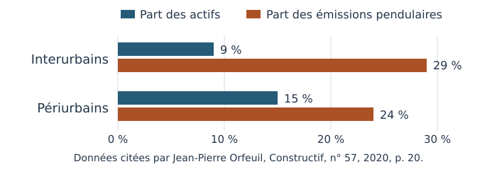

# ENS-PSL · Densité, mobilité et sobriété · 2022 — corrigé brut

*Corrigé rédigé par IA, non officiel. Signalez toute erreur.*

**Rédaction** · GPT-6.2 Astra Ultra · vitesse non renseignée · 26 novembre 2026

## 1. Résumé critique

Dans *Constructif* de novembre 2020, Jean-Pierre Orfeuil se demande si la densité suffit à rendre les déplacements plus sobres. À partir des années 1970, la protection des terres néerlandaises, puis la recherche de villes où l’on pourrait marcher et financer des transports collectifs, ont donné à la compacité valeur de modèle. La célèbre courbe de Newman et Kenworthy associe forte densité des agglomérations et faible consommation d’énergie par habitant pour les déplacements. Orfeuil en interroge le changement d’échelle implicite. Un écart observé entre Denver et Tokyo renvoie aussi à des différences de richesse, de réseaux et de modes de vie. Il renseigne assez peu, à lui seul, sur les conséquences d’une densification dans une ville française.

L’auteur reconnaît la dépendance automobile des couronnes. Les distances quotidiennes citées y atteignent 29 kilomètres contre 17 dans les villes-centres. Mais réduire l’étalement à une relégation des pauvres néglige les différences de prix du logement, le jardin recherché par certains ménages et le coût combiné du logement et des trajets. Une moyenne de coût résidentiel comparable peut d’ailleurs masquer des ménages très exposés à une hausse du carburant. La discussion sur la Covid illustre un problème analogue. À densité élevée, la pauvreté et la suroccupation peuvent aussi expliquer une partie des écarts sanitaires observés avant le confinement.

Changer le périmètre des déplacements modifie le bilan. Les voyages lointains de certains habitants du centre peuvent annuler l’avantage de trajets quotidiens courts. L’« effet barbecue », qui associe jardin et moindre départ le week-end, reste une hypothèse de compensation à distinguer d’un effet du revenu. Les actifs qui habitent et travaillent dans deux agglomérations différentes concentrent, sur le champ étudié, 29 % des émissions des migrations pendulaires pour 9 % des actifs. Le télétravail, les cycles légers ou des services qui se déplacent vers les habitants élargissent les réponses possibles. Leur bénéfice dépend des métiers, des réseaux, du remplissage et des déplacements réellement évités. Les contraintes fiscales et les intérêts des acteurs pèsent sur leur diffusion. Cet article de débat, écrit en pleine pandémie, met ainsi les moyennes urbaines à l’épreuve sans démontrer que toute localisation produirait les mêmes effets. La consommation de terres conserve sa logique propre.

## 2. Apports et limites pour un projet de recherche

Je prends ici comme **projet de recherche d’exemple** l’accès à l’emploi des habitants de Montargis travaillant dans une autre agglomération, notamment Orléans. Le couple imaginé par Orfeuil, dont les lieux de travail sont Orléans et Nemours, m’invite à déplacer l’unité d’enquête. Habiter un centre ne garantit pas un emploi proche. Je comparerais des actifs de revenu et de métier proches résidant dans l’agglomération de Montargis, les uns travaillant sur place et les autres ailleurs. Mon hypothèse est que les horaires et la dispersion des emplois expliquent une part des émissions que la densité résidentielle laisse inexpliquée.

L’article fournit un principe de mesure. Je croiserais les flux domicile-travail du recensement avec un carnet de déplacements d’une semaine et un relevé séparé des voyages plus rares. Je mesurerais distance, mode, fréquence, coût et nombre d’emplois accessibles aux heures de prise de poste. Un entretien avec des salariés en horaires décalés permettrait de comprendre pourquoi une gare ou une piste proche ne garantit pas un déplacement réalisable. Le pourcentage national d’émissions attribué aux interurbains justifie la question, mais ne vaut pas mesure locale. Enfin, recueillir le lieu de travail avant et après un changement d’emploi aiderait à distinguer une véritable contrainte de desserte d’un choix résidentiel antérieur. Cette enquête pourrait ainsi comparer des interventions précises, service matinal ou travail à distance lorsqu’il est possible, en estimant à la fois les émissions évitées et les emplois réellement accessibles.
