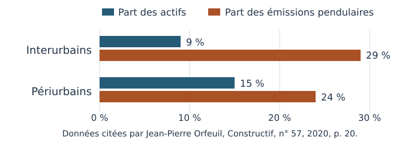

# ENS-PSL · Densité, mobilité et sobriété · 2022 — corrigé guidé

*Corrigé rédigé par IA, non officiel. Signalez toute erreur.*

**Rédaction** · GPT-6.2 Astra Ultra · vitesse non renseignée · 26 novembre 2026

## Organiser la copie double

Le jury répartit le travail entre un résumé critique de l’article de Jean-Pierre Orfeuil et une discussion de ses apports et limites pour le projet de recherche du candidat. Réserver une place réelle à chaque partie. Le projet proposé ici sert d’exemple et peut être remplacé par le terrain présenté dans le dossier personnel.

### 1. Faire apparaître une thèse, la mettre à l’épreuve

**Partir du graphique de la page 18.** L’abscisse donne la densité urbaine en habitants par hectare. L’ordonnée représente l’énergie par habitant consacrée aux déplacements, en gigajoules. Les métropoles nord-américaines peu denses du graphique se distinguent des métropoles asiatiques plus denses. Newman et Kenworthy ont fourni par là une image largement mobilisée en faveur de la ville compacte. L’article demande si ce rapprochement à l’échelle des métropoles suffit à prévoir les déplacements d’un ménage ou les effets d’une politique. Orfeuil met notamment en doute la comparabilité de villes de niveaux économiques différents et la cohérence de l’ampleur des écarts avec d’autres statistiques.

**Accorder à la compacité ce que les observations établissent.** Les résidents périurbains ont en moyenne davantage de voitures, habitent plus loin de leur travail et roulent plus chaque jour. En revanche, l’ensemble des dépenses de déplacement et de logement ne progresse pas nécessairement avec la distance au centre. Dans les grandes aires urbaines citées, 9 % des habitants des couronnes et 19 % de ceux des centres vivent sous le seuil de pauvreté. Cette comparaison d’ensembles ne dispense pas de chercher les périurbains pauvres qui dépendent de leur voiture. L’article prend aussi l’exemple de la pandémie pour distinguer densité, suroccupation des logements et encombrement des transports.

**Changer la population et le temps observés.** Dans le graphique ci-dessous, lire les deux barres de chaque groupe séparément. Le premier 9 % a pour dénominateur les actifs du champ étudié. Les 29 % portent sur les émissions des déplacements domicile-travail. Le graphique permet d’identifier un objet d’enquête, les déplacements interurbains. Il ne donne ni une part de toutes les émissions françaises, ni une mesure de chaque navette individuelle.

**Formuler la réserve critique.** Inclure également les voyages de loisir et le temps long. Un résident central peut prendre l’avion tandis qu’un ménage qui dispose d’un jardin peut moins partir. Le terme « effet barbecue » nomme cette compensation possible. Pour lui donner une valeur causale, il faudrait comparer des ménages de revenus et de compositions semblables. Orfeuil ouvre enfin des pistes variées, du vélo à assistance électrique au télétravail et aux services mobiles. La crise de 2020 a modifié les pratiques dans des conditions exceptionnelles. Une proposition de mobilité sobre demande encore une estimation des kilomètres remplacés, des emplois concernés et des coûts pour la collectivité.

### 2. Relier chaque idée à une décision de recherche

**Projet illustratif.** Étudier comment les habitants de Montargis accèdent à un emploi situé dans une autre agglomération. La reformulation géographique porte sur la coïncidence entre résidence centrale et emploi proche. L’exemple du ménage qui vit à Montargis et travaille à Orléans et à Nemours suffit à montrer que cette coïncidence ne va pas de soi.

**Apport théorique et méthode.** L’article conduit à comparer deux types de navetteurs résidant dans la même agglomération, ceux qui y travaillent et ceux qui en sortent. Pour distinguer la distance du domicile à la gare de l’accessibilité réelle du travail, noter les heures exactes de prise de poste, les correspondances et la distance finale. Croiser un carnet hebdomadaire, des entretiens et les tables de flux du recensement. Pour l’empreinte annuelle, ajouter les déplacements occasionnels et multiplier les distances par des facteurs d’émission cohérents avec l’occupation des véhicules. Tenir séparés les résultats sur la navette et sur l’ensemble de la mobilité.

**Limite et amélioration.** Une moyenne portant sur plusieurs agglomérations fournit un motif d’enquêter et ne permet pas de chiffrer la part propre à Montargis. Des personnes qui anticipent des déplacements longs peuvent choisir leur résidence en conséquence. Des entretiens sur la chronologie du déménagement et de la prise d’emploi aideraient à tester cette explication concurrente. La comparaison entre métiers télétravaillables et métiers à présence obligatoire aiderait enfin à déterminer qui bénéficie d’une solution proposée.

**Dernière phrase possible.** « Je pourrai ainsi tester si une meilleure desserte des lieux de travail réduit les kilomètres émis sans réduire l’éventail des emplois accessibles aux personnes dont les horaires sont les plus contraints. » Cette phrase répond à la seconde partie en désignant un résultat que l’enquête permettrait effectivement de discuter.
