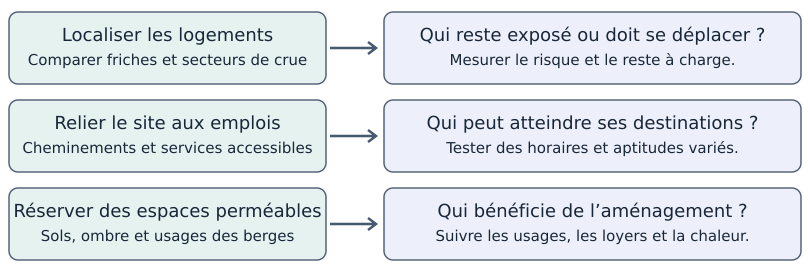

# ENS-PSL · Le rôle de l’urbaniste face aux enjeux environnementaux et sociaux · 2022 — corrigé brut

*Corrigé rédigé par IA, non officiel. Signalez toute erreur.*

**Rédaction** · GPT-6.2 Astra Ultra · vitesse non renseignée · 26 novembre 2026

## Une proposition d’exposé de dix minutes

Après la crue du Loing de 2016, que voudrait dire « bien aménager » un quartier de vallée comme on en trouve dans l’agglomération de Montargis ? Laisser passer l’eau est une exigence. Trouver un logement abordable, aller travailler et garder accès aux commerces en sont d’autres. Une famille peut vivre dans la zone la plus exposée précisément parce que les loyers y sont à sa portée. Si l’on traite le problème de l’eau sans celui du logement, le risque peut simplement changer d’adresse. Selon moi, le rôle de l’urbaniste consiste à rendre ces interdépendances visibles, à mettre des choix réalisables en discussion et à examiner qui bénéficie réellement des décisions prises. Le quartier de vallée servira ici à raisonner sur un aménagement possible.

### Faire un diagnostic qui parte aussi des habitants

Pour examiner un projet de nouveaux logements, je commencerais par superposer plusieurs géographies. À l’échelle du bassin versant, où vont les eaux et quels secteurs peuvent stocker temporairement une crue ? À l’échelle du quartier, quels bâtiments, rez-de-chaussée et accès se trouvent exposés ? À l’échelle de l’agglomération, où sont les écoles, les emplois, les logements disponibles et les transports utilisables ? Une promesse de relogement hors d’eau perd de sa valeur si elle oblige un ménage à acheter une deuxième voiture.

Il faut ensuite sortir de la carte. Marcher du site vers une école avec un parent, relever l’heure du premier bus pour une salariée qui prend son poste tôt, demander à une personne qui se déplace difficilement quels parcours restent praticables, voilà trois manières de mesurer la différence entre une proximité sur le plan et un accès réel. Une inondation ne pèse d’ailleurs pas du même poids selon qu’on peut monter à l’étage, s’absenter de son emploi ou compter sur un proche. L’urbaniste organise cette enquête avec les habitants, les services de l’eau et des transports, les bailleurs et les collectivités. Chacun possède une connaissance partielle du même territoire.

### Construire des choix dont on voie les effets

Prenons trois possibilités. Étendre le quartier sur des terres encore libres paraît facile si l’on ne regarde que le prix de la parcelle. Il faut aussi compter l’imperméabilisation, le coût durable des réseaux et l’allongement des trajets. Construire sur une friche déjà desservie économise du sol agricole. Mais il faut vérifier le risque d’inondation, le coût éventuel de dépollution et le prix auquel les logements pourront sortir. Enfin, réhabiliter le bâti existant permet de réutiliser des matériaux et de conserver des voisinages. Cette solution exige de protéger les occupants contre les hausses de loyers ou les déplacements subis pendant les travaux.

L’urbaniste rend ces options comparables. Pour chacune, il présenterait par exemple le nombre de ménages encore exposés, les logements abordables réellement produits, les surfaces de sol perméable conservées et les emplois accessibles à l’heure de prise de poste. J’écarterais la construction de logements supplémentaires dans les secteurs où la sécurité des personnes ne peut être assurée. Ailleurs, je donnerais priorité à la réhabilitation et aux sites déjà desservis, en chiffrant simultanément des mesures de maintien des habitants. Ce choix permet de discuter un coût et des bénéficiaires identifiables.

Les métiers et les autorités n’ont pas tous la même responsabilité. Un spécialiste de l’eau caractérise un aléa. Un bailleur connaît les conditions de retour des locataires. La collectivité peut fixer des règles d’usage du sol, négocier la maîtrise foncière et choisir une dépense. L’urbaniste articule ces propositions, expose leurs conflits et prépare les décisions dont les élus répondent publiquement. Une réunion tenue après avoir arrêté le projet a peu d’effet. Un atelier où les participants peuvent encore déplacer un accès, maintenir un commerce ou demander une autre implantation laisse une trace dans le plan et dans le budget.

### Revenir après les travaux

Une berge plantée et accessible peut donner de l’ombre, offrir un lieu de rencontre et ménager de l’espace à l’eau. Ses avantages peuvent aussi être captés par la valorisation immobilière. Je proposerais de suivre, dès avant les travaux puis après leur livraison, les loyers, le retour des ménages relogés, la fréquentation à différentes heures et l’évolution des itinéraires lors des fortes pluies. Un écart entre résultats et promesses doit pouvoir conduire à modifier un aménagement ou les conditions de gestion. Cette capacité de révision demande du temps et un responsable désigné.

La qualité environnementale d’une ville se mesure ainsi dans la vie sociale qu’elle rend possible. Pour moi, un urbaniste remplit son rôle lorsque celles et ceux qui supporteront les conséquences d’un projet peuvent comprendre les options, y peser et constater, quelques années plus tard, si le projet a tenu ses engagements.

## Relier cet exposé au projet et à l’entretien

La consigne individuelle publiée porte sur le rôle de l’urbaniste. Le rapport de session décrit aussi une présentation de dix minutes du projet scientifique, académique et professionnel suivie de dix minutes d’entretien. Voici un **projet illustratif**, distinct de celui de la personne admise. J’étudierais l’accès au logement et au travail après une opération d’adaptation à la crue. Mon hypothèse serait qu’un gain de sécurité résidentielle peut s’accompagner d’une perte d’accessibilité pour les ménages les moins motorisés. Je comparerais deux secteurs du même bassin de vie, relierais les cartes de risque et les horaires de transport à des entretiens volontaires, et vérifierais l’accès aux archives locales avant de fixer la période. Une formation en méthodes spatiales et en enquête de terrain permettrait d’acquérir les compétences nécessaires. Le projet pourrait conduire à un travail d’étude au service d’une collectivité.

**Que feriez-vous si les ménages ayant quitté le quartier sont difficiles à retrouver ?** L’intermédiaire d’associations ou d’un bailleur peut faciliter un contact volontaire et confidentiel. Je documenterais les limites du recrutement. Une enquête menée seulement auprès de ceux qui sont restés conduirait vraisemblablement à sous-estimer les déplacements subis.
