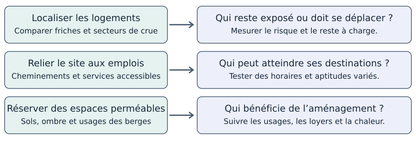

# ENS-PSL · Le rôle de l’urbaniste face aux enjeux environnementaux et sociaux · 2022 — corrigé guidé

*Corrigé rédigé par IA, non officiel. Signalez toute erreur.*

**Rédaction** · GPT-6.2 Astra Ultra · vitesse non renseignée · 26 novembre 2026

## Préparer les deux pièces de l’oral

Le feuillet individuel de 2022 demande un exposé de dix minutes sur le rôle de l’urbaniste devant les enjeux sociaux et environnementaux. Le rapport décrit une présentation du projet scientifique, académique et professionnel et une discussion avec le jury, de dix minutes chacune au maximum. Préparer une réponse au feuillet et savoir montrer en quoi elle rejoint son terrain. L’exemple proposé ici est celui d’un quartier de la vallée du Loing. Les opérations d’aménagement envisagées sont des scénarios de travail.

### 1. Transformer deux grands mots en un problème de terrain

**Pour ouvrir, une minute.** Prendre une famille dont le logement, situé en zone inondable, est proche de son emploi. Éloigner ce ménage de l’eau peut alourdir ses déplacements et sa dépense de logement. Comment réduire son exposition tout en préservant son accès aux ressources de la ville ? On dispose désormais d’une question sur laquelle un urbaniste peut agir. Le lien entre environnement et société devient l’objet de la démonstration.

**Pour enquêter, deux minutes.** Il faut d’abord distinguer l’aléa de crue, les biens exposés et la capacité inégale des habitants à se protéger puis à se relever. Faire parler deux cartes complémentaires, celle de l’eau à l’échelle du bassin et celle des logements, des prix et des services à l’échelle de l’agglomération. Pour vérifier les temps d’accès réels, faire le trajet aux horaires de prise de poste et écouter les personnes concernées. En expliquer la raison à voix haute. Un arrêt situé à cent mètres ne rend aucun service au salarié qui commence avant le premier passage du bus.

### 2. Donner à voir un arbitrage

**Pour comparer les solutions, quatre minutes.** Construire le même nombre de logements sur trois types de sites serait un point de départ. Une extension en périphérie consomme du sol et peut imposer du transport aux ménages. Une friche desservie réduit ces deux effets, sous réserve des risques, de la dépollution et des prix. Une rénovation réemploie les logements existants, mais suppose une solution pour les occupants pendant les travaux et des conditions crédibles de retour. Dans chaque cas, relever qui finance, qui gagne en accessibilité et qui risque d’être déplacé.

Aller jusqu’à un parti défendable. Préserver les espaces nécessaires à l’écoulement des eaux, privilégier les sites déjà desservis et sélectionner les opérations qui maintiennent une offre abordable. Puis annoncer une objection sérieuse. Une friche trop coûteuse à dépolluer peut ne produire que des logements chers. Comparer le coût complet des solutions et examiner la possibilité d’une maîtrise foncière publique permet de préciser où la proposition tient.

**Pour parler des acteurs, deux minutes.** L’urbaniste réunit les compétences des services de l’eau, du logement et des transports et présente des scénarios. Les habitants disposent d’un savoir d’usage, les élus assument la décision et son financement. Énoncer une modification concrète que la concertation pourrait entraîner, par exemple ajuster l’emplacement d’une desserte le long du trajet quotidien vers l’école. Puis chercher un moyen de contrôle. Mesurer le nombre de ménages revenus après travaux ou les loyers réellement versés fournit un test de la promesse sociale.

**Pour conclure, une minute.** Rappeler la réponse personnelle. La responsabilité de l’urbaniste est de traduire des exigences collectives en choix spatiaux examinables, de rendre explicite leur distribution sociale et d’organiser un suivi qui permette de les corriger.

### 3. Appuyer le propos sur un projet réalisable

Exemple à adapter au dossier personnel. « Je voudrais établir comment un relogement lié au risque de crue transforme l’accès à l’emploi dans deux secteurs de l’agglomération. Je comparerais les temps de parcours et les coûts avant et après le déménagement en tenant compte des horaires de travail et de la motorisation. » Pour développer ce projet, préciser les dates, le choix des secteurs, les documents publics disponibles et le mode de recrutement volontaire pour les entretiens. Comparer aussi des ménages restés sur place. Cette comparaison aiderait à identifier les changements généraux dans la desserte plutôt que d’attribuer toute différence au déménagement.

Le rapport attend une articulation entre la question scientifique, la formation envisagée et un horizon professionnel. À partir de son propre parcours, expliquer quelle compétence d’analyse spatiale ou d’enquête reste à acquérir, comment elle servirait la comparaison et à quel métier ou travail de recherche elle pourrait conduire. On peut prendre pour horizon une fonction d’étude en collectivité. La cohérence se manifeste par le lien entre cette fonction, le terrain et la méthode.

**Deux relances pour s’entraîner.** « Un nouvel espace vert est-il toujours un gain pour les habitants actuels ? » Distinguer fréquentation, rafraîchissement et accès économique durable au quartier en suivant aussi les loyers. « Comment éviter une consultation peu représentative ? » Varier lieux et horaires, proposer des entretiens aux personnes qui ne se rendent pas aux réunions et restituer publiquement ce que leurs observations ont changé dans les options.
