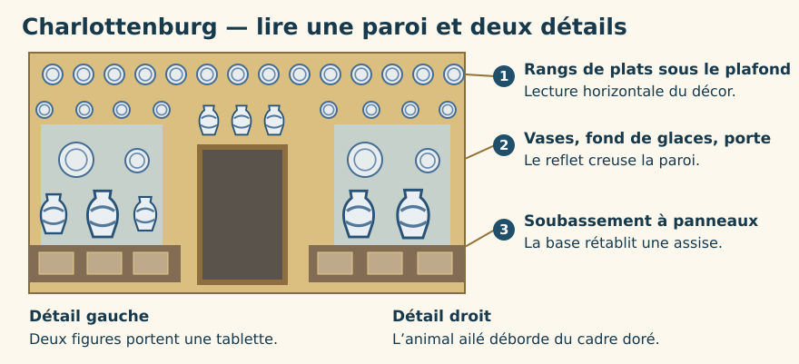

# ENS-PSL · Sélection internationale Lettres — Histoire de l’art — le cabinet de porcelaine de Charlottenburg (oral) 2022 · Corrigé brut

*Corrigé rédigé par IA, non officiel. Signalez toute erreur.*

**Rédaction** · GPT-6.2 Astra Ultra · vitesse non renseignée

**Autocontrôle** · GPT-6.2 Astra Ultra · vitesse non renseignée

Le jury demande un commentaire de la vue générale et des détails, suivi d’une ouverture vers la chinoiserie ou la production européenne de porcelaine. La vue et les deux agrandissements sont reproduits à la page 2 du fascicule.

## Entrer dans une collection par le regard

Le regard rencontre d’abord une porte ouverte. De part et d’autre de cette percée, des vases occupent le bas du mur, des plats suspendus présentent leur disque et des couvercles silhouettés se détachent devant des glaces. Au-dessus du passage, trois grands vases bleus et blancs forment un groupe. Le visiteur traverse donc une pièce dont même les vides sont composés. La légende situe le cabinet à Charlottenburg, dans la Prusse de Sophie-Charlotte de Hanovre, et donne 1703. Comment faire agir ensemble une multitude de pièces mobiles jusqu’à donner à une collection la force d’une architecture ?

La vue générale est prise en biais, à la rencontre de deux murs. Elle permet de suivre une ligne presque continue de plats au-dessous du plafond, puis des rangs où alternent des formes hautes, des disques et des pièces plus petites. Les montants dorés et les ouvertures divisent cet ensemble en travées. Plus bas, le soubassement à petits panneaux figurés ménage une assise visuelle aux grands vases. Le bleu et le blanc réapparaissent selon des rythmes et des échelles différents sur le fond d’or. Le plat, présenté verticalement, offre son décor au regard. Le vase fait intervenir un contour et un volume. La vaisselle a acquis ici une fonction qu’aucune de ces pièces n’aurait isolément. Dans les glaces, la profondeur semble se prolonger au-delà du plan de la paroi. Un décompte à partir du cliché confondrait des objets avec leurs reflets.

## Ce que changent les deux détails

Sous le cintre du détail de gauche, deux figures coiffées se font pendant. Leurs mains s’avancent sous une tablette rouge où se détachent de petites pièces bleues et blanches. Un vase beaucoup plus grand domine l’axe central. Plus bas, l’alternance de plats et de vases reprend en miniature le rythme du mur entier. La présentation prête aux deux figures le geste de servir. Elle associe les objets à une image humaine construite pour le regard de cour. Cette mise en scène renseigne sur celui qui l’a commandée. Les costumes à eux seuls ne permettent d’identifier ni des personnes réelles ni la région de fabrication d’un vase.

À droite, une créature ailée, au corps couvert d’écailles, bascule au-dessus d’un angle de cadre doré. Sa tête retombe devant la moulure tandis que les ailes se dressent. Sur cette photographie rapprochée, le bleu-vert de son corps tranche sur l’or et le bord réfléchissant reprend un fragment de la figure. Là où le premier détail installait une symétrie frontale, cet être fantastique travaille le passage d’un plan à un autre et paraît franchir la limite du cadre. Les deux images expliquent ainsi comment le décor donne vie à l’arrangement mural. La seconde n’autorise pas à identifier une espèce ou une matière à partir de sa seule couleur.

## De la porcelaine aux chinoiseries

Parler de chinoiserie désigne ici le travail européen de sélection et d’invention qui rapproche un type de vaisselle, des costumes et un animal fabuleux. Un vase asiatique peut participer à un tel décor en conservant son lieu de production et sa technique propres. Inversement, un motif tenu en Europe pour chinois peut être créé localement. Ces deux provenances, celle de l’objet et celle du dispositif, doivent être examinées séparément. Dans un appartement princier, le coût du rassemblement et la maîtrise d’un ensemble si fragile rendent visible la capacité de la cour à faire venir, choisir et ordonner.

L’engouement pouvait aussi déplacer la concurrence vers les ateliers. Sous Auguste le Fort, la manufacture saxonne de Meissen est fondée en 1710. Les essais conduits autour de Tschirnhaus et Böttger avaient permis de passer du grès rouge à la mise au point d’une porcelaine dure européenne. Le Metropolitan Museum documente un exemple précis. Une figure chinoise de Guanyin collectionnée en Saxe a fourni un modèle repris en grès rouge puis en porcelaine dure à Meissen. Le modèle, la matière et le lieu d’exécution ont ainsi des histoires distinctes. La fondation saxonne est postérieure à la date indiquée sur la planche de Charlottenburg. Elle éclaire une ambition européenne sans déterminer la provenance des pièces photographiées en Prusse.

La gloire du cabinet tient finalement à deux transformations visibles. Une vaisselle que l’on pourrait prendre en main compose une paroi que l’on parcourt des yeux. Des objets venus de loin entrent dans une représentation européenne du lointain. La photographie témoigne de l’état présenté au visiteur. La fondation qui conserve le château précise que les salles baroques ont été restaurées et situe en 1706 l’achèvement de l’appartement de parade. On peut donc conserver la date de création donnée au concours tout en distinguant la formation du décor, l’achèvement de l’appartement et l’histoire ultérieure de ce que nous voyons.

[Feuillet et planche officiels](https://www.ens.psl.eu/sites/default/files/sujets-arts-sil2022._.pdf)

[Fondation des châteaux et jardins prussiens, Charlottenburg](https://www.spsg.de/presse-foto-film/pressematerial-schloesser-gaerten-stiftung/berlin/presse-material-schloss-charlottenburg/) · [Fondation des châteaux et jardins prussiens, appartement de parade](https://www.spsg.de/fileadmin/user_upload/pdf/sans-souci/SPSG_sans-souci_2017_04_download.pdf) · [Manufacture de Meissen, histoire de la porcelaine dure](https://www.meissen.com/en/geschichte) · [Metropolitan Museum, reprises de la Guanyin en Saxe](https://www.metmuseum.org/art/collection/search/205883)
