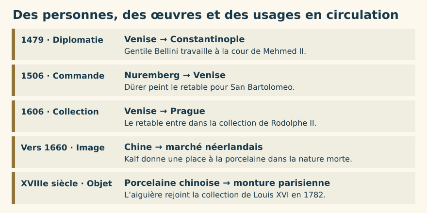

# ENS-PSL · Sélection internationale Lettres — Histoire de l’art — les échanges en Europe moderne 2022 · Corrigé guidé

*Corrigé rédigé par IA, non officiel. Signalez toute erreur.*

**Rédaction** · GPT-6.2 Astra Ultra · vitesse non renseignée

**Autocontrôle** · GPT-6.2 Astra Ultra · vitesse non renseignée

Sujet écrit 3. « L’Europe artistique moderne : un monde fermé ou ouvert ? » Le sujet demande d’étudier les voyages des artistes, les déplacements des œuvres et les objets venus de loin, du XVe au XVIIIe siècle.

## Passer d’un parcours à une preuve

Posez trois questions à chaque exemple. Qui se déplace effectivement ? Quel intermédiaire rend le passage possible ? Qu’est-ce qui change à l’arrivée ? Pour Bellini, c’est l’artiste qui rejoint Constantinople grâce à un accord diplomatique. Pour le retable de Dürer, c’est, un siècle après la commande, le panneau achevé qui gagne Prague. Dessiner ces deux trajets avec une seule flèche ferait perdre le cœur de la démonstration.

**Comment prouver la présence d’objets lointains ?** L’aiguière conservée au Louvre offre une preuve matérielle, dont la notice distingue vase et monture. La nature morte de Kalf livre une autre sorte de preuve. Le peintre rend une porcelaine identifiable et désirable pour un public, mais sa toile n’est ni une facture ni l’inventaire d’un ménage néerlandais. Le rapprochement des deux sources gagne en force quand on distingue ce qu’établit chacune.

**Peut-on faire une place aux frontières sans annuler la thèse ?** Reprenez 1479. Si la mission du peintre dépend d’un geste diplomatique entre puissances récemment en guerre, le passage atteste simultanément une ouverture et les difficultés qu’elle surmonte. À Meissen, l’existence d’un débouché pour les biens asiatiques incite un souverain à concurrencer ces importations. Ce sont deux façons précises de nuancer la réponse.

**Quelle place faire à la Russie ?** La mention de la Russie sur la feuille donne une possibilité supplémentaire, sans en faire un passage obligé. L’introduction et la conclusion doivent garder l’Europe et les quatre siècles pour horizon. Vérifiez la présence d’un cas du XVe siècle et d’un autre du XVIIIe, puis celle de plusieurs centres européens qui agissent dans des directions différentes.

## À quelles conditions un monde de l’art est-il ouvert ?

Une aiguière du Louvre réunit une porcelaine céladon chinoise et une monture en bronze doré exécutée à Paris. Louis XVI l’achète à la vente du duc d’Aumont en 1782. À quel monde de l’art appartient cette pièce ? Une réponse par les frontières du royaume laisserait de côté la fabrication du vase. Une réponse par la seule origine de la céramique effacerait la transformation qui en fait une pièce de collection française. Entre le XVe et le XVIIIe siècle, il faut donc suivre trois déplacements qui ne coïncident pas toujours, ceux des artistes, ceux des œuvres et ceux des usages. L’ouverture de l’Europe moderne se mesure autant aux médiations qui permettent un échange qu’aux limites que celles-ci imposent.

## Voyager suppose une commande, une route et un destinataire

En 1479, la République de Venise envoie Gentile Bellini auprès de Mehmed II à Constantinople. La paix entre puissances rivales ouvre à un peintre de la République l’accès à la cour ottomane. Un souverain recherche les services d’un artiste et un gouvernement engage son crédit en les lui accordant. Les deux cours interviennent dans cet échange. En Italie, la médaille de Mehmed II par Bertoldo di Giovanni reprend pour l’effigie un modèle de Bellini. La circulation du portrait continue ainsi après la rencontre. La frontière confessionnelle était réelle et la diplomatie permettait de la franchir. Rien ne prouve qu’elle eût été aussi perméable à quiconque aurait voulu suivre le même chemin.

La *Fête du Rosaire* offre une autre géographie. Albrecht Dürer, peintre de Nuremberg, exécute en 1506 à Venise un grand retable destiné à l’église San Bartolomeo, liée aux marchands germanophones. Sa compétence et la communauté de commanditaires passent les Alpes selon des logiques différentes. Le tableau donne à une confrérie établie hors de sa région d’origine une présence publique dans une cité marchande. Un siècle plus tard, en 1606, il entre dans la collection de Rodolphe II à Prague. Le premier trajet, celui du peintre, ne suffit donc pas à définir le second, celui du panneau. Le changement de lieu transforme une commande de dévotion en objet éminent de collection impériale.

## L’ailleurs dans une collection et dans une image

Dans les Provinces-Unies du XVIIe siècle, les arrivages de porcelaine chinoise accompagnent l’expansion des échanges maritimes. Vers 1660, Willem Kalf peint un bol de porcelaine avec des fruits et un citron partiellement pelé. Le blanc de la céramique et les accents jaunes émergent d’un fond sombre. Le peintre réunit des biens susceptibles de provenir de lieux éloignés dans l’espace étroit d’une table. Le tableau ne constitue pas une carte exacte des routes commerciales. Il montre quelque chose de différent, la possibilité pour un spectateur européen d’imaginer ou de goûter la proximité de choses que leur production séparait. Posséder une telle nature morte ne signifiait d’ailleurs pas posséder tout ce qu’elle représente.

Cette proximité avait un prix. Les prises de cargaisons portugaises au début du XVIIe siècle ont contribué à faire connaître aux acheteurs néerlandais de grandes quantités de porcelaines. L’ouverture d’une collection pouvait ainsi être liée à la rivalité entre compagnies et puissances. L’objet parvenu en Europe n’y transporte pas automatiquement les usages qu’il avait dans son contexte de production. Le terme d’« exotique » qualifie un regard situé. Le même bol est pour les uns une prouesse ordinaire d’un atelier spécialisé, pour d’autres un bien rare, pour Kalf l’occasion de peindre des reflets et une profondeur.

## Transformer ce qui arrive et contrôler ce qui sort

Dans l’aiguière du duc d’Aumont, un artisan parisien adapte une monture à un corps de céramique déjà formé. La forme finale rend ostensibles la maîtrise du bronze et la valeur accordée au céladon. La réception européenne produit donc un objet nouveau dont l’auteur et la date ne sauraient se résumer à ceux d’une seule pièce. En Saxe, la cour d’Auguste le Fort soutient une autre solution, fabriquer de la porcelaine dure sur place. La manufacture de Meissen, fondée en 1710, reprend d’abord certaines formes connues par les collections asiatiques. Des compétences et des techniques se développent grâce à une curiosité que le prince cherche aussi à convertir en avantage propre. Un collectionneur peut vouloir ouvrir ses cabinets aux objets venus de loin tout en réservant à ses ateliers la connaissance de leur fabrication.

La commande de Mehmed II, le retable passé de Venise à Prague, la table peinte à Amsterdam et la monture parisienne ne dessinent donc ni une Europe confinée entre ses frontières ni un espace également disponible à tous. Chaque passage exige un intermédiaire et modifie ce qui passe. L’originalité de cette Europe tient notamment à ses foyers multiples, tantôt reliés par des marchands, des artistes et des ambassades, tantôt concurrents pour l’acquisition d’un modèle ou d’un savoir. C’est en reconstituant ces passages concrets que l’on peut saisir à la fois l’intensité et les limites historiques de son ouverture.

[Feuillet officiel des sujets, p. 1](https://www.ens.psl.eu/sites/default/files/sujets-arts-sil2022._.pdf)

[Metropolitan Museum, Venise et le monde islamique](https://www.metmuseum.org/exhibitions/listings/2007/venice-and-the-islamic-world) · [Metropolitan Museum, médaille de Mehmed II par Bertoldo](https://www.metmuseum.org/art/collection/search/461519) · [Galerie nationale de Prague, la Fête du Rosaire](https://www.ngprague.cz/en/event/369/albrecht-durer-ruzencova-slavnost-1506-8211-2006) · [Galerie nationale de Prague, histoire des collections](https://www.ngprague.cz/en/about/page/history) · [National Gallery of Art, nature morte de Kalf](https://www.nga.gov/artworks/12206-still-life) · [Louvre, aiguière OA 5151 1](https://collections.louvre.fr/ark:/53355/cl010097375) · [Manufacture de Meissen, histoire de la porcelaine dure](https://www.meissen.com/en/geschichte)
