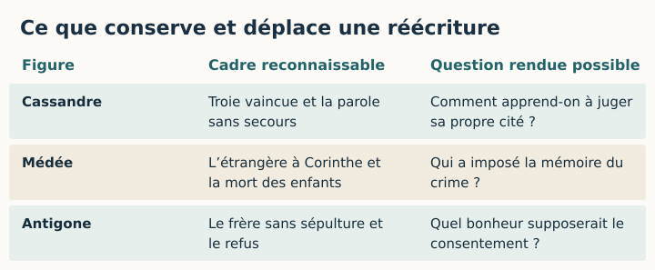

# ENS-PSL · Sélection internationale Lettres · Littérature — Christa Wolf 2022 — Corrigé brut

*Corrigé rédigé par IA, non officiel. Signalez toute erreur.*

**Rédaction** · GPT-6.2 Astra Ultra · vitesse non renseignée

[Sujet officiel](https://www.ens.psl.eu/sites/default/files/litterature-sil2022-3.pdf) · [Rapport du jury](https://www.ens.psl.eu/sites/default/files/rapport-litterature-sil_2022.pdf)

La troisième proposition écrite de 2022 provient du texte de Christa Wolf « De Cassandre à Médée ». Le commentaire traite du rapport entre respect du cadre antique et liberté d’une réécriture actuelle. La consigne prévoit deux heures.

## Qu’est-ce qu’il faut garder d’une histoire connue ?

Le lecteur qui ouvre *Cassandre* de Christa Wolf sait que Troie est tombée. Il sait probablement aussi ce qui attend la captive au terme du voyage qui l’a conduite à Mycènes. Pourquoi écouter un récit dont la catastrophe lui est déjà connue ? Wolf voit précisément dans l’obligation de respecter un cadre une condition de la liberté d’inventer. Son énumération va de l’exploration à l’imagination en passant par l’acte de rendre à la vie et celui d’interpréter. Ces verbes n’accordent pas tous le même pouvoir à l’écrivaine. On explore quelque chose qui existait avant soi, on imagine quelque chose que personne n’a encore vu. Comment faire droit à ces deux gestes, et jusqu’où peut-on changer un récit sans perdre la rencontre avec l’histoire ancienne ?

### Disposer de la fin pour changer la question

Dans l’*Agamemnon* d’Eschyle, Cassandre, ramenée à Argos dans le cortège du vainqueur, demeure d’abord muette devant Clytemnestre. Quand elle parle enfin au chœur, elle connaît le passé sanglant de la maison et la mort qui l’attend. Elle peut essayer de faire entendre l’avenir sans avoir les moyens de le modifier. Le spectateur reconnaît au moins pour partie la vérité que ses interlocuteurs accueillent mal. Et pourtant une extrême tension naît de la distance entre cette vérité et le secours qu’elle serait censée rendre possible. Savoir et pouvoir se trouvent dissociés. Ce rapport fait partie du cadre dont Wolf hérite. Elle n’a nul besoin de tenir le lecteur dans l’incertitude sur une victoire ou une défaite.

Ce qui change dans *Cassandre*, c’est d’abord la propriété du temps. Au seuil de la mort, la captive dispose de l’immense espace que sa parole donne au souvenir de Troie. Il devient possible de se demander à quel moment une prêtresse et fille de Priam commence à interpréter autrement que les siens les paroles et les gestes publics de sa cité. Elle a été assez proche du pouvoir pour en désirer la reconnaissance. Son désaccord n’est pas un don tout fait qui la préserverait, depuis sa naissance, de toutes les illusions collectives. La mémoire à la première personne restitue le coût successif de la lucidité. J’écoute alors d’une autre façon la prophétie que je croyais reconnaître. Qu’a donc de surnaturel la capacité de pressentir un désastre lorsque les signes en sont visibles, mais que les institutions organisent la manière de les méconnaître ? Le déplacement a eu lieu à l’intérieur du cadre. Le dénouement fixé laisse assez de temps pour examiner la naissance d’un jugement.

### Quand le cadre lui-même apparaît comme le résultat d’un choix

*Médée. Voix* pose à cette formule une objection plus radicale. Beaucoup de lecteurs associent le seul nom de Médée au meurtre de ses enfants. Dans la tragédie d’Euripide, l’horreur tient précisément à ce que la mère mesure ce qu’elle va faire, lutte avec elle-même et finit par le faire. Cette lutte intérieure donne une existence terrible aux enfants qui vont périr en même temps qu’elle met le spectateur dans l’impossibilité de réduire Médée à une seule intention. Or chez Wolf, d’autres tuent les enfants et Corinthe impute le crime à la mère. Une romancière qui change ainsi l’attribution de l’acte n’a-t-elle pas rompu avec ce qu’elle voulait respecter ?

L’objection est précieuse parce qu’elle oblige à décider ce qu’on appelle le mythe. Les récits grecs n’ont jamais formé une édition unique placée sous l’autorité d’un auteur. Une version peut devenir si puissante qu’elle donne l’impression d’être la seule origine de toutes les autres. Il suffit que je sois entrée dans cette histoire par Euripide pour que je confonde le souvenir de ma première lecture avec la définition de Médée. Wolf conserve l’étrangère venue de Colchide, sa relation à Jason, Corinthe, la rupture et la perte des enfants. Elle déplace le lieu où l’on pourra entendre la vérité sur leur mort. L’écart avec Euripide reste indispensable au fonctionnement du livre. Si je n’avais jamais entendu l’accusation d’infanticide, je pourrais suivre l’intrigue. Je ne ferais pas l’expérience plus dérangeante de la retrouver parmi mes propres certitudes.

Le sous-titre de l’œuvre, « Voix », compte ici autant que le changement d’intrigue. Une Médée qui se contenterait de plaider son innocence pourrait substituer une certitude à une autre. La succession des voix nous oblige à reconstruire les intérêts, les ignorances et les violences dont une mémoire publique peut être faite. La découverte du secret du palais de Corinthe concernant Iphinoé, fille du roi, compromet l’image que la cité présente d’elle-même. L’étrangère qui en sait trop offre ensuite une cible aux peurs de la communauté. Ce qui fait scandale est aussi ce que la cité pourra, à force de le raconter autrement, faire retenir de cette femme. Dès lors un regard actuel se reconnaît à la question posée aux rapports entre pouvoir et récit. Il n’a nul besoin de distribuer à Jason ou au roi les noms de dirigeants contemporains pour être politique. [Christa Wolf, *Medea. Stimmen*, présentation et extrait de l’édition allemande](https://www.suhrkamp.de/buch/christa-wolf-medea-stimmen-t-9783518460085)

### L’actualité d’un mythe ne se laisse pas régler d’avance

L’*Antigone* de Jean Anouilh, créée à Paris en 1944, permet d’éprouver la limite de ce raisonnement. Sophocle a donné à la tragédie plusieurs de ses points de résistance. Un frère sera privé de sépulture, sa sœur refuse de lui refuser les rites, un édit est désobéi et la jeune fille meurt. Sous l’Occupation, le spectateur peut entendre dans la désobéissance un refus puissamment actuel. Mais l’intérêt de la pièce se perdrait si un dictionnaire suffisait à traduire Antigone par la Résistance et Créon par son adversaire. Anouilh leur donne le temps de négocier, de se tromper sur la raison d’agir de l’autre et même d’essayer de se sauver l’un l’autre à des conditions incompatibles.

Chez lui, Créon réduit la différence officielle entre les deux frères à une décision dont les cadavres ne garantissent même plus le bien-fondé. Il peut ruiner le beau motif que l’action de sa nièce semblait avoir. Il ne peut pour autant la faire consentir à la vie qu’il lui propose. Le conflit se déplace de la vérité d’un récit public à la valeur du bonheur qu’une jeune personne peut attendre en acceptant de se taire. Je peux sortir de la scène admirative de son refus et inquiète de la pureté qu’il exige. Rien n’assure que mon voisin ait éprouvé ces deux sentiments dans la même proportion. La disponibilité du mythe au présent inclut cette divergence des réceptions. Soutenir que la pièce était actuelle en 1944 ne résout pas à l’avance le désaccord de ceux qui l’ont entendue.

Le « cadre » évoqué par Wolf apparaît donc moins comme une liste intangible de péripéties que comme un réseau de rapports auxquels le lecteur éprouve qu’on a touché. Une prophétesse doit être entendue trop tard, une étrangère restera liée à la mémoire d’enfants morts, une sœur s’obstine devant une cité qui lui commande d’oublier un frère. Selon ce que l’écrivain préserve ou déplace, le récit nous apprend à y poser une question différente. Respecter ce qui a été transmis demande parfois de mesurer la violence qui a fait triompher une version. La liberté commence quand l’œuvre donne au lecteur, lui aussi, les moyens de reconnaître ce qu’il croyait déjà savoir.

