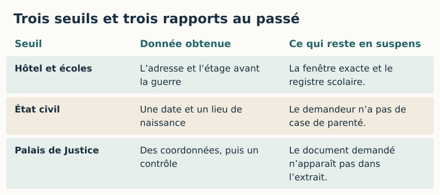

# ENS-PSL · Sélection internationale Lettres · Littérature — Dora Bruder de Patrick Modiano (oral) 2022 — Corrigé brut

*Corrigé rédigé par IA, non officiel. Signalez toute erreur.*

**Rédaction** · GPT-6.2 Astra Ultra · vitesse non renseignée

[Sujet officiel](https://www.ens.psl.eu/sites/default/files/litterature-oral-sil2022.pdf) · [Rapport du jury](https://www.ens.psl.eu/sites/default/files/rapport-litterature-sil_2022.pdf)

L’original propose le début du deuxième chapitre de Dora Bruder (1997). Une heure de préparation précède un commentaire d’environ vingt minutes puis dix minutes d’entretien. Les indications de lignes renvoient à l’extrait numéroté fourni par le concours.

## Chercher un acte, écrire le temps de sa recherche

Le narrateur qui ouvre ce deuxième chapitre connaît déjà le nom de Dora Bruder. Le premier chapitre, nous dit la notice, partait d’un avis de recherche publié à Paris à la demande de ses parents en décembre 1941. La jeune fille avait quinze ans. Ici, le narrateur cherche quelque chose d’apparemment plus simple que les circonstances d’une disparition. Il voudrait savoir dans quelle école Dora allait et obtenir une copie de son acte de naissance. Or la dernière chose que nous voyons de lui, dans cet extrait, ce sont ses poches au moment d’un contrôle. Comment un texte parti à la recherche d’une autre personne en vient-il à montrer avec autant de précision le corps du chercheur, ses hésitations et jusqu’à son trousseau de clés ? Je suivrai d’abord le passage des fenêtres aux écoles, puis l’entrée du document administratif dans le récit, enfin la transformation du trajet au Palais en expérience physique. À chacune de ces étapes, les lieux de Paris mettent en présence plusieurs temps qu’aucun document ne permettra de confondre.

### Des fenêtres certaines, une place incertaine

Les cinq premières lignes pourraient être un préambule à toute enquête. Le premier pronom, « Il », est impersonnel. Le sujet exact de la résurgence tarde à apparaître et prend la forme la moins déterminée qui soit, « ce qui a été effacé ». La voix ne nomme ni celui qui efface ni l’événement effacé. Mais elle ne conclut pas davantage à une perte complète. Au présent, des traces « subsistent ». Le contraste des deux verbes compte. Ce qui subsiste n’est accessible qu’à certaines conditions. Une série de questions indirectes ouvre en profondeur une phrase qui commençait avec une assurance presque sereine. Où se trouvent les registres ? Qui y veille ? Ces personnes accepteront-elles de les montrer ? À l’obstacle matériel s’ajoutent donc une médiation humaine et la possibilité d’un refus. Puis une phrase se reprend. Peut-être les gardiens ont-ils eux-mêmes oublié jusqu’à l’existence des registres. Il y a là deux histoires de l’effacement, celle d’un secret activement défendu et celle d’un savoir si peu transmis que même son détenteur ne sait plus qu’il le détient. L’extrait mettra successivement ces deux suppositions à l’épreuve.

La ligne 5 semble répondre à la difficulté par une assurance laconique. Un peu de patience suffirait. Sa solitude sur la page lui donne la force d’une maxime, mais le mot « longtemps » de la première phrase reste dans l’oreille. De quoi sera fait ce « peu » ? Le récit personnel commence précisément lorsqu’il lui faut donner une durée à l’échelle de la vie d’un homme. La formule « j’ai fini par savoir » porte déjà avec son résultat le temps qu’il a fallu lui consacrer. Le boulevard Ornano, le cinquième étage, la cuisine et le balcon de fer apportent pourtant une vraie récompense. Une enfant dont nous ne connaissions qu’un signalement a habité une chambre. Une phrase sans verbe compte les fenêtres. Je suis tentée, en lisant, d’installer Dora derrière l’une d’elles. Or le narrateur se garde bien de choisir. La dizaine de fenêtres, les deux ou trois qui ouvrent sur le boulevard, délimitent un ensemble de possibilités. La précision topographique a pour effet singulier de rendre sensible tout ce qui demeure hors d’atteinte.

Le retour de mai 1996 accentue cet écart. Le narrateur a vu des volets rouillés et des objets sur le balcon. Il les désigne mal, « hétéroclites », puis use d’un verbe d’apparence pour suggérer leur abandon. Rien ne permet d’en attribuer un seul à Dora. Dans beaucoup de récits d’enquête, un objet aperçu de loin deviendrait l’indice qui relance l’action. Ici il est aussi une épreuve imposée à l’imagination du lecteur. Notre besoin de retrouver une histoire ne donne aucun titre sur des objets entrés plus tard dans le champ du regard. La même retenue s’entend au sujet des écoles. La tournure « devait être inscrite » autorise une inférence sur une enfant en âge scolaire et laisse incertaine l’identité de l’établissement. Les quatre adresses occupent quatre lignes. On peut parcourir cette petite carte, refaire mentalement un trajet d’élève. Aucun des directeurs contactés ne trouve le nom. La mise en page donne à l’hypothèse une étendue que le résultat vient soudain vider.

Il reste le 69 rue Championnet. Après la longue phrase où le directeur lui propose de consulter les registres lui-même, le narrateur passe au futur, puis au présent de son hésitation. Sa recherche a ici une limite très différente d’une porte qu’on lui fermerait. On l’invite. Il pourrait y aller. Ne pas y aller tout de suite préserve cependant la dernière possibilité d’apercevoir Dora dans une classe du quartier. La dernière indication, la proximité du domicile, a deux sens selon qu’on la rapporte à un géographe ou à celui qui espère. C’est une raison sérieuse de consulter ce registre. C’est également une raison de redouter son silence. Ainsi l’une des informations les plus justes sur le travail de mémoire est donnée par l’aveu d’une démarche encore inaccomplie.

### La durée d’un homme entre dans un formulaire

Après le blanc typographique, un renseignement paraît assuré. Dora est née le 25 février 1926, à Paris, dans le douzième arrondissement. Mais le récit ne joint pas d’emblée lieu et date comme le ferait une notice biographique. Il rend à chacun des deux termes sa durée d’acquisition, quatre années pour la date, deux années de plus pour le lieu. Il se produit presque un échange d’unités. Quatre ans du temps du chercheur ont été nécessaires pour obtenir un seul jour du temps de Dora. L’écart entre ces deux échelles donne un poids inattendu à une date que je pourrais lire en une seconde. Le narrateur passe ensuite, sans préciser le motif de l’attente, à l’image très concrète d’un homme capable de rester des heures sous la pluie. Ainsi se précise le mot « patience » du début. Ce n’est pas seulement une vertu de l’esprit. Attendre signifie aussi être quelque part avec un corps.

L’ordre de narration attire l’attention sur un autre décalage. Le retour au boulevard Ornano était situé en mai 1996. La visite à la mairie que le récit nous propose maintenant a lieu un vendredi de février de cette même année. Nous sommes revenus en arrière sans les marques traditionnelles d’un grand retour en arrière. L’ordre choisi est celui des liens entre démarches, lieux et preuves, avec leurs réussites et leurs suspensions. La marche dans Paris ne reconstitue pas une ligne de temps continue. Elle nous place à la fois en 1926, avant la guerre, au moment de l’Occupation évoqué par le premier chapitre et parmi des démarches de 1996 qu’on peut elles-mêmes raconter dans un autre ordre.

À la mairie du douzième arrondissement, le jeune homme tend une fiche. Brusquement le récit lui fait une place très étendue. Pourquoi ne pas avoir résumé l’incident en une ligne : je n’étais pas parent de Dora ? Pour obtenir cette ligne, il faut passer par toutes les places proposées. Le formulaire apostrophe son demandeur, lui demande son nom, lui fournit une première personne toute prête pour déclarer ce qu’il veut. En face, le nom de BRUDER et le prénom de DORA, imprimés en capitales, acquièrent une présence visuelle très forte. Si je suis une ligne du doigt, ces capitales me donnent un instant l’impression d’avoir déjà retrouvé l’acte. Mais le papier que je lis est la demande de copie. Cette différence minuscule en apparence décide de tout. Le document inclus dans l’œuvre atteste une étape de l’enquête et porte la trace de son objet. Il ne donne pas au narrateur la pièce recherchée.

La liste descend les générations, passe du couple au représentant légal, puis à la procuration. Pour un demandeur ordinaire, ce sont des liens qui peuvent s’énoncer et se prouver. Ici, toutes ces positions disponibles font apparaître celle qui manque. Il n’existe pas de case pour qui, ayant lu un avis de recherche ancien, se sent tenu de chercher une inconnue. Aucune parenté nouvelle ne vient apporter une solution romanesque. Le narrateur peut signer de son nom. Il ne peut pas transformer cette signature en lien de filiation. Et la même règle a deux faces. Elle protège les données d’une personne contre un inconnu. Appliquée à l’histoire précise de Dora, elle met celui qui souhaite sauver la trace d’une vie devant une impossibilité dont les rédacteurs du formulaire n’avaient pas fait un cas particulier. Faire lire tout le formulaire nous fait partager cette place vide. Le document nous concerne également, lecteurs étrangers à la famille.

### La démarche administrative gagne le corps du narrateur

Le refus du préposé semble à première vue confirmer la vision des gardiens esquissée au début. Survient une expression plus inquiétante encore, « sentinelles de l’oubli ». Comme les registres, l’oubli paraît avoir des hommes pour le défendre. Pourtant le narrateur encadre ce soupçon par deux limites. Il a pensé cela « un moment ». Et, après l’élan de la phrase sur le secret honteux, il remarque le visage du jeune homme. Sa « bonne tête » introduit un registre familier, presque déconcertant après la grandeur de la métaphore. Puis un geste confirme la correction. Le préposé lui fournit l’adresse d’un autre service où demander une dérogation. Le texte rapporte l’effet d’une rencontre sur l’imagination sans transformer cette impression en accusation. Le même homme dont le narrateur venait de faire mentalement un gardien du secret lui ouvre une voie.

Les détails pratiques reprennent alors la précision de la fiche, jusqu’à l’étage, l’escalier, le numéro du bureau et l’intervalle de deux heures où le service est ouvert. L’accumulation prête à sourire. On peut disposer de tant de coordonnées et ignorer encore par où entrer. Le premier planton le réoriente vers l’accès à la Sainte-Chapelle. Des touristes font la queue. Pour eux, attendre prépare la visite d’un monument. Pour lui, avancer de quelques mètres appartient à une recherche sur le sort d’une personne. Le parcours matériel leur est commun. Personne à la porte ne peut en connaître la signification pour chacun. Le narrateur essaie de passer, un autre agent lui fait signe de rejoindre la file. Le récit précise la brutalité du geste. Il ne prête pas à cet agent la connaissance de ce qui motive la démarche.

Au contrôle, la fiche demandait tout à l’heure ce qu’il pouvait déclarer de lui-même. À présent il doit montrer ce qu’il porte sur lui. Ce sont de simples clés. Étrange objet pour un homme qui passe depuis le début de porte en porte sans posséder la bonne clé. Pourtant le texte le traite d’abord dans sa matérialité. Il y a le tapis, la vitre, le mouvement de déposer les clés puis de les reprendre. Le narrateur ne comprend pas tout de suite. Il est réprimandé. En quelques phrases, nous sommes passés de l’enquêteur capable de restituer une adresse et des horaires à un homme qui ne sait même plus quelle est la fonction exacte de celui qui l’interpelle. Aux questions initiales sur les gardiens de l’archive répondent ainsi les dernières questions sur un gendarme ou un policier. Aux impératifs de la fiche répond une liste d’objets qu’il craint d’avoir encore à remettre.

Le dernier rapprochement, avec l’entrée d’une prison, est interrogatif. Il ne signifie pas que le narrateur serait arrêté, ni qu’un contrôle de 1996 se confondrait avec ce qui est arrivé à Dora sous l’Occupation. Sa force tient à la fois à la remontée d’une image historique et à la différence des situations. Un homme d’aujourd’hui peut, sous l’effet d’un geste brusque, éprouver quelque chose de la dépossession de sa propre personne. Ce qu’il éprouve ne lui apprend pas ce qu’a éprouvé une jeune fille en 1941. Cette limite donne une portée éthique à la forme interrogative. Le livre rend perceptible une inquiétude sans s’approprier la voix de l’absente.

Ainsi les dernières lignes, tout occupées du narrateur, ramènent à Dora par un chemin exigeant. La recherche laisse entrer dans ses phrases les dates obtenues, les cases vides, la maille du filet administratif et même les réactions excessives de celui qui cherche. Entre un balcon vu en mai et des clés déposées en février, le lieu le plus important est peut-être l’intervalle entre deux moments qu’on ne peut combler. C’est parce que Modiano donne une forme lisible à cet intervalle que l’acte d’écrire garde la trace d’une vie sans prétendre la reconstituer tout entière.

## Entretien avec le jury

**Pourquoi le prénom apparaît-il en capitales dans le formulaire ?** Il remplit une rubrique et reprend ainsi la présentation matérielle d’un document. Visuellement, il fait resurgir Dora. Juridiquement, il figure sur une demande. Ce que le lecteur obtient et ce que le demandeur espère obtenir restent distincts.

**Quelle différence faites-vous entre l’école et la mairie ?** À l’école du 69 rue Championnet, une consultation lui est proposée et il la diffère. À la mairie, il dépose une demande que le préposé ne peut accepter sous cette forme. Les deux épisodes rendent impossibles une explication unique par l’hostilité administrative.

**Quels sont les interlocuteurs de cet extrait ?** Les directeurs répondent à des lettres. Un préposé parle au guichet et oriente le narrateur. Les plantons indiquent, ordonnent ou réprimandent. Le formulaire lui-même donne des ordres à la deuxième personne. L’échange mêle ainsi les propos rapportés, le langage impersonnel des services et les gestes.

**Les rues n’ont-elles qu’une valeur documentaire ?** Les noms rendent les trajets vérifiables. Mais le passage de mai à février inverse l’ordre chronologique, et l’hôtel possède deux états, celui des années d’avant-guerre et celui de 1996. La précision spatiale fait ressortir la discontinuité des époques.

**Que devient la phrase sur la patience ?** Elle a d’abord l’assurance d’une maxime. Les années d’attente lui donnent ensuite un prix. À la fin l’hésitation du visiteur se paie d’une réprimande. Une même durée prise du côté du chercheur signifie persévérance et, du côté de celui qui régule le passage, retard.

**Peut-on qualifier le fragment d’autobiographie ?** Le « je » donne à lire son expérience de la recherche. L’autre vie demeure l’objet de cette expérience sans se fondre dans la sienne. On peut parler d’un récit personnel d’enquête et soumettre cette formule à la présence de documents et aux limites que le narrateur signale lui-même.

