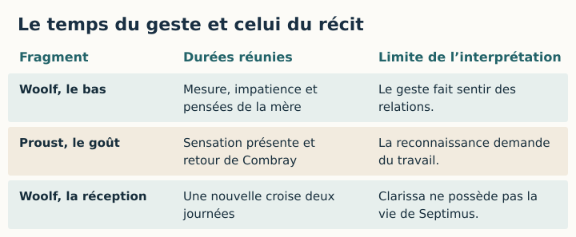

# ENS-PSL · Sélection internationale Lettres · Littérature — Erich Auerbach 2022 — Corrigé guidé

*Corrigé rédigé par IA, non officiel. Signalez toute erreur.*

**Rédaction** · GPT-6.2 Astra Ultra · vitesse non renseignée

[Sujet officiel](https://www.ens.psl.eu/sites/default/files/litterature-sil2022-1.pdf) · [Rapport du jury](https://www.ens.psl.eu/sites/default/files/rapport-litterature-sil_2022.pdf)

La question de deux heures porte sur un passage de Mimésis. Le rapport de 2022 invite à traiter précisément la transformation de la narration au XXe siècle. La copie étudie la différence entre raconter tous les événements d’une vie et donner à percevoir leur durée.

## Préparer la réponse

Dans la citation, relever ce qui perd de son autorité : succession chronologique, moments de bascule extérieurs, idéal d’exhaustivité. En regard, préciser ce que promet le fragment : il peut représenter un destin entier. Ce n’est pas une invitation à commenter toute la tradition réaliste. Au brouillon, choisir un geste qui prend quelques secondes, puis nommer les différents temps et consciences que l’écrivain y fait entrer.

Pour l’objection, tester le mot « hasard ». La circonstance peut être fortuite dans la vie du personnage et minutieusement préparée par le récit. Inversement, découvrir son importance n’autorise pas à lui faire prédire toute la biographie future. Appuyer la nuance sur le retour du goût de la madeleine ou sur le passage d’une nouvelle entre deux lignes de vie dans Mrs Dalloway.

## Une vie à la mesure d’un bas de laine

Dans *Vers le phare* de Virginia Woolf, une mère veut savoir si le bas qu’elle tricote pour le fils du gardien du phare est à la bonne taille. Elle le mesure contre la jambe de son propre fils, qui remue et compromet la mesure. Même celui qui a lu le roman se souvient-il exactement de la longueur obtenue ? Il se souvient en revanche de Mrs Ramsay, de l’enfant impatient, de la distance entre leurs pensées et de ce que cette mère fait pour tenir ensemble le monde de la maison. La scène compte parmi celles qui ont amené Erich Auerbach, dans *Mimésis*, à décrire une transformation du récit. Le grand événement perd le privilège de dire la vérité d’une vie. Un moment pris en apparence au hasard pourrait en contenir le destin. La proposition paraît d’abord substituer une manière de choisir les faits à une autre. Elle oblige plus profondément à se demander ce que nous reconnaissons d’une existence quand nous en lisons l’histoire.

### Le temps qu’un calendrier ne peut inscrire

Si je devais raconter de loin la vie de Mrs Ramsay, je choisirais certainement sa mort parmi les rares événements que mon récit ne peut omettre. Or Woolf, dans la partie intitulée « Le temps passe », la fait connaître au détour d’une notation entre crochets, liée au geste de Mr Ramsay qui tend les bras et les trouve vides. En revanche, elle consacre des pages à la durée incertaine d’un geste de tricot. Il y a dans ce renversement autre chose qu’un goût du paradoxe. Considérée depuis l’extérieur, la mort partage une existence en un avant et un après. Ressentie par un autre, elle peut être tout entière dans un mouvement d’habitude qu’aucun corps n’accueille plus. Le soin que prenait Mrs Ramsay des vivants devient rétrospectivement plus sensible. Un autre partage du temps correspond ainsi à une autre question posée au personnage. Quelles relations son existence rendait-elle possibles ?

Revenons à la mesure du bas. James connaît la raison pour laquelle il doit rester tranquille. Il n’en éprouve pas moins de jalousie à servir de mesure pour un autre enfant. Sa mère, elle, passe aussi par la pensée de Lily et de William qu’elle aimerait voir mariés. Pour un témoin à distance, il s’agirait du même instant. L’écriture fait entendre les développements inégaux qu’il prend pour chacun. Elle peut s’attacher aux aiguilles, puis s’éloigner de l’objet sans que la jambe enfantine ait eu le temps de grandir. La simple différence entre la durée du geste et l’ampleur de la page rend possible une expérience que la chronologie d’un roman ne garantit pas. J’apprends à voir dans la sollicitude de Mrs Ramsay tout à la fois sa générosité et sa manière d’assigner aux autres les places qu’elle pense leur convenir. Ce mélange est un trait de son destin. Une liste de ses bienfaits et de ses mariages arrangés me l’aurait d’abord présenté comme deux caractères séparés. [Virginia Woolf, *To the Lighthouse*](https://gutenberg.net.au/ebooks01/0100101h.html)

### Comment un hasard devient lisible

L’adjectif « quelconque » cache pourtant une difficulté. À la lecture de Proust, il ne suffit manifestement pas que le narrateur croque au hasard un morceau de gâteau pour que tout son passé lui devienne accessible. La saveur provoque d’abord une joie dont la cause lui échappe. Il recommence, et la répétition de l’expérience n’augmente pas mécaniquement son efficacité. Il lui faut chercher, se détourner, revenir à l’impression, avant de reconnaître les dimanches matin où sa tante lui donnait à Combray une petite madeleine trempée dans une infusion. Loin d’équivaloir à la consultation d’un registre, ce retour est d’abord le sentiment qu’il reste quelque chose à découvrir. Le récit nous fait traverser ce temps du défaut de savoir. À sa première apparition, le contenu du souvenir était déjà là pour le corps, sans être disponible pour celui qui raconte.

Pourquoi donc la mémoire s’attache-t-elle à cet aliment si ordinaire ? Une date importante aurait donné au narrateur les mots pour nommer d’avance ce qu’il recherchait. Le goût, au contraire, échappe à ce qu’il connaît officiellement de son histoire. La découverte élargit jusqu’à Combray tout entier ce qui semblait ne concerner qu’un plaisir de bouche. Mais le livre que je tiens a composé cette apparente rencontre. Il a préparé l’attente par le récit des souvenirs appauvris dont le narrateur disposait jusque-là. Il a ralenti la reconnaissance et réservé au souvenir une vaste puissance de déploiement. Ce qui est fortuit dans l’ordre d’une journée fait l’objet d’un calcul très sûr dans l’ordre de l’œuvre. Dire que le fragment *peut servir* à représenter une vie désigne un travail de forme. Cette possibilité est à distinguer d’une promesse faite à quiconque prélèverait au hasard une minute dans un journal intime.

### Que contient une journée entière ?

On peut faire un pas de plus à partir de *Mrs Dalloway*. Une journée suffit au livre. Le choix des fleurs pour la réception du soir met Clarissa en mouvement dès le matin. Les rues de Londres réveillent des pensées qui éloignent très vite du seul emploi du temps d’une maîtresse de maison. Cependant un événement brutal se produit aussi ce jour-là. Septimus, ancien combattant, meurt. Clarissa, qui ne le connaît pas, apprend cette mort au cours de sa soirée. Si Woolf avait simplement congédié les grands événements, comment comprendre la place que cette nouvelle prend pour une femme dont elle semblait ne pas relever ? Justement par la médiation. Des invités rapportent la mort. Clarissa s’écarte un moment des autres et essaie de se représenter l’inconnu. Revenir ensuite à la réception n’a plus pour elle la même signification. L’événement entre dans son existence sous la forme singulière d’une nouvelle reçue entre deux moments de sociabilité.

Il faut prendre au sérieux ce que le fragment ne peut contenir. L’intensité de ce rapprochement ne fait pas de Clarissa celle qui saurait tout de Septimus. Le lecteur a suivi l’ancien combattant là où elle n’a jamais été. La composition conserve deux vies séparées jusque dans ce qu’elle fait passer de l’une à l’autre. De même, le bas ne prédit pas à lui seul la disparition de Mrs Ramsay, et la madeleine n’énumère pas le passé dans l’ordre où il a été vécu. La totalité dont parle Auerbach se comprend alors comme une manière d’être affecté, d’agir et d’habiter le temps, plutôt que comme le stock de tous les faits qui arriveront à quelqu’un.

Le lecteur d’une biographie chronologique s’arrête volontiers sur tel jour dont il sait que la suite dépend. Chez Woolf ou Proust, la lecture fait l’expérience inverse. Elle entre dans un moment dont rien, à première vue, ne garantissait la conséquence. En le traversant, elle découvre des temps superposés et les liens dont une personne est faite. Il faut pour cela la liberté de s’attarder sur l’accessoire, mais aussi la discipline de ne jamais lui faire dire plus que la forme du livre n’y laisse entendre.
