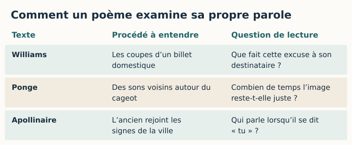

# ENS-PSL · Sélection internationale Lettres · Littérature — Jean-Michel Maulpoix 2022 — Corrigé brut

*Corrigé rédigé par IA, non officiel. Signalez toute erreur.*

**Rédaction** · GPT-6.2 Astra Ultra · vitesse non renseignée

**Révision (tour 1)** · GPT-6.2 Astra Ultra · vitesse non renseignée

[Sujet officiel](https://www.ens.psl.eu/sites/default/files/litterature-sil2022-2.pdf) · [Rapport du jury](https://www.ens.psl.eu/sites/default/files/rapport-litterature-sil_2022.pdf)

L’écrit littéraire de deux heures demande de commenter une proposition de Jean-Michel Maulpoix dans « Pour un lyrisme critique ». Le devoir suit la transformation du rapport entre la voix singulière du poème, les paroles ordinaires et le monde contemporain.

## Sujet de l’écrit

Vous analyserez et commenterez la citation ci-dessous sous la forme d’un écrit organisé. Vous pouvez éclairer ces propos par des éléments de contexte, par vos connaissances d’histoire de la littérature. Vous ferez appel à votre expérience de lectrice, sans vous limiter au corpus de votre projet de recherche.

Jean-Michel Maulpoix, « Pour un lyrisme critique ». Le passage commence par « Moins émerveillante et poétique que jamais » et se termine par « de cette parole que nous sommes. ». La coupure entre parenthèses appartient au texte proposé.

## Quelqu’un parle encore dans le poème

Qu’une poésie puisse être moins « poétique » et rester pourtant de la poésie paraît une contradiction, à moins de penser à un lecteur qui s’attend à reconnaître d’emblée ce qu’on lui donne à lire. Il cherche un son, une attitude, un sujet sur lequel il conviendrait de s’émerveiller. Jean-Michel Maulpoix observe qu’au contact de son temps la poésie s’est faite plus prosaïque, discontinue et interrogative, jusqu’à prendre pour objet de critique sa propre parole. Sa formule porte pourtant sur « cette parole que nous sommes ». Comment une pratique qui paraît se défaire de ses privilèges peut-elle nous engager plus intimement dans le fait de parler ? Je voudrais partir d’un poème qui ressemble à un billet de cuisine, puis demander à deux écrivains français ce qu’il reste de la merveille lorsque la langue examine ses propres moyens.

### À quelle condition un billet fait-il un poème ?

Dans « This Is Just To Say », William Carlos Williams fait dire à un locuteur qu’il a mangé les prunes que quelqu’un gardait sans doute pour le petit déjeuner. Une demande de pardon précède de très peu le rappel du plaisir qu’il a pris à leur douceur et à leur fraîcheur. L’histoire tiendrait sur un bout de papier laissé près d’une glacière. Or elle occupe trois strophes, et surtout elle parvient au lecteur par très petites unités. L’acte de manger arrive avant son complément. Les prunes, séparées de leur lieu de conservation, demeurent un instant seules à l’attention. Lorsque la demande de pardon intervient, je suis obligée de la lire avant de savoir que le locuteur reviendra aussitôt à son plaisir. Lire vite, comme on lit un message pratique, et lire selon ces suspensions produisent deux expériences différentes du même langage. [William Carlos Williams, « This Is Just To Say »](https://www.poetryfoundation.org/poems/56159/this-is-just-to-say)

Que critique ce poème ? Il n’énonce aucune opinion sur la mauvaise littérature ou les mœurs domestiques. Il soumet toutefois à l’épreuve une forme ordinaire de parole, l’excuse. Demande-t-on encore franchement pardon lorsqu’on fait saliver celui qu’on a privé de son fruit ? Et quelle relation permet de lui parler de cette façon, avec une confiance qui rend possible aussi bien la tendresse que la désinvolture ? La personne à laquelle le billet est destiné ne répond pas. Cette absence donne un rôle au lecteur. À la première lecture, je peux rire de l’effronterie. À la suivante, je peux entendre le désir de partager après coup une sensation qu’on n’a pas partagé en acte. Le poème a pris pour objet un geste de parole assez modeste pour que chacun en reconnaisse les risques. Il me rend sensible à ce que je fais à un autre lorsque je prononce une excuse.

Il serait donc hâtif de déduire de l’allure prosaïque du texte un simple renoncement au chant. Le froid du fruit et la douceur qu’il promet sont plus perceptibles au terme des douze vers que dans mon résumé. Le poète n’a pas besoin d’annoncer une merveille. Il produit, dans des mots ordinaires et jusque dans l’indélicatesse d’un geste, une attention nouvelle à la sensation. « Moins émerveillante » peut désigner la désaffection à l’égard d’un effet obligé. Cela laisse ouverte la question de ce qui effectivement étonne.

La succession des comparatifs chez Maulpoix ne donne donc pas le programme d’une accélération uniforme. Chez Williams, douze vers très courts pourraient se lire en quelques secondes. Pourtant les blancs entre ses trois quatrains retardent successivement la découverte de la part que l’autre avait peut-être réservée et celle de la saveur dont le locuteur garde la mémoire. Il suffit de rétablir la continuité d’un billet ordinaire pour que l’aveu paraisse plus expéditif. J’éprouve ainsi personnellement ce que le passage appelle faire face à son temps : le poème emprunte la brièveté d’une parole quotidienne et m’oblige à prendre le temps d’entendre ce qu’une excuse laisse en suspens.

### Regarder le mot pendant qu’il désigne

Francis Ponge radicalise l’expérience autrement. Le cageot que présente *Le Parti pris des choses* est un emballage léger, construit pour transporter des fruits et bientôt jeté. Sa destination économique semble décidée à l’avance. Une première phrase, pourtant, cherche sa place dans la langue française entre deux mots de consonance voisine, la cage et le cachot. Tout à coup la relation entre le bois ajouré et les fruits qu’il enferme se laisse entendre à travers leur nom. Est-ce une découverte sur l’objet ou un effet que le français fabrique tout seul ? Le soupçon fait partie du plaisir. Le lecteur entend à la fois le pouvoir du mot, qui rend visibles les lattes d’une enceinte, et son excès, puisqu’une caisse pour denrées fragiles n’est pas un cachot pour prisonniers. La prose progresse en proposant de tels rapprochements, puis en revenant à la fabrication, à la brièveté de l’usage, au bois clair abandonné à la sortie des halles.

À mesure que l’objet gagne en présence, un danger d’un autre ordre apparaît. Le poète qui s’attendrit sur son sort et lui prête des sentiments pourrait faire du cageot le prétexte de sa propre éloquence. La fin du texte, qui s’interroge sur le temps qu’il convient de lui consacrer, inclut cette disproportion dans le portrait. On prend congé d’un objet dont on vient justement de mesurer la disponibilité très brève. Une sorte d’affection demeure, mais elle se surveille. Ponge donne ainsi au terme « critique » une précision grammaticale et matérielle. Cette prose regarde comment naît une image, et à quel moment il est juste de l’interrompre. La présence d’un sujet ne dépend plus du nombre de fois où il dit « je ». Elle se découvre dans l’attention qu’il accorde et dans le pouvoir qu’il se refuse.

### De quel temps parle un poème ?

Reste la formule « fait face à son temps ». Elle pourrait laisser croire que les seules formes légitimes seraient les plus semblables à un monde rapide et disparate. Mais la poésie a le pouvoir de faire rencontrer des temps que le calendrier sépare. Dans « Zone », qui ouvre *Alcools* d’Apollinaire, le goût du nouveau amène des signes urbains, des imprimés et des techniques au voisinage du souvenir religieux. La tour Eiffel surgit au milieu d’un imaginaire de bergère et de troupeau. Cette métaphore ne signifie pas que la vieille pastorale suffirait à dire Paris. Elle surprend parce que la nouveauté du monument et l’ancienneté de la scène continuent toutes deux à se faire sentir. Plus loin, l’aviation rencontre dans les airs les figures d’un répertoire chrétien et légendaire. Ce montage fait douter de la simplicité du mot « moderne ». Celui qui croit se tourner tout entier vers le présent découvre les images anciennes dont il a encore besoin pour le voir.

Le très étrange « tu » auquel s’adresse le poème travaille cette incertitude jusque dans la personne qui parle. Il me rapproche d’un marcheur dont je peux partager la fatigue tout en maintenant la division de celui qui se parle à lui-même. Au fil des lieux et des souvenirs, le sujet lyrique ne dispose plus d’une voix souveraine qui mettrait en ordre le spectacle entier. Mais le besoin de s’adresser à quelqu’un persiste. L’hétérogénéité n’abolit pas le lyrisme. Elle déplace la question qui le fonde. À qui parle cette voix qui entend la rumeur des textes et des rues jusque dans ses souvenirs les plus personnels ?

Si l’on transformait l’énoncé de Maulpoix en inventaire de procédés obligatoires, on n’obtiendrait qu’une nouvelle convention du « poétique ». Ces trois expériences de lecture font comprendre le sens d’une poésie devenue critique sans lui donner pour règle de toujours briser le vers ou de toujours renoncer à la beauté. Elle fait voir le risque attaché à chaque prise de parole, qu’il s’agisse d’une excuse, d’un nom donné à une chose ou d’une adresse à soi-même. C’est par ce risque, commun à ceux qui écrivent des poèmes et à ceux qui laissent un mot sur une table, qu’elle peut véritablement faire face à son temps.

